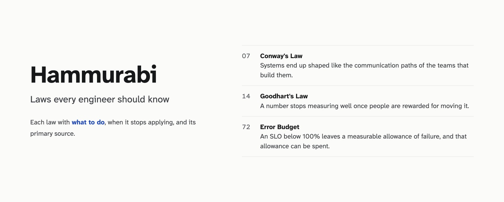
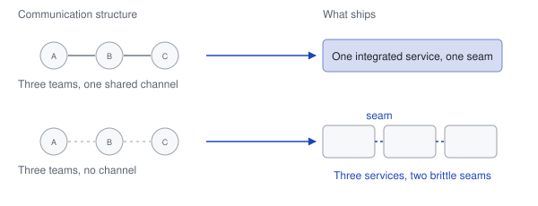
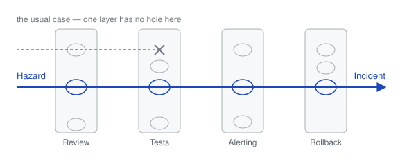
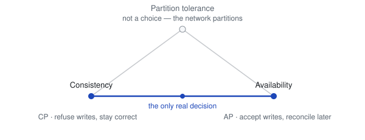
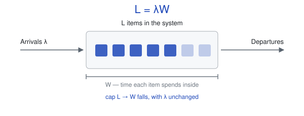
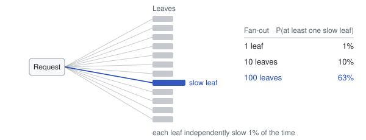
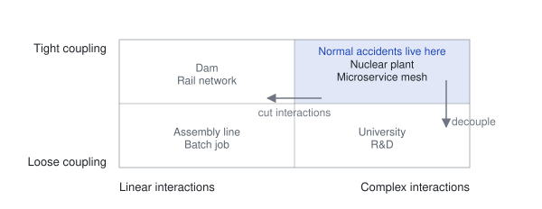

**Engineering laws, each with its counter-force.** Every article also carries a field guideline and a primary source.

[](https://github.com/kanywst/hammurabi/stargazers)
[](#the-codex)
[](https://kanywst.github.io/hammurabi/)
[](./LICENSE)

**English** • [日本語](./translations/ja.md)

---

**Use the data:** every law is published as [JSON](https://kanywst.github.io/hammurabi/api/laws.json), as Markdown (`/laws/<slug>/index.md`), in [llms.txt](https://kanywst.github.io/hammurabi/llms.txt) and as an [RSS feed](https://kanywst.github.io/hammurabi/feed.xml), all under CC BY-SA 4.0.

## What is Hammurabi?

In a world of increasing complexity, the primary bottleneck in engineering is no longer **code**, but **decision-making under uncertainty**.

Hammurabi is a curated codex of engineering laws drawn from **cognitive psychology**, **safety engineering**, and **system design**. It is named for the first written code of laws — the point at which a rule stopped being something you remembered and became something you could cite.

Most collections of laws stop at the explanation. This one does not, because an explanation is not a decision. Every article here carries three more things:

- **A counter-force.** The principle that stops the law from hardening into dogma. Every law in this codex can be applied until it does damage; the counter is the boundary. Postel's Law without fail-fast produces systems that swallow corruption. Least Privilege without psychological acceptability produces controls that users route around.
- **A field guideline.** Something you can act on tomorrow, written as an instruction rather than an observation.
- **A primary source.** The paper, book, letter or RFC where the idea actually appeared — not a blog post summarising one. Every entry links to it, so you can check the claim rather than trust it.

## How to read an article

Each article has the same five parts, in the same order:

| Part | What it answers |
| --- | --- |
| **Concept** | What force is this, in one line? |
| **Mechanism** | Why does it happen? Usually a fact about people or about systems, not about software. |
| **Counter** | What keeps it from becoming dogma? |
| **Guideline** | What do I do on Monday? |
| **Source** | Where did this actually come from, and how do I verify it? |

The `§` number is a stable display label, assigned in file order. The permanent identity of an article is its **slug** — that is what the website's permalinks use, and it never changes even if articles are added around it.

## The Codex

<!-- CODEX:START -->

<!-- Generated from data/laws.yaml by scripts/generate.mjs. Do not edit by hand. -->

**Start from a situation**

- **Estimates keep slipping:** [Hofstadter's Law](#hofstadters-law) · [Ninety-Ninety Rule](#ninety-ninety-rule) · [Parkinson's Law](#parkinsons-law) · [Brooks' Law](#brooks-law) · [Fixed Time, Variable Scope](#fixed-time-variable-scope)
- **The team is growing:** [Brooks' Law](#brooks-law) · [Dunbar's Number](#dunbars-number) · [Ringelmann Effect](#ringelmann-effect) · [Conway's Law](#conways-law) · [Bystander Effect](#bystander-effect) · [Context, Not Control](#context-not-control) · [Bus Factor](#bus-factor)
- **A metric is being gamed:** [Goodhart's Law](#goodharts-law) · [Cobra Effect](#cobra-effect) · [Shirky Principle](#shirky-principle)
- **The decision is stuck:** [Type 1 vs Type 2 Decisions](#type-1-vs-type-2-decisions) · [Disagree and Commit](#disagree-and-commit) · [Law of Triviality](#law-of-triviality) · [Sunk Cost Fallacy](#sunk-cost-fallacy) · [Narratives, Not Slides](#narratives-not-slides) · [Believability-Weighted Decisions](#believability-weighted-decisions)
- **After an incident:** [Blameless Postmortem](#blameless-postmortem) · [Swiss Cheese Model](#swiss-cheese-model) · [Normalization of Deviance](#normalization-of-deviance) · [Normal Accident Theory](#normal-accident-theory) · [Hanlon's Razor](#hanlons-razor) · [Ironies of Automation](#ironies-of-automation) · [Five Whys](#five-whys) · [Mechanisms, Not Good Intentions](#mechanisms-not-good-intentions) · [Pesticide Paradox](#pesticide-paradox) · [Genchi Genbutsu (Go and See)](#genchi-genbutsu-go-and-see)
- **Reliability versus shipping speed:** [Error Budget](#error-budget) · [Toil](#toil) · [Normalization of Deviance](#normalization-of-deviance) · [Murphy's Law](#murphys-law) · [You Build It, You Run It](#you-build-it-you-run-it) · [Andon (Stop the Line)](#andon-stop-the-line) · [Chaos Engineering](#chaos-engineering) · [Technical Debt](#technical-debt)
- **Something is too slow:** [Amdahl's Law](#amdahls-law) · [Theory of Constraints](#theory-of-constraints) · [Premature Optimization](#premature-optimization) · [The Tail at Scale](#the-tail-at-scale) · [Little's Law](#littles-law)
- **Deleting or rewriting old code:** [Chesterton's Fence](#chestertons-fence) · [Second-System Effect](#second-system-effect) · [Gall's Law](#galls-law) · [Hyrum's Law](#hyrums-law) · [Eagleson's Law](#eaglesons-law) · [Boy Scout Rule](#boy-scout-rule) · [Strangler Fig](#strangler-fig) · [Beyoncé Rule](#beyoncé-rule) · [Churn Rule](#churn-rule) · [Technical Debt](#technical-debt) · [Lehman's Laws of Software Evolution](#lehmans-laws-of-software-evolution) · [One-Version Rule](#one-version-rule)
- **Designing an API or interface:** [Hyrum's Law](#hyrums-law) · [Postel's Law](#postels-law) · [Principle of Least Astonishment](#principle-of-least-astonishment) · [Law of Leaky Abstractions](#law-of-leaky-abstractions) · [Tesler's Law](#teslers-law) · [Beyoncé Rule](#beyoncé-rule)
- **Starting something new:** [Working Backwards](#working-backwards) · [YAGNI](#yagni) · [Gall's Law](#galls-law) · [Worse is Better](#worse-is-better) · [KISS Principle](#kiss-principle) · [XY Problem](#xy-problem)
- **Choosing a technology:** [Lindy Effect](#lindy-effect) · [Cargo Cult Engineering](#cargo-cult-engineering) · [Amara's Law](#amaras-law) · [Survivorship Bias](#survivorship-bias) · [Choose Boring Technology](#choose-boring-technology)
- **Building a distributed system:** [Fallacies of Distributed Computing](#fallacies-of-distributed-computing) · [CAP Theorem](#cap-theorem) · [Two Generals Problem](#two-generals-problem) · [The Tail at Scale](#the-tail-at-scale) · [Static Stability](#static-stability) · [Avoid Fallback](#avoid-fallback) · [Constant Work](#constant-work) · [Chaos Engineering](#chaos-engineering)
- **Designing permissions and secrets:** [Principle of Least Privilege](#principle-of-least-privilege) · [Kerckhoffs's Principle](#kerckhoffss-principle)

**All laws**

| § | Law | Category | The core idea |
| --- | --- | --- | --- |
| `01` | [Type 1 vs Type 2 Decisions](#type-1-vs-type-2-decisions) | Decision | Teams spend the caution meant for irreversible decisions on ones they could easily undo. |
| `02` | [Normalization of Deviance](#normalization-of-deviance) | Safety | A broken rule that causes no immediate harm quietly becomes the new normal. |
| `03` | [Chesterton's Fence](#chestertons-fence) | Systems | Code or rules whose origin you don't know look like clutter, which makes them tempting to delete. |
| `04` | [Normalcy Bias](#normalcy-bias) | Cognition | Faced with a real anomaly, people reach for the familiar, harmless explanation. |
| `05` | [Law of Triviality](#law-of-triviality) | Organization | Discussion goes to the parts everyone understands, not the parts that matter. |
| `06` | [Gall's Law](#galls-law) | Systems | Complex systems that work usually grew from simple systems that worked; designed ones rarely do. |
| `07` | [Conway's Law](#conways-law) | Organization | Systems end up shaped like the communication paths of the teams that build them. |
| `08` | [Hyrum's Law](#hyrums-law) | Systems | With enough users, every observable behavior of a system, bugs included, is depended on. |
| `09` | [Brooks' Law](#brooks-law) | Organization | Adding people to a late project tends to make it later, because ramp-up and coordination cost more than they add. |
| `10` | [XY Problem](#xy-problem) | Cognition | People ask for help with their attempted fix instead of the problem they actually have. |
| `11` | [Postel's Law](#postels-law) | Distributed Systems | Systems that assume every peer follows the spec exactly tend to be brittle against the first one that doesn't. |
| `12` | [Hanlon's Razor](#hanlons-razor) | Organization | People read malice into delays and bugs that are better explained by fatigue or missing context. |
| `13` | [Hofstadter's Law](#hofstadters-law) | Estimation | Work takes longer than estimated, even when the estimate already allows for that. |
| `14` | [Goodhart's Law](#goodharts-law) | Incentives | A number stops measuring well once people are rewarded for moving it. |
| `15` | [Lindy Effect](#lindy-effect) | Systems | For ideas and software, the longer something has survived, the longer it is likely to last. |
| `16` | [Sunk Cost Fallacy](#sunk-cost-fallacy) | Decision | Teams keep funding a failing project because of what they have already spent on it. |
| `17` | [Cargo Cult Engineering](#cargo-cult-engineering) | Cognition | Teams copy another company's practices without the conditions that made them work. |
| `18` | [Amdahl's Law](#amdahls-law) | Performance | Speeding up one part of a system barely helps when the bottleneck is somewhere else. |
| `19` | [Law of Leaky Abstractions](#law-of-leaky-abstractions) | Systems | Every non-trivial abstraction eventually exposes the details it was meant to hide. |
| `20` | [Pareto Principle](#pareto-principle) | Decision | Most of the effect comes from a small share of the causes, such as bugs in a few modules. |
| `21` | [Survivorship Bias](#survivorship-bias) | Cognition | Conclusions drawn only from successes ignore the failures that used the same strategy. |
| `22` | [Kernighan's Law](#kernighans-law) | Maintainability | Debugging is harder than writing, so code written at your cleverest is beyond your debugging. |
| `23` | [Cobra Effect](#cobra-effect) | Incentives | An incentive meant to reduce a problem rewards people for producing more of it. |
| `24` | [Dunbar's Number](#dunbars-number) | Organization | People keep only about 150 stable relationships. Engineers extrapolate: past shared context, added headcount goes to coordination. |
| `25` | [Worse is Better](#worse-is-better) | Systems | A simpler design that is easy to build and adopt tends to beat a more correct but complex one. |
| `26` | [Cunningham's Law](#cunninghams-law) | Organization | People are quicker to correct a wrong answer than to answer a question. |
| `27` | [Bystander Effect](#bystander-effect) | Organization | The more people who see a problem, the less likely any one of them is to act on it. |
| `28` | [Murphy's Law](#murphys-law) | Safety | Given enough time and traffic, a failure mode that can happen eventually will. |
| `29` | [Boy Scout Rule](#boy-scout-rule) | Maintainability | Code decays because cleanup tends to be deferred to a refactor that rarely happens. |
| `30` | [Tesler's Law](#teslers-law) | Systems | A system's inherent complexity can't be removed, only moved to someone else. |
| `31` | [Dunning-Kruger Effect](#dunning-kruger-effect) | Cognition | People who are least skilled at something tend to overrate their ability the most. |
| `32` | [Curse of Knowledge](#curse-of-knowledge) | Cognition | Once you know something, you can't easily imagine what it's like not to know it. |
| `33` | [Swiss Cheese Model](#swiss-cheese-model) | Safety | Every safeguard has holes; accidents happen when the holes in several layers line up. |
| `34` | [Premature Optimization](#premature-optimization) | Performance | Optimizing before measuring spends effort on code that isn't the bottleneck. |
| `35` | [Linus's Law](#linuss-law) | Maintainability | A bug that stumps one person is often obvious to someone else looking at the same code. |
| `36` | [CAP Theorem](#cap-theorem) | Distributed Systems | During a network partition, a data store must give up either consistency or availability. |
| `37` | [Little's Law](#littles-law) | Performance | In a stable system, the average number of items inside equals arrival rate times average time spent. |
| `38` | [Two Generals Problem](#two-generals-problem) | Distributed Systems | Over an unreliable channel, two parties can never be certain they have agreed. |
| `39` | [Peter Principle](#peter-principle) | Organization | People tend to get promoted until they reach a role they are bad at, and stay there. |
| `40` | [Parkinson's Law](#parkinsons-law) | Organization | Work expands to fill the time available for it. |
| `41` | [Wirth's Law](#wirths-law) | Performance | Software gets slower faster than hardware gets faster. |
| `42` | [Ninety-Ninety Rule](#ninety-ninety-rule) | Estimation | The last 10% of the work tends to take as long as the first 90% did. |
| `43` | [Eagleson's Law](#eaglesons-law) | Maintainability | Your own code that you haven't read in six months might as well be someone else's. |
| `44` | [Hick's Law](#hicks-law) | Interaction | The more options people are given, the longer they take to choose one. |
| `45` | [Fitts's Law](#fittss-law) | Interaction | Small, distant targets take longer to hit and get missed more often. |
| `46` | [Miller's Law](#millers-law) | Cognition | Working memory holds only a handful of chunks (Miller said about seven; later estimates are lower). |
| `47` | [Fallacies of Distributed Computing](#fallacies-of-distributed-computing) | Distributed Systems | Networked code quietly assumes eight things about the network that are false in production. |
| `48` | [Ironies of Automation](#ironies-of-automation) | Safety | Automation leaves people only the hardest cases, after their skills have faded from disuse. |
| `49` | [Principle of Least Privilege](#principle-of-least-privilege) | Security | Every permission a component doesn't need widens the damage when something goes wrong. |
| `50` | [Kerckhoffs's Principle](#kerckhoffss-principle) | Security | A system that is secure only while its design stays secret is not secure. |
| `51` | [Gustafson's Law](#gustafsons-law) | Performance | When the problem grows with the machine, parallel speedup keeps growing nearly linearly. |
| `52` | [The Tail at Scale](#the-tail-at-scale) | Distributed Systems | When one request fans out to many servers, the slowest one sets the response time. |
| `53` | [Ashby's Law of Requisite Variety](#ashbys-law-of-requisite-variety) | Systems | A controller can only handle a system if it can respond to as many states as the system has. |
| `54` | [Law of Demeter](#law-of-demeter) | Maintainability | Code that reaches through other objects' internals breaks when anything in the chain changes. |
| `55` | [Jevons Paradox](#jevons-paradox) | Incentives | Making a resource cheaper to use can increase how much of it is used in total. |
| `56` | [Normal Accident Theory](#normal-accident-theory) | Safety | In complex, tightly coupled systems, accidents are built into the structure. |
| `57` | [Broken Windows Theory](#broken-windows-theory) | Safety | Visible disorder left unrepaired can signal that standards are optional, inviting more. |
| `58` | [YAGNI](#yagni) | Maintainability | Code built for imagined future needs costs time now and rarely fits the need that arrives. |
| `59` | [KISS Principle](#kiss-principle) | Maintainability | A system has to be simple enough for an ordinary person to fix under bad conditions. |
| `60` | [DRY Principle](#dry-principle) | Maintainability | Knowledge kept in two places drifts apart, because nothing makes the copies change together. |
| `61` | [Theory of Constraints](#theory-of-constraints) | Performance | A system's throughput is set by its single tightest bottleneck. |
| `62` | [Occam's Razor](#occams-razor) | Cognition | The explanation that needs the fewest unverified assumptions is usually the right one. |
| `63` | [Single Responsibility Principle](#single-responsibility-principle) | Maintainability | A module serving two groups gets conflicting change requests from both. |
| `64` | [Principle of Least Astonishment](#principle-of-least-astonishment) | Interaction | Behavior that surprises users costs more than behavior that is slightly worse but expected. |
| `65` | [Second-System Effect](#second-system-effect) | Systems | After a first success, designers tend to pack the ideas they deferred into the second system. |
| `66` | [Moore's Law](#moores-law) | Performance | The number of transistors on a chip at lowest cost per part doubles about every two years. |
| `67` | [Amara's Law](#amaras-law) | Estimation | New technology is overrated in its first years and underrated over a decade. |
| `68` | [The Bitter Lesson](#the-bitter-lesson) | Systems | In AI, general methods that scale with compute have, in the long run, beaten hand-coded human knowledge. |
| `69` | [Metcalfe's Law](#metcalfes-law) | Systems | Each new node adds value to every existing one, so a network's value outgrows its size. |
| `70` | [Ringelmann Effect](#ringelmann-effect) | Organization | Each person contributes less as a group grows, most of all when no one can see who did what. |
| `71` | [Shirky Principle](#shirky-principle) | Incentives | Institutions tend to keep alive the problem they exist to solve. |
| `72` | [Error Budget](#error-budget) | Operations | An SLO below 100% leaves a measurable allowance of failure, and that allowance can be spent. |
| `73` | [Toil](#toil) | Operations | Manual, repetitive operational work grows with the service and, left unchecked, crowds out engineering. |
| `74` | [Blameless Postmortem](#blameless-postmortem) | Operations | Punishing the person nearest a failure teaches people to hide what they did. |
| `75` | [Working Backwards](#working-backwards) | Decision | Teams that start from a solution often build things no customer needed; starting from the announcement exposes that early. |
| `76` | [Disagree and Commit](#disagree-and-commit) | Decision | Waiting for everyone to agree is often slower than committing and correcting course if the call turns out wrong. |
| `77` | [You Build It, You Run It](#you-build-it-you-run-it) | Operations | When the team that writes a service also operates it, the cost of every operational weakness lands on the people who can fix it. |
| `78` | [Static Stability](#static-stability) | Distributed Systems | A system that has to take new action to survive a failure depends on that action succeeding at the moment things are going wrong. |
| `79` | [Avoid Fallback](#avoid-fallback) | Distributed Systems | A fallback path runs only after something has already failed, so the least-tested code in the system runs under the worst conditions. |
| `80` | [Constant Work](#constant-work) | Distributed Systems | A system whose work grows with the number of changes or failures does the most work exactly when it has the least headroom. |
| `81` | [Mechanisms, Not Good Intentions](#mechanisms-not-good-intentions) | Organization | Asking people to try harder after a failure changes little, because the failure happened to people who were already trying. |
| `82` | [Andon (Stop the Line)](#andon-stop-the-line) | Operations | Letting anyone who sees an abnormality stop the line keeps a defect from traveling downstream, where it costs more to find and fix. |
| `83` | [Five Whys](#five-whys) | Operations | The first answer to "why did this fail" is usually a symptom, and fixing a symptom leaves the cause in place to fail again. |
| `84` | [Chaos Engineering](#chaos-engineering) | Operations | Resilience that has never been exercised is a hypothesis, and production will test it whether or not you schedule the test. |
| `85` | [Context, Not Control](#context-not-control) | Organization | As an organization grows, rules and approvals tend to scale worse than shared understanding; Netflix's argument is that people given the reasons behind a goal make better local decisions than people given a procedure. |
| `86` | [Approve What Improves Code Health](#approve-what-improves-code-health) | Maintainability | Holding every change to a standard of perfection makes review slow, and slow review leaves the codebase worse, not better. |
| `87` | [Beyoncé Rule](#beyoncé-rule) | Maintainability | In a shared codebase, the behavior no test checks is the behavior that changes without warning. |
| `88` | [Churn Rule](#churn-rule) | Organization | When the team that changes shared infrastructure can push the migration onto its users, the cost of the change multiplies by the number of users. |
| `89` | [Fixed Time, Variable Scope](#fixed-time-variable-scope) | Estimation | When scope is fixed and time is not, the date slips and the scope stays; fixing the time instead forces a choice about what matters. |
| `90` | [Strangler Fig](#strangler-fig) | Maintainability | Replacing a live system piece by piece around its edges is usually safer than replacing it all at once. |
| `91` | [Choose Boring Technology](#choose-boring-technology) | Decision | Every unfamiliar technology a team adopts brings unknown failure modes and a permanent operating cost, and a team can afford only a few of them. |
| `92` | [Technical Debt](#technical-debt) | Maintainability | Code shipped before the team fully understands the problem charges extra on later changes to that code until someone rewrites it. |
| `93` | [Lehman's Laws of Software Evolution](#lehmans-laws-of-software-evolution) | Maintainability | A program in real use must keep changing or grow less useful, and each change makes it more complex unless work is spent to simplify it. |
| `94` | [Bus Factor](#bus-factor) | Organization | The fewer people who can keep a system running, the more its future depends on each of them staying. |
| `95` | [Pesticide Paradox](#pesticide-paradox) | Maintainability | Every way of finding bugs leaves behind the bugs it cannot find, so a test suite that never changes finds fewer and fewer. |
| `96` | [Narratives, Not Slides](#narratives-not-slides) | Decision | An argument cut down to slides and bullets loses the links between its points, so the gaps and warnings that prose would have exposed pass through the review unnoticed. |
| `97` | [One-Version Rule](#one-version-rule) | Maintainability | When consumers may choose which version of a shared dependency to use, each choice becomes a conflict for someone who never made it. |
| `98` | [Genchi Genbutsu (Go and See)](#genchi-genbutsu-go-and-see) | Decision | Decisions made from reports drift away from what is actually happening, because each layer of summary drops the detail that did not fit its form. |
| `99` | [Believability-Weighted Decisions](#believability-weighted-decisions) | Decision | When a group counts every opinion the same, or defers to rank, the people who have actually done the thing before are outvoted by those who have not. |
| `100` | [Braintrust (Notes Without Authority)](#braintrust-notes-without-authority) | Organization | Feedback from people who can overrule the owner gets defended against rather than used; peers with no power to impose a fix can be candid, and the owner can afford to hear them. |

### Type 1 vs Type 2 Decisions

`§ 01` · Decision

- **Concept:** Teams spend the caution meant for irreversible decisions on ones they could easily undo.
- **Mechanism:** Bezos's letter makes an argument about organizations. As a company grows it tends to run the heavyweight process built for irreversible (Type 1) decisions on most decisions, reversible (Type 2) ones included. The result, in the letter's words, is "slowness, unthoughtful risk aversion, failure to experiment sufficiently, and consequently diminished invention."
- **Counter:** **Hidden One-Way Doors** — many decisions look reversible and are not (a public API, a data format written to disk, a price announced to customers), and fast-tracking them ships a commitment you cannot take back.
- **Guideline:** Classify a decision before you schedule the debate. If you could undo it within a sprint at a cost you would accept, let one person or a small group decide it this week. Keep the full review for decisions that touch persisted data, public interfaces, security, or something already promised to customers.
- **Source:** Jeff Bezos, *2015 Letter to Shareholders* (Amazon.com, Inc., filed April 2016) — the letter that introduced the "Type 1 / Type 2 decisions" framing. The 1997 letter is the "Day 1" letter and does not contain it. — [source ↗](https://www.sec.gov/Archives/edgar/data/1018724/000119312516530910/d168744dex991.htm)
- **See also:** [Sunk Cost Fallacy](#sunk-cost-fallacy) · [Parkinson's Law](#parkinsons-law) · [Disagree and Commit](#disagree-and-commit) · [Narratives, Not Slides](#narratives-not-slides)

### Normalization of Deviance

`§ 02` · Safety

- **Concept:** A broken rule that causes no immediate harm quietly becomes the new normal.
- **Mechanism:** Vaughan found no rule-breaking villains at NASA. Each time O-ring erosion appeared and the shuttle came back safely, engineers documented it, judged it acceptable, and widened what counted as acceptable for the next flight. Every step was reasoned and signed off. The deviation became the standard through the organization's normal process, which is why nobody felt they were taking a risk.
- **Counter:** **Error Budget** — not every deviation is a precursor; a team that investigates every one stops shipping and starts ignoring the investigations, so an agreed allowance keeps the real alarms visible.
- **Guideline:** When a check fails and you ship anyway, write down who decided, why, and when it will be reviewed. In postmortems, ask which past exceptions made this one look normal.
- **In practice:** The board that investigated the 2003 loss of Space Shuttle Columbia found that foam had been shed on many earlier flights, with left bipod ramp foam lost on 10 percent of the flights with visible evidence, and that NASA had come to treat it as normal. When a large piece of bipod foam struck the booster on STS-112 in October 2002, management did not classify it as an In-Flight Anomaly and downgraded it to an "action" item. [account ↗](https://govinfo.library.unt.edu/caib/news/report/pdf/vol1/chapters/chapter8.pdf)
- **Source:** Diane Vaughan, *The Challenger Launch Decision: Risky Technology, Culture, and Deviance at NASA* (University of Chicago Press, 1996; enlarged edition 2016, which is what this links to) — where the term is coined, from the Challenger O-ring decisions. — [source ↗](https://www.press.uchicago.edu/ucp/books/book/chicago/C/bo22781921.html)
- **See also:** [Swiss Cheese Model](#swiss-cheese-model) · [Normal Accident Theory](#normal-accident-theory) · [Boy Scout Rule](#boy-scout-rule) · [Normalcy Bias](#normalcy-bias) · [Broken Windows Theory](#broken-windows-theory) · [Blameless Postmortem](#blameless-postmortem) · [Error Budget](#error-budget) · [Andon (Stop the Line)](#andon-stop-the-line)

### Chesterton's Fence

`§ 03` · Systems

- **Concept:** Code or rules whose origin you don't know look like clutter, which makes them tempting to delete.
- **Mechanism:** A rule or a branch of code records the answer to a problem, not the problem. The incident it prevents, the customer it was written for and the person who added it are rarely in the file, so the answer looks like noise. Removing it is cheap and instant; the cost arrives later, often to someone else, when the problem it answered comes back.
- **Counter:** **Time-Boxed Archaeology** — taken absolutely the rule removes nothing ever, because the reason is sometimes gone with the person who had it.
- **Guideline:** You are forbidden from removing a "fence" (code/rule) until you can explain why it was put there — but put a deadline on the search. When it expires, take the fence down behind a flag, with a rollback ready, and watch what complains.
- **In practice:** In 2006 a Debian maintainer removed a line from OpenSSL's random number generator because Valgrind flagged it for reading uninitialized memory, writing that he had "no idea what effect this really has on the RNG." That line was what added the caller's data to the entropy pool, leaving the process ID as the only unpredictable input. Until the flaw was announced in May 2008, ssh-keygen on Debian-based systems could produce only about 32,767 different keys of each type and size. [account ↗](https://research.swtch.com/openssl)
- **Source:** G. K. Chesterton, *The Thing* (1929) — the original parable of the fence in the road. — [source ↗](https://www.chesterton.org/taking-a-fence-down/)
- **See also:** [Eagleson's Law](#eaglesons-law) · [YAGNI](#yagni)

### Normalcy Bias

`§ 04` · Cognition

- **Concept:** Faced with a real anomaly, people reach for the familiar, harmless explanation.
- **Mechanism:** Most anomalies really are the usual thing, so the usual explanation is right most of the time, and people learn to reach for it. In a real emergency that habit becomes delay: people look for confirmation, check with others, and finish what they were doing before acting. In an incident it sounds like "probably a transient network blip" while the database is corrupting.
- **Counter:** **Alarm Fatigue** — treating every anomaly as the start of a collapse burns out the on-call rotation, and an engineer who escalates everything is soon ignored; most anomalies really are the usual thing.
- **Guideline:** When an error occurs, ask: "If this were the start of a total system collapse, what would the next 10 minutes look like?" If that scares you, investigate now.
- **Source:** No single originator; the term grew out of disaster-response research on why people delay evacuating. Amanda Ripley, *The Unthinkable: Who Survives When Disaster Strikes — and Why* (Crown, 2008) — the survey this entry relies on, including delay on 9/11 in the World Trade Center. Hirotada Hirose, *Hito wa naze nigeokureru no ka* (Why People Are Late to Evacuate; Shueisha Shinsho, 2004, in Japanese) covers the same pattern. — [source ↗](https://en.wikipedia.org/wiki/Normalcy_bias)
- **See also:** [Murphy's Law](#murphys-law) · [Normalization of Deviance](#normalization-of-deviance) · [Occam's Razor](#occams-razor)

### Law of Triviality

`§ 05` · Organization

- **Concept:** Discussion goes to the parts everyone understands, not the parts that matter.
- **Mechanism:** Parkinson's committee approves a reactor in minutes and spends forty-five on a bicycle shed, because everyone can picture a shed and only a few can judge a reactor. Commenting on what you understand feels like contributing, and the cost of the discussion is the same whatever its subject, so attention flows to the cheapest topic rather than the most important one.
- **Counter:** **Names Are Interfaces** — the small, easy-to-discuss things are sometimes the permanent ones; a public API name or a config key is cheap to argue about and expensive to change after release.
- **Guideline:** Move everything a tool can decide (format, import order, lint rules) out of human review. When a review thread is mostly style, stop it and ask one question about the riskiest part of the change. In meetings, put the most expensive or riskiest item first on the agenda.
- **In practice:** On October 2, 1999, FreeBSD developer Poul-Henning Kamp wrote to the project's mailing list after a long argument over whether sleep(1) should accept fractional seconds. He called that thread "the most blatant example of a bike shed discussion we have had ever in FreeBSD," noting that small, easy-to-grasp changes draw endless debate while complex ones pass with little comment. [account ↗](https://phk.freebsd.dk/sagas/bikeshed/)
- **Source:** C. Northcote Parkinson, *Parkinson's Law and Other Studies in Administration* (Houghton Mifflin, 1957), in the chapter "High Finance, or the Point of Vanishing Interest" — the original bike-shed committee parable. Published in the UK as *Parkinson's Law: The Pursuit of Progress* (John Murray, 1958). — [source ↗](https://en.wikipedia.org/wiki/Law_of_triviality)
- **See also:** [Parkinson's Law](#parkinsons-law) · [Disagree and Commit](#disagree-and-commit) · [Approve What Improves Code Health](#approve-what-improves-code-health) · [Believability-Weighted Decisions](#believability-weighted-decisions)

### Gall's Law

`§ 06` · Systems

- **Concept:** Complex systems that work usually grew from simple systems that worked; designed ones rarely do.
- **Mechanism:** A design written from scratch has to anticipate every interaction between its parts, and in a complex system most interactions are only discovered by running it. A simple system that works has already had its interactions tested by use; each addition is then a small change to something known. A system designed whole has to discover all its interactions at once, after the investment has been made.
- **Counter:** **Some Systems Cannot Grow From a Toy** — a payments ledger, a safety interlock or a protocol with many independent implementers has to be right in its first version, and evolving it in production means running the incorrect versions on real money or real people.
- **Guideline:** Ship the smallest version that does one real job end to end, and grow it in steps that each keep it working. When a rewrite is proposed, ask which working system it will grow from.
- **In practice:** In March 2005 the FBI terminated the Virtual Case File, a three-year, $170 million effort to replace its paper-based case management in one system, after a pilot in a field office confirmed the project was not working. The Justice Department's Inspector General recorded that its replacement, Sentinel, would instead be built in four overlapping phases, each delivering distinct capabilities, starting with a web portal. [account ↗](https://oig.justice.gov/sites/default/files/legacy/reports/FBI/a0614/final.pdf)
- **Source:** John Gall, *General Systemantics: An Essay on How Systems Work, and Especially How They Fail* (General Systemantics Press, 1975); reissued as *Systemantics: How Systems Work and Especially How They Fail* (Quadrangle, 1977) — "A complex system that works is invariably found to have evolved from a simple system that worked." — [source ↗](https://en.wikipedia.org/wiki/John_Gall_(author))
- **See also:** [Worse is Better](#worse-is-better) · [YAGNI](#yagni) · [Second-System Effect](#second-system-effect) · [Strangler Fig](#strangler-fig)

### Conway's Law

`§ 07` · Organization

- **Concept:** Systems end up shaped like the communication paths of the teams that build them.
- **Mechanism:** Every interface in a system has to be agreed by the people on either side of it. Where people talk every day, interfaces can be fine-grained and change often; where they rarely talk, interfaces become coarse, formal and slow to change. So the boundaries that are easy to build are the ones that match the communication paths, and the design converges on them whether anyone intends it or not.
- **Counter:** **Monolith First** — giving every team its own service imports the costs of a distributed system; sometimes one team should own one deployable unit whatever the org chart says.
- **Guideline:** If you want a modular architecture, create modular, independent teams first. Do not fight the org chart with code.
- **In practice:** In a 2008 Harvard Business School study, Alan MacCormack, John Rusnak and Carliss Baldwin compared pairs of software products that do the same job, one built by a tightly coupled commercial firm and one by a loosely coupled open source community. In every pair the open source product was significantly more modular, and a change to one component in the commercial product could spread to others up to eight times as much. The authors read this as evidence consistent with a product's architecture mirroring the organization that builds it. [account ↗](https://ideas.repec.org/p/hbs/wpaper/08-039.html)
- **Source:** Melvin E. Conway, *How Do Committees Invent?* (Datamation, April 1968). — [source ↗](https://www.melconway.com/Home/Committees_Paper.html)
- **See also:** [Dunbar's Number](#dunbars-number) · [Brooks' Law](#brooks-law) · [Single Responsibility Principle](#single-responsibility-principle) · [You Build It, You Run It](#you-build-it-you-run-it) · [Context, Not Control](#context-not-control)

<picture>
  <source media="(prefers-color-scheme: dark)" srcset="./assets/diagrams/conways-law-en-dark.svg">
  
</picture>

The architecture is downstream of the communication structure, not the org chart on paper — the one that describes who actually talks to whom. Redraw the teams and the seam moves with them; redraw the diagram alone and the old seam grows back.

### Hyrum's Law

`§ 08` · Systems

- **Concept:** With enough users, every observable behavior of a system, bugs included, is depended on.
- **Mechanism:** A contract says what is promised; users see what happens. Response order, timing, error text, the exact rounding: each is observable, and with enough users someone builds on each one, usually without knowing it was never promised. The cost lands on the maintainer, who discovers the dependency only when a "safe" internal change breaks a customer.
- **Counter:** **Deliberate Variance** — if every observable behavior were sacred nothing could ever change, so vary what you never promised — randomized iteration order, planned outages — and the dependency never forms.
- **Guideline:** "Internal" doesn't exist once you have users. Version and feature-flag what you promise; deliberately vary what you do not, so nobody can build on it in the first place.
- **In practice:** In 2010 a Fedora 14 development build of glibc shipped a faster memcpy for some Intel CPUs that copied memory backward, and audio in Adobe's 64-bit Flash plugin turned to noise. Flash had been calling memcpy on overlapping buffers, which the C standard leaves undefined but the old forward copy had happened to handle. The bug thread split over whether glibc should keep the old behavior, with Linus Torvalds arguing memcpy should simply act like memmove. [account ↗](https://bugzilla.redhat.com/show_bug.cgi?id=638477)
- **Source:** Hyrum Wright, *hyrumslaw.com*; canonicalized in *Software Engineering at Google* (Winters, Manshreck, Wright, 2020). — [source ↗](https://www.hyrumslaw.com/)
- **See also:** [Postel's Law](#postels-law) · [Principle of Least Astonishment](#principle-of-least-astonishment) · [Beyoncé Rule](#beyoncé-rule) · [Churn Rule](#churn-rule) · [One-Version Rule](#one-version-rule)

### Brooks' Law

`§ 09` · Organization

- **Concept:** Adding people to a late project tends to make it later, because ramp-up and coordination cost more than they add.
- **Mechanism:** Adding people to a late project increases communication overhead quadratically (n(n-1)/2 communication channels for n people). For a while, new people take more time from veterans than they contribute.
- **Counter:** **Partitionable Work** — Brooks introduced the law as "oversimplifying outrageously": people added early, to work that splits cleanly with little communication, do speed it up.
- **Guideline:** If a project is late, cut scope or move the date first. Add people only to work that splits cleanly and that they can start without a veteran's daily help, and do it early, not in the last month.
- **Source:** Fred Brooks, *The Mythical Man-Month* (Addison-Wesley, 1975; anniversary edition 1995), ch. 2 — where the law is stated. — [source ↗](https://en.wikipedia.org/wiki/Brooks%27s_law)
- **See also:** [Conway's Law](#conways-law) · [Dunbar's Number](#dunbars-number) · [Second-System Effect](#second-system-effect) · [Metcalfe's Law](#metcalfes-law)

### XY Problem

`§ 10` · Cognition

- **Concept:** People ask for help with their attempted fix instead of the problem they actually have.
- **Mechanism:** Once someone has picked an approach, the approach becomes the problem in their head, and they ask about the step that failed rather than the goal. The helper sees only Y, so they answer Y, and both sides can spend an hour on a solution to a problem that a different X-level approach makes disappear.
- **Counter:** **Answer the Question Asked** — sometimes the asker has already weighed X and needs Y for reasons they do not owe you; interrogating every question is patronizing and slows down the people who knew what they were doing.
- **Guideline:** When someone asks "How do I do Y?", answer Y if it is cheap, then ask once what they are trying to achieve.
- **Source:** Folklore from the Perl IRC and sysadmin communities; canonical write-up at *xyproblem.info*. — [source ↗](https://xyproblem.info/)
- **See also:** [Curse of Knowledge](#curse-of-knowledge) · [Working Backwards](#working-backwards) · [Five Whys](#five-whys)

### Postel's Law

`§ 11` · Distributed Systems

- **Concept:** Systems that assume every peer follows the spec exactly tend to be brittle against the first one that doesn't.
- **Mechanism:** Specifications are incomplete and implementations are written by different people at different times. A receiver that rejects anything slightly off breaks against the first peer that read the spec differently; a sender that emits only the strict core gives receivers the least to disagree about. Postel's asymmetry helped early internet implementations interoperate before the specs had settled.
- **Counter:** **Maintaining Robust Protocols (RFC 9413)** — tolerating malformed input lets broken senders ship, every receiver then has to copy the tolerance, and the de facto protocol drifts from the spec; the IAB now asks protocol designers to keep maintaining their specifications so tolerance does not become permanent, and calls ignoring faulty input almost always the wrong fix.
- **Guideline:** Send exactly what the spec says. Accept small deviations at the edge only where they are documented and logged, and set a date to stop accepting them.
- **In practice:** RFC 9413 (2023), written by Martin Thomson and David Schinazi to examine the robustness principle, recounts that some widely deployed TLS servers dropped the connection when a ClientHello ended with an empty extension, even though TLS lets extensions appear in any order. Clients that followed the spec exactly broke against those servers, so they had to avoid that ordering to keep working. [account ↗](https://www.rfc-editor.org/rfc/rfc9413.html)
- **Source:** Jon Postel, *RFC 761* (DoD Standard TCP, January 1980) §2.10 — "be conservative in what you do, be liberal in what you accept from others". The same guidance appears in *RFC 760* (IP) §3.2 in different words, and verbatim again in *RFC 793* (1981). — [source ↗](https://www.rfc-editor.org/rfc/rfc761)
- **See also:** [Hyrum's Law](#hyrums-law) · [Fallacies of Distributed Computing](#fallacies-of-distributed-computing)

### Hanlon's Razor

`§ 12` · Organization

- **Concept:** People read malice into delays and bugs that are better explained by fatigue or missing context.
- **Mechanism:** Inside a team the people whose work affects you are mostly invisible: you see the broken build, not the pager that woke them at 4 AM or the requirement they were never told about. Intent fills the gap in the story, and malice is the most vivid intent available. Acting on it turns a fixable gap in context into a conflict between people.
- **Counter:** **Assume Breach** — some failures are malicious, and an attacker relies on looking like an honest mistake; the xz utils backdoor (2024) came from a helpful, patient contributor.
- **Guideline:** Before you attribute a failure to intent, find out what the person could see at the time, and fix what was missing. Raise intent only with evidence, and then privately.
- **In practice:** When Cloudflare's network began failing on November 18, 2025, the team at first suspected a hyper-scale DDoS attack, a suspicion strengthened when its separately hosted status page went down at the same time by coincidence. The real cause was a database permissions change that made a query return duplicate rows, doubling a Bot Management feature file past a size limit in the routing software. Cloudflare's postmortem states the outage was not caused by any attack or malicious activity. [account ↗](https://blog.cloudflare.com/18-november-2025-outage/)
- **Source:** Robert J. Hanlon, contributed to *Murphy's Law Book Two* (Arthur Bloch, 1980). — [source ↗](https://en.wikipedia.org/wiki/Hanlon%27s_razor)
- **See also:** [Bystander Effect](#bystander-effect) · [Occam's Razor](#occams-razor) · [Blameless Postmortem](#blameless-postmortem)

### Hofstadter's Law

`§ 13` · Estimation

- **Concept:** Work takes longer than estimated, even when the estimate already allows for that.
- **Mechanism:** "It always takes longer than you expect, even when you take into account Hofstadter's Law." Estimates are built from the steps you can picture, and the steps you cannot picture (integration surprises, rework, waiting on other people) are exactly the ones missing. Adjusting for that from the inside fails for the same reason: you can only adjust for the surprises you can already imagine.
- **Counter:** **Parkinson's Law** — padding an estimate does not bank the slack; the work expands into it, so a generous estimate can be as late as a tight one.
- **Guideline:** Estimate from what similar past work actually took, not from how this work looks today. Write down, at the start, which scope you will cut when the date is at risk, and re-estimate when a milestone lands rather than only at the end.
- **In practice:** When NASA re-planned the James Webb Space Telescope in 2011, it set an October 2018 launch and built in 13 months of funded schedule reserve, later raised to 14. By early 2018 the GAO reported that the project had used all of that reserve on technical problems such as an anomaly in vibration testing, had moved launch to a window at least five months later, and was likely to slip further. [account ↗](https://www.gao.gov/assets/gao-18-273.pdf)
- **Source:** Douglas Hofstadter, *Gödel, Escher, Bach: an Eternal Golden Braid* (Basic Books, 1979) — where the law is stated. — [source ↗](https://en.wikipedia.org/wiki/Hofstadter%27s_law)
- **See also:** [Ninety-Ninety Rule](#ninety-ninety-rule) · [Parkinson's Law](#parkinsons-law) · [Fixed Time, Variable Scope](#fixed-time-variable-scope)

### Goodhart's Law

`§ 14` · Incentives

- **Concept:** A number stops measuring well once people are rewarded for moving it.
- **Mechanism:** In Marilyn Strathern's phrasing, "when a measure becomes a target, it ceases to be a good measure." A number is useful because it moves with the thing you care about; once people are rewarded for the number, they find cheaper ways to move it that leave the thing alone. Reward "number of commits" and people make tiny, useless commits.
- **Counter:** **Balanced Scorecards** — you still have to steer by numbers; several measures that are hard to game together, read alongside the work itself, keep the signal longer than refusing to measure.
- **Guideline:** Never use a single metric to judge performance. Observe the system's output, not its proxies.
- **In practice:** In September 2016 the US Consumer Financial Protection Bureau fined Wells Fargo $100 million after the bank's own analysis found employees had opened more than two million deposit and credit card accounts customers may not have authorized. The CFPB said the conduct was "spurred by sales targets and compensation incentives," and that employees were paid for meeting sales goals. [account ↗](https://www.consumerfinance.gov/about-us/newsroom/consumer-financial-protection-bureau-fines-wells-fargo-100-million-widespread-illegal-practice-secretly-opening-unauthorized-accounts/)
- **Source:** Charles Goodhart, *Problems of Monetary Management: The U.K. Experience* (Papers in Monetary Economics, Reserve Bank of Australia, 1975) — the original law; Marilyn Strathern, *'Improving ratings': audit in the British University system* (European Review, 1997) — the "when a measure becomes a target" wording usually quoted. — [source ↗](https://en.wikipedia.org/wiki/Goodhart%27s_law)
- **See also:** [Cobra Effect](#cobra-effect) · [Shirky Principle](#shirky-principle) · [Error Budget](#error-budget) · [Mechanisms, Not Good Intentions](#mechanisms-not-good-intentions) · [Genchi Genbutsu (Go and See)](#genchi-genbutsu-go-and-see)

### Lindy Effect

`§ 15` · Systems

- **Concept:** For ideas and software, the longer something has survived, the longer it is likely to last.
- **Mechanism:** For things that do not wear out, every year of survival is evidence of having passed tests that killed the alternatives: changes in hardware, fashion, maintainers and scale. Software that has lasted twenty years has had its bugs found, its edge cases documented and its operators trained. A new tool has not been tested yet, so its expected remaining life is short, however good it looks.
- **Counter:** **The Substrate Changes** — age measures survival under past conditions; when the hardware, scale or threat model shifts, the long-lived choice can be the one that was optimized for a world that no longer exists.
- **Guideline:** If you need a stable system for 10 years, choose a technology that has already been around for 10 years (e.g., PostgreSQL over a new NoSQL).
- **Source:** Coined by Albert Goldman (*New Republic*, 1964); formalized by Benoit Mandelbrot and popularized by Nassim Taleb, *Antifragile* (2012). — [source ↗](https://en.wikipedia.org/wiki/Lindy_effect)
- **See also:** [Worse is Better](#worse-is-better) · [Amara's Law](#amaras-law) · [Choose Boring Technology](#choose-boring-technology)

### Sunk Cost Fallacy

`§ 16` · Decision

- **Concept:** Teams keep funding a failing project because of what they have already spent on it.
- **Mechanism:** Stopping a project turns money already spent from "investment" into "loss", and someone has to own that loss in public. Continuing defers the admission and keeps alive the chance of being proved right. Arkes and Blumer found the effect even in people paying for their own theater tickets: those who paid full price attended more often than those who got a discount.
- **Counter:** **The J-Curve** — many worthwhile projects look worst in the middle, and a team that kills everything at the first trough never finishes anything; past investment says nothing, but the remaining cost to finish may be small.
- **Guideline:** Ask: "If we started today with zero investment, would we choose this path?" If no, kill it.
- **Source:** Hal R. Arkes & Catherine Blumer, *The Psychology of Sunk Cost* (Organizational Behavior and Human Decision Processes, 1985). — [source ↗](https://doi.org/10.1016/0749-5978(85)90049-4)
- **See also:** [Type 1 vs Type 2 Decisions](#type-1-vs-type-2-decisions) · [Fixed Time, Variable Scope](#fixed-time-variable-scope)

### Cargo Cult Engineering

`§ 17` · Cognition

- **Concept:** Teams copy another company's practices without the conditions that made them work.
- **Mechanism:** A practice is visible; the conditions that made it work are not. Another company's process, tool or team model gets published as a description of what they do, without the scale, people and problems that made it pay off, so copying it reproduces the form and not the conditions. Feynman's islanders built a runway, a hut for a controller and wooden headphones, and the planes did not land.
- **Counter:** **Proven Practice** — deriving everything from first principles throws away other people's hard-won lessons; copying a practice that is widely known to work is usually cheaper than reinventing it.
- **Guideline:** Do not adopt a tool/process because Google uses it. Adopt it because you have the exact problem Google had at that scale.
- **Source:** Richard P. Feynman, *Cargo Cult Science* (Caltech commencement address, 1974). — [source ↗](https://calteches.library.caltech.edu/51/2/CargoCult.htm)
- **See also:** [Survivorship Bias](#survivorship-bias) · [The Bitter Lesson](#the-bitter-lesson)

### Amdahl's Law

`§ 18` · Performance

- **Concept:** Speeding up one part of a system barely helps when the bottleneck is somewhere else.
- **Mechanism:** If a fraction s of the work cannot be parallelized or sped up, the whole job can never run faster than 1/s, however much the rest improves. With 5% serial work, even infinite processors give at most a 20× speedup. Effort spent on the parallel part has diminishing returns, and the serial part sets the ceiling.
- **Counter:** **Gustafson's Law** — when the problem grows with the machine, the serial fraction shrinks and speedup keeps climbing.
- **Guideline:** Profile first; time usually concentrates in a small part of the code, often around 1% of it taking 90% of the time. Optimize that part only, and ignore the rest.
- **Source:** Gene Amdahl, *Validity of the Single Processor Approach to Achieving Large Scale Computing Capabilities* (AFIPS, 1967). — [source ↗](https://doi.org/10.1145/1465482.1465560)
- **See also:** [Gustafson's Law](#gustafsons-law) · [Premature Optimization](#premature-optimization) · [Theory of Constraints](#theory-of-constraints)

### Law of Leaky Abstractions

`§ 19` · Systems

- **Concept:** Every non-trivial abstraction eventually exposes the details it was meant to hide.
- **Mechanism:** An abstraction hides details by assuming they behave well, and they behave well only most of the time. TCP hides packet loss until the cable is cut; SQL hides access paths until a missing index turns a query from milliseconds into minutes. When the assumption breaks, the problem shows up in terms of the hidden layer, and only someone who understands that layer can read it.
- **Counter:** **Information Hiding** — most users of an abstraction never hit the leak, and the point of a layer is that most people do not have to learn what is underneath (Parnas, 1972).
- **Guideline:** Use abstractions to move fast, but ensure at least one person on the team understands the layer beneath it.
- **In practice:** At midnight UTC on January 1, 2017, a leap second stepped the clock back, and Cloudflare's RRDNS DNS software computed a negative response time by subtracting a start time from Go's time.Now(), which at the time was not monotonic. The negative value eventually reached rand.Int63n(), which panicked, and some DNS lookups for customers using CNAME records failed, peaking at about 0.2% of queries. [account ↗](https://blog.cloudflare.com/how-and-why-the-leap-second-affected-cloudflare-dns/)
- **Source:** Joel Spolsky, *The Law of Leaky Abstractions* (Joel on Software, 2002). — [source ↗](https://www.joelonsoftware.com/2002/11/11/the-law-of-leaky-abstractions/)
- **See also:** [Tesler's Law](#teslers-law) · [Law of Demeter](#law-of-demeter)

### Pareto Principle

`§ 20` · Decision

- **Concept:** Most of the effect comes from a small share of the causes, such as bugs in a few modules.
- **Mechanism:** Causes are rarely spread evenly. Pareto noticed it in Italian land ownership; Juran generalized it to quality as "the vital few and the trivial many". In software, defects, load and support tickets tend to cluster in a few modules, endpoints and customers. The ratio is rarely exactly 80/20, but the skew is usually large enough that ranking beats spreading effort evenly.
- **Counter:** **The Long Tail** — the many small causes can add up to more than the few big ones; in availability and security, the rare path you deprioritized is where the outage or breach comes from.
- **Guideline:** Before a quality push, rank modules by defects or incidents over the last quarter and start at the top. Re-rank every quarter; the vital few move.
- **In practice:** Microsoft's 2009 SOSP paper on Windows Error Reporting, drawn from crash reports across about a billion machines, states that error reports "follow a Pareto distribution with a small number of bugs accounting for most error reports." The top 500 buckets accounted for 65% of all error reports for Windows Vista, and when ranked by volume, the first quarter of reports came from well under 1% of buckets. [account ↗](https://www.microsoft.com/en-us/research/wp-content/uploads/2016/02/sosp153-glerum-web.pdf)
- **Source:** Vilfredo Pareto, *Cours d'Économie Politique* (1896); applied to quality engineering by Joseph M. Juran (*Quality Control Handbook*, 1951). — [source ↗](https://en.wikipedia.org/wiki/Pareto_principle)
- **See also:** [Premature Optimization](#premature-optimization)

### Survivorship Bias

`§ 21` · Cognition

- **Concept:** Conclusions drawn only from successes ignore the failures that used the same strategy.
- **Mechanism:** Success stories are easy to find because the successes are still around to tell them; the projects that used the same strategy and failed left no blog post, no conference talk and no case study. Any sample built from what survived is skewed toward whatever survival looks like. Wald's bombers are the classic case: the planes that came back showed where a plane could be hit and still return, so the armor belonged where the returning planes had no holes.
- **Counter:** **Learning From Success (Safety-II)** — studying only failures misses why things usually go right; most of the time the same messy practices succeed, and that is evidence too.
- **Guideline:** Before adopting a strategy because "Company X succeeded with it," research how many companies failed using the same approach. The dead don't write blog posts.
- **Source:** Abraham Wald, *A Method of Estimating Plane Vulnerability Based on Damage of Survivors* (Statistical Research Group, Columbia University, 1943; reprinted by the Center for Naval Analyses, 1980) — the WWII bomber-armor analysis. — [source ↗](https://en.wikipedia.org/wiki/Survivorship_bias)
- **See also:** [Cargo Cult Engineering](#cargo-cult-engineering) · [Amara's Law](#amaras-law)

### Kernighan's Law

`§ 22` · Maintainability

- **Concept:** Debugging is harder than writing, so code written at your cleverest is beyond your debugging.
- **Mechanism:** Kernighan and Plauger's words are: "Everyone knows that debugging is twice as hard as writing a program in the first place. So if you're as clever as you can be when you write it, how will you ever debug it?" When you write code you hold the whole design in your head. Debugging starts from a symptom, often months later and often by someone else, and has to rebuild that context from the code alone. Every trick that made the code shorter to write makes the rebuilding longer.
- **Counter:** **Leverage of Abstraction** — the clever version is sometimes the short, correct one; a well-chosen data structure or library can remove whole classes of bugs that the "simple" hand-written loop keeps.
- **Guideline:** In review, ask whether the next on-call engineer could explain the code without the author. If a trick is worth keeping, name it, link to where it is explained and add a test that pins its behavior.
- **Source:** Brian W. Kernighan & P. J. Plauger, *The Elements of Programming Style*, 2nd ed. (McGraw-Hill, 1978), ch. 2 — the original wording; the "by definition, not smart enough" version is a later paraphrase. — [source ↗](https://en.wikipedia.org/wiki/The_Elements_of_Programming_Style)
- **See also:** [Eagleson's Law](#eaglesons-law) · [KISS Principle](#kiss-principle)

### Cobra Effect

`§ 23` · Incentives

- **Concept:** An incentive meant to reduce a problem rewards people for producing more of it.
- **Mechanism:** A bounty pays for evidence of the problem, not for the problem going away, and evidence is usually cheaper to produce than the outcome. Siebert named the effect after an undocumented anecdote from colonial Delhi, a cobra bounty that led to cobra farming. The documented case is Hanoi in 1902, where a French bounty on rat tails led people to cut off tails and release the rats to breed, and rats were farmed outside the city. When such a bounty ends, the stock it created is released and the problem is bigger than before.
- **Counter:** **Incentives Mostly Work** — most bounties and targets do move behavior the intended way; refusing to reward the outcome because it could be gamed leaves the problem unpaid-for.
- **Guideline:** For every incentive, ask how someone would earn it without fixing the problem, pay for the outcome rather than the evidence where you can, and decide in advance how you will wind it down.
- **In practice:** Under the Kyoto Protocol's Clean Development Mechanism, factories making the refrigerant HCFC-22 could earn carbon credits for destroying HFC-23, a potent greenhouse gas the process gives off. Lambert Schneider's 2011 study in Climate Policy found that these plants produced significantly less HFC-23 in periods when no credits could be claimed, and that their HCFC-22 output appeared to be set mainly by CDM rules. He concluded the scheme gave "perverse incentives to generate more HFC-23." [account ↗](https://ideas.repec.org/a/taf/tcpoxx/v11y2011i2p851-864.html)
- **Source:** Horst Siebert, *Der Kobra-Effekt: Wie man Irrwege der Wirtschaftspolitik vermeidet* (DVA, 2001) — who named the effect; the documented Hanoi case is Michael G. Vann, *Of Rats, Rice, and Race: The Great Hanoi Rat Massacre* (French Colonial History, 2003). — [source ↗](https://en.wikipedia.org/wiki/Perverse_incentive)
- **See also:** [Goodhart's Law](#goodharts-law) · [Jevons Paradox](#jevons-paradox)

### Dunbar's Number

`§ 24` · Organization

- **Concept:** People keep only about 150 stable relationships. Engineers extrapolate: past shared context, added headcount goes to coordination.
- **Mechanism:** Humans can maintain approximately 150 stable social relationships. Dunbar's result is about neocortex size and group size across primates — it is not about work teams. What engineering extrapolates from it is a separate argument: communication channels grow as n(n-1)/2, so past the size where everyone can still hold everyone else's context, added people go into coordination rather than output.
- **Counter:** **Coordination Through Interfaces** — large groups do ship coherent systems (the Linux kernel has thousands of contributors) when the interfaces between parts are stable enough that most people never need each other's context.
- **Guideline:** Watch for the symptom, not a number: when the people on one team can no longer say what everyone else is working on, or status meetings start multiplying, split along the seams of the system. Treat any specific size limit as a convention, not a finding.
- **Source:** Robin I. M. Dunbar, *Neocortex size as a constraint on group size in primates* (Journal of Human Evolution, 1992). The smaller team-size figures usually quoted alongside it are not Dunbar's finding: 7±2 is folklore, and the two-pizza rule is an Amazon convention attributed to Jeff Bezos ("We try to create teams that are no larger than can be fed by two pizzas", AWS, *Introduction to DevOps on AWS*). — [source ↗](https://doi.org/10.1016/0047-2484(92)90081-J)
- **See also:** [Conway's Law](#conways-law) · [Brooks' Law](#brooks-law) · [Miller's Law](#millers-law) · [Metcalfe's Law](#metcalfes-law) · [Ringelmann Effect](#ringelmann-effect)

### Worse is Better

`§ 25` · Systems

- **Concept:** A simpler design that is easy to build and adopt tends to beat a more correct but complex one.
- **Mechanism:** A simpler, "inferior" design that is easy to implement and adopt will beat a theoretically "correct" but complex design in the real world. Unix beat Lisp. HTTP beat CORBA.
- **Counter:** **The Right Thing** — Gabriel's own opposite: when the interface is hard to change later (a protocol, a file format, a security boundary) getting it right first can matter more than getting it out first.
- **Guideline:** For anything users will build on, ship the simplest version whose interface you can live with for years; keep the implementation simple and spend the care on the interface.
- **In practice:** In the 1980s the OSI networking standards were written by international committees that, unable to settle disputes between the computer and telecom camps, put options for both designs into the standard, making it larger and more complex. TCP/IP was already running on ARPA's network and its specifications were free, while OSI documents had to be bought from ISO. By the early 1990s TCP/IP had won, and in 1992 Internet engineers loudly rejected an ISO protocol offered as a replacement for IP. [account ↗](https://spectrum.ieee.org/osi-the-internet-that-wasnt)
- **Source:** Richard P. Gabriel, *Lisp: Good News, Bad News, How to Win Big* (1991) — the "Worse is Better" essay. — [source ↗](https://www.dreamsongs.com/RiseOfWorseIsBetter.html)
- **See also:** [Gall's Law](#galls-law) · [Lindy Effect](#lindy-effect) · [Second-System Effect](#second-system-effect)

### Cunningham's Law

`§ 26` · Organization

- **Concept:** People are quicker to correct a wrong answer than to answer a question.
- **Mechanism:** A plausible reading: answering a question means admitting you have time to help a stranger; correcting a wrong answer feels like defending the record, and it costs less because the wrong answer already set out the structure. So a confident mistake draws replies that an open question does not. The law is itself an example: Cunningham disowns it, yet it still circulates under his name.
- **Counter:** **Wrong Answers Persist** — the correction does not always arrive, and the wrong answer gets copied and indexed in the meantime; in shared docs, a guess must be labeled as a guess.
- **Guideline:** When documentation is missing, write your best understanding, mark it as unverified, and send it to the person most likely to know.
- **Source:** Steven McGeady, comment on a New York Times blog (2010), recalling advice Ward Cunningham gave him in the early 1980s about Usenet. Cunningham disowns it: "a misquote that disproves itself by propagating through the internet as Cunningham's Law." — [source ↗](https://meta.wikimedia.org/wiki/Cunningham%27s_Law)
- **See also:** [Linus's Law](#linuss-law)

### Bystander Effect

`§ 27` · Organization

- **Concept:** The more people who see a problem, the less likely any one of them is to act on it.
- **Mechanism:** In an emergency, the more people who are present, the less likely any single person is to take action. "Someone else will handle it." A meta-analysis of five decades of studies (Fischer et al., Psychological Bulletin, 2011) found the effect weaker when the danger is obvious, but a page in a busy channel rarely looks like danger. In engineering, a page sent to a group channel often means nobody responds.
- **Counter:** **Single Point of Failure** — naming one owner every time makes that person the bottleneck and the bus factor; the owner should coordinate the response, not do all of it.
- **Guideline:** Never say "Can someone look at this?" Instead, say "@name, you are investigating this." Assign a single, named owner for every incident.
- **Source:** John M. Darley & Bibb Latané, *Bystander Intervention in Emergencies: Diffusion of Responsibility* (JPSP, 1968). — [source ↗](https://doi.org/10.1037/h0025589)
- **See also:** [Hanlon's Razor](#hanlons-razor) · [Ringelmann Effect](#ringelmann-effect) · [Blameless Postmortem](#blameless-postmortem) · [Bus Factor](#bus-factor)

### Murphy's Law

`§ 28` · Safety

- **Concept:** Given enough time and traffic, a failure mode that can happen eventually will.
- **Mechanism:** The popular form is "Anything that can go wrong, will go wrong." Given enough time, traffic, or unexpected input, every latent failure mode eventually fires. Engineers who design only for the happy path build systems that are one network blip away from collapse.
- **Counter:** **Risk Budgeting** — defending against every conceivable failure costs more than some of the failures; rank failure modes by likelihood and cost and accept the cheap, rare ones.
- **Guideline:** Treat every external dependency, retry, and timeout as something that *will* fail in production. Build the failure path before the success path.
- **In practice:** On February 28, 2017, an AWS engineer running a playbook to remove a few servers from an S3 billing subsystem in US-EAST-1 mistyped one input, and the command removed far more servers, including ones the S3 index and placement subsystems depended on. S3 in the region could not serve requests until those subsystems restarted, about four hours later. AWS's fix was to change the tool so it removes capacity more slowly and refuses to take any subsystem below its minimum required capacity. [account ↗](https://aws.amazon.com/message/41926/)
- **Source:** Capt. Edward A. Murphy Jr., USAF Project MX981 (1949); popularized by Maj. John Paul Stapp. Accounts of the original words conflict; see Nick T. Spark, *A History of Murphy's Law* (2006). — [source ↗](https://en.wikipedia.org/wiki/Murphy%27s_law)
- **See also:** [Normalcy Bias](#normalcy-bias) · [Fallacies of Distributed Computing](#fallacies-of-distributed-computing) · [Chaos Engineering](#chaos-engineering)

### Boy Scout Rule

`§ 29` · Maintainability

- **Concept:** Code decays because cleanup tends to be deferred to a refactor that rarely happens.
- **Mechanism:** Codebases decay because cleanup is always "someone else's job." Each engineer absorbs the entropy hit but defers the fix to a future refactor that never lands. The graph trends down.
- **Counter:** **One Reason Per Diff** — cleanup riding along with a behavior change hides the change, and a pull request that also renames forty things is one nobody reviews.
- **Guideline:** Always leave the code cleaner than you found it, and keep the cleanup small enough to read inside the same diff — a one-line rename, a clearer comment, a deleted dead branch. Anything bigger gets its own commit.
- **Source:** Robert C. Martin, *The Boy Scout Rule*, in Kevlin Henney (ed.), *97 Things Every Programmer Should Know* (O'Reilly, 2010) — adapting Baden-Powell's "leave this world a little better than you found it". Also stated in *Clean Code* (2008). — [source ↗](https://www.oreilly.com/library/view/97-things-every/9780596809515/ch08.html)
- **See also:** [Normalization of Deviance](#normalization-of-deviance) · [Broken Windows Theory](#broken-windows-theory) · [Approve What Improves Code Health](#approve-what-improves-code-health) · [Technical Debt](#technical-debt) · [Lehman's Laws of Software Evolution](#lehmans-laws-of-software-evolution)

### Tesler's Law

`§ 30` · Systems

- **Concept:** A system's inherent complexity can't be removed, only moved to someone else.
- **Mechanism:** Every system has an irreducible amount of complexity that cannot be removed — only relocated. Hide it from the user and it lands on the developer. Hide it from the developer and it lands on the operator. Hide it from the operator and it lands on the customer at 3 AM.
- **Counter:** **Accidental Complexity** — Brooks split complexity into essential and accidental; much of what a system carries is the accidental kind, and that can be deleted rather than moved.
- **Guideline:** When a "simple API" feels too clean, ask: who absorbed the complexity I just removed? If you can't name them, you didn't simplify — you displaced.
- **Source:** Larry Tesler, interviewed in Dan Saffer, *Designing for Interaction* (New Riders, 2006) — recalling that he formulated the Law of Conservation of Complexity at Apple in the mid-1980s while arguing for MacApp. — [source ↗](https://en.wikipedia.org/wiki/Law_of_conservation_of_complexity)
- **See also:** [Law of Leaky Abstractions](#law-of-leaky-abstractions) · [Ashby's Law of Requisite Variety](#ashbys-law-of-requisite-variety)

### Dunning-Kruger Effect

`§ 31` · Cognition

- **Concept:** People who are least skilled at something tend to overrate their ability the most.
- **Mechanism:** Lacking expertise in a domain also means lacking the meta-skill required to recognize one's own incompetence. In the original study the bottom quartile scored around the 12th percentile and placed themselves near the 60th. Top performers *under*-rated themselves, because they assumed others found the task as easy as they did.
- **Counter:** **Calibrated Confidence** — the effect is contested — much of the classic pattern is reproduced by regression to the mean in noisy self-assessment, so treat overconfidence as a prompt to check the record rather than as a diagnosis.
- **Guideline:** When someone declares a hard problem "easy," check their domain history before trusting the estimate. During scoping, pair confident newcomers with quiet veterans and weight the quiet voice.
- **Source:** Justin Kruger & David Dunning, *Unskilled and Unaware of It* (JPSP, 1999). — [source ↗](https://doi.org/10.1037/0022-3514.77.6.1121)
- **See also:** [Curse of Knowledge](#curse-of-knowledge) · [Peter Principle](#peter-principle) · [Believability-Weighted Decisions](#believability-weighted-decisions)

### Curse of Knowledge

`§ 32` · Cognition

- **Concept:** Once you know something, you can't easily imagine what it's like not to know it.
- **Mechanism:** Once you know a thing, you cannot easily imagine not knowing it. Engineers write docs, error messages, and APIs that are obvious to themselves and opaque to the next person who has to use them.
- **Counter:** **Write for Your Audience** — docs that explain everything bury the expert reader; an operator at 3 AM needs the command, not the tutorial.
- **Guideline:** Before shipping documentation or a public API, have someone who has never touched the system attempt the task while you watch silently. Their confusion points exactly at the assumptions you forgot to spell out.
- **Source:** Colin Camerer, George Loewenstein & Martin Weber, *The Curse of Knowledge in Economic Settings: An Experimental Analysis* (Journal of Political Economy, 1989). — [source ↗](https://doi.org/10.1086/261651)
- **See also:** [XY Problem](#xy-problem) · [Dunning-Kruger Effect](#dunning-kruger-effect) · [Principle of Least Astonishment](#principle-of-least-astonishment) · [Context, Not Control](#context-not-control) · [Bus Factor](#bus-factor) · [Narratives, Not Slides](#narratives-not-slides) · [Braintrust (Notes Without Authority)](#braintrust-notes-without-authority)

### Swiss Cheese Model

`§ 33` · Safety

- **Concept:** Every safeguard has holes; accidents happen when the holes in several layers line up.
- **Mechanism:** Every protective layer (review, test, alert, runbook, rollback) has holes. Accidents happen when holes across multiple independent layers happen to align. No single layer can ever be perfect, so resilience comes from layers that fail in independent ways.
- **Counter:** **Normal Accident Theory** — layers are not independent and each one adds interactions of its own; past a point, another safeguard is another way to fail.
- **Guideline:** During an incident review, do not stop at "the one thing that failed." Enumerate every layer that should have caught the failure and ask why each hole was open at exactly that moment. The fix is rarely a single layer; prefer changes that make the layers fail independently of each other.
- **In practice:** On January 31, 2017, a GitLab.com engineer meant to wipe the data directory of a lagging PostgreSQL replica but ran the command on the primary. Then every safeguard turned out to have its own hole: the daily pg_dump backups had been failing because of a version mismatch, the failure emails were rejected so nobody saw them, and disk snapshots were not enabled for the database servers. GitLab restored from a six-hour-old staging snapshot and lost about 5,000 projects, 5,000 comments and 700 user accounts created in that window. [account ↗](https://about.gitlab.com/blog/2017/02/10/postmortem-of-database-outage-of-january-31/)
- **Source:** James Reason, *Human Error* (Cambridge University Press, 1990) — the layered-defenses model; the Swiss-cheese picture of it is from Reason, *Human error: models and management* (BMJ, 2000), which is what this links to. Larouzée & Le Coze (Safety Science, 2020) trace the cheese metaphor to Rob Lee. — [source ↗](https://doi.org/10.1136/bmj.320.7237.768)
- **See also:** [Normalization of Deviance](#normalization-of-deviance) · [Normal Accident Theory](#normal-accident-theory) · [Blameless Postmortem](#blameless-postmortem) · [Five Whys](#five-whys)

<picture>
  <source media="(prefers-color-scheme: dark)" srcset="./assets/diagrams/swiss-cheese-model-en-dark.svg">
  
</picture>

Every layer has holes, and the holes move. The incident is not the failure of one layer — it is the moment four independent holes happen to align. Which is why the fix is rarely the layer that failed last.

### Premature Optimization

`§ 34` · Performance

- **Concept:** Optimizing before measuring spends effort on code that isn't the bottleneck.
- **Mechanism:** Knuth's full sentence is: "We should forget about small efficiencies, say about 97% of the time: premature optimization is the root of all evil. Yet we should not pass up our opportunities in that critical 3%." Intuition about where time goes is usually wrong, so effort spent before measuring lands on code that is not hot. It adds complexity, and by entangling hot and cold paths it makes the real optimization harder to do later.
- **Counter:** **Performance Is Architecture** — some performance is set by early design (data layout, number of round trips, sync vs async) and cannot be profiled in later; for those decisions, think about speed before there is anything to measure.
- **Guideline:** Write the obvious code first. Only optimize hot paths that a profiler proves are bottlenecks. Leave the other 97% of the code simple — that's where the next maintainer will live.
- **In practice:** For years GTA Online took minutes to load. In 2021 a player who goes by t0st profiled it and found that almost all the time went to two plain pieces of code: a parser that called sscanf, and through it strlen, again and again over a 10 MB JSON file, and a duplicate check that compared each of 63,000 items against every item before it. Patching just those two spots cut his load time from about six minutes to 1 minute 50 seconds, and Rockstar shipped a fix in March 2021. [account ↗](https://nee.lv/2021/02/28/How-I-cut-GTA-Online-loading-times-by-70/)
- **Source:** Donald E. Knuth, *Structured Programming with go to Statements* (Computing Surveys, 1974). — [source ↗](https://doi.org/10.1145/356635.356640)
- **See also:** [Amdahl's Law](#amdahls-law) · [Pareto Principle](#pareto-principle)

### Linus's Law

`§ 35` · Maintainability

- **Concept:** A bug that stumps one person is often obvious to someone else looking at the same code.
- **Mechanism:** "Given enough eyeballs, all bugs are shallow." A defect that looks impossible to one person often becomes trivial when many independent perspectives are applied to it — provided the code is actually visible to those perspectives.
- **Counter:** **Many Eyes, Few Looking** — visibility is not review; the Heartbleed bug sat in OpenSSL's public source for two years before its disclosure in 2014, and some code needs a few paid, expert eyes rather than many casual ones.
- **Guideline:** If the same class of bug keeps slipping through, the fix is not more careful review by the same people — it is exposing the code to more, differently-shaped eyes. Rotate reviewers, open up internal libraries, run bug bounties.
- **In practice:** The Heartbleed bug entered OpenSSL in December 2011 and shipped in OpenSSL 1.0.1 in March 2012, in code that was open for anyone to read and ran on a large part of the web's servers. It became public only on April 7, 2014, after engineers at Codenomicon and Neel Mehta of Google Security found it independently. Many potential eyeballs did not mean many actual reviewers. [account ↗](https://heartbleed.com/)
- **Source:** Eric S. Raymond, *The Cathedral and the Bazaar* (1999) — named for Linus Torvalds. — [source ↗](https://web.archive.org/web/2024/http://www.catb.org/~esr/writings/cathedral-bazaar/cathedral-bazaar/)
- **See also:** [Cunningham's Law](#cunninghams-law)

### CAP Theorem

`§ 36` · Distributed Systems

- **Concept:** During a network partition, a data store must give up either consistency or availability.
- **Mechanism:** A networked data store cannot simultaneously guarantee **C**onsistency, **A**vailability, and **P**artition tolerance. Because network partitions are not optional in the real world, the live choice is really between consistency and availability *at the moment a partition happens*.
- **Counter:** **PACELC / Tunable Consistency** — partitions are rare; the trade-off you pay every day is latency against consistency (Abadi, 2012), so a design argued only in CAP terms ignores the normal case.
- **Guideline:** Decide *before* an outage whether each operation prefers consistency or availability. The partition will happen; the only question is what your system does when it does.
- **In practice:** On October 21, 2018, a 43-second network cut between GitHub's East Coast hub and its primary East Coast data center led its MySQL failover tooling to promote West Coast databases, and both sites ended up holding writes the other lacked. GitHub chose to keep data consistent over keeping the site fully available: it paused webhooks and Pages builds and ran degraded for 24 hours and 11 minutes while it reconciled the data. Its postmortem says the extended degradation was worth ensuring the consistency of users' data. [account ↗](https://github.blog/news-insights/company-news/oct21-post-incident-analysis/)
- **Source:** Eric Brewer, *Towards Robust Distributed Systems* (PODC keynote, 2000); proved by Seth Gilbert & Nancy Lynch (*SIGACT News*, 2002). — [source ↗](https://doi.org/10.1145/564585.564601)
- **See also:** [Two Generals Problem](#two-generals-problem) · [Fallacies of Distributed Computing](#fallacies-of-distributed-computing)

<picture>
  <source media="(prefers-color-scheme: dark)" srcset="./assets/diagrams/cap-theorem-en-dark.svg">
  
</picture>

The triangle is usually drawn as "pick two", which is misleading — you do not get to decline partitions, the network declines for you. P is a fact about the world. The only choice you actually make is the one along the bottom edge, and you make it before the partition, not during it.

### Little's Law

`§ 37` · Performance

- **Concept:** In a stable system, the average number of items inside equals arrival rate times average time spent.
- **Mechanism:** In any stable system, the average number of items in the system (L) equals the average arrival rate (λ) times the average time each item spends in it (W): **L = λW**. It holds regardless of arrival distribution or service discipline.
- **Counter:** **Utilization** — cut work-in-progress too far and servers sit idle between arrivals; throughput drops and the work you refused still has to be done somewhere.
- **Guideline:** To cut time-in-system without adding capacity, start less work: cap work-in-progress and shed, reject or defer what exceeds the cap, so the excess is refused quickly instead of queuing slowly. A cap without shedding just moves the queue somewhere you are not measuring.
- **In practice:** Netflix used to configure fixed concurrency limits for its services through laborious performance testing, and in auto-scaling systems those limits went stale, so a service could fall over instead of shedding excess load. Its open-source concurrency-limits library instead derives each service's limit from Little's Law, limit = average RPS × average latency, and adjusts it at runtime from measured latency. [account ↗](https://github.com/Netflix/concurrency-limits)
- **Source:** John D. C. Little, *A Proof for the Queuing Formula L = λW* (Operations Research, 1961). — [source ↗](https://doi.org/10.1287/opre.9.3.383)
- **See also:** [The Tail at Scale](#the-tail-at-scale) · [Theory of Constraints](#theory-of-constraints)

<picture>
  <source media="(prefers-color-scheme: dark)" srcset="./assets/diagrams/littles-law-en-dark.svg">
  
</picture>

L = λW binds the three quantities, so you cannot move one without moving another. Arrival rate is set by your users, not by you. That leaves one lever you actually control: cap the work in progress, and latency falls out of the arithmetic — no faster server required.

### Two Generals Problem

`§ 38` · Distributed Systems

- **Concept:** Over an unreliable channel, two parties can never be certain they have agreed.
- **Mechanism:** Two parties communicating over an unreliable channel can never be *certain* they have reached agreement — every message needs an acknowledgment, which itself needs an acknowledgment, forever. No fixed number of messages yields common knowledge.
- **Counter:** **Good-Enough Certainty** — certainty is impossible but rarely needed; TCP, payments and every RPC run on high probability plus a way to reconcile, and waiting for proof means never acting.
- **Guideline:** Never assume "I sent it, so they got it." Make every cross-network action safely retryable and idempotent, and reconcile state instead of trusting a single round-trip.
- **In practice:** Stripe's 2017 engineering post on API idempotency starts from a case the client cannot resolve: a call can succeed on the server but the connection breaks before the response arrives, so the client cannot know whether the charge happened. Rather than trying to get certainty, Stripe has clients send an idempotency key with each request, so a retry with the same key returns the saved result instead of charging the customer twice. [account ↗](https://stripe.com/blog/idempotency)
- **Source:** E. A. Akkoyunlu, K. Ekanadham & R. V. Huber, *Some Constraints and Tradeoffs in the Design of Network Communications* (SOSP, 1975) — the first statement of the problem; named "the two generals problem" and framed as a database problem by Jim Gray, *Notes on Data Base Operating Systems* (1978). — [source ↗](https://doi.org/10.1145/800213.806523)
- **See also:** [CAP Theorem](#cap-theorem)

### Peter Principle

`§ 39` · Organization

- **Concept:** People tend to get promoted until they reach a role they are bad at, and stay there.
- **Mechanism:** In a hierarchy, people are promoted on performance in their *current* role, not the one above. So everyone tends to rise until they reach a role they are bad at — and there they stay. Competence is promoted away; incompetence accumulates.
- **Counter:** **People Grow Into Roles** — promoting only those already proven at the next level means nobody gets the chance to learn it; stretch roles with support and a way back are how most good managers were made.
- **Guideline:** Do not promote your best engineer into management as a reward — it removes a great engineer and risks creating a poor manager. Offer a technical ladder, and evaluate candidates for the role above, not the one they already mastered.
- **In practice:** Alan Benson, Danielle Li and Kelly Shue studied sales workers at 131 U.S. firms and published the results in 2019. They found that firms promoted their best salespeople into management even when other observable traits better predicted who would be a good manager, and estimated that promoting people with lower managerial potential was costly. Firms leaned less on sales numbers when the management job carried more responsibility. [account ↗](https://doi.org/10.1093/qje/qjz017)
- **Source:** Laurence J. Peter & Raymond Hull, *The Peter Principle* (1969). — [source ↗](https://en.wikipedia.org/wiki/Peter_principle)
- **See also:** [Dunning-Kruger Effect](#dunning-kruger-effect) · [Shirky Principle](#shirky-principle)

### Parkinson's Law

`§ 40` · Organization

- **Concept:** Work expands to fill the time available for it.
- **Mechanism:** "Work expands so as to fill the time available for its completion." Give a task a week and it takes a week; the same task with a two-day deadline ships in two days. Slack is consumed, not banked.
- **Counter:** **Slack** — work that is always squeezed into the shortest box has no room for the thinking, learning and recovery that keep quality up (DeMarco, Slack, 2001).
- **Guideline:** Set deliberately short timeboxes for open-ended work and review at the deadline. A tight box forces the scoping decisions an open one defers forever.
- **Source:** C. Northcote Parkinson, *Parkinson's Law* (The Economist, 19 November 1955); expanded into *Parkinson's Law and Other Studies in Administration* (Houghton Mifflin, 1957). — [source ↗](https://www.economist.com/news/1955/11/19/parkinsons-law)
- **See also:** [Type 1 vs Type 2 Decisions](#type-1-vs-type-2-decisions) · [Law of Triviality](#law-of-triviality) · [Hofstadter's Law](#hofstadters-law) · [Fixed Time, Variable Scope](#fixed-time-variable-scope)

### Wirth's Law

`§ 41` · Performance

- **Concept:** Software gets slower faster than hardware gets faster.
- **Mechanism:** "Software is getting slower more rapidly than hardware becomes faster." Each hardware gain is absorbed by added abstraction layers, features, and carelessness, so user-perceived speed stays flat or worsens.
- **Counter:** **Programmer Time Over Machine Time** — hardware is cheap and engineers are not; much of the "bloat" is abstraction that let a feature ship in weeks instead of months.
- **Guideline:** Treat the speed a faster machine buys you as a budget to protect, not a license to spend. Set a performance budget and fail the build when a release regresses against it.
- **Source:** Niklaus Wirth, *A Plea for Lean Software* (IEEE Computer, February 1995) — where Wirth quotes the line as "Reiser's law", crediting his colleague Martin Reiser; the name Wirth's Law was attached later. — [source ↗](https://doi.org/10.1109/2.348001)
- **See also:** [Jevons Paradox](#jevons-paradox) · [Moore's Law](#moores-law)

### Ninety-Ninety Rule

`§ 42` · Estimation

- **Concept:** The last 10% of the work tends to take as long as the first 90% did.
- **Mechanism:** "The first 90% of the code accounts for the first 90% of the development time. The remaining 10% of the code accounts for the other 90% of the development time." The visible work hides a second, equally large body of integration, edge cases, and polish.
- **Counter:** **Good Enough to Ship** — the last 10% is sometimes not worth doing; polish nobody uses and edge cases nobody hits can be cut, and the hard part is deciding which.
- **Guideline:** When something looks "almost done," assume an entire second project remains: the last-10% of hardening, edge cases, and integration. Schedule it explicitly instead of treating it as a rounding error.
- **Source:** Tom Cargill (Bell Labs); popularized by Jon Bentley, *Programming Pearls* (CACM, 1985). — [source ↗](https://en.wikipedia.org/wiki/Ninety%E2%80%93ninety_rule)
- **See also:** [Hofstadter's Law](#hofstadters-law) · [Strangler Fig](#strangler-fig)

### Eagleson's Law

`§ 43` · Maintainability

- **Concept:** Your own code that you haven't read in six months might as well be someone else's.
- **Mechanism:** "Any code of your own that you haven't looked at for six months might as well have been written by someone else." Your mental model of the code evaporates far faster than the code does; context is not stored in the source.
- **Counter:** **Comments Rot** — the code is the only description that is guaranteed current; a comment or ADR that is not maintained becomes a confident lie, which is worse than nothing.
- **Guideline:** Write code and commit messages for the stranger you will become in six months. If a decision is not obvious from the code, record the *why* in a comment or an ADR — not just in your head.
- **Source:** Origin unknown. Programming folklore attributed to a Peter Eagleson, of whom nothing else is recorded; the line circulates in collections of programming laws, with no first publication found. — [source ↗](https://wiki.c2.com/?EaglesonsLaw)
- **See also:** [Chesterton's Fence](#chestertons-fence) · [Kernighan's Law](#kernighans-law)

### Hick's Law

`§ 44` · Interaction

- **Concept:** The more options people are given, the longer they take to choose one.
- **Mechanism:** The time to make a decision grows logarithmically with the number of choices: **T = b·log₂(n+1)**. More options do not just add visual clutter — they measurably slow every user down. Hick measured choice among equally likely options; on a menu people already know, they search rather than choose, so the law applies most to unfamiliar screens.
- **Counter:** **Expert Efficiency** — hiding options behind menus and defaults costs frequent users clicks and discoverability; a dense screen that experts learn once can be faster than a sparse one.
- **Guideline:** Cut the number of choices on any screen or API surface to the few that matter; push the rest behind defaults and progressive disclosure. Fewer doors, faster decisions.
- **Source:** William E. Hick (1952) and Ray Hyman (1953) — the "Hick–Hyman Law." — [source ↗](https://doi.org/10.1080/17470215208416600)
- **See also:** [Miller's Law](#millers-law) · [Fitts's Law](#fittss-law)

### Fitts's Law

`§ 45` · Interaction

- **Concept:** Small, distant targets take longer to hit and get missed more often.
- **Mechanism:** The time to move to a target depends on its distance and size: distant, small targets are slow and error-prone; near, large targets are fast. Pointing is a physical act with a measurable cost.
- **Counter:** **Deliberate Friction** — the same law that makes a button easy to hit makes it easy to hit by accident; for irreversible actions a slower, harder target is the point.
- **Guideline:** Make frequent actions big and close to where the pointer already is; make destructive ones small, far from the frequent ones, and behind a confirmation. Screen edges and corners are effectively infinite targets, because the pointer stops there, so put primary actions there.
- **In practice:** Apple put the Macintosh menu bar at the top edge of the screen, while Microsoft, Sun and others attached menu bars to each window. Bruce Tognazzini, who wrote Apple's early interface guidelines, explained in 1999 that a menu on the screen edge has effectively infinite height, because the pointer stops there, so users can fling the mouse up without aiming, and he called Mac menus at least five times faster to reach. In a test he ran at Apple with a second monitor stacked above, so the menu bar was no longer on an edge, users overshot, slowed down, and their access times fell to about those of Windows users. [account ↗](https://www.asktog.com/columns/022DesignedToGiveFitts.html)
- **Source:** Paul M. Fitts, *The Information Capacity of the Human Motor System in Controlling the Amplitude of Movement* (Journal of Experimental Psychology, 1954). — [source ↗](https://doi.org/10.1037/h0055392)
- **See also:** [Hick's Law](#hicks-law)

### Miller's Law

`§ 46` · Cognition

- **Concept:** Working memory holds only a handful of chunks (Miller said about seven; later estimates are lower).
- **Mechanism:** Miller put the span of immediate memory at about seven chunks; later work, notably Cowan (2001), puts working memory nearer four. Either way the limit is small, and past it people drop items rather than slow down.
- **Counter:** **Too Much Chunking** — every grouping is a level of indirection; split a short list into named groups and people now have to remember the groups as well.
- **Guideline:** Group related items into a handful of named chunks — phone-number style — wherever a person must hold state in their head: function arguments, form fields, menu groups, on-call steps.
- **Source:** George A. Miller, *The Magical Number Seven, Plus or Minus Two* (Psychological Review, 1956); Nelson Cowan, *The magical number 4 in short-term memory: A reconsideration of mental storage capacity* (Behavioral and Brain Sciences, 2001) — the lower estimate. — [source ↗](https://doi.org/10.1037/h0043158)
- **See also:** [Dunbar's Number](#dunbars-number) · [Hick's Law](#hicks-law)

### Fallacies of Distributed Computing

`§ 47` · Distributed Systems

- **Concept:** Networked code quietly assumes eight things about the network that are false in production.
- **Mechanism:** Newcomers to distributed systems silently assume the network is reliable, latency is zero, bandwidth is infinite, the network is secure, topology is stable, there is one administrator, transport cost is zero, and the network is homogeneous. Each of these eight can fail in production, and the code that assumed it fails with it.
- **Counter:** **Don't Distribute** — Fowler's first law of distributed object design; the cheapest way to survive the eight fallacies is not to make the call remote in the first place.
- **Guideline:** Before shipping any cross-process call, name which of the eight assumptions you are relying on and add an explicit timeout, retry, and failure path for each.
- **Source:** L. Peter Deutsch drafted seven at Sun Microsystems in 1994, folding in four "Fallacies of Networked Computing" already identified there by Bill Joy and Lyon (given as Dave Lyon in the source, often as Tom Lyon); James Gosling added the eighth around 1997 — Ingrid Van Den Hoogen, *Deutsch's Fallacies, 10 Years After* (Java Developer's Journal, 2004). Arnon Rotem-Gal-Oz, *Fallacies of Distributed Computing Explained* (2006), is the standard commentary. — [source ↗](https://en.wikipedia.org/wiki/Fallacies_of_distributed_computing)
- **See also:** [Postel's Law](#postels-law) · [Murphy's Law](#murphys-law) · [CAP Theorem](#cap-theorem) · [Static Stability](#static-stability) · [Chaos Engineering](#chaos-engineering)

### Ironies of Automation

`§ 48` · Safety

- **Concept:** Automation leaves people only the hardest cases, after their skills have faded from disuse.
- **Mechanism:** Automating the routine parts of a task leaves the human only the rarest, hardest exceptions — while their manual skill and situational awareness atrophy from disuse, precisely at the moment a failing automated system hands control back to them.
- **Counter:** **Toil** — keeping people on routine manual work only to keep them practiced has its own cost: repetitive work that scales with load, burns time and invites slips, so the push to automate is real, and the tension is resolved by better human-machine teaming rather than by automating less.
- **Guideline:** Keep operators sharp with regular game-days and hands-on drills, and design handoffs so a human takes over with context, not cold.
- **In practice:** On June 1, 2009, ice crystals likely blocked the pitot probes of Air France flight 447, the speed readings disagreed, and the autopilot disconnected over the Atlantic. The crew's manual inputs destabilized the flight path and they did not recognize the stall that followed. France's BEA listed among the causes an absence of training in manual handling at high altitude. [account ↗](https://bea.aero/fileadmin/uploads/tx_elyextendttnews/presentation.rapport.final.05juillet2012.en_04.pdf)
- **Source:** Lisanne Bainbridge, *Ironies of Automation* (Automatica, 1983). — [source ↗](https://doi.org/10.1016/0005-1098(83)90046-8)
- **See also:** [Normal Accident Theory](#normal-accident-theory) · [Toil](#toil) · [Avoid Fallback](#avoid-fallback)

### Principle of Least Privilege

`§ 49` · Security

- **Concept:** Every permission a component doesn't need widens the damage when something goes wrong.
- **Mechanism:** Every component granted more authority than it strictly needs enlarges the blast radius of any bug, compromise, or accident, and multiplies the interactions an auditor must reason about.
- **Counter:** **Psychological Acceptability** — over-restriction that users route around defeats itself.
- **Guideline:** Default every process, service account, and token to deny, then add only the minimal scopes the job provably needs; re-audit the grants whenever the job changes.
- **In practice:** In the 2019 Capital One breach, a firewall misconfiguration let an outsider run commands on one server and obtain credentials for the role used by its web application firewall. According to the DOJ complaint, that role could list more than 700 folders or buckets of data in Capital One's cloud storage and copy out the ones it had permissions for. [account ↗](https://www.justice.gov/media/1019711/dl?inline)
- **Source:** Jerome Saltzer & Michael Schroeder, *The Protection of Information in Computer Systems* (Proceedings of the IEEE, 1975). — [source ↗](https://web.mit.edu/Saltzer/www/publications/protection/)
- **See also:** [Kerckhoffs's Principle](#kerckhoffss-principle)

### Kerckhoffs's Principle

`§ 50` · Security

- **Concept:** A system that is secure only while its design stays secret is not secure.
- **Mechanism:** A cryptosystem should remain secure even if everything about it except the key is public. Secrecy of the algorithm is brittle: mechanisms leak, get reverse-engineered, and get reused across systems.
- **Counter:** **Defense in Depth** — obscurity may be one thin extra layer, never the foundation.
- **Guideline:** Assume the attacker has your source and design. Put all of the secret in rotatable keys, and never rely on a hidden algorithm to protect anything.
- **In practice:** NXP kept the design of CRYPTO1, the 48-bit cipher in its MIFARE Classic smart card, secret, and the card was used in transit systems such as London's Oyster card and the Dutch OV-chipkaart. In 2008 researchers at Radboud University Nijmegen reverse engineered the cipher and authentication protocol from recorded card-reader traffic. Their attack recovers the secret key from one or two authentication attempts with a genuine reader in under a second, enough to clone a card. [account ↗](https://doi.org/10.1007/978-3-540-88313-5_7)
- **Source:** Auguste Kerckhoffs, *La cryptographie militaire* (Journal des sciences militaires, January and February 1883) — the principle, stated as the second of six requirements; both parts are scanned at the linked page. — [source ↗](https://www.petitcolas.net/kerckhoffs/)
- **See also:** [Principle of Least Privilege](#principle-of-least-privilege)

### Gustafson's Law

`§ 51` · Performance

- **Concept:** When the problem grows with the machine, parallel speedup keeps growing nearly linearly.
- **Mechanism:** For a fixed time budget, a larger machine lets you solve a proportionally larger problem, so the serial fraction shrinks with scale and speedup grows near-linearly — the optimistic counterpart to Amdahl's fixed-workload pessimism.
- **Counter:** **Amdahl's Law** — for a fixed-size workload, the serial fraction still hard-caps speedup.
- **Guideline:** Before justifying more cores, ask whether the problem size grows with the hardware. If the workload is fixed, reason with Amdahl; if it scales, Gustafson applies.
- **In practice:** In a 2023 paper, AMD engineers ran rocHPL, their Linpack implementation for the Frontier supercomputer, on 1 to 128 nodes of Frontier's early-access system Crusher. At each node count they grew the problem size N to fill the GPUs' memory again, rather than holding it fixed. Performance went from 153 TFLOPS on one node to 17.75 PFLOPS on 128 nodes, over 90% weak-scaling efficiency. [account ↗](https://arxiv.org/abs/2304.10397)
- **Source:** John L. Gustafson, *Reevaluating Amdahl's Law* (Communications of the ACM, 1988). — [source ↗](https://doi.org/10.1145/42411.42415)
- **See also:** [Amdahl's Law](#amdahls-law) · [Moore's Law](#moores-law)

### The Tail at Scale

`§ 52` · Distributed Systems

- **Concept:** When one request fans out to many servers, the slowest one sets the response time.
- **Mechanism:** In a service that fans out to many components, rare per-node slowness (GC pauses, contention, a failing disk) is near-certain to hit some node on every request. So tail latency (p99, p99.9) governs the user experience even when medians look healthy.
- **Counter:** **Redundancy Has a Price** — hedged and tied requests add load; don't chase the tail where the median is what users feel.
- **Guideline:** Set SLOs on p99/p99.9, not the mean, and deploy tail-tolerance — hedged requests, micro-partitioning — instead of trying to make every node uniformly fast.
- **In practice:** In August 2021, Grafana's tracing backend Tempo 1.1 added hedged requests: when a read from object storage takes longer than a set threshold, Tempo sends it again and uses whichever answer comes back. With the threshold at the backend's p99, only the slowest 1% of requests are resent. Grafana reported that query p99 fell from about 4.5 seconds to 2.5 seconds, a 45% improvement. [account ↗](https://grafana.com/blog/2021/08/27/grafana-tempo-1.1-released-new-hedged-requests-reduce-latency-by-45/)
- **Source:** Jeffrey Dean & Luiz André Barroso, *The Tail at Scale* (Communications of the ACM, 2013). — [source ↗](https://doi.org/10.1145/2408776.2408794)
- **See also:** [Little's Law](#littles-law) · [Error Budget](#error-budget)

<picture>
  <source media="(prefers-color-scheme: dark)" srcset="./assets/diagrams/tail-at-scale-en-dark.svg">
  
</picture>

A leaf that is slow one request in a hundred is invisible on its own. Fan out to 100 of them and the same leaf-level p99 becomes the median user experience: 63% of requests now wait on a straggler. Tail latency is not a per-node property at scale — it is an arithmetic consequence of the fan-out.

### Ashby's Law of Requisite Variety

`§ 53` · Systems

- **Concept:** A controller can only handle a system if it can respond to as many states as the system has.
- **Mechanism:** A controller can regulate a system only if it can match the variety of states that system can produce. Under-powered control simply cannot cope with a sufficiently rich environment.
- **Counter:** **Constrain the Environment** — excess control variety is itself cost and complexity.
- **Guideline:** When incidents keep escaping your alerts and runbooks, either add matching response capability or deliberately shrink the system's state space: fewer configurations, stricter inputs.
- **Source:** W. Ross Ashby, *An Introduction to Cybernetics* (Chapman & Hall, 1956; the linked scan is the Wiley, New York, printing of the same year), ch. 11 — the law of requisite variety. — [source ↗](https://archive.org/details/introductiontocy00ashb)
- **See also:** [Tesler's Law](#teslers-law) · [Normal Accident Theory](#normal-accident-theory) · [KISS Principle](#kiss-principle)

### Law of Demeter

`§ 54` · Maintainability

- **Concept:** Code that reaches through other objects' internals breaks when anything in the chain changes.
- **Mechanism:** An object that reaches through other objects' internals (`a.getB().getC().doThing()`) couples itself to the entire dependency chain, so a change anywhere along that chain ripples back and breaks it.
- **Counter:** **Pragmatism over Dogma** — strict application breeds forwarding and wrapper bloat.
- **Guideline:** Only call methods on your direct collaborators, your arguments, objects you create, and your own fields. If you are chaining getters, add a method to the object that owns the data.
- **Source:** Karl Lieberherr & Ian Holland, *Assuring Good Style for Object-Oriented Programs* (IEEE Software, 1989). — [source ↗](https://doi.org/10.1109/52.35588)
- **See also:** [Law of Leaky Abstractions](#law-of-leaky-abstractions) · [DRY Principle](#dry-principle) · [Single Responsibility Principle](#single-responsibility-principle)

### Jevons Paradox

`§ 55` · Incentives

- **Concept:** Making a resource cheaper to use can increase how much of it is used in total.
- **Mechanism:** Making a resource cheaper to use per unit lowers its effective price and can raise total consumption instead of lowering it — the efficiency gain is spent on more usage rather than banked as savings.
- **Counter:** **Cap the Rebound** — pair efficiency with a quota, cap, or price signal to actually capture the savings.
- **Guideline:** When you make something cheaper — compute, storage, an internal API — expect demand to balloon; provision and budget for the rebound instead of assuming a net reduction.
- **In practice:** Sandia National Laboratories researcher Jeff Tsao and colleagues compiled lighting data spanning three centuries, six continents and five lighting technologies. Each gain in efficiency was met by consuming more light, so global energy use for lighting showed a 100% rebound: the efficiency gains were fully offset, and energy use for lighting did not fall. The authors still argue for better lighting, and say their result is misread as proof that efficiency is counterproductive. [account ↗](https://www.sandia.gov/-jytsao/energy/)
- **Source:** William Stanley Jevons, *The Coal Question* (Macmillan, 1865), ch. 7 — "It is wholly a confusion of ideas to suppose that the economical use of fuel is equivalent to a diminished consumption." — [source ↗](https://archive.org/details/in.ernet.dli.2015.224624)
- **See also:** [Cobra Effect](#cobra-effect) · [Wirth's Law](#wirths-law)

### Normal Accident Theory

`§ 56` · Safety

- **Concept:** In complex, tightly coupled systems, accidents are built into the structure.
- **Mechanism:** In systems that are both interactively complex and tightly coupled, small independent failures interact in ways no designer anticipated and propagate faster than operators can intervene — so accidents become a property of the structure, not bad luck.
- **Counter:** **High-Reliability Organizations** — organizations such as aircraft carriers and air-traffic control run tightly coupled, complex systems with very few accidents, through redundancy, deference to expertise and constant attention to small failures.
- **Guideline:** Reduce coupling — add buffers, timeouts, bulkheads, and circuit breakers — and cut complexity before adding more safety interlocks, which themselves add interactions.
- **Source:** Charles Perrow, *Normal Accidents: Living with High-Risk Technologies* (Basic Books, 1984). — [source ↗](https://en.wikipedia.org/wiki/Normal_Accidents)
- **See also:** [Normalization of Deviance](#normalization-of-deviance) · [Swiss Cheese Model](#swiss-cheese-model) · [Ironies of Automation](#ironies-of-automation) · [Ashby's Law of Requisite Variety](#ashbys-law-of-requisite-variety) · [Five Whys](#five-whys)

<picture>
  <source media="(prefers-color-scheme: dark)" srcset="./assets/diagrams/normal-accident-theory-en-dark.svg">
  
</picture>

Perrow put systems on two axes. Only the top-right quadrant produces accidents nobody designed and nobody can catch in time. Both axes are yours to move: decouple with buffers, timeouts and bulkheads, or cut the interactions. Adding another safety interlock moves you the wrong way on the horizontal one.

### Broken Windows Theory

`§ 57` · Safety

- **Concept:** Visible disorder left unrepaired can signal that standards are optional, inviting more.
- **Mechanism:** An unrepaired broken window signals that nobody is watching, which lowers the cost of the next violation. In a codebase, one tolerated hack, one skipped test and one permanently silenced alert together announce that the standard is optional.
- **Counter:** **Repair Is Not Free** — attention spent on paint is attention not spent on the foundation, and the criminological evidence for the original claim is contested.
- **Guideline:** Repair the first visible defect in a file you are already touching, and give every tolerated exception an owner and a date. Do not open a refactor for a window you are not standing next to.
- **In practice:** In a 2008 field experiment in Groningen, researchers attached flyers to bicycles parked in an alley with no trash cans and varied only the wall: clean, or covered in graffiti next to a no-graffiti sign. With the clean wall, 33% of cyclists littered the flyer; with graffiti, 69% did. One visible violation made people more likely to break a different rule. [account ↗](https://www.rug.nl/staff/e.m.steg/keizerlindenbergstegdisorder.pdf)
- **Source:** James Q. Wilson & George L. Kelling, *Broken Windows* (The Atlantic, March 1982). — [source ↗](https://www.theatlantic.com/magazine/archive/1982/03/broken-windows/304465/)
- **See also:** [Normalization of Deviance](#normalization-of-deviance) · [Boy Scout Rule](#boy-scout-rule) · [Approve What Improves Code Health](#approve-what-improves-code-health)

### YAGNI

`§ 58` · Maintainability

- **Concept:** Code built for imagined future needs costs time now and rarely fits the need that arrives.
- **Mechanism:** Speculative generality is paid for three times: writing the abstraction, carrying it while it is unused, and unpicking it when the anticipated requirement finally arrives in a different shape. Predictions about future requirements are usually wrong in exactly the details the abstraction fixed.
- **Counter:** **Chesterton's Fence** — YAGNI licenses you not to build something; it never licenses you to delete something whose purpose you have not established.
- **Guideline:** Implement the case you actually have. When you feel the pull to generalize, name the second concrete case first — if you cannot, you do not have a pattern, you have a guess.
- **Source:** Ron Jeffries, Extreme Programming practice notes; named "You Aren't Gonna Need It" and popularized in Kent Beck, *Extreme Programming Explained* (1999). — [source ↗](https://ronjeffries.com/xprog/articles/practices/pracnotneed/)
- **See also:** [Chesterton's Fence](#chestertons-fence) · [Gall's Law](#galls-law) · [Working Backwards](#working-backwards)

### KISS Principle

`§ 59` · Maintainability

- **Concept:** A system has to be simple enough for an ordinary person to fix under bad conditions.
- **Mechanism:** "Keep it simple, stupid" came out of aircraft design, where the requirement was that a jet be repairable by an average mechanic in a field with basic tools. The test was never elegance — it was whether an ordinary person could fix it in the worst circumstances the thing would actually meet.
- **Counter:** **Ashby's Law of Requisite Variety** — a system simpler than the problem it has to regulate cannot cope with it, and simplicity below that floor is displaced complexity rather than less of it.
- **Guideline:** Judge a design by who can repair it at 3 AM, not by how it reads in review. If the on-call engineer needs the author on the call, it is not simple — it is familiar to one person.
- **Source:** Attributed to Kelly Johnson at Lockheed's Skunk Works (c. 1960), as a field-maintainability requirement for combat aircraft. — [source ↗](https://en.wikipedia.org/wiki/KISS_principle)
- **See also:** [Kernighan's Law](#kernighans-law) · [Ashby's Law of Requisite Variety](#ashbys-law-of-requisite-variety) · [Choose Boring Technology](#choose-boring-technology)

### DRY Principle

`§ 60` · Maintainability

- **Concept:** Knowledge kept in two places drifts apart, because nothing makes the copies change together.
- **Mechanism:** Duplicated knowledge drifts, because nothing forces the copies to change together. The cost is not the extra characters — it is that some future editor fixes one copy and ships a system that now quietly contradicts itself.
- **Counter:** **Duplication Is Cheaper Than the Wrong Abstraction** — two blocks that merely look alike today will fight each other the moment they need to diverge.
- **Guideline:** Deduplicate knowledge, not text. Before merging two similar blocks, ask whether they change for the same reason and at the request of the same person; if not, leave them apart.
- **Source:** Andrew Hunt & David Thomas, *The Pragmatic Programmer* (Addison-Wesley, 1999) — "every piece of knowledge must have a single, unambiguous, authoritative representation within a system." — [source ↗](https://pragprog.com/titles/tpp20/the-pragmatic-programmer-20th-anniversary-edition/)
- **See also:** [Law of Demeter](#law-of-demeter) · [Single Responsibility Principle](#single-responsibility-principle)

### Theory of Constraints

`§ 61` · Performance

- **Concept:** A system's throughput is set by its single tightest bottleneck.
- **Mechanism:** Every chain has one weakest link. Improvement anywhere else raises local efficiency while total throughput stays flat — and often makes things worse, because the faster upstream stage simply piles more work in front of the real bottleneck.
- **Counter:** **The Constraint Moves** — relieve one and another takes its place, so a process permanently optimized around yesterday's bottleneck starves at the new one.
- **Guideline:** Find the constraint, exploit it fully before you buy capacity, and subordinate every other stage to it. Then measure again — you have just created a different bottleneck somewhere else.
- **In practice:** In 2001 the Marine Corps Maintenance Center in Albany, Georgia, was overhauling five MK-48 heavy haulers a month against demand for ten, and nearly every shop was thought to be a bottleneck. A Theory of Constraints analysis found enough physical capacity; the real constraint was a push scheduling policy that released work regardless of resource status. After switching to pull scheduling, MK-48 repair cycle time fell from an average of 167 days to 58. [account ↗](https://www.dbrmfg.co.nz/Critical%20Chain%20in%20Marine%20Corps%20Depot.pdf)
- **Source:** Eliyahu M. Goldratt & Jeff Cox, *The Goal: A Process of Ongoing Improvement* (North River Press, 1984). — [source ↗](https://en.wikipedia.org/wiki/Theory_of_constraints)
- **See also:** [Amdahl's Law](#amdahls-law) · [Little's Law](#littles-law)

### Occam's Razor

`§ 62` · Cognition

- **Concept:** The explanation that needs the fewest unverified assumptions is usually the right one.
- **Mechanism:** Under incident pressure the mind reaches for the interesting hypothesis — a kernel bug, a bad disk, an attacker. The explanation requiring the fewest unverified assumptions is often the deploy that went out twenty minutes ago.
- **Counter:** **Hickam's Dictum** — a system can carry several independent faults at once, and the simplest story that fits the symptoms is not automatically the true one.
- **Guideline:** Rank your hypotheses by how many unverified assumptions each needs, and test the cheapest first. Ask "what changed?" before "what is broken?"
- **Source:** Attributed to William of Ockham (c. 1287–1347); the shaving metaphor and the formula *entia non sunt multiplicanda praeter necessitatem* are both later glosses on his principle of parsimony. — [source ↗](https://en.wikipedia.org/wiki/Occam%27s_razor)
- **See also:** [Normalcy Bias](#normalcy-bias) · [Hanlon's Razor](#hanlons-razor)

### Single Responsibility Principle

`§ 63` · Maintainability

- **Concept:** A module serving two groups gets conflicting change requests from both.
- **Mechanism:** When one module serves two audiences, their change requests arrive on different schedules and collide in the same file. Coupling is not really about calls between modules — it is about who is entitled to force you to edit them.
- **Counter:** **Premature Decomposition** — splitting by imagined responsibilities produces a scatter of one-method classes and moves all the complexity into the wiring between them.
- **Guideline:** Define responsibility by who asks for the change, not by what the code does. If two different people can each demand an edit to the same module, split it along that line and nowhere else.
- **Source:** Robert C. Martin, *Agile Software Development: Principles, Patterns, and Practices* (2002); sharpened to "a module should be responsible to one, and only one, actor" in *The Single Responsibility Principle* (The Clean Code Blog, 8 May 2014), which is what this links to, and restated in *Clean Architecture* (2017). — [source ↗](https://blog.cleancoder.com/uncle-bob/2014/05/08/SingleReponsibilityPrinciple.html)
- **See also:** [DRY Principle](#dry-principle) · [Law of Demeter](#law-of-demeter) · [Conway's Law](#conways-law)

### Principle of Least Astonishment

`§ 64` · Interaction

- **Concept:** Behavior that surprises users costs more than behavior that is slightly worse but expected.
- **Mechanism:** Users arrive with a model assembled from every similar thing they have used. A behavior that is defensible but surprising costs more than a behavior that is slightly worse but predicted, because the surprise is paid again by every user, every time, forever.
- **Counter:** **Astonishment Is Relative** — designing only for today's expectations freezes bad conventions in place; sometimes the right move is to surprise everyone once, loudly, with a migration path.
- **Guideline:** When two designs are close, take the one that matches the convention your users already know — the flag name, the exit code, the sort order. Spend deliberate surprise only where you can afford to announce it.
- **In practice:** On August 11, 2020, Citibank meant to send Revlon's lenders only an interest payment but wired out nearly $900 million, including about $894 million of principal. In its Flexcube software, suppressing a principal payment required setting three fields (FRONT, FUND and PRINCIPAL) to an internal wash account, yet all three employees who built and approved the payment believed setting PRINCIPAL alone was enough. The approver wrote, "Principal is going to wash." [account ↗](https://www.nysd.uscourts.gov/sites/default/files/2021-02/20cv6539%20Citibank%20Opinion.pdf)
- **Source:** Long-standing folklore in language and interface design; stated explicitly in Michael F. Cowlishaw, *The Design of the REXX Language* (IBM Systems Journal, 1984). — [source ↗](https://en.wikipedia.org/wiki/Principle_of_least_astonishment)
- **See also:** [Hyrum's Law](#hyrums-law) · [Curse of Knowledge](#curse-of-knowledge)

### Second-System Effect

`§ 65` · Systems

- **Concept:** After a first success, designers tend to pack the ideas they deferred into the second system.
- **Mechanism:** The first system is built cautiously, by someone unsure of the ground. Its success converts that caution into confidence, and every idea deferred the first time is loaded into the rewrite at once. The result, Brooks warns, is the most dangerous system a designer ever builds: over-general and late.
- **Counter:** **Dead-End Architecture** — some first systems cannot be grown: a data model, a platform or a security boundary that blocks the next step outright, and there a deliberate, scoped second system is the right call.
- **Guideline:** When rewriting, carry forward the constraints and not just the wish list. Cut the deferred features to the few that actually blocked users, and replace the original one piece at a time.
- **Source:** Fred Brooks, *The Mythical Man-Month* (Addison-Wesley, 1975), chapter 5. — [source ↗](https://en.wikipedia.org/wiki/Second-system_effect)
- **See also:** [Brooks' Law](#brooks-law) · [Gall's Law](#galls-law) · [Worse is Better](#worse-is-better) · [Strangler Fig](#strangler-fig)

### Moore's Law

`§ 66` · Performance

- **Concept:** The number of transistors on a chip at lowest cost per part doubles about every two years.
- **Mechanism:** Moore's observation was economic rather than physical: the component count giving the lowest cost per component doubles about every two years. It held for half a century and quietly underwrote every plan that assumed hardware would rescue it — but single-thread performance stopped following it once Dennard scaling ended around 2005.
- **Counter:** **Wirth's Law** — the gains get spent rather than banked, and clock speed stopped rising long before transistor counts did.
- **Guideline:** Do not budget for the hardware bailing out a design. If the workload is single-threaded and latency-bound, next year's machine will not save it — you have to parallelize it or do less work.
- **Source:** Gordon E. Moore, *Cramming More Components onto Integrated Circuits* (Electronics, 19 April 1965; reprinted in IEEE Solid-State Circuits Society Newsletter, 2006, which is what this links to), which projected a doubling every year; Moore revised it to every two years in *Progress in Digital Integrated Electronics* (IEDM, 1975). — [source ↗](https://doi.org/10.1109/N-SSC.2006.4785860)
- **See also:** [Wirth's Law](#wirths-law) · [Gustafson's Law](#gustafsons-law) · [The Bitter Lesson](#the-bitter-lesson)

### Amara's Law

`§ 67` · Estimation

- **Concept:** New technology is overrated in its first years and underrated over a decade.
- **Mechanism:** A new technology is judged on a demo, which flatters it, and then adopted against an installed base, which resists it — so the first two years disappoint. The same compounding that made the early forecast wrong then runs for a decade in the other direction, and the ten-year forecast turns out to be wrong too, this time low.
- **Counter:** **Some Things Simply Do Not Arrive** — survivorship makes the law look inevitable, because the technologies that never got a long run are not the ones quoted back at us.
- **Guideline:** Discount two-year forecasts about a new technology and take ten-year ones seriously — but plan around the version that actually ships, not the one in the demo.
- **Source:** Roy Amara, president of the Institute for the Future; attributed and circulated from the 1970s onward. — [source ↗](https://en.wikipedia.org/wiki/Roy_Amara)
- **See also:** [Survivorship Bias](#survivorship-bias) · [Lindy Effect](#lindy-effect)

### The Bitter Lesson

`§ 68` · Systems

- **Concept:** In AI, general methods that scale with compute have, in the long run, beaten hand-coded human knowledge.
- **Mechanism:** Across seven decades of AI research the approaches that won were search and learning scaled with available computation, not the ones that encoded human insight about the domain. Built-in knowledge helps in the short run and becomes the ceiling in the long run, because unlike computation it does not get cheaper every year.
- **Counter:** **Compute Is Not Free** — inside a fixed budget domain knowledge is often the only lever you have, and the lesson describes the trajectory of a field rather than the right move this quarter.
- **Guideline:** When choosing between encoding what you know and building something that learns from more data or more compute, ask which one improves on its own when the budget doubles. Bet on that one for anything with a multi-year horizon.
- **Source:** Richard S. Sutton, *The Bitter Lesson* (13 March 2019). — [source ↗](https://web.archive.org/web/2024/http://www.incompleteideas.net/IncIdeas/BitterLesson.html)
- **See also:** [Cargo Cult Engineering](#cargo-cult-engineering) · [Moore's Law](#moores-law)

### Metcalfe's Law

`§ 69` · Systems

- **Concept:** Each new node adds value to every existing one, so a network's value outgrows its size.
- **Mechanism:** A network of n nodes has n(n−1)/2 possible connections, so its value was claimed to scale with n². The exponent is disputed — n log n fits real networks better — but the shape holds: each new node adds value to every existing node, which is why networks tip rather than grow smoothly.
- **Counter:** **The Same Quadratic Is a Cost** — connections are an asset between users and a liability between colleagues; Brooks' Law is Metcalfe's Law with the sign flipped.
- **Guideline:** For a product whose value comes from other users, spend early effort on the smallest network that is already useful to its own members, not on features. For a team, do the opposite and cut connections.
- **In practice:** In 2015 researchers at the Chinese Academy of Sciences tested four proposed network-value laws against real financial and user data from Tencent and Facebook. Metcalfe's law, value proportional to the square of the number of users, fit both companies' data better than the alternatives they tested, and the paper reports that costs also grew with the square of network size. It is one fit on two social platforms; the n log n critique by Briscoe, Odlyzko and Tilly still stands. [account ↗](https://doi.org/10.1007/s11390-015-1518-1)
- **Source:** Attributed to Robert Metcalfe (c. 1980); the n log n critique is Bob Briscoe, Andrew Odlyzko & Benjamin Tilly, *Metcalfe's Law is Wrong* (IEEE Spectrum, July 2006). — [source ↗](https://en.wikipedia.org/wiki/Metcalfe%27s_law)
- **See also:** [Dunbar's Number](#dunbars-number) · [Brooks' Law](#brooks-law)

### Ringelmann Effect

`§ 70` · Organization

- **Concept:** Each person contributes less as a group grows, most of all when no one can see who did what.
- **Mechanism:** Ringelmann had men pull a rope alone and in teams, and measured the force. Each additional person contributed less than they had alone — partly coordination loss, partly reduced individual effort once the contribution stopped being separable. It shows up wherever output is pooled and nobody can see who produced which part.
- **Counter:** **Separable Contribution** — the effect is a property of how the work is measured rather than of the people; make the individual contribution legible and most of it disappears.
- **Guideline:** Give every workstream one named owner and a visible output. If you cannot say who produced which part of a result, expect the group to produce less than the sum of its members.
- **In practice:** In 1979, Latané, Williams and Harkins at Ohio State had students shout as loudly as they could, alone or in groups. In groups of two they produced 66% of their individual capacity and in groups of six only 36%. Blindfolded and wearing headphones, students who only believed others were shouting with them still shouted at 82% (one partner) and 74% (five partners) of their solo intensity, so about half the loss came from reduced effort rather than coordination. [account ↗](https://web.mit.edu/curhan/www/docs/Articles/15341_Readings/Group_Dynamics/required_reading/4Latane_et_al_1979_Many_hands_make_light_the_work.pdf)
- **Source:** Maximilien Ringelmann, *Recherches sur les moteurs animés: Travail de l'homme* (Annales de l'Institut National Agronomique, 1913). — [source ↗](https://en.wikipedia.org/wiki/Ringelmann_effect)
- **See also:** [Bystander Effect](#bystander-effect) · [Dunbar's Number](#dunbars-number)

### Shirky Principle

`§ 71` · Incentives

- **Concept:** Institutions tend to keep alive the problem they exist to solve.
- **Mechanism:** An organization built to solve a problem draws its budget, headcount and status from that problem persisting. Nobody has to be cynical for this to work: the incentives simply never point at making the team unnecessary, so over time the solution quietly becomes an argument for the problem.
- **Counter:** **Some Problems Are Permanent** — treating every long-lived team as self-serving destroys the ones doing necessary maintenance, which is invisible precisely when it is working.
- **Guideline:** For any team or tool created to fix something, write down what "fixed" looks like and when you will check. A platform team that cannot describe its own obsolescence is optimizing for its own survival.
- **In practice:** ProPublica reported in October 2019, from Intuit's internal documents, that the maker of TurboTax had spent two decades fighting proposals to make US tax filing free and simple, including a government-run free filing option and return-free filing where the IRS pre-fills returns. A 2007 Intuit board presentation said: "For a decade proposals have sought to create IRS tax software or a ReturnFree Tax System; All were stopped." In ProPublica's reading, a company that sells help with a complicated chore worked to keep the chore complicated. [account ↗](https://www.propublica.org/article/inside-turbotax-20-year-fight-to-stop-americans-from-filing-their-taxes-for-free)
- **Source:** Clay Shirky, named and quoted in Kevin Kelly, *The Shirky Principle* (The Technium, 2010). — [source ↗](https://kk.org/thetechnium/the-shirky-prin/)
- **See also:** [Goodhart's Law](#goodharts-law) · [Peter Principle](#peter-principle)

### Error Budget

`§ 72` · Operations

- **Concept:** An SLO below 100% leaves a measurable allowance of failure, and that allowance can be spent.
- **Mechanism:** Product teams are judged on velocity and operations teams on reliability, so every release becomes a negotiation decided by whoever argues harder. Past a point users cannot tell the difference (someone on a 99%-reliable phone cannot tell 99.99% from 99.999%), but the last fraction costs the most and blocks the most change. Once the target is explicit, the gap between it and perfect is a budget: 99.9% over 30 days is about 43 minutes of failure, and both sides can see how much of it is left.
- **Counter:** **Normalization of Deviance** — a standing allowance for failure teaches a team that each failure is routine; the outage that should have alarmed people gets logged against the budget and never investigated.
- **Guideline:** Agree on the SLO and the policy before the incident, not during it: while budget remains, ship; when it is spent, freeze feature releases and put the time into reliability until it recovers. Keep data loss and security outside the budget entirely.
- **In practice:** After moving to Google Cloud, Evernote set its first SLO at 99.95% uptime per calendar month for certain services, counting even maintenance windows as downtime, and said it used the SLO and error budget to decide where to spend engineering effort, reviewing performance monthly with Google. In 2017, while chasing a complex bug, it applied an SLO calculation to quantify customer impact and cut its weekly release windows from five to two. [account ↗](https://sre.google/workbook/slo-engineering-case-studies/)
- **Source:** Marc Alvidrez, "Embracing Risk" (with "Motivation for Error Budgets" by Mark Roth), in Beyer, Jones, Petoff & Murphy (eds.), *Site Reliability Engineering* (O'Reilly, 2016), ch. 3 — where the error budget is defined and "100% is probably never the right reliability target" is argued. — [source ↗](https://sre.google/sre-book/embracing-risk/)
- **See also:** [Goodhart's Law](#goodharts-law) · [The Tail at Scale](#the-tail-at-scale) · [Toil](#toil) · [Normalization of Deviance](#normalization-of-deviance) · [Andon (Stop the Line)](#andon-stop-the-line)

### Toil

`§ 73` · Operations

- **Concept:** Manual, repetitive operational work grows with the service and, left unchecked, crowds out engineering.
- **Mechanism:** Toil is work that is manual, repetitive, automatable, interrupt-driven, leaves the system no better than it found it, and scales linearly with traffic or users. Each instance is small and urgent, so it always beats project work in the moment. Because it grows with the service and engineering time does not, a team that never pushes back ends up doing nothing else.
- **Counter:** **Ironies of Automation** — automating a task removes the practice people needed to handle it when the automation fails, and some automation costs more to build and keep alive than the toil it replaces.
- **Guideline:** Measure the share of each person's time spent on toil and set a ceiling (Google uses 50%). When a task comes back a third time (a rule of thumb, not the book's), file it as engineering work; when it scales with users, treat it as a defect rather than a chore.
- **In practice:** Google's datacenter network engineers had to handle each failed line card in its Saturn and Jupiter switch fabrics by hand: check that traffic could move, drain the switch, reboot or replace the card, and undrain it. Jupiter was more than six times larger than any earlier Google fabric, and the volume of these repairs grew with it. The team automated the procedure, first reboot and reinstall, then replacement on a second failure, which freed engineers for other work; it also concluded that spending nearly three years (2012-2015) analyzing memory errors before automating had been unnecessary. [account ↗](https://sre.google/workbook/eliminating-toil/)
- **Source:** Vivek Rau, "Eliminating Toil", in Beyer, Jones, Petoff & Murphy (eds.), *Site Reliability Engineering* (O'Reilly, 2016), ch. 5 — the definition of toil and the 50% cap. — [source ↗](https://sre.google/sre-book/eliminating-toil/)
- **See also:** [Ironies of Automation](#ironies-of-automation) · [Error Budget](#error-budget) · [You Build It, You Run It](#you-build-it-you-run-it) · [Churn Rule](#churn-rule)

### Blameless Postmortem

`§ 74` · Operations

- **Concept:** Punishing the person nearest a failure teaches people to hide what they did.
- **Mechanism:** The people closest to an incident hold the only accurate account of what they saw, what they believed and why the action made sense at the time. If telling that story can cost them, they tell a shorter one, and the organization loses the information it needs to fix the conditions that made the mistake easy. The error repeats with someone else's name on it. Blameless is not consequence-free: a just culture still separates an honest mistake inside a bad system from knowingly disregarding a risk.
- **Counter:** **Diffused Ownership** — when nobody is answerable, the action items have no owner and quietly expire; some teams name a person accountable for the fix precisely because blamelessness leaves no one holding it.
- **Guideline:** Write the postmortem as a timeline of what people saw and why each action made sense then, and end with changes to the system, not to a person, each with one named owner and a date. Ban "human error" as a root cause; ask what made the error easy to make.
- **Source:** John Allspaw, *Blameless PostMortems and a Just Culture* (Code as Craft, Etsy, 2012); the practice is codified in Lunney & Lueder, "Postmortem Culture", *Site Reliability Engineering* (O'Reilly, 2016), ch. 15. — [source ↗](https://www.etsy.com/codeascraft/blameless-postmortems)
- **See also:** [Swiss Cheese Model](#swiss-cheese-model) · [Normalization of Deviance](#normalization-of-deviance) · [Hanlon's Razor](#hanlons-razor) · [Bystander Effect](#bystander-effect) · [Mechanisms, Not Good Intentions](#mechanisms-not-good-intentions) · [Five Whys](#five-whys) · [Braintrust (Notes Without Authority)](#braintrust-notes-without-authority)

### Working Backwards

`§ 75` · Decision

- **Concept:** Teams that start from a solution often build things no customer needed; starting from the announcement exposes that early.
- **Mechanism:** Engineers start from what they can build and look for customers afterwards. A press release written before any code forces the team to state who the customer is, what problem they have and why existing options fail, in words the customer would use. If that page is hard to write, the product is unclear, and rewriting a page is far cheaper than rewriting the product.
- **Counter:** **Build to Learn** — when customers cannot judge an idea on paper (a new platform, an infrastructure change, something with no precedent) a cheap prototype tells you more than a polished press release.
- **Guideline:** Before a project starts, write a one-page press release and an FAQ for the customer, and review them as a team. If you cannot name the customer and their problem in the first paragraph, do not start building.
- **Source:** Werner Vogels, *Working Backwards* (All Things Distributed, 2006) — Amazon's CTO describing the press-release-first process; Ian McAllister's Quora answer "What is Amazon's approach to product development and product management?" is the source of "if the press release is hard to write, the product is probably going to suck"; Colin Bryar & Bill Carr, *Working Backwards* (St. Martin's Press, 2021) — the PR/FAQ process in full. — [source ↗](https://www.allthingsdistributed.com/2006/11/working_backwards.html)
- **See also:** [XY Problem](#xy-problem) · [YAGNI](#yagni) · [Narratives, Not Slides](#narratives-not-slides)

### Disagree and Commit

`§ 76` · Decision

- **Concept:** Waiting for everyone to agree is often slower than committing and correcting course if the call turns out wrong.
- **Mechanism:** When a group needs consensus, the decision moves at the speed of its most persistent skeptic, and late in the debate the answer often cannot be known anyway. A dissenter who keeps arguing can also half-execute the choice they lost, which makes the outcome worse whichever option was right. Separating "do you agree" from "will you commit" lets the disagreement be stated fully and the work still go ahead at full effort.
- **Counter:** **Groupthink** — a culture that prizes commitment teaches people to stop objecting early, and silent compliance hides the dissent that would have caught the error.
- **Guideline:** State your disagreement once, in full, with your reasons. Then say "I disagree and commit" and execute as if it were your idea. If you are the senior person, do it too: back the team's call instead of making them convince you. For an irreversible decision, or one with a safety or ethical risk, do not commit quietly: escalate.
- **Source:** Jeff Bezos, *2016 Letter to Shareholders* (Amazon.com, Inc., 2017) — "use the phrase 'disagree and commit'", with the Amazon Studios example. The phrase predates Amazon: Karen Southwick, *High Noon* (1999), records Scott McNealy using it at Sun Microsystems, and Richard Tedlow, Andy Grove's biographer, lists "disagree and then commit" alongside "constructive confrontation" among the parts of Intel culture under Grove ("Andy Grove: A Biographer's Tale", *HBS Working Knowledge*, 2006). Netflix's culture memo (jobs.netflix.com, current version) uses the same rule, "disagree then commit", in its "informed captain" model, where one named person makes each significant decision after "farming for dissent". — [source ↗](https://www.aboutamazon.com/news/company-news/2016-letter-to-shareholders)
- **See also:** [Type 1 vs Type 2 Decisions](#type-1-vs-type-2-decisions) · [Law of Triviality](#law-of-triviality) · [Believability-Weighted Decisions](#believability-weighted-decisions) · [Context, Not Control](#context-not-control)

### You Build It, You Run It

`§ 77` · Operations

- **Concept:** When the team that writes a service also operates it, the cost of every operational weakness lands on the people who can fix it.
- **Mechanism:** When software is thrown over a wall to a separate operations team, the people who take the page and face the angry customer are not the people who can change the code, so the fix arrives late or as a workaround. Developers who are paged for their own service learn which shortcuts hurt, and design for failure because they are the ones who will be woken up. Running it also puts them in daily contact with customers, which shortens the path from a complaint to a change. The incentive only works when the ownership is real: the team has to be able to change what it is paged for.
- **Counter:** **Developer Cognitive Load** — owning the whole cycle widens what each developer must know and the priorities they juggle every week; without shared tooling and an on-call rotation it ends in burnout, and Netflix, which runs the model, says it supports people who want depth over breadth in finding other roles.
- **Guideline:** Put the team that ships a service on its pager, and give it the authority and the deploy rights to fix what pages it. Pair that with a paved road (shared deploy, observability and alerting tooling) and a rotation, so no one person is on call for everything. Do not apply it to a team that cannot change the thing it is woken up for; that hands over the pager, not the ownership.
- **Source:** Jim Gray, "A Conversation with Werner Vogels", *ACM Queue* 4(4) (2006) — Amazon's CTO on why every service team runs what it builds: "You build it, you run it." The trade-off is from Philip Fisher-Ogden, Greg Burrell & Dianne Marsh, *Full Cycle Developers at Netflix — Operate What You Build* (Netflix Technology Blog, 2018). — [source ↗](https://queue.acm.org/detail.cfm?id=1142065)
- **See also:** [Conway's Law](#conways-law) · [Toil](#toil) · [Mechanisms, Not Good Intentions](#mechanisms-not-good-intentions)

### Static Stability

`§ 78` · Distributed Systems

- **Concept:** A system that has to take new action to survive a failure depends on that action succeeding at the moment things are going wrong.
- **Mechanism:** Recovering from a failure usually means doing something the system does not do in normal operation: launching replacement instances, calling a control plane, changing routes. Control planes have more moving parts than data planes and so are more likely to be impaired, which means recovery leans on the weaker half of the system at the moment it is needed most. A statically stable design keeps working when a dependency is impaired, because the capacity and state it needs are already in place. Amazon runs its stateless services across three Availability Zones overprovisioned by 50 percent, so losing one leaves the other two able to carry the load without launching anything.
- **Counter:** **Cost of Idle Capacity** — capacity held for a failure that rarely happens is paid for every day, and scaling to demand is cheaper wherever a slow recovery is acceptable; the source itself concedes that building services zone by zone rather than regionally adds complexity.
- **Guideline:** List what your service must do to recover from losing a zone or a dependency. For every step that calls a control plane or launches something, decide whether to have it in place beforehand instead: spare capacity in every zone, the last good configuration cached locally, serving that continues while the control plane is down. Reserve this for paths whose failure you cannot afford; elsewhere, scale on demand.
- **In practice:** On December 7, 2021, an internal network problem in AWS's us-east-1 region impaired the EC2 APIs that launch and describe instances for hours, and new launches did not fully recover until 2:40 PM PST. AWS's summary noted that "running EC2 instances were unaffected by this event": workloads already running kept serving because the data plane did not need the impaired control plane, while anything that depended on launching new capacity to recover was stuck. [account ↗](https://aws.amazon.com/message/12721/)
- **Source:** Becky Weiss & Mike Furr, *Static stability using Availability Zones* (Amazon Builders' Library, 2019) — "In a statically stable design, the overall system keeps working even when a dependency becomes impaired", with EC2's control-plane/data-plane split and the 50 percent overprovisioning across three zones. — [source ↗](https://builder.aws.com/content/3K9SiqiJ369TGkkGzqPM95BuYWI/static-stability-using-availability-zones)
- **See also:** [Avoid Fallback](#avoid-fallback) · [Constant Work](#constant-work) · [Fallacies of Distributed Computing](#fallacies-of-distributed-computing)

### Avoid Fallback

`§ 79` · Distributed Systems

- **Concept:** A fallback path runs only after something has already failed, so the least-tested code in the system runs under the worst conditions.
- **Mechanism:** Fallback code sits idle in normal operation, so its bugs, its capacity limits and its stale data go unnoticed until it is needed. It then switches on in the middle of an outage, when load is unusual and other parts are degraded, and adds a new mode to a system that is already behaving strangely. A fallback that routes around a cache straight to a database, or onto a secondary service, can move load onto something never sized for it and widen a partial failure; Amazon.com's outage around 2001 began that way. Amazon's conclusion is that the effort is usually better spent making the primary path more available.
- **Counter:** **Graceful Degradation** — returning a reduced answer beats returning an error when the reduced path runs all the time, as when a recommendations panel falls back to a static list it serves anyway; the danger is the path that never runs, not degradation itself.
- **Guideline:** Before adding a fallback, ask whether the same effort would make the primary path more available: push data to the caller ahead of time instead of pulling it at request time, add redundancy. If you keep a fallback, run it in production continuously, not only on failure, and treat its output as an equally valid source. Delete fallback paths nobody has exercised.
- **In practice:** On November 2, 2023, a power failure at Cloudflare's main Portland data center took down its control plane and analytics, and Cloudflare failed over to its disaster-recovery sites in Europe. The fallback had never been tested at that scale: Cloudflare had "never tested fully taking the entire PDX-04 facility offline," some newer products had no tested DR procedure, log processing was not supported at the DR site at all, and retrying clients swamped the services that did come up. Full restoration took until November 4. [account ↗](https://blog.cloudflare.com/post-mortem-on-cloudflare-control-plane-and-analytics-outage/)
- **Source:** Jacob Gabrielson, *Avoiding fallback in distributed systems* (Amazon Builders' Library, 2019) — the Amazon.com outage of around 2001, when every web server fell back to querying the database directly once the caches failed together, and "At Amazon, we avoid fallback in our systems because it's difficult to prove and its effectiveness is hard to test." — [source ↗](https://builder.aws.com/content/3EuS9Sakq7L3VLQIF3qzfMfke1Y/avoiding-fallback-in-distributed-systems)
- **See also:** [Static Stability](#static-stability) · [Constant Work](#constant-work) · [Ironies of Automation](#ironies-of-automation) · [Chaos Engineering](#chaos-engineering)

### Constant Work

`§ 80` · Distributed Systems

- **Concept:** A system whose work grows with the number of changes or failures does the most work exactly when it has the least headroom.
- **Mechanism:** Most systems do more work as conditions get worse: more retries, more changes to propagate, more health transitions to process. That extra work arrives when the system has the least headroom, and the code that handles it is the code that runs least often. A constant-work design does the same amount regardless: Route 53's health-check aggregators send DNS servers a fixed-size table of every status every few seconds, and Network Load Balancer nodes reload their full configuration from S3 every few seconds even when nothing has changed. A surge of failures produces no extra work, so there is no overload mode to discover in production.
- **Counter:** **Elasticity** — doing the full work every cycle wastes resources when little has changed; for configuration and health status the cost is negligible, but for a web fleet the savings from scaling with load usually win over running peak capacity all day.
- **Guideline:** For control loops that propagate configuration or health, send the whole state on a fixed schedule instead of deltas on change, and size the payload for the maximum, not the typical case. Keep the amount of work independent of how many things changed. Use it where the work is small; for request-serving capacity, scale with load and design the overload case explicitly.
- **Source:** Colm MacCárthaigh, *Reliability, constant work, and a good cup of coffee* (Amazon Builders' Library, 2021) — the coffee-urn analogy, the Route 53 health-check and Network Load Balancer configuration examples, and the admission that physical constant work "usually come[s] at the cost of waste." — [source ↗](https://builder.aws.com/content/3F05oqNtNUWxHJ5r6L6I2HrH4rI/reliability-constant-work-and-a-good-cup-of-coffee)
- **See also:** [Static Stability](#static-stability) · [Avoid Fallback](#avoid-fallback)

### Mechanisms, Not Good Intentions

`§ 81` · Organization

- **Concept:** Asking people to try harder after a failure changes little, because the failure happened to people who were already trying.
- **Mechanism:** Many mistakes are made by people who meant well and knew the rule, so telling them again adds nothing they lacked. Attention is finite and fades, so a fix that depends on someone remembering often fades, and the same error comes back. What changes behavior is a mechanism: a tool, its actual adoption, and inspection that checks whether it works. A checklist nobody reads is not a mechanism; a gate that blocks the merge is.
- **Counter:** **Resist Proxies** — a mechanism can harden into the goal; once following the process is what gets judged, people defend a bad outcome by saying they followed it, and nobody asks whether the process still serves the result.
- **Guideline:** When a postmortem action item says "be more careful", "remind the team" or "double-check", replace it with a change that works without anyone remembering: a CI check, a safe default, a field that cannot be skipped. Give each one an owner and a date to inspect whether it is used and whether it worked. Retire mechanisms that no longer change outcomes.
- **In practice:** On July 2, 2019, a single regular expression in a Cloudflare WAF rule backtracked catastrophically and exhausted CPU on its HTTP-serving cores worldwide, taking traffic down for 27 minutes. Instead of asking engineers to write safer regexes, Cloudflare's fixes were mechanisms: switch to the re2 or Rust regex engine, which give run-time guarantees, add performance profiling of every rule to the test suite, restore the CPU-usage protection that had been removed, and require staged rollouts for rules. [account ↗](https://blog.cloudflare.com/details-of-the-cloudflare-outage-on-july-2-2019/)
- **Source:** An internal Amazon saying, not a published Bezos text. Gregor Hohpe, *Strategy Is a Winding Road. Mechanisms Keep You on Track.* (AWS Enterprise Strategy blog, 2021) records "At Amazon we have a common saying: 'Good intentions don't work—mechanisms do'" and defines a mechanism as tools, adoption and inspection; attributions of the line to Jeff Bezos are secondhand. The counter-force is from Jeff Bezos, *2016 Letter to Shareholders* (Amazon.com, Inc., 2017): "The process is not the thing." — [source ↗](https://aws.amazon.com/blogs/enterprise-strategy/strategy-is-a-winding-road-mechanisms-keep-you-on-track/)
- **See also:** [Blameless Postmortem](#blameless-postmortem) · [Goodhart's Law](#goodharts-law) · [You Build It, You Run It](#you-build-it-you-run-it) · [Context, Not Control](#context-not-control)

### Andon (Stop the Line)

`§ 82` · Operations

- **Concept:** Letting anyone who sees an abnormality stop the line keeps a defect from traveling downstream, where it costs more to find and fix.
- **Mechanism:** A defect caught where it is made has one cause and an obvious fix; the same defect found three stations later is buried under work built on top of it, and the person who could explain it has moved on. Pressure to keep the line moving makes each worker discount what they saw and assume someone downstream will catch it. Toyota's jidoka moved the decision into the station: first a loom that stopped itself when a thread broke, later a cord any operator can pull to halt the line and light the andon board. The stop is not the point; it forces the abnormality to be examined while the evidence is still fresh.
- **Counter:** **Throughput Pressure** — every stop costs output, and where a team is judged on throughput, pulling the cord becomes a cost someone has to justify, so a cord that fires often or falsely teaches people to route around it.
- **Guideline:** Make a red main-branch build, a failed canary or a breached SLO halt further merges or deploys for everyone, and let anyone pull that cord without asking permission. Keep the trigger narrow enough that it rarely fires falsely, and treat a stop that nobody investigates as a defect in the response, not in the person who pulled it.
- **In practice:** At the old GM plant in Fremont, California, which closed in 1982, workers said the rule was that the line must never stop, and one recalled that stopping it could get you fired. When GM and Toyota reopened it as NUMMI, workers got an andon cord: a pull summoned team leaders, and the line stopped only if they could not fix the problem. NUMMI's defect rate was among the best in America from the start, with near-perfect quality ratings within months of the first car in December 1984. [account ↗](https://www.thisamericanlife.org/403/transcript)
- **Source:** Toyota Motor Corporation, *Toyota Production System* (official page, global.toyota) — jidoka, the andon board and the stop cord any operator can pull, traced to the Toyoda Power Loom with a weft-breakage automatic stopping device, developed in 1896; the page credits Taiichi Ohno (1912–1990) with establishing the system and the framework of Just-in-Time. — [source ↗](https://global.toyota/en/company/vision-and-philosophy/production-system/)
- **See also:** [Normalization of Deviance](#normalization-of-deviance) · [Error Budget](#error-budget) · [Five Whys](#five-whys) · [Genchi Genbutsu (Go and See)](#genchi-genbutsu-go-and-see)

### Five Whys

`§ 83` · Operations

- **Concept:** The first answer to "why did this fail" is usually a symptom, and fixing a symptom leaves the cause in place to fail again.
- **Mechanism:** Investigations stop at the first cause that someone could plausibly have prevented, because it closes the ticket and names an action. That cause is usually the one nearest in time (a bad config push, a full disk), and fixing it removes this instance without touching whatever produced it. Asking why again of each answer walks the chain back to a condition (a missing check, a process nobody owns) whose fix prevents a whole class of failures. Five is a rule of thumb, not a required depth.
- **Counter:** **Swiss Cheese Model** — a single chain of whys picks one path through an accident that had several, the analyst's choice at each step decides which root cause comes out, and in complex systems there is often no single root to find.
- **Guideline:** In the postmortem, keep asking why of each answer until you reach something the team can change that would have stopped the chain, and give that change an owner. Branch whenever an answer has more than one cause, and never stop at a person: "the engineer made a mistake" is a cue to ask why the mistake was easy to make.
- **Source:** Taiichi Ohno, *Toyota Production System: Beyond Large-Scale Production* (Productivity Press, 1988; originally 『トヨタ生産方式』, Diamond, 1978), ch. 2 "Evolution of the Toyota Production System", section "Repeating Why Five Times" — the method as the basis of Toyota's approach to problems. — [source ↗](https://www.routledge.com/Toyota-Production-System-Beyond-Large-Scale-Production/Ohno/p/book/9780915299140)
- **See also:** [Swiss Cheese Model](#swiss-cheese-model) · [Normal Accident Theory](#normal-accident-theory) · [Blameless Postmortem](#blameless-postmortem) · [Andon (Stop the Line)](#andon-stop-the-line) · [XY Problem](#xy-problem) · [Genchi Genbutsu (Go and See)](#genchi-genbutsu-go-and-see)

### Chaos Engineering

`§ 84` · Operations

- **Concept:** Resilience that has never been exercised is a hypothesis, and production will test it whether or not you schedule the test.
- **Mechanism:** Failover paths, retries and redundancy run only when something breaks, so they decay between failures: a config drifts, a dependency is added, a timeout changes, and nobody notices until the real outage. Staging cannot reproduce production's traffic, data and coupling, so a test there tells you less than you would hope about the system people actually use. Injecting failure on purpose, in production, against a stated hypothesis about steady-state behavior, makes those weaknesses show up on a weekday afternoon with engineers watching instead of at 3 a.m. Netflix built Chaos Monkey early in its move to AWS to kill instances at random, so every service had to survive losing one.
- **Counter:** **First, Do No Harm** — deliberately degrading a system real customers depend on spends their trust, and much of the same knowledge comes cheaper from fault-injection tests, game days and design review; on a system already known to be fragile an experiment only confirms what you knew, so fix it first.
- **Guideline:** Pick one dependency, write down what steady state should look like while it is down, and take it away in production during working hours with an abort switch and someone watching. Start with a small slice of traffic, widen only after the system holds, and do not experiment on a service you already expect to fall over.
- **In practice:** In late September 2014, AWS rebooted about a tenth of its EC2 fleet on short notice to patch a Xen vulnerability. Of Netflix's 2,700+ production Cassandra nodes, 218 were rebooted and 22 did not come back, yet Netflix reported zero downtime that weekend. The team credited the Chaos Monkey runs against Cassandra it had started a year earlier, which had forced it to build the automation that detected and replaced the failed nodes. [account ↗](https://www.infoq.com/news/2014/10/netflix-cassandra)
- **Source:** *Principles of Chaos Engineering* (principlesofchaos.org, last updated March 2019) — the definition, the steady-state hypothesis, running experiments in production and minimizing blast radius; Netflix Technology Blog, *5 Lessons We've Learned Using AWS* (2010) — the introduction of Chaos Monkey. — [source ↗](https://principlesofchaos.org/)
- **See also:** [Murphy's Law](#murphys-law) · [Fallacies of Distributed Computing](#fallacies-of-distributed-computing) · [Avoid Fallback](#avoid-fallback) · [Pesticide Paradox](#pesticide-paradox)

### Context, Not Control

`§ 85` · Organization

- **Concept:** As an organization grows, rules and approvals tend to scale worse than shared understanding; Netflix's argument is that people given the reasons behind a goal make better local decisions than people given a procedure.
- **Mechanism:** A rule encodes someone's judgment about the cases they could foresee, so it fails on the ones they could not, and every approval step sends a decision to a person with less detail than the one asking. As a company grows, each incident adds a rule and rules accumulate faster than anyone removes them, until people follow the procedure instead of thinking about the outcome. When managers spend their effort on the why (the goal, the constraints, what good looks like), the people closest to the work can decide quickly and still pull in the same direction. Netflix calls the result "highly aligned and loosely coupled".
- **Counter:** **Guardrails** — some failures (a leaked credential, a compliance breach, an irreversible deletion) cost too much to leave to judgment, and context does nothing for a newcomer who has not absorbed it yet.
- **Guideline:** When a team makes a call you would have made differently, ask what context they were missing before you write a rule, and fix the context first. Keep hard controls (approval gates, enforced policy) for decisions that are irreversible, unethical or a material risk, and record why each one exists so it can be removed when the reason goes away.
- **Source:** Netflix, *Netflix Culture Memo* (jobs.netflix.com, current version c. 2024), with the same principles set out in Reed Hastings & Erin Meyer, *No Rules Rules: Netflix and the Culture of Reinvention* (Penguin Press, 2020) — "context not control", "highly aligned and loosely coupled", and keeping rules to a minimum to avoid the process creep that comes with growth. — [source ↗](https://jobs.netflix.com/culture)
- **See also:** [Conway's Law](#conways-law) · [Mechanisms, Not Good Intentions](#mechanisms-not-good-intentions) · [Curse of Knowledge](#curse-of-knowledge) · [Disagree and Commit](#disagree-and-commit)

### Approve What Improves Code Health

`§ 86` · Maintainability

- **Concept:** Holding every change to a standard of perfection makes review slow, and slow review leaves the codebase worse, not better.
- **Mechanism:** There is no perfect code, only better code, so a reviewer who waits for perfect is holding out for a bar nobody reaches while the change sits. Authors respond by batching work into large changes that get reviewed less carefully, or by not touching the code that needs it, and the improvement the change carried never lands. A bar of net improvement keeps each merge moving the codebase in the right direction, while still letting the reviewer refuse anything that makes it worse.
- **Counter:** **Broken Windows Theory** — a reviewer who waves each small flaw through because the change is a net improvement can still leave a codebase full of tolerated flaws, each one making the next easier to accept.
- **Guideline:** Approve a change once it definitely leaves the code healthier than before, even if you would have written it differently. Prefix polish with "Nit:" so the author can skip it, and block only on what makes the code worse: outside an emergency, do not approve a change that definitely worsens overall code health.
- **Source:** Google, "The Standard of Code Review", *Google Engineering Practices Documentation* (2019) — "favor approving a CL once it is in a state where it definitely improves the overall code health", "there is no such thing as 'perfect' code—there is only better code", and "Nit:" for optional comments. — [source ↗](https://google.github.io/eng-practices/review/reviewer/standard.html)
- **See also:** [Boy Scout Rule](#boy-scout-rule) · [Broken Windows Theory](#broken-windows-theory) · [Law of Triviality](#law-of-triviality) · [Braintrust (Notes Without Authority)](#braintrust-notes-without-authority)

### Beyoncé Rule

`§ 87` · Maintainability

- **Concept:** In a shared codebase, the behavior no test checks is the behavior that changes without warning.
- **Mechanism:** A team changing infrastructure that the whole codebase uses cannot read every caller, so the only contract it can check at scale is the test suite. Whatever the suite does not exercise is invisible to them and changes without warning, not through carelessness but because nothing told them it mattered. The rule turns that blind spot into an assignment of responsibility: if an unrelated change passes all your tests and still breaks your product, the fix and the missing test are yours. It is only fair where a pervasive CI system runs everyone's tests against everyone's changes.
- **Counter:** **Churn Rule** — a test-shaped contract tells the changer what it broke, not that breaking it was free; the team making the change still owes its users the migration.
- **Guideline:** Write a test for every behavior your product relies on in a shared library or dependency, and make sure it runs in the CI that gates other people's changes. When something breaks and no test caught it, add that test before closing the incident. If you own the shared code, say up front that tests are the contract, and do not invoke the rule unless your changes actually run consumers' tests.
- **Source:** Adam Bender, "Testing Overview", in Winters, Manshreck & Wright, *Software Engineering at Google* (O'Reilly, 2020), ch. 11 — "If you liked it, then you shoulda put a test on it", invoked by infrastructure teams making changes across the entire codebase. — [source ↗](https://abseil.io/resources/swe-book/html/ch11.html)
- **See also:** [Hyrum's Law](#hyrums-law) · [Churn Rule](#churn-rule) · [Pesticide Paradox](#pesticide-paradox) · [One-Version Rule](#one-version-rule)

### Churn Rule

`§ 88` · Organization

- **Concept:** When the team that changes shared infrastructure can push the migration onto its users, the cost of the change multiplies by the number of users.
- **Mechanism:** Each consuming team meets the change cold: it ramps up on a problem it has never seen, solves its own instance and throws the knowledge away. Across hundreds of teams that is hundreds of shallow learning curves, and dependent projects spend progressively more effort just keeping up. The team that made the change never sees the bill, so nothing pushes it to change less often or make changes cheaper. Requiring the changer to do the migration puts the cost where the decision is made, and a few experts who learn the problem once can apply it everywhere.
- **Counter:** **Code Ownership** — people who change a codebase they do not live in miss its local reasons, so a central migration still needs the owning team's review, and some changes only its owners can make safely.
- **Guideline:** If you own a library, service or platform, budget the migration as part of the change: move the callers yourself, or change in place in a backward-compatible way. Do not ship a deprecation notice and a deadline as the migration plan. Invest in the tooling that makes cross-codebase changes cheap, and send each change to the owning team for review instead of landing it unseen.
- **Source:** Titus Winters, "What Is Software Engineering?", in Winters, Manshreck & Wright, *Software Engineering at Google* (O'Reilly, 2020), ch. 1 — the 2012 "Churn Rule": "infrastructure teams must do the work to move their internal users to new versions themselves or do the update in place, in backward-compatible fashion." — [source ↗](https://abseil.io/resources/swe-book/html/ch01.html)
- **See also:** [Beyoncé Rule](#beyoncé-rule) · [Hyrum's Law](#hyrums-law) · [Toil](#toil) · [One-Version Rule](#one-version-rule)

### Fixed Time, Variable Scope

`§ 89` · Estimation

- **Concept:** When scope is fixed and time is not, the date slips and the scope stays; fixing the time instead forces a choice about what matters.
- **Mechanism:** An estimate starts from a design and ends with a number, and the number is usually wrong in the same direction because the unknowns only surface once the work is under way. When the date slips, the scope stays, since every item already has an advocate and asking for more time feels cheaper than cutting something. Fixing the time first (what *Shape Up* calls the appetite) turns the question from "how long will this take" into "what is the best version we can ship in this much time", so cutting scope becomes the normal move rather than an admission of failure. An overrun project that keeps getting extensions is the same force again, now fed by sunk cost.
- **Counter:** **Quality as the Hidden Variable** — under a fixed date a team that cannot or will not cut scope cuts tests, review and error handling instead, and some work (a protocol, a compliance requirement) has a floor below which no slice is worth shipping.
- **Guideline:** Before the work starts, decide how much time it is worth, not how long it will take, and shape the scope to fit. When the time runs out, stop by default: ship what is done if it stands on its own, otherwise reshape it and decide afresh whether to bet on it again; do not quietly extend. Cut features before tests or review, and do not fix the time on work that cannot be sliced below a coherent minimum.
- **Source:** Ryan Singer, *Shape Up* (Basecamp, 2019), ch. 3 "Set Boundaries" — the appetite and "fixed time, variable scope"; ch. 8 "The Betting Table" — the circuit breaker: "by default the project doesn't get an extension". Earlier, 37signals, *Getting Real* (2006), "Fix Time and Budget, Flex Scope": "Never throw more time or money at a problem, just scale back the scope." — [source ↗](https://basecamp.com/shapeup/1.2-chapter-03)
- **See also:** [Parkinson's Law](#parkinsons-law) · [Hofstadter's Law](#hofstadters-law) · [Sunk Cost Fallacy](#sunk-cost-fallacy) · [Technical Debt](#technical-debt)

### Strangler Fig

`§ 90` · Maintainability

- **Concept:** Replacing a live system piece by piece around its edges is usually safer than replacing it all at once.
- **Mechanism:** A complete rewrite has to reproduce years of behavior nobody wrote down, while users keep needing features the old system must still deliver, so the target moves while the new system is not yet usable. Nothing reaches production until the end, so the risk and the value both land on a cutover day that often never comes. Routing one capability at a time to new code keeps each step small enough to verify and roll back, and each step starts paying back as soon as it lands. The price is transitional architecture: interception layers and adapters built to be thrown away.
- **Counter:** **Clean Cutover** — when the old system cannot be intercepted cleanly, or the transitional layer would cost more than the rewrite, a single planned switch avoids the common end state of incremental migration: the easy routes move, the tangled core never does, and the organization runs and pays for two systems indefinitely.
- **Guideline:** Put an interception point (a proxy, router or facade) in front of the legacy system and move one slice of behavior behind it at a time, starting with one that delivers value on its own. Define "done" at the start, track the share of traffic still on the old path, and budget deleting the old code and the transitional layer as part of the project, not as cleanup for later.
- **Source:** Martin Fowler, *Strangler Fig Application* (martinfowler.com; originally "Strangler Application", 2004; rewritten 2024) — the fig metaphor and the case that the reduced risk and earlier value of gradual modernization outweigh the cost of transitional architecture. — [source ↗](https://martinfowler.com/bliki/StranglerFigApplication.html)
- **See also:** [Second-System Effect](#second-system-effect) · [Gall's Law](#galls-law) · [Ninety-Ninety Rule](#ninety-ninety-rule) · [Lehman's Laws of Software Evolution](#lehmans-laws-of-software-evolution)

### Choose Boring Technology

`§ 91` · Decision

- **Concept:** Every unfamiliar technology a team adopts brings unknown failure modes and a permanent operating cost, and a team can afford only a few of them.
- **Mechanism:** Most of a technology's cost is paid after launch: keeping a system working reliably for years costs far more than the convenience it bought while building. With a mature tool the failure modes are well understood because someone has already hit them; with a new one the unknown unknowns are larger, and the team discovers them in production. Each addition is also one more thing to monitor, hire for and keep patched, and that cost stays after the novelty wears off. So novelty is a budget, not a free choice: McKinley gives every company about three innovation tokens.
- **Counter:** **Fitness for Purpose** — boring is not the same as never new; when the existing stack genuinely cannot do the job, forcing it costs more than a token, and a stack that never moves becomes the legacy nobody wants to work on.
- **Guideline:** Before adding a language, datastore or framework, write down what it would take to do the job with what you already run and why that falls short, and make the decision with everyone who will operate it, not inside one team. Spend new technology only where it sets the product apart. When you do adopt something, plan to retire what it replaces.
- **Source:** Dan McKinley, *Choose Boring Technology* (mcfunley.com, 2015) — "every company gets about three innovation tokens", drawn from his years at Etsy. — [source ↗](https://mcfunley.com/choose-boring-technology)
- **See also:** [KISS Principle](#kiss-principle) · [Lindy Effect](#lindy-effect)

### Technical Debt

`§ 92` · Maintainability

- **Concept:** Code shipped before the team fully understands the problem charges extra on later changes to that code until someone rewrites it.
- **Mechanism:** The first version of a program records what the team understood when it wrote it, and that understanding keeps improving after the code stops changing. Every later change has to work around the gap between the two, and the extra effort recurs on each change the way interest recurs on a loan. The cost is spread thin and lands on whoever touches the code next, so no single change makes repaying it look worthwhile, and the balance grows until the whole team slows down. Cunningham did not object to the shortcut itself; his warning was about debt that is not paid back with a rewrite while it is still small.
- **Counter:** **Premature Repayment** — paying down debt early spends time on code whose design may still change or that may be deleted before anyone touches it again, so cleaning up ahead of the next change can cost more than the interest it saves.
- **Guideline:** Treat code written before the team fully understood the problem as a loan: write down where it is and what repaying it would take, and schedule the rewrite while the code is still fresh in someone's head. Repay first where the team changes code most often, not where the code merely looks worst. Do not let debt pile up unrecorded.
- **Source:** Ward Cunningham, *The WyCash Portfolio Management System* (OOPSLA '92 Experience Report, 1992) — "Shipping first time code is like going into debt. A little debt speeds development so long as it is paid back promptly with a rewrite." and "Every minute spent on not-quite-right code counts as interest on that debt." The prudent/reckless distinction is from Martin Fowler, *Technical Debt Quadrant* (martinfowler.com, 2009). — [source ↗](https://c2.com/doc/oopsla92.html)
- **See also:** [Lehman's Laws of Software Evolution](#lehmans-laws-of-software-evolution) · [Boy Scout Rule](#boy-scout-rule) · [Fixed Time, Variable Scope](#fixed-time-variable-scope)

### Lehman's Laws of Software Evolution

`§ 93` · Maintainability

- **Concept:** A program in real use must keep changing or grow less useful, and each change makes it more complex unless work is spent to simplify it.
- **Mechanism:** A program that automates part of the world is a model of that world, and the world keeps moving: users' needs shift, the business changes, and the program's own arrival changes how people work. So the program is never finished, and each release reopens the gap between the model and what it models. Changes are made under pressure by people who do not hold the whole design in mind, so special cases and dependencies are added faster than they are removed, and the structure decays. Lehman drew the laws from watching large systems evolve over many releases, and in the same paper describes them as arising from the habits and practices of people and organizations rather than being immutable like the laws of physics.
- **Counter:** **Stability Is a Feature** — every change makes users relearn something and breaks someone who relied on the old behavior, so for a protocol, file format or tool that others build on, freezing the design can be worth more than keeping up with the world.
- **Guideline:** Budget ongoing change as the normal cost of a program in use, not as an exception after launch. Reserve part of every cycle for work that reduces complexity, such as deleting dead paths and merging special cases, and track a complexity measure across releases so you see the trend before it stalls you. Freeze only what other people build on, and say so when you do.
- **Source:** Meir M. Lehman, *Programs, Life Cycles, and Laws of Software Evolution* (Proceedings of the IEEE, vol. 68, no. 9, 1980), Table I — Continuing Change: "A program that is used and that as an implementation of its specification reflects some other reality, undergoes continual change or becomes progressively less useful."; Increasing Complexity: "As an evolving program is continually changed, its complexity, reflecting deteriorating structure, increases unless work is done to maintain or reduce it."; p. 1069: the laws are "clearly not immutable, as for example, are the laws of physics" and "arise from the habits and practices of people and organizations". — [source ↗](https://doi.org/10.1109/PROC.1980.11805)
- **See also:** [Technical Debt](#technical-debt) · [Boy Scout Rule](#boy-scout-rule) · [Strangler Fig](#strangler-fig)

### Bus Factor

`§ 94` · Organization

- **Concept:** The fewer people who can keep a system running, the more its future depends on each of them staying.
- **Mechanism:** Knowledge tends to concentrate on its own: whoever wrote a part fixes it fastest, so the next change goes to them too, and every round widens the gap. Nobody decides to make one person indispensable; it is the cheapest choice each time, and the risk stays invisible until that person leaves, falls ill or simply goes on vacation. In a sample of 133 popular GitHub projects, Avelino and colleagues found that 65% have a truck factor of two or less, meaning that losing at most two developers would leave most of their files without an active author. Spreading knowledge spends time now against a loss that may never come, so it usually loses the scheduling argument unless someone makes it an explicit goal.
- **Counter:** **Depth of Ownership** — a specialist who owns an area works far faster and notices more than a rotation of people who each know a little, and a small team that copies everything into a second head spends time it does not have.
- **Guideline:** List the parts of your system that only one person can change or operate. For each, pair a second person on the next real change instead of writing a handover document nobody reads. Rotate on-call and code review so knowledge moves as a side effect of normal work. Treat a planned absence as a drill: if a week away stalls a system, fix that before someone leaves for good.
- **Source:** Folklore: the question of what becomes of a project if a key person is "hit by a bus" was in circulation by 1994, when Michael McLay posted "If Guido was hit by a bus?" to the Python mailing list on 29 June 1994 (python.org mailing-list archive, python-1994q2, message 1040). Measured in Guilherme Avelino, Leonardo Passos, Andre Hora & Marco Tulio Valente, *A Novel Approach for Estimating Truck Factors* (ICPC, 2016) — the truck factor as "the minimal number of developers that have to be hit by a truck (or quit) before a project is incapacitated", and the finding that "the majority of our target systems (65%) have TF ≤ 2". — [source ↗](https://doi.org/10.1109/ICPC.2016.7503718)
- **See also:** [Bystander Effect](#bystander-effect) · [Curse of Knowledge](#curse-of-knowledge)

### Pesticide Paradox

`§ 95` · Maintainability

- **Concept:** Every way of finding bugs leaves behind the bugs it cannot find, so a test suite that never changes finds fewer and fewer.
- **Mechanism:** A test method catches a particular kind of bug, and once a team has run it for a while those bugs are fixed and developers learn not to write them. What remains are the bugs the method is blind to, so the same tests keep passing while the defects move to places they do not look. As with insects after seasons of the same pesticide, what survives is what the treatment cannot kill. A green suite then shows how well the code avoids yesterday's bugs, not how few bugs it has.
- **Counter:** **Old Tests Still Guard** — a test that has not failed in years still keeps a fixed bug from coming back and pins behavior others rely on, so retiring old tests to chase new bugs gives up protection they still provide.
- **Guideline:** Keep the regression suite, but do not count on it to find new bugs. Add tests aimed at what the suite does not exercise: new inputs, fuzzing, property-based tests, exploratory sessions. When a bug escapes to production, ask which kind of test would have caught it and add that kind, not only that one case. Review the suite on a schedule and remove tests that duplicate each other.
- **Source:** Boris Beizer, *Software Testing Techniques* (2nd ed., Van Nostrand Reinhold, 1990), "The Pesticide Paradox and the Complexity Barrier" — "Every method you use to prevent or find bugs leaves a residue of subtler bugs against which those methods are ineffectual", and "Test suites wear out." — [source ↗](https://openlibrary.org/books/OL2205629M/Software_testing_techniques)
- **See also:** [Beyoncé Rule](#beyoncé-rule) · [Chaos Engineering](#chaos-engineering)

### Narratives, Not Slides

`§ 96` · Decision

- **Concept:** An argument cut down to slides and bullets loses the links between its points, so the gaps and warnings that prose would have exposed pass through the review unnoticed.
- **Mechanism:** A bullet list records claims without the links between them: which point rests on which, and which one matters most. When an analysis is condensed to fit a slide, the reasoning that would expose a gap or a warning is what gets cut, and each step up a hierarchy condenses it again; the board that investigated the loss of Space Shuttle Columbia found that information is "inevitably lost" this way. Prose forces the author to state the links, and a group that reads the document in silence at the start of the meeting argues about the same text rather than about the presenter's delivery. The price is time: Bezos says a good memo can take a week or more, so the practice pays only for decisions worth that week.
- **Counter:** **Working Software over Comprehensive Documentation** — when running code would settle a design question faster than prose, a document written first spends a week recording guesses, and a design doc that is really an implementation manual should not be written at all.
- **Guideline:** For a decision that is expensive to reverse, or that people outside the team must approve, write the proposal as a few pages of prose: the problem, the options considered, the trade-offs and the recommendation. Open the review with everyone reading it in silence, then discuss. Do not write one for a reversible change or for a question a quick prototype will answer; build the prototype instead.
- **Source:** Jeff Bezos, *2017 Letter to Shareholders* (Amazon.com, Inc., 2018) — "We don't do PowerPoint (or any other slide-oriented) presentations at Amazon. Instead, we write narratively structured six-page memos.", read silently at the start of each meeting, and a memo that "might take a week or more"; Columbia Accident Investigation Board, *Report*, vol. I (2003), ch. 7, "Engineering by Viewgraphs" — "When engineering analyses and risk assessments are condensed to fit on a standard form or overhead slide, information is inevitably lost."; Malte Ubl, *Design Docs at Google* (industrialempathy.com, 2020) — the engineering form, and design docs that are "really implementation manuals" as a sign that none was needed. The counter-force is from the *Manifesto for Agile Software Development* (2001). — [source ↗](https://www.aboutamazon.com/news/company-news/2017-letter-to-shareholders)
- **See also:** [Working Backwards](#working-backwards) · [Curse of Knowledge](#curse-of-knowledge) · [Type 1 vs Type 2 Decisions](#type-1-vs-type-2-decisions)

### One-Version Rule

`§ 97` · Maintainability

- **Concept:** When consumers may choose which version of a shared dependency to use, each choice becomes a conflict for someone who never made it.
- **Mechanism:** Two components that pin different versions of the same library each work on their own. A program that comes to depend on both gets a link failure at best, or one copy picked at random at runtime, and the team that pays is the one that combined them, not the ones that pinned. Every extra version also adds another place a security fix or an upgrade has to land, and the copies drift apart until moving off the old one is a project of its own. Hiding the second copy, by shading or renaming, does not make the conflict go away. Allowing exactly one version per dependency removes the choice, so an upgrade can be done once for every caller, and adding a dependency no longer breaks a bystander through a version conflict.
- **Counter:** **Semantic Import Versioning** — where no one owns every caller, as across an open-source ecosystem, nobody can make the single change that moves everyone, so letting incompatible major versions live side by side under different import paths lets each caller upgrade on its own schedule and accepts the duplicate copies as the price, which is the approach Go modules take.
- **Guideline:** Keep one version of every shared dependency, internal or third-party, and do each upgrade as one change that moves every caller. When an upgrade cannot land in one step, allow a second version only under a different name, with an owner and an end date, and delete it when the date comes. Do not let a team fork or pin a shared library on its own. Where projects have genuinely different security, legal or release requirements, split them into separate repositories, but hold each one to a single version per dependency.
- **Source:** Titus Winters, "Version Control and Branch Management", in Winters, Manshreck & Wright, *Software Engineering at Google* (O'Reilly, 2020), ch. 16 — "For every dependency in our repository, there must be only one version of that dependency to choose.", shading solutions that "work neither in theory nor in practice", and "What is important is not whether we focus on monorepo; it's to adhere to the One-Version principle to the greatest extent possible"; Google Open Source, *The One Version Rule* (third-party policy) — "There may only be one version of a package in `//third_party`." The counter-force is Russ Cox, *Semantic Import Versioning* (research!rsc, 2018) — "to make it possible to upgrade the clients of that package one at a time and still have a buildable result". — [source ↗](https://abseil.io/resources/swe-book/html/ch16.html)
- **See also:** [Churn Rule](#churn-rule) · [Hyrum's Law](#hyrums-law) · [Beyoncé Rule](#beyoncé-rule)

### Genchi Genbutsu (Go and See)

`§ 98` · Decision

- **Concept:** Decisions made from reports drift away from what is actually happening, because each layer of summary drops the detail that did not fit its form.
- **Mechanism:** A report is written by someone who chose what to include, in categories fixed before the problem appeared, so the anomaly that matters can be averaged away or left out. A dashboard shows only what someone thought to measure, and the failure nobody predicted has no panel. The further the person deciding sits from the work, the more layers of summary lie between them, and each layer is also shaped by what its writer expects the reader to want. Toyota made going to the source one of the five key concepts of the Toyota Way: find the facts where the work happens before deciding.
- **Counter:** **Trust the Aggregate** — a visit shows one shift, one user or one trace, and people judge from a small sample as if it stood for the whole (the belief in the law of small numbers), so for a question about the whole fleet the dashboard that covers every case is the better witness.
- **Guideline:** Before you decide on a fix, a priority or a postmortem conclusion, look at the primary evidence yourself: reproduce the bug, read the raw logs and the trace of one failing request, watch a real user hit the problem, or sit on the support queue for an hour. Use what you saw to question the dashboard, not to replace it.
- **Source:** Toyota Motor Corporation, *The Toyota Way 2001*, as recorded in Toyota's official history *75 Years of Toyota*, ch. 4, sec. 7 — "Genchi Genbutsu (go to the source to find the facts)", one of five key concepts compiled in April 2001; Toyota, *Sustainable Management Report 2016*, p. 23 — "go to the source to find the facts to make correct decisions, build consensus and achieve goals at our best speed." The book's opening message credits the founder with applying it: "Kiichiro thoroughly applied the principle of genchi genbutsu (going and seeing for oneself)" (Fujio Cho, *75 Years of Toyota*, Message, 2012). The bias behind the counter-force is from Amos Tversky & Daniel Kahneman, *Belief in the Law of Small Numbers* (Psychological Bulletin, 1971). — [source ↗](https://www.toyota-global.com/company/history_of_toyota/75years/text/leaping_forward_as_a_global_corporation/chapter4/section7/item4.html)
- **See also:** [Five Whys](#five-whys) · [Andon (Stop the Line)](#andon-stop-the-line) · [Goodhart's Law](#goodharts-law)

### Believability-Weighted Decisions

`§ 99` · Decision

- **Concept:** When a group counts every opinion the same, or defers to rank, the people who have actually done the thing before are outvoted by those who have not.
- **Mechanism:** In a design review everyone can form a view on every part, but only some of the room has built or run something like it. A show of hands gives the first-timer and the engineer who ran the last migration one vote each, and deferring to the most senior person only swaps one blind spot for another. Dalio's test is narrow and checkable: the most believable people have "repeatedly and successfully accomplished the thing in question" and can explain the cause and effect behind their view. Bridgewater shows the equal-weighted and the believability-weighted vote side by side: when they agree the matter is settled, and when they split, it tries again to resolve the disagreement and otherwise goes with the weighted vote. The split itself is where the information is.
- **Counter:** **Wisdom of Crowds** — when judgments are made independently, a plain equal-weight aggregate is hard to beat (the median guess of Galton's fairground crowd was within 1 percent of the ox's weight), and picking experts in advance bets on a track record that may not carry over to the new question.
- **Guideline:** Before a contested technical call, ask who has built or run this kind of thing before and whether it worked, and give their view more weight than headcount or title. Collect views in writing before the discussion so they stay independent, and look at both the plain tally and the weighted one; where they disagree, dig in rather than letting the weighted side win by default. Base believability on outcomes you can check, such as systems shipped and postmortems, and drop the weighting for questions nobody on the team has faced before.
- **Source:** Ray Dalio, *Principles: Life & Work* (Simon & Schuster, 2017), work principle "Believability Weight Your Decision Making" (principles.com) — "the best decisions are made by an idea meritocracy with believability-weighted decision making", the most believable people being those who "have repeatedly and successfully accomplished the thing in question", and a tool that "displays both the equal-weighted average and the believability-weighted results". Netflix's culture memo (jobs.netflix.com, current version) makes the same point: "not all opinions are created equal". The counter-force is Francis Galton, *Vox Populi* (Nature, 1907). — [source ↗](https://www.principles.com/principles/633d5d13-8610-425f-ad62-cd62347d9165/)
- **See also:** [Disagree and Commit](#disagree-and-commit) · [Dunning-Kruger Effect](#dunning-kruger-effect) · [Law of Triviality](#law-of-triviality)

### Braintrust (Notes Without Authority)

`§ 100` · Organization

- **Concept:** Feedback from people who can overrule the owner gets defended against rather than used; peers with no power to impose a fix can be candid, and the owner can afford to hear them.
- **Mechanism:** Someone deep in a piece of work loses perspective and needs outside eyes. But if those eyes can impose a fix, the owner comes in to defend the work instead of to hear about it, and reviewers drift from naming the problem to dictating their own solution. Taking away the veto changes both sides: reviewers can be blunt because nothing they say is binding, and the owner can listen because nothing they hear is an order. The owner, who still answers for the result and knows constraints the room does not, then chooses the remedy.
- **Counter:** **Review as a Gate** — where a blind spot's cost lands on someone other than the owner (a security hole, lost data, another team's pager), advice that can be ignored is not enough, and a reviewer has to be able to block.
- **Guideline:** In a design or RFC review, let reviewers name problems and their suspected causes but not dictate the fix, and leave the decision with the author, who answers each point in writing. Fill the room with peers who have built something similar, not the manager who rates the author. Where a mistake would land on others (security, data loss, an irreversible migration), keep a blocking approval, but run it as a separate step from the advisory review.
- **Source:** Ed Catmull, quoted in "Spark Creativity with These Tips from Pixar's President" (*First Round Review*, 2015) — "the Braintrust should have no authority", so that the person responsible "would never have to come into the room in a defensive posture"; the practice is set out at length in Ed Catmull with Amy Wallace, *Creativity, Inc.* (Random House, 2014). The counter-force is the approver model of code review, where "the reviewer can certainly deny approval" (Google, *The Standard of Code Review*). — [source ↗](https://review.firstround.com/spark-creativity-with-these-tips-from-pixars-president/)
- **See also:** [Approve What Improves Code Health](#approve-what-improves-code-health) · [Blameless Postmortem](#blameless-postmortem) · [Curse of Knowledge](#curse-of-knowledge)

<!-- CODEX:END -->

## The site

An engraved, editorial companion site renders the codex as a numbered code of articles, framed by a prologue and an epilogue, in English and Japanese.

```bash
cd website
npm install
npm run dev
```

Visit `http://localhost:3000` to read the codex.

## Contributing

Laws with a strong basis in cognitive science, safety engineering, or engineering history are very welcome. So are corrections — a wrong attribution is the most valuable issue you can file here.

**`data/laws.yaml` is the only file you edit.** `README.md`, `translations/ja.md` and the website's data module are all generated from it, and CI fails if they are out of date. See [CONTRIBUTING.md](./CONTRIBUTING.md) for the full workflow.

```bash
npm install
npm run validate      # structural checks on data/laws.yaml
npm run generate      # rewrite README.md, translations/ja.md, website data
npm run check:links   # verify every source URL still resolves
```

## Contributors

Thanks to everyone who has added an article, fixed an attribution, or corrected a translation.

<!-- ALL-CONTRIBUTORS-LIST:START - Do not remove or modify this section -->
<!-- prettier-ignore-start -->
<!-- markdownlint-disable -->
<table>
  <tbody>
    <tr>
      <td align="center" valign="top" width="16.66%"><a href="https://github.com/kanywst"><br /><sub><b>kanywst</b></sub></a><br /><a href="#content-kanywst" title="Content">🖋</a> <a href="https://github.com/kanywst/hammurabi/commits?author=kanywst" title="Code">💻</a> <a href="#design-kanywst" title="Design">🎨</a> <a href="#translation-kanywst" title="Translation">🌍</a> <a href="#maintenance-kanywst" title="Maintenance">🚧</a></td>
    </tr>
  </tbody>
</table>

<!-- markdownlint-restore -->
<!-- prettier-ignore-end -->

<!-- ALL-CONTRIBUTORS-LIST:END -->

This list is maintained with [all-contributors](https://allcontributors.org). Contributions of every kind count — a corrected source is worth as much as a new law.

## License

- **Content** — the codex text in `data/`, `README.md` and `translations/` — is licensed under [CC BY-SA 4.0](./LICENSE). Use it, translate it, build on it; keep the attribution and share alike.
- **Code** — everything under `website/` and `scripts/` — is licensed under [MIT](./website/LICENSE).
