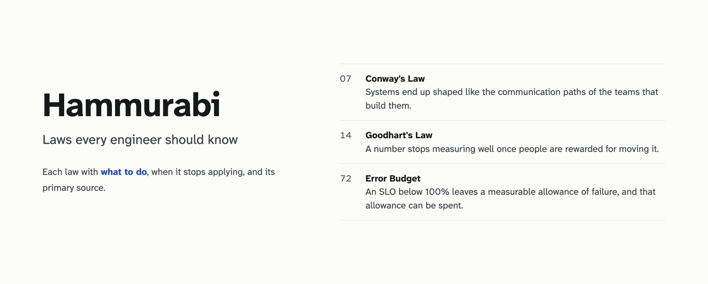
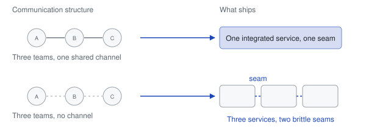
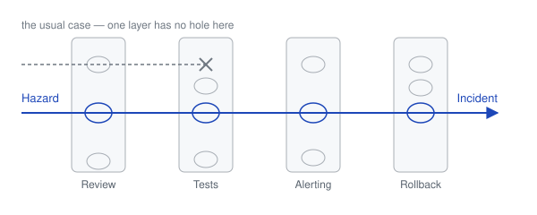
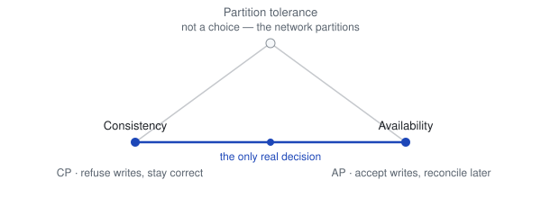
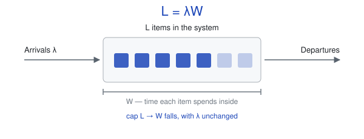
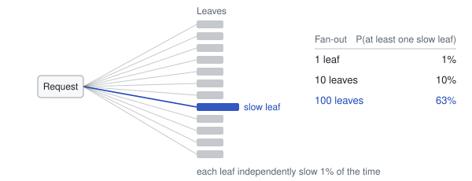
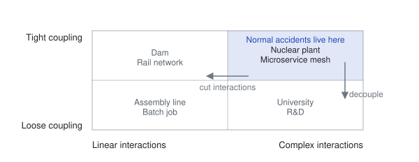

A codex of engineering laws — each with its counter-force, a field guideline, and a source.

[](https://github.com/kanywst/hammurabi/stargazers)
[](#the-codex)
[](https://kanywst.github.io/hammurabi/)
[](./LICENSE)

**English** • [日本語](./translations/ja.md)

---

## What is Hammurabi?

In a world of increasing complexity, the primary bottleneck in engineering is no longer **code**, but **decision-making under uncertainty**.

Hammurabi is a curated codex of engineering laws drawn from **cognitive psychology**, **safety engineering**, and **system design**. It is named for the first written code of laws — the point at which a rule stopped being something you remembered and became something you could cite.

Most collections of laws stop at the explanation. This one does not, because an explanation is not a decision. Every article here carries three more things:

- **A counter-force.** The principle that stops the law from hardening into dogma. Every law in this codex can be applied until it does damage; the counter is the boundary. Postel's Law without fail-fast produces systems that swallow corruption. Least Privilege without psychological acceptability produces controls that users route around.
- **A field guideline.** Something you can act on tomorrow, written as an instruction rather than an observation.
- **A primary source.** The paper, book, letter or RFC where the idea actually appeared — not a blog post summarising one. Every entry links to it, so you can check the claim rather than trust it.

## How to read an article

Each article has the same five parts, in the same order:

| Part | What it answers |
| --- | --- |
| **Concept** | What force is this, in one line? |
| **Mechanism** | Why does it happen? Usually a fact about people or about systems, not about software. |
| **Counter** | What keeps it from becoming dogma? |
| **Guideline** | What do I do on Monday? |
| **Source** | Where did this actually come from, and how do I verify it? |

The `§` number is a stable display label, assigned in file order. The permanent identity of an article is its **slug** — that is what the website's permalinks use, and it never changes even if articles are added around it.

## The Codex

<!-- CODEX:START -->

<!-- Generated from data/laws.yaml by scripts/generate.mjs. Do not edit by hand. -->

| § | Law | Category | The core idea |
| --- | --- | --- | --- |
| `01` | [Type 1 vs Type 2 Decisions](#type-1-vs-type-2-decisions) | Decision | Teams spend the caution meant for irreversible decisions on ones they could easily undo. |
| `02` | [Normalization of Deviance](#normalization-of-deviance) | Safety | A broken rule that causes no immediate harm quietly becomes the new normal. |
| `03` | [Chesterton's Fence](#chestertons-fence) | Systems | Code or rules whose origin you don't know look like clutter, so they get deleted. |
| `04` | [Normalcy Bias](#normalcy-bias) | Cognition | Faced with a real anomaly, people reach for the familiar, harmless explanation. |
| `05` | [Law of Triviality](#law-of-triviality) | Organization | Review effort goes to the parts everyone understands, not the parts that matter. |
| `06` | [Gall's Law](#galls-law) | Systems | Complex systems that work grew from simple systems that worked; designed ones don't. |
| `07` | [Conway's Law](#conways-law) | Organization | Systems end up shaped like the communication paths of the teams that build them. |
| `08` | [Hyrum's Law](#hyrums-law) | Systems | With enough users, every observable behavior of a system, bugs included, is depended on. |
| `09` | [Brooks' Law](#brooks-law) | Organization | Adding people to a late project makes it later, because coordination cost grows faster. |
| `10` | [XY Problem](#xy-problem) | Cognition | People ask for help with their attempted fix instead of the problem they actually have. |
| `11` | [Postel's Law](#postels-law) | Distributed Systems | Systems that assume every peer follows the spec exactly break on the first one that doesn't. |
| `12` | [Hanlon's Razor](#hanlons-razor) | Organization | We read malice into delays and bugs that are better explained by fatigue or missing context. |
| `13` | [Hofstadter's Law](#hofstadters-law) | Estimation | Work takes longer than estimated, even when the estimate already allows for that. |
| `14` | [Goodhart's Law](#goodharts-law) | Incentives | A number stops measuring well once people are rewarded for moving it. |
| `15` | [Lindy Effect](#lindy-effect) | Systems | For ideas and software, the longer something has survived, the longer it is likely to last. |
| `16` | [Sunk Cost Fallacy](#sunk-cost-fallacy) | Decision | Teams keep funding a failing project because of what they have already spent on it. |
| `17` | [Cargo Cult Engineering](#cargo-cult-engineering) | Cognition | Teams copy another company's practices without the conditions that made them work. |
| `18` | [Amdahl's Law](#amdahls-law) | Performance | Speeding up one part of a system barely helps when the bottleneck is somewhere else. |
| `19` | [Law of Leaky Abstractions](#law-of-leaky-abstractions) | Systems | Every non-trivial abstraction eventually exposes the details it was meant to hide. |
| `20` | [Pareto Principle](#pareto-principle) | Decision | Most of the effect comes from a small share of the causes, such as bugs in a few modules. |
| `21` | [Survivorship Bias](#survivorship-bias) | Cognition | Conclusions drawn only from successes ignore the failures that used the same strategy. |
| `22` | [Kernighan's Law](#kernighans-law) | Maintainability | Debugging is harder than writing, so code written at your cleverest is beyond your debugging. |
| `23` | [Cobra Effect](#cobra-effect) | Incentives | An incentive meant to reduce a problem rewards people for producing more of it. |
| `24` | [Dunbar's Number](#dunbars-number) | Organization | People keep only about 150 stable relationships; past a team's shared context, people add coordination. |
| `25` | [Worse is Better](#worse-is-better) | Systems | A simpler design that is easy to build and adopt beats a more correct but complex one. |
| `26` | [Cunningham's Law](#cunninghams-law) | Organization | People are quicker to correct a wrong answer than to answer a question. |
| `27` | [Bystander Effect](#bystander-effect) | Organization | The more people who see a problem, the less likely any one of them is to act on it. |
| `28` | [Murphy's Law](#murphys-law) | Safety | Given enough time and traffic, every failure mode a system has will eventually occur. |
| `29` | [Boy Scout Rule](#boy-scout-rule) | Maintainability | Code decays because cleanup is always deferred to a refactor that never happens. |
| `30` | [Tesler's Law](#teslers-law) | Systems | Complexity can't be removed from a system, only moved to someone else. |
| `31` | [Dunning-Kruger Effect](#dunning-kruger-effect) | Cognition | The less skilled people are at something, the more they overrate their own ability. |
| `32` | [Curse of Knowledge](#curse-of-knowledge) | Cognition | Once you know something, you can't easily imagine what it's like not to know it. |
| `33` | [Swiss Cheese Model](#swiss-cheese-model) | Safety | Every safeguard has holes; accidents happen when the holes in several layers line up. |
| `34` | [Premature Optimization](#premature-optimization) | Performance | Optimizing before measuring spends effort on code that isn't the bottleneck. |
| `35` | [Linus's Law](#linuss-law) | Maintainability | A bug that stumps one person is often obvious to someone else looking at the same code. |
| `36` | [CAP Theorem](#cap-theorem) | Distributed Systems | During a network partition, a data store must give up either consistency or availability. |
| `37` | [Little's Law](#littles-law) | Performance | Items in a system equal arrival rate times time spent in it, whatever the traffic pattern. |
| `38` | [Two Generals Problem](#two-generals-problem) | Distributed Systems | Over an unreliable channel, two parties can never be certain they have agreed. |
| `39` | [Peter Principle](#peter-principle) | Organization | People get promoted until they reach a role they are bad at, and stay there. |
| `40` | [Parkinson's Law](#parkinsons-law) | Organization | Work expands to fill the time available for it. |
| `41` | [Wirth's Law](#wirths-law) | Performance | Software gets slower faster than hardware gets faster. |
| `42` | [Ninety-Ninety Rule](#ninety-ninety-rule) | Estimation | The last 10% of the work takes as long as the first 90%. |
| `43` | [Eagleson's Law](#eaglesons-law) | Maintainability | Your own code that you haven't read in six months might as well be someone else's. |
| `44` | [Hick's Law](#hicks-law) | Interaction | The more options people are given, the longer they take to choose one. |
| `45` | [Fitts's Law](#fittss-law) | Interaction | Small, distant targets take longer to hit and get missed more often. |
| `46` | [Miller's Law](#millers-law) | Cognition | Working memory holds only about seven items; past that, people start dropping them. |
| `47` | [Fallacies of Distributed Computing](#fallacies-of-distributed-computing) | Distributed Systems | Networked code quietly assumes eight things about the network that are false in production. |
| `48` | [Ironies of Automation](#ironies-of-automation) | Safety | Automation leaves people only the hardest cases, after their skills have faded from disuse. |
| `49` | [Principle of Least Privilege](#principle-of-least-privilege) | Security | Every permission a component doesn't need widens the damage when something goes wrong. |
| `50` | [Kerckhoffs's Principle](#kerckhoffss-principle) | Security | A system that is secure only while its design stays secret is not secure. |
| `51` | [Gustafson's Law](#gustafsons-law) | Performance | When the problem grows with the machine, parallel speedup keeps growing nearly linearly. |
| `52` | [The Tail at Scale](#the-tail-at-scale) | Distributed Systems | When one request fans out to many servers, the slowest one sets the response time. |
| `53` | [Ashby's Law of Requisite Variety](#ashbys-law-of-requisite-variety) | Systems | A controller can only handle a system if it can respond to as many states as the system has. |
| `54` | [Law of Demeter](#law-of-demeter) | Maintainability | Code that reaches through other objects' internals breaks when anything in the chain changes. |
| `55` | [Jevons Paradox](#jevons-paradox) | Incentives | Making a resource cheaper to use can increase how much of it is used in total. |
| `56` | [Normal Accident Theory](#normal-accident-theory) | Safety | In complex, tightly coupled systems, accidents are built into the structure. |
| `57` | [Broken Windows Theory](#broken-windows-theory) | Safety | Visible disorder left unrepaired signals that standards are optional, inviting more. |
| `58` | [YAGNI](#yagni) | Maintainability | Code built for imagined future needs costs time now and rarely fits the need that arrives. |
| `59` | [KISS Principle](#kiss-principle) | Maintainability | A system has to be simple enough for an ordinary person to fix under bad conditions. |
| `60` | [DRY Principle](#dry-principle) | Maintainability | Knowledge kept in two places drifts apart, because nothing makes the copies change together. |
| `61` | [Theory of Constraints](#theory-of-constraints) | Performance | A system's throughput is set by its single tightest bottleneck. |
| `62` | [Occam's Razor](#occams-razor) | Cognition | The explanation that needs the fewest unverified assumptions is usually the right one. |
| `63` | [Single Responsibility Principle](#single-responsibility-principle) | Maintainability | A module serving two groups gets conflicting change requests from both. |
| `64` | [Principle of Least Astonishment](#principle-of-least-astonishment) | Interaction | Behavior that surprises users costs more than behavior that is slightly worse but expected. |
| `65` | [Second-System Effect](#second-system-effect) | Systems | After a first success, designers pack every deferred idea into the second system. |
| `66` | [Moore's Law](#moores-law) | Performance | The number of transistors on a chip at lowest cost per part doubles about every two years. |
| `67` | [Amara's Law](#amaras-law) | Estimation | New technology is overrated in its first years and underrated over a decade. |
| `68` | [The Bitter Lesson](#the-bitter-lesson) | Systems | In AI, general methods that scale with compute beat hand-coded human knowledge. |
| `69` | [Metcalfe's Law](#metcalfes-law) | Systems | Each new node adds value to every existing one, so a network's value outgrows its size. |
| `70` | [Ringelmann Effect](#ringelmann-effect) | Organization | Each person contributes less as a group grows, most of all when no one can see who did what. |
| `71` | [Shirky Principle](#shirky-principle) | Incentives | Institutions tend to keep alive the problem they exist to solve. |
| `72` | [Error Budget](#error-budget) | Operations | An SLO below 100% leaves a measurable allowance of failure, and that allowance can be spent. |
| `73` | [Toil](#toil) | Operations | Manual, repetitive operational work grows with the service until it crowds out engineering. |
| `74` | [Blameless Postmortem](#blameless-postmortem) | Operations | Punishing the person nearest a failure teaches everyone to hide what they did. |
| `75` | [Working Backwards](#working-backwards) | Decision | Teams that start from a solution build things no customer needed; starting from the announcement exposes that early. |
| `76` | [Disagree and Commit](#disagree-and-commit) | Decision | Waiting for everyone to agree costs more time than most wrong decisions would. |

### Type 1 vs Type 2 Decisions

`§ 01` · Decision

- **Concept:** Teams spend the caution meant for irreversible decisions on ones they could easily undo.
- **Mechanism:** The brain instinctively treats all failures as threats to survival, demanding excessive caution for reversible decisions (Two-way doors). This causes "Analysis Paralysis."
- **Counter:** **The "One-Way Door" Filter**.
- **Guideline:** If a decision is easily reversible (two-way door), ship within 24 hours to gain data. Only spend days/weeks on "one-way doors" (e.g., core database schema, security protocols).
- **Source:** Jeff Bezos, *2015 Letter to Shareholders* (Amazon.com, Inc., filed April 2016) — the letter that introduced the "Type 1 / Type 2 decisions" framing. The 1997 letter is the "Day 1" letter and does not contain it. — [source ↗](https://www.sec.gov/Archives/edgar/data/1018724/000119312516530910/d168744dex991.htm)
- **See also:** [Sunk Cost Fallacy](#sunk-cost-fallacy) · [Parkinson's Law](#parkinsons-law) · [Disagree and Commit](#disagree-and-commit)

### Normalization of Deviance

`§ 02` · Safety

- **Concept:** A broken rule that causes no immediate harm quietly becomes the new normal.
- **Mechanism:** When a minor rule is broken (e.g., skipping a test) and no immediate disaster occurs, the brain re-classifies this "deviance" as "normal." This is how catastrophic failures begin.
- **Counter:** **Broken Windows Theory**.
- **Guideline:** If you see a "hack" or a bypassed alert, do not say "it worked before." Either fix it immediately or document it as high-priority technical debt.
- **Source:** Diane Vaughan, *The Challenger Launch Decision* (1996) — coined while analyzing the NASA Challenger disaster. — [source ↗](https://en.wikipedia.org/wiki/Normalization_of_deviance)
- **See also:** [Swiss Cheese Model](#swiss-cheese-model) · [Normal Accident Theory](#normal-accident-theory) · [Boy Scout Rule](#boy-scout-rule) · [Normalcy Bias](#normalcy-bias) · [Broken Windows Theory](#broken-windows-theory) · [Blameless Postmortem](#blameless-postmortem)

### Chesterton's Fence

`§ 03` · Systems

- **Concept:** Code or rules whose origin you don't know look like clutter, so they get deleted.
- **Mechanism:** We view legacy code/processes as "clutter" because we lack the context of their origin. The ego jumps to "simplify" by deleting what it doesn't understand.
- **Counter:** **Time-Boxed Archaeology** — taken absolutely the rule removes nothing ever, because the reason is sometimes gone with the person who had it.
- **Guideline:** You are forbidden from removing a "fence" (code/rule) until you can explain why it was put there — but put a deadline on the search. When it expires, take the fence down behind a flag, with a rollback ready, and watch what complains.
- **Source:** G. K. Chesterton, *The Thing* (1929) — the original parable of the fence in the road. — [source ↗](https://www.chesterton.org/taking-a-fence-down/)
- **See also:** [Eagleson's Law](#eaglesons-law) · [YAGNI](#yagni)

### Normalcy Bias

`§ 04` · Cognition

- **Concept:** Faced with a real anomaly, people reach for the familiar, harmless explanation.
- **Mechanism:** In the face of a true anomaly, the brain defaults to the most "frequent" explanation to save energy. "It's probably just a transient network error," we say as the database corrupts.
- **Counter:** **Pre-mortem / Red Teaming**.
- **Guideline:** When an error occurs, ask: "If this were the start of a total system collapse, what would the next 10 minutes look like?" If that scares you, investigate now.
- **Source:** Disaster psychology literature; widely surveyed in Amanda Ripley, *The Unthinkable* (2008). — [source ↗](https://en.wikipedia.org/wiki/Normalcy_bias)
- **See also:** [Murphy's Law](#murphys-law) · [Normalization of Deviance](#normalization-of-deviance) · [Occam's Razor](#occams-razor)

### Law of Triviality

`§ 05` · Organization

- **Concept:** Review effort goes to the parts everyone understands, not the parts that matter.
- **Mechanism:** People provide more feedback on simple things (naming variables) than complex things (distributed consensus) because everyone understands the simple things, creating a false sense of value.
- **Counter:** **Core Value Focus**.
- **Guideline:** If a PR review spends 80% of comments on style/naming, approve immediately and move the discussion to an automated linter config.
- **Source:** C. Northcote Parkinson, *Parkinson's Law and Other Studies in Administration* (Houghton Mifflin, 1957), in the chapter "High Finance, or the Point of Vanishing Interest" — the original bike-shed committee parable. Published in the UK as *Parkinson's Law: The Pursuit of Progress* (John Murray, 1958). — [source ↗](https://en.wikipedia.org/wiki/Law_of_triviality)
- **See also:** [Parkinson's Law](#parkinsons-law) · [Disagree and Commit](#disagree-and-commit)

### Gall's Law

`§ 06` · Systems

- **Concept:** Complex systems that work grew from simple systems that worked; designed ones don't.
- **Mechanism:** We believe we can "architect" a complex system from scratch. We can't. Complex systems are too chaotic to be designed top-down.
- **Counter:** **The MVP (Minimum Viable Product)**.
- **Guideline:** A complex system that works is invariably found to have evolved from a simple system that worked. Start with a working "Hello World" and evolve.
- **Source:** John Gall, *Systemantics: How Systems Really Work and How They Fail* (1975). — [source ↗](https://en.wikipedia.org/wiki/John_Gall_(author))
- **See also:** [Worse is Better](#worse-is-better) · [YAGNI](#yagni) · [Second-System Effect](#second-system-effect)

### Conway's Law

`§ 07` · Organization

- **Concept:** Systems end up shaped like the communication paths of the teams that build them.
- **Mechanism:** The software architecture is a map of the organizational chart. If two teams don't talk, their services won't integrate smoothly.
- **Counter:** **Inverse Conway Maneuver**.
- **Guideline:** If you want a modular architecture, create modular, independent teams first. Do not fight the org chart with code.
- **Source:** Melvin E. Conway, *How Do Committees Invent?* (Datamation, April 1968). — [source ↗](https://www.melconway.com/Home/Committees_Paper.html)
- **See also:** [Dunbar's Number](#dunbars-number) · [Brooks' Law](#brooks-law) · [Single Responsibility Principle](#single-responsibility-principle)

<picture>
  <source media="(prefers-color-scheme: dark)" srcset="./assets/diagrams/conways-law-en-dark.svg">
  
</picture>

The architecture is downstream of the communication structure, not the org chart on paper — the one that describes who actually talks to whom. Redraw the teams and the seam moves with them; redraw the diagram alone and the old seam grows back.

### Hyrum's Law

`§ 08` · Systems

- **Concept:** With enough users, every observable behavior of a system, bugs included, is depended on.
- **Mechanism:** With a sufficient number of users, every observable behavior of your system (even bugs) will be depended on by someone.
- **Counter:** **Deliberate Variance** — if every observable behaviour were sacred nothing could ever change, so vary what you never promised — randomised iteration order, planned outages — and the dependency never forms.
- **Guideline:** "Internal" doesn't exist once you have users. Version and feature-flag what you promise; deliberately vary what you do not, so nobody can build on it in the first place.
- **Source:** Hyrum Wright, *hyrumslaw.com*; canonicalized in *Software Engineering at Google* (Winters, Manshreck, Wright, 2020). — [source ↗](https://www.hyrumslaw.com/)
- **See also:** [Postel's Law](#postels-law) · [Principle of Least Astonishment](#principle-of-least-astonishment)

### Brooks' Law

`§ 09` · Organization

- **Concept:** Adding people to a late project makes it later, because coordination cost grows faster.
- **Mechanism:** Adding people to a late project increases communication overhead quadratically (n(n-1)/2 communication channels for n people). New people take more time from veterans than they contribute.
- **Counter:** **Scope Cutting**.
- **Guideline:** If a project is late, do not add people. Remove features or push the date.
- **Source:** Fred Brooks, *The Mythical Man-Month* (1975, anniversary edition 1995). — [source ↗](https://en.wikipedia.org/wiki/Brooks%27s_law)
- **See also:** [Conway's Law](#conways-law) · [Dunbar's Number](#dunbars-number) · [Second-System Effect](#second-system-effect) · [Metcalfe's Law](#metcalfes-law)

### XY Problem

`§ 10` · Cognition

- **Concept:** People ask for help with their attempted fix instead of the problem they actually have.
- **Mechanism:** A user/engineer gets stuck on a solution (Y) and asks for help with it, forgetting that the original problem (X) might have a much simpler solution.
- **Counter:** **Five Whys**.
- **Guideline:** When someone asks "How do I do Y?", always reply "What are you trying to achieve with Y?"
- **Source:** Folklore from the Perl IRC and sysadmin communities; canonical write-up at *xyproblem.info*. — [source ↗](https://xyproblem.info/)
- **See also:** [Curse of Knowledge](#curse-of-knowledge) · [Working Backwards](#working-backwards)

### Postel's Law

`§ 11` · Distributed Systems

- **Concept:** Systems that assume every peer follows the spec exactly break on the first one that doesn't.
- **Mechanism:** In a distributed system, assuming everyone follows the spec perfectly leads to brittle failures.
- **Counter:** **Fail-Fast (Internal only)**.
- **Guideline:** Be conservative in what you send (strict compliance) and liberal in what you accept (handle messy inputs gracefully).
- **Source:** Jon Postel, *RFC 761* (DoD Standard TCP, January 1980) §2.10 — "be conservative in what you do, be liberal in what you accept from others". The same guidance appears in *RFC 760* (IP) §3.2 in different words, and verbatim again in *RFC 793* (1981). — [source ↗](https://www.rfc-editor.org/rfc/rfc761)
- **See also:** [Hyrum's Law](#hyrums-law) · [Fallacies of Distributed Computing](#fallacies-of-distributed-computing)

### Hanlon's Razor

`§ 12` · Organization

- **Concept:** We read malice into delays and bugs that are better explained by fatigue or missing context.
- **Mechanism:** We take bugs/delays personally, assuming "malice" or "sabotage" when it's usually just lack of sleep or missing context.
- **Counter:** **Psychological Safety**.
- **Guideline:** Never attribute to malice that which is adequately explained by stupidity or lack of context. Focus on the system, not the person.
- **Source:** Robert J. Hanlon, contributed to *Murphy's Law Book Two* (Arthur Bloch, 1980). — [source ↗](https://en.wikipedia.org/wiki/Hanlon%27s_razor)
- **See also:** [Bystander Effect](#bystander-effect) · [Occam's Razor](#occams-razor) · [Blameless Postmortem](#blameless-postmortem)

### Hofstadter's Law

`§ 13` · Estimation

- **Concept:** Work takes longer than estimated, even when the estimate already allows for that.
- **Mechanism:** "It always takes longer than you expect, even when you take into account Hofstadter's Law." The brain cannot visualize unknown unknowns.
- **Counter:** **Evidence-Based Scheduling**.
- **Guideline:** Double your most conservative estimate, then add 20%. And expect to be wrong.
- **Source:** Douglas Hofstadter, *Gödel, Escher, Bach: an Eternal Golden Braid* (1979). — [source ↗](https://en.wikipedia.org/wiki/Hofstadter%27s_law)
- **See also:** [Ninety-Ninety Rule](#ninety-ninety-rule) · [Parkinson's Law](#parkinsons-law)

### Goodhart's Law

`§ 14` · Incentives

- **Concept:** A number stops measuring well once people are rewarded for moving it.
- **Mechanism:** When a measure becomes a target, it ceases to be a good measure. If you reward "number of commits," people will make tiny, useless commits.
- **Counter:** **Balanced Scorecards**.
- **Guideline:** Never use a single metric to judge performance. Observe the system's output, not its proxies.
- **Source:** Charles Goodhart, *Problems of Monetary Management* (1975); reformulated by Marilyn Strathern (1997). — [source ↗](https://en.wikipedia.org/wiki/Goodhart%27s_law)
- **See also:** [Cobra Effect](#cobra-effect) · [Shirky Principle](#shirky-principle) · [Error Budget](#error-budget)

### Lindy Effect

`§ 15` · Systems

- **Concept:** For ideas and software, the longer something has survived, the longer it is likely to last.
- **Mechanism:** For non-perishable things like ideas or software, the longer they have survived, the longer they are likely to survive.
- **Counter:** **Hype Cycle Analysis**.
- **Guideline:** If you need a stable system for 10 years, choose a technology that has already been around for 10 years (e.g., PostgreSQL over a new NoSQL).
- **Source:** Coined by Albert Goldman (*New Republic*, 1964); formalized by Benoit Mandelbrot and popularized by Nassim Taleb, *Antifragile* (2012). — [source ↗](https://en.wikipedia.org/wiki/Lindy_effect)
- **See also:** [Worse is Better](#worse-is-better) · [Amara's Law](#amaras-law)

### Sunk Cost Fallacy

`§ 16` · Decision

- **Concept:** Teams keep funding a failing project because of what they have already spent on it.
- **Mechanism:** We continue investing in a failing tech stack/project because "we've already spent so much on it." The brain hates admitting a loss.
- **Counter:** **Zero-Based Budgeting**.
- **Guideline:** Ask: "If we started today with zero investment, would we choose this path?" If no, kill it.
- **Source:** Hal R. Arkes & Catherine Blumer, *The Psychology of Sunk Cost* (Organizational Behavior and Human Decision Processes, 1985). — [source ↗](https://doi.org/10.1016/0749-5978(85)90049-4)
- **See also:** [Type 1 vs Type 2 Decisions](#type-1-vs-type-2-decisions)

### Cargo Cult Engineering

`§ 17` · Cognition

- **Concept:** Teams copy another company's practices without the conditions that made them work.
- **Mechanism:** Copying the practices of successful companies (e.g., "The Spotify Model") without understanding *why* they worked there, hoping for the same results.
- **Counter:** **First Principles Thinking**.
- **Guideline:** Do not adopt a tool/process because Google uses it. Adopt it because you have the exact problem Google had at that scale.
- **Source:** Richard P. Feynman, *Cargo Cult Science* (Caltech commencement address, 1974). — [source ↗](https://calteches.library.caltech.edu/51/2/CargoCult.htm)
- **See also:** [Survivorship Bias](#survivorship-bias) · [The Bitter Lesson](#the-bitter-lesson)

### Amdahl's Law

`§ 18` · Performance

- **Concept:** Speeding up one part of a system barely helps when the bottleneck is somewhere else.
- **Mechanism:** Optimizing a small part of a system has no impact if the bottleneck is elsewhere.
- **Counter:** **Theory of Constraints**.
- **Guideline:** Find the 1% of the code that takes 90% of the time. Only optimize that. Ignore the rest.
- **Source:** Gene Amdahl, *Validity of the Single Processor Approach to Achieving Large Scale Computing Capabilities* (AFIPS, 1967). — [source ↗](https://doi.org/10.1145/1465482.1465560)
- **See also:** [Gustafson's Law](#gustafsons-law) · [Premature Optimization](#premature-optimization) · [Theory of Constraints](#theory-of-constraints)

### Law of Leaky Abstractions

`§ 19` · Systems

- **Concept:** Every non-trivial abstraction eventually exposes the details it was meant to hide.
- **Mechanism:** All non-trivial abstractions, to some degree, leak. You can't use SQL without understanding how indexes work eventually.
- **Counter:** **T-Shaped Skills**.
- **Guideline:** Use abstractions to move fast, but ensure at least one person on the team understands the layer beneath it.
- **Source:** Joel Spolsky, *The Law of Leaky Abstractions* (Joel on Software, 2002). — [source ↗](https://www.joelonsoftware.com/2002/11/11/the-law-of-leaky-abstractions/)
- **See also:** [Tesler's Law](#teslers-law) · [Law of Demeter](#law-of-demeter)

### Pareto Principle

`§ 20` · Decision

- **Concept:** Most of the effect comes from a small share of the causes, such as bugs in a few modules.
- **Mechanism:** 80% of bugs come from 20% of the code. 80% of value comes from 20% of the features.
- **Counter:** **Ruthless Prioritization**.
- **Guideline:** Identify the "Critical 20%" and give it 100% of your quality focus.
- **Source:** Vilfredo Pareto, *Cours d'Économie Politique* (1896); applied to quality engineering by Joseph M. Juran (*Quality Control Handbook*, 1951). — [source ↗](https://en.wikipedia.org/wiki/Pareto_principle)
- **See also:** [Premature Optimization](#premature-optimization)

### Survivorship Bias

`§ 21` · Cognition

- **Concept:** Conclusions drawn only from successes ignore the failures that used the same strategy.
- **Mechanism:** We study only the successes that survived and draw conclusions from them, ignoring the silent graveyard of failures that used the same strategy. The data we see is fundamentally skewed.
- **Counter:** **Failure Studies / Post-mortem Culture**.
- **Guideline:** Before adopting a strategy because "Company X succeeded with it," research how many companies failed using the same approach. The dead don't write blog posts.
- **Source:** Abraham Wald, *A Method of Estimating Plane Vulnerability* (SRG Memo, 1943) — the WWII bomber-armor analysis. — [source ↗](https://en.wikipedia.org/wiki/Survivorship_bias)
- **See also:** [Cargo Cult Engineering](#cargo-cult-engineering) · [Amara's Law](#amaras-law)

### Kernighan's Law

`§ 22` · Maintainability

- **Concept:** Debugging is harder than writing, so code written at your cleverest is beyond your debugging.
- **Mechanism:** "Debugging is twice as hard as writing the code in the first place. Therefore, if you write the code as cleverly as possible, you are, by definition, not smart enough to debug it."
- **Counter:** **KISS (Keep It Simple, Stupid)**.
- **Guideline:** Code "cleverness" is a liability, not an asset. Write code that your future self, sleep-deprived at 3 AM, can still understand in 6 months.
- **Source:** Brian W. Kernighan & P. J. Plauger, *The Elements of Programming Style*, 2nd ed. (1978). — [source ↗](https://en.wikipedia.org/wiki/The_Elements_of_Programming_Style)
- **See also:** [Eagleson's Law](#eaglesons-law) · [KISS Principle](#kiss-principle)

### Cobra Effect

`§ 23` · Incentives

- **Concept:** An incentive meant to reduce a problem rewards people for producing more of it.
- **Mechanism:** A solution designed to fix a problem creates a worse problem. In colonial India, a bounty on cobras led people to breed cobras for the reward. When the bounty was cancelled, breeders released their stock, making the problem worse.
- **Counter:** **Second-Order Effects Analysis / System Dynamics**.
- **Guideline:** For every incentive you create, ask: "If someone wanted to game this, how would they?" If you can find a way, the design is wrong.
- **Source:** Horst Siebert, *Der Kobra-Effekt: Wie man Irrwege der Wirtschaftspolitik vermeidet* (2001). — [source ↗](https://en.wikipedia.org/wiki/Perverse_incentive)
- **See also:** [Goodhart's Law](#goodharts-law) · [Jevons Paradox](#jevons-paradox)

### Dunbar's Number

`§ 24` · Organization

- **Concept:** People keep only about 150 stable relationships; past a team's shared context, people add coordination.
- **Mechanism:** Humans can maintain approximately 150 stable social relationships. Dunbar's result is about neocortex size and group size across primates — it is not about work teams. What engineering extrapolates from it is a separate argument: communication channels grow as n(n-1)/2, so past the size where everyone can still hold everyone else's context, added people go into coordination rather than output.
- **Counter:** **Two-Pizza Rule / Team Topologies**.
- **Guideline:** When a team exceeds 7±2 people, split it. If "information-sharing meetings" start multiplying, that's the symptom of exceeding the cognitive limit.
- **Source:** Robin I. M. Dunbar, *Neocortex size as a constraint on group size in primates* (Journal of Human Evolution, 1992). The smaller team-size figures usually quoted alongside it — 7±2, the two-pizza rule — are folklore rather than Dunbar's finding. — [source ↗](https://doi.org/10.1016/0047-2484(92)90081-J)
- **See also:** [Conway's Law](#conways-law) · [Brooks' Law](#brooks-law) · [Miller's Law](#millers-law) · [Metcalfe's Law](#metcalfes-law) · [Ringelmann Effect](#ringelmann-effect)

### Worse is Better

`§ 25` · Systems

- **Concept:** A simpler design that is easy to build and adopt beats a more correct but complex one.
- **Mechanism:** A simpler, "inferior" design that is easy to implement and adopt will beat a theoretically "correct" but complex design in the real world. Unix beat Lisp. HTTP beat CORBA.
- **Counter:** **The Right Thing / Perfectionism**.
- **Guideline:** A solution that is 80% correct and ships today will outperform a 100% correct solution that ships next year. Optimize for adoption, not elegance.
- **Source:** Richard P. Gabriel, *Lisp: Good News, Bad News, How to Win Big* (1991) — the "Worse is Better" essay. — [source ↗](https://www.dreamsongs.com/RiseOfWorseIsBetter.html)
- **See also:** [Gall's Law](#galls-law) · [Lindy Effect](#lindy-effect) · [Second-System Effect](#second-system-effect)

### Cunningham's Law

`§ 26` · Organization

- **Concept:** People are quicker to correct a wrong answer than to answer a question.
- **Mechanism:** "The best way to get the right answer on the internet is not to ask a question; it's to post the wrong answer." People are more motivated to correct mistakes than to answer questions.
- **Counter:** **Socratic Method**.
- **Guideline:** When documentation is missing, post your best guess of how something works. The person who knows the truth will appear to correct you far faster than if you had asked directly.
- **Source:** Attributed to Ward Cunningham (inventor of the wiki) by Steven McGeady; named in this form on Wikipedia (~2010). — [source ↗](https://meta.wikimedia.org/wiki/Cunningham%27s_Law)
- **See also:** [Linus's Law](#linuss-law)

### Bystander Effect

`§ 27` · Organization

- **Concept:** The more people who see a problem, the less likely any one of them is to act on it.
- **Mechanism:** In an emergency, the more people who are present, the less likely any single person is to take action. "Someone else will handle it." In engineering, a page sent to a group channel often means nobody responds.
- **Counter:** **Explicit Role Assignment / Incident Commander**.
- **Guideline:** Never say "Can someone look at this?" Instead, say "@name, you are investigating this." Assign a single, named owner for every incident.
- **Source:** John M. Darley & Bibb Latané, *Bystander Intervention in Emergencies: Diffusion of Responsibility* (JPSP, 1968). — [source ↗](https://doi.org/10.1037/h0025589)
- **See also:** [Hanlon's Razor](#hanlons-razor) · [Ringelmann Effect](#ringelmann-effect)

### Murphy's Law

`§ 28` · Safety

- **Concept:** Given enough time and traffic, every failure mode a system has will eventually occur.
- **Mechanism:** "Anything that can go wrong, will go wrong." Given enough time, traffic, or unexpected input, every latent failure mode eventually fires. Engineers who design only for the happy path build systems that are one network blip away from collapse.
- **Counter:** **Defensive Design / Chaos Engineering**.
- **Guideline:** Treat every external dependency, retry, and timeout as something that *will* fail in production. Build the failure path before the success path.
- **Source:** Capt. Edward A. Murphy Jr., USAF Project MX981 (1949); popularized by Maj. John Paul Stapp. — [source ↗](https://en.wikipedia.org/wiki/Murphy%27s_law)
- **See also:** [Normalcy Bias](#normalcy-bias) · [Fallacies of Distributed Computing](#fallacies-of-distributed-computing)

### Boy Scout Rule

`§ 29` · Maintainability

- **Concept:** Code decays because cleanup is always deferred to a refactor that never happens.
- **Mechanism:** Codebases decay because cleanup is always "someone else's job." Each engineer absorbs the entropy hit but defers the fix to a future refactor that never lands. The graph trends down.
- **Counter:** **One Reason Per Diff** — cleanup riding along with a behaviour change hides the change, and a pull request that also renames forty things is one nobody reviews.
- **Guideline:** Always leave the code cleaner than you found it, and keep the cleanup small enough to read inside the same diff — a one-line rename, a clearer comment, a deleted dead branch. Anything bigger gets its own commit.
- **Source:** Robert C. Martin, *The Boy Scout Rule*, in Kevlin Henney (ed.), *97 Things Every Programmer Should Know* (O'Reilly, 2010) — adapting Baden-Powell's "leave this world a little better than you found it". Also stated in *Clean Code* (2008). — [source ↗](https://www.oreilly.com/library/view/97-things-every/9780596809515/ch08.html)
- **See also:** [Normalization of Deviance](#normalization-of-deviance) · [Broken Windows Theory](#broken-windows-theory)

### Tesler's Law

`§ 30` · Systems

- **Concept:** Complexity can't be removed from a system, only moved to someone else.
- **Mechanism:** Every system has an irreducible amount of complexity that cannot be removed — only relocated. Hide it from the user and it lands on the developer. Hide it from the developer and it lands on the operator. Hide it from the operator and it lands on the customer at 3 AM.
- **Counter:** **Honest Layering / Explicit Tradeoffs**.
- **Guideline:** When a "simple API" feels too clean, ask: who absorbed the complexity I just removed? If you can't name them, you didn't simplify — you displaced.
- **Source:** Larry Tesler, while at Xerox PARC / Apple (~1984); cited as the "Law of Conservation of Complexity." — [source ↗](https://en.wikipedia.org/wiki/Law_of_conservation_of_complexity)
- **See also:** [Law of Leaky Abstractions](#law-of-leaky-abstractions) · [Ashby's Law of Requisite Variety](#ashbys-law-of-requisite-variety)

### Dunning-Kruger Effect

`§ 31` · Cognition

- **Concept:** The less skilled people are at something, the more they overrate their own ability.
- **Mechanism:** Lacking expertise in a domain also means lacking the meta-skill required to recognize one's own incompetence. In the original study the bottom quartile scored around the 12th percentile and placed themselves near the 60th. Top performers *under*-rated themselves, because they assumed others found the task as easy as they did.
- **Counter:** **Calibrated Confidence** — the effect is contested — much of the classic pattern is reproduced by regression to the mean in noisy self-assessment, so treat overconfidence as a prompt to check the record rather than as a diagnosis.
- **Guideline:** When someone declares a hard problem "easy," check their domain history before trusting the estimate. During scoping, pair confident newcomers with quiet veterans and weight the quiet voice.
- **Source:** Justin Kruger & David Dunning, *Unskilled and Unaware of It* (JPSP, 1999). — [source ↗](https://doi.org/10.1037/0022-3514.77.6.1121)
- **See also:** [Curse of Knowledge](#curse-of-knowledge) · [Peter Principle](#peter-principle)

### Curse of Knowledge

`§ 32` · Cognition

- **Concept:** Once you know something, you can't easily imagine what it's like not to know it.
- **Mechanism:** Once you know a thing, you cannot easily imagine not knowing it. Engineers write docs, error messages, and APIs that are obvious to themselves and opaque to the next person who has to use them.
- **Counter:** **User Testing / Onboarding Buddies / Documentation Reviewers Outside the Author's Team**.
- **Guideline:** Before shipping documentation or a public API, have someone who has never touched the system attempt the task while you watch silently. Their confusion points exactly at the assumptions you forgot to spell out.
- **Source:** Colin Camerer, George Loewenstein & Martin Weber, *The Curse of Knowledge in Economic Settings: An Experimental Analysis* (Journal of Political Economy, 1989). — [source ↗](https://doi.org/10.1086/261651)
- **See also:** [XY Problem](#xy-problem) · [Dunning-Kruger Effect](#dunning-kruger-effect) · [Principle of Least Astonishment](#principle-of-least-astonishment)

### Swiss Cheese Model

`§ 33` · Safety

- **Concept:** Every safeguard has holes; accidents happen when the holes in several layers line up.
- **Mechanism:** Every protective layer (review, test, alert, runbook, rollback) has holes. Accidents happen when holes across multiple independent layers happen to align. No single layer can ever be perfect, so resilience comes from layers that fail in independent ways.
- **Counter:** **Defense in Depth / Independent Controls / Hole-Audit at Post-Mortem**.
- **Guideline:** During an incident review, do not stop at "the one thing that failed." Enumerate every layer that should have caught the failure and ask why each hole was open at exactly that moment. The fix is rarely a single layer; it's plugging the cheapest two.
- **Source:** James Reason, *Human Error* (Cambridge University Press, 1990). — [source ↗](https://en.wikipedia.org/wiki/Swiss_cheese_model)
- **See also:** [Normalization of Deviance](#normalization-of-deviance) · [Normal Accident Theory](#normal-accident-theory) · [Blameless Postmortem](#blameless-postmortem)

<picture>
  <source media="(prefers-color-scheme: dark)" srcset="./assets/diagrams/swiss-cheese-model-en-dark.svg">
  
</picture>

Every layer has holes, and the holes move. The incident is not the failure of one layer — it is the moment four independent holes happen to align. Which is why the fix is rarely the layer that failed last.

### Premature Optimization

`§ 34` · Performance

- **Concept:** Optimizing before measuring spends effort on code that isn't the bottleneck.
- **Mechanism:** "Premature optimization is the root of all evil." Optimizing code before measurement proves it matters wastes engineering hours, adds complexity, and obstructs the eventual real optimization by entangling hot and cold paths.
- **Counter:** **Profile First / Make It Work, Make It Right, Make It Fast (in that order)**.
- **Guideline:** Write the obvious code first. Only optimize hot paths that a profiler proves are bottlenecks. Leave the other 97% of the code simple — that's where the next maintainer will live.
- **Source:** Donald E. Knuth, *Structured Programming with go to Statements* (Computing Surveys, 1974). — [source ↗](https://doi.org/10.1145/356635.356640)
- **See also:** [Amdahl's Law](#amdahls-law) · [Pareto Principle](#pareto-principle)

### Linus's Law

`§ 35` · Maintainability

- **Concept:** A bug that stumps one person is often obvious to someone else looking at the same code.
- **Mechanism:** "Given enough eyeballs, all bugs are shallow." A defect that looks impossible to one person often becomes trivial when many independent perspectives are applied to it — provided the code is actually visible to those perspectives.
- **Counter:** **Open Source / Rotated Reviewers / Bug Bounties / Internal Code Discoverability**.
- **Guideline:** If the same class of bug keeps slipping through, the fix is not more careful review by the same people — it is exposing the code to more, differently-shaped eyes. Rotate reviewers, open up internal libraries, run bug bounties.
- **Source:** Eric S. Raymond, *The Cathedral and the Bazaar* (1999) — named for Linus Torvalds. — [source ↗](https://web.archive.org/web/2024/http://www.catb.org/~esr/writings/cathedral-bazaar/cathedral-bazaar/)
- **See also:** [Cunningham's Law](#cunninghams-law)

### CAP Theorem

`§ 36` · Distributed Systems

- **Concept:** During a network partition, a data store must give up either consistency or availability.
- **Mechanism:** A networked data store cannot simultaneously guarantee **C**onsistency, **A**vailability, and **P**artition tolerance. Because network partitions are not optional in the real world, the live choice is really between consistency and availability *at the moment a partition happens*.
- **Counter:** **PACELC / Tunable Consistency**.
- **Guideline:** Decide *before* an outage whether each operation prefers consistency or availability. The partition will happen; the only question is what your system does when it does.
- **Source:** Eric Brewer, *Towards Robust Distributed Systems* (PODC keynote, 2000); proved by Seth Gilbert & Nancy Lynch (*SIGACT News*, 2002). — [source ↗](https://doi.org/10.1145/564585.564601)
- **See also:** [Two Generals Problem](#two-generals-problem) · [Fallacies of Distributed Computing](#fallacies-of-distributed-computing)

<picture>
  <source media="(prefers-color-scheme: dark)" srcset="./assets/diagrams/cap-theorem-en-dark.svg">
  
</picture>

The triangle is usually drawn as "pick two", which is misleading — you do not get to decline partitions, the network declines for you. P is a fact about the world. The only choice you actually make is the one along the bottom edge, and you make it before the partition, not during it.

### Little's Law

`§ 37` · Performance

- **Concept:** Items in a system equal arrival rate times time spent in it, whatever the traffic pattern.
- **Mechanism:** In any stable system, the average number of items in the system (L) equals the average arrival rate (λ) times the average time each item spends in it (W): **L = λW**. It holds regardless of arrival distribution or service discipline.
- **Counter:** **Backpressure / Admission Control**.
- **Guideline:** To cut latency (W) without adding capacity, cut work-in-progress (L). Cap concurrent requests — a shorter queue is faster than a faster server.
- **Source:** John D. C. Little, *A Proof for the Queuing Formula L = λW* (Operations Research, 1961). — [source ↗](https://doi.org/10.1287/opre.9.3.383)
- **See also:** [The Tail at Scale](#the-tail-at-scale) · [Theory of Constraints](#theory-of-constraints)

<picture>
  <source media="(prefers-color-scheme: dark)" srcset="./assets/diagrams/littles-law-en-dark.svg">
  
</picture>

L = λW binds the three quantities, so you cannot move one without moving another. Arrival rate is set by your users, not by you. That leaves one lever you actually control: cap the work in progress, and latency falls out of the arithmetic — no faster server required.

### Two Generals Problem

`§ 38` · Distributed Systems

- **Concept:** Over an unreliable channel, two parties can never be certain they have agreed.
- **Mechanism:** Two parties communicating over an unreliable channel can never be *certain* they have reached agreement — every message needs an acknowledgment, which itself needs an acknowledgment, forever. No fixed number of messages yields common knowledge.
- **Counter:** **Idempotency / Eventual Consistency / Acknowledged Retries**.
- **Guideline:** Never assume "I sent it, so they got it." Make every cross-network action safely retryable and idempotent, and reconcile state instead of trusting a single round-trip.
- **Source:** E. A. Akkoyunlu, K. Ekanadham & R. V. Huber (1975); framed as a database problem by Jim Gray, *Notes on Data Base Operating Systems* (1978). — [source ↗](https://en.wikipedia.org/wiki/Two_Generals%27_Problem)
- **See also:** [CAP Theorem](#cap-theorem)

### Peter Principle

`§ 39` · Organization

- **Concept:** People get promoted until they reach a role they are bad at, and stay there.
- **Mechanism:** In a hierarchy, people are promoted on performance in their *current* role, not the one above. So everyone tends to rise until they reach a role they are bad at — and there they stay. Competence is promoted away; incompetence accumulates.
- **Counter:** **Dual Career Ladders / Role-Specific Evaluation**.
- **Guideline:** Do not promote your best engineer into management as a reward — it removes a great engineer and risks creating a poor manager. Offer a technical ladder, and evaluate candidates for the role above, not the one they already mastered.
- **Source:** Laurence J. Peter & Raymond Hull, *The Peter Principle* (1969). — [source ↗](https://en.wikipedia.org/wiki/Peter_principle)
- **See also:** [Dunning-Kruger Effect](#dunning-kruger-effect) · [Shirky Principle](#shirky-principle)

### Parkinson's Law

`§ 40` · Organization

- **Concept:** Work expands to fill the time available for it.
- **Mechanism:** "Work expands so as to fill the time available for its completion." Give a task a week and it takes a week; the same task with a two-day deadline ships in two days. Slack is consumed, not banked.
- **Counter:** **Timeboxing**.
- **Guideline:** Set deliberately short timeboxes for open-ended work and review at the deadline. A tight box forces the scoping decisions an open one defers forever.
- **Source:** C. Northcote Parkinson, *Parkinson's Law* (The Economist, 19 November 1955); expanded into *Parkinson's Law and Other Studies in Administration* (Houghton Mifflin, 1957). — [source ↗](https://www.economist.com/news/1955/11/19/parkinsons-law)
- **See also:** [Type 1 vs Type 2 Decisions](#type-1-vs-type-2-decisions) · [Law of Triviality](#law-of-triviality) · [Hofstadter's Law](#hofstadters-law)

### Wirth's Law

`§ 41` · Performance

- **Concept:** Software gets slower faster than hardware gets faster.
- **Mechanism:** "Software is getting slower more rapidly than hardware is becoming faster." Each hardware gain is absorbed by added abstraction layers, features, and carelessness, so user-perceived speed stays flat or worsens.
- **Counter:** **Performance Budgets / Lean Software**.
- **Guideline:** Treat the speed a faster machine buys you as a budget to protect, not a license to spend. Set a performance budget and fail the build when a release regresses against it.
- **Source:** Niklaus Wirth, *A Plea for Lean Software* (IEEE Computer, 1995). — [source ↗](https://doi.org/10.1109/2.348001)
- **See also:** [Jevons Paradox](#jevons-paradox) · [Moore's Law](#moores-law)

### Ninety-Ninety Rule

`§ 42` · Estimation

- **Concept:** The last 10% of the work takes as long as the first 90%.
- **Mechanism:** "The first 90% of the code accounts for the first 90% of the development time. The remaining 10% of the code accounts for the other 90% of the development time." The visible work hides a second, equally large body of integration, edge cases, and polish.
- **Counter:** **Demo on Real Data / Hard Definition of Done**.
- **Guideline:** When something looks "almost done," assume an entire second project remains: the last-10% of hardening, edge cases, and integration. Schedule it explicitly instead of treating it as a rounding error.
- **Source:** Tom Cargill (Bell Labs); popularized by Jon Bentley, *Programming Pearls* (CACM, 1985). — [source ↗](https://en.wikipedia.org/wiki/Ninety%E2%80%93ninety_rule)
- **See also:** [Hofstadter's Law](#hofstadters-law)

### Eagleson's Law

`§ 43` · Maintainability

- **Concept:** Your own code that you haven't read in six months might as well be someone else's.
- **Mechanism:** "Any code of your own that you haven't looked at for six months might as well have been written by someone else." Your mental model of the code evaporates far faster than the code does; context is not stored in the source.
- **Counter:** **ADRs / Self-Explaining Code / Code Comments on the "Why"**.
- **Guideline:** Write code and commit messages for the stranger you will become in six months. If a decision is not obvious from the code, record the *why* in a comment or an ADR — not just in your head.
- **Source:** Programming folklore attributed to Peter Eagleson; a long-circulated adage among the catalogued "laws of software development." — [source ↗](https://wiki.c2.com/?EaglesonsLaw)
- **See also:** [Chesterton's Fence](#chestertons-fence) · [Kernighan's Law](#kernighans-law)

### Hick's Law

`§ 44` · Interaction

- **Concept:** The more options people are given, the longer they take to choose one.
- **Mechanism:** The time to make a decision grows logarithmically with the number of choices: **T = b·log₂(n+1)**. More options do not just add visual clutter — they measurably slow every user down.
- **Counter:** **Progressive Disclosure / Sensible Defaults**.
- **Guideline:** Cut the number of choices on any screen or API surface to the few that matter; push the rest behind defaults and progressive disclosure. Fewer doors, faster decisions.
- **Source:** William E. Hick (1952) and Ray Hyman (1953) — the "Hick–Hyman Law." — [source ↗](https://doi.org/10.1080/17470215208416600)
- **See also:** [Miller's Law](#millers-law) · [Fitts's Law](#fittss-law)

### Fitts's Law

`§ 45` · Interaction

- **Concept:** Small, distant targets take longer to hit and get missed more often.
- **Mechanism:** The time to move to a target depends on its distance and size: distant, small targets are slow and error-prone; near, large targets are fast. Pointing is a physical act with a measurable cost.
- **Counter:** **Edges & Corners / Sizing by Frequency**.
- **Guideline:** Make frequent or destructive actions big and easy to hit; make rare or dangerous ones small and far. Screen edges and corners are effectively infinite targets — put primary actions there.
- **Source:** Paul M. Fitts, *The Information Capacity of the Human Motor System in Controlling the Amplitude of Movement* (Journal of Experimental Psychology, 1954). — [source ↗](https://doi.org/10.1037/h0055392)
- **See also:** [Hick's Law](#hicks-law)

### Miller's Law

`§ 46` · Cognition

- **Concept:** Working memory holds only about seven items; past that, people start dropping them.
- **Mechanism:** "The Magical Number Seven, Plus or Minus Two" — human working memory holds only about seven chunks at once. Cross that limit and recall collapses; the brain drops items rather than slowing down.
- **Counter:** **Chunking / Information Hiding**.
- **Guideline:** Group related items into a handful of named chunks — phone-number style — wherever a person must hold state in their head: function arguments, form fields, menu groups, on-call steps.
- **Source:** George A. Miller, *The Magical Number Seven, Plus or Minus Two* (Psychological Review, 1956). — [source ↗](https://doi.org/10.1037/h0043158)
- **See also:** [Dunbar's Number](#dunbars-number) · [Hick's Law](#hicks-law)

### Fallacies of Distributed Computing

`§ 47` · Distributed Systems

- **Concept:** Networked code quietly assumes eight things about the network that are false in production.
- **Mechanism:** Newcomers to distributed systems silently assume the network is reliable, latency is zero, bandwidth is infinite, the network is secure, topology is stable, there is one administrator, transport cost is zero, and the network is homogeneous. Every one of these eight assumptions fails in production.
- **Counter:** **Design for Failure** — without gold-plating against impossible modes.
- **Guideline:** Before shipping any cross-process call, name which of the eight assumptions you are relying on and add an explicit timeout, retry, and failure path for each.
- **Source:** L. Peter Deutsch (fallacies 5–7, 1994) and James Gosling (the 8th, ~1997), building on earlier work at Sun Microsystems. — [source ↗](https://en.wikipedia.org/wiki/Fallacies_of_distributed_computing)
- **See also:** [Postel's Law](#postels-law) · [Murphy's Law](#murphys-law) · [CAP Theorem](#cap-theorem)

### Ironies of Automation

`§ 48` · Safety

- **Concept:** Automation leaves people only the hardest cases, after their skills have faded from disuse.
- **Mechanism:** Automating the routine parts of a task leaves the human only the rarest, hardest exceptions — while their manual skill and situational awareness atrophy from disuse, precisely at the moment a failing automated system hands control back to them.
- **Counter:** **Human-in-the-Loop Drills** — better teaming, not less automation.
- **Guideline:** Keep operators sharp with regular game-days and hands-on drills, and design handoffs so a human takes over with context, not cold.
- **Source:** Lisanne Bainbridge, *Ironies of Automation* (Automatica, 1983). — [source ↗](https://doi.org/10.1016/0005-1098(83)90046-8)
- **See also:** [Normal Accident Theory](#normal-accident-theory) · [Toil](#toil)

### Principle of Least Privilege

`§ 49` · Security

- **Concept:** Every permission a component doesn't need widens the damage when something goes wrong.
- **Mechanism:** Every component granted more authority than it strictly needs enlarges the blast radius of any bug, compromise, or accident, and multiplies the interactions an auditor must reason about.
- **Counter:** **Psychological Acceptability** — over-restriction that users route around defeats itself.
- **Guideline:** Default every process, service account, and token to deny, then add only the minimal scopes the job provably needs; re-audit the grants whenever the job changes.
- **Source:** Jerome Saltzer & Michael Schroeder, *The Protection of Information in Computer Systems* (Proceedings of the IEEE, 1975). — [source ↗](https://web.mit.edu/Saltzer/www/publications/protection/)
- **See also:** [Kerckhoffs's Principle](#kerckhoffss-principle)

### Kerckhoffs's Principle

`§ 50` · Security

- **Concept:** A system that is secure only while its design stays secret is not secure.
- **Mechanism:** A cryptosystem should remain secure even if everything about it except the key is public. Secrecy of the algorithm is brittle: mechanisms leak, get reverse-engineered, and get reused across systems.
- **Counter:** **Defense in Depth** — obscurity may be one thin extra layer, never the foundation.
- **Guideline:** Assume the attacker has your source and design. Put all of the secret in rotatable keys, and never rely on a hidden algorithm to protect anything.
- **Source:** Auguste Kerckhoffs, *La cryptographie militaire* (Journal des sciences militaires, 1883). — [source ↗](https://en.wikipedia.org/wiki/Kerckhoffs%27s_principle)
- **See also:** [Principle of Least Privilege](#principle-of-least-privilege)

### Gustafson's Law

`§ 51` · Performance

- **Concept:** When the problem grows with the machine, parallel speedup keeps growing nearly linearly.
- **Mechanism:** For a fixed time budget, a larger machine lets you solve a proportionally larger problem, so the serial fraction shrinks with scale and speedup grows near-linearly — the optimistic counterpart to Amdahl's fixed-workload pessimism.
- **Counter:** **Amdahl's Law** — for a fixed-size workload, the serial fraction still hard-caps speedup.
- **Guideline:** Before justifying more cores, ask whether the problem size grows with the hardware. If the workload is fixed, reason with Amdahl; if it scales, Gustafson applies.
- **Source:** John L. Gustafson, *Reevaluating Amdahl's Law* (Communications of the ACM, 1988). — [source ↗](https://doi.org/10.1145/42411.42415)
- **See also:** [Amdahl's Law](#amdahls-law) · [Moore's Law](#moores-law)

### The Tail at Scale

`§ 52` · Distributed Systems

- **Concept:** When one request fans out to many servers, the slowest one sets the response time.
- **Mechanism:** In a service that fans out to many components, rare per-node slowness (GC pauses, contention, a failing disk) is near-certain to hit some node on every request. So tail latency (p99, p99.9) governs the user experience even when medians look healthy.
- **Counter:** **Redundancy Has a Price** — hedged and tied requests add load; don't chase the tail where the median is what users feel.
- **Guideline:** Set SLOs on p99/p99.9, not the mean, and deploy tail-tolerance — hedged requests, micro-partitioning — instead of trying to make every node uniformly fast.
- **Source:** Jeffrey Dean & Luiz André Barroso, *The Tail at Scale* (Communications of the ACM, 2013). — [source ↗](https://doi.org/10.1145/2408776.2408794)
- **See also:** [Little's Law](#littles-law) · [Error Budget](#error-budget)

<picture>
  <source media="(prefers-color-scheme: dark)" srcset="./assets/diagrams/tail-at-scale-en-dark.svg">
  
</picture>

A leaf that is slow one request in a hundred is invisible on its own. Fan out to 100 of them and the same leaf-level p99 becomes the median user experience: 63% of requests now wait on a straggler. Tail latency is not a per-node property at scale — it is an arithmetic consequence of the fan-out.

### Ashby's Law of Requisite Variety

`§ 53` · Systems

- **Concept:** A controller can only handle a system if it can respond to as many states as the system has.
- **Mechanism:** A controller can regulate a system only if it can match the variety of states that system can produce. Under-powered control simply cannot cope with a sufficiently rich environment.
- **Counter:** **Constrain the Environment** — excess control variety is itself cost and complexity.
- **Guideline:** When incidents keep escaping your alerts and runbooks, either add matching response capability or deliberately shrink the system's state space: fewer configurations, stricter inputs.
- **Source:** W. Ross Ashby, *An Introduction to Cybernetics* (Chapman & Hall, 1956). — [source ↗](https://en.wikipedia.org/wiki/Variety_(cybernetics))
- **See also:** [Tesler's Law](#teslers-law) · [Normal Accident Theory](#normal-accident-theory) · [KISS Principle](#kiss-principle)

### Law of Demeter

`§ 54` · Maintainability

- **Concept:** Code that reaches through other objects' internals breaks when anything in the chain changes.
- **Mechanism:** An object that reaches through other objects' internals (`a.getB().getC().doThing()`) couples itself to the entire dependency chain, so a change anywhere along that chain ripples back and breaks it.
- **Counter:** **Pragmatism over Dogma** — strict application breeds forwarding and wrapper bloat.
- **Guideline:** Only call methods on your direct collaborators, your arguments, objects you create, and your own fields. If you are chaining getters, add a method to the object that owns the data.
- **Source:** Karl Lieberherr & Ian Holland, *Assuring Good Style for Object-Oriented Programs* (IEEE Software, 1989). — [source ↗](https://doi.org/10.1109/52.35588)
- **See also:** [Law of Leaky Abstractions](#law-of-leaky-abstractions) · [DRY Principle](#dry-principle) · [Single Responsibility Principle](#single-responsibility-principle)

### Jevons Paradox

`§ 55` · Incentives

- **Concept:** Making a resource cheaper to use can increase how much of it is used in total.
- **Mechanism:** Making a resource cheaper to use per unit lowers its effective price and can raise total consumption instead of lowering it — the efficiency gain is spent on more usage rather than banked as savings.
- **Counter:** **Cap the Rebound** — pair efficiency with a quota, cap, or price signal to actually capture the savings.
- **Guideline:** When you make something cheaper — compute, storage, an internal API — expect demand to balloon; provision and budget for the rebound instead of assuming a net reduction.
- **Source:** William Stanley Jevons, *The Coal Question* (1865). — [source ↗](https://en.wikipedia.org/wiki/Jevons_paradox)
- **See also:** [Cobra Effect](#cobra-effect) · [Wirth's Law](#wirths-law)

### Normal Accident Theory

`§ 56` · Safety

- **Concept:** In complex, tightly coupled systems, accidents are built into the structure.
- **Mechanism:** In systems that are both interactively complex and tightly coupled, small independent failures interact in ways no designer anticipated and propagate faster than operators can intervene — so accidents become a property of the structure, not bad luck.
- **Counter:** **High-Reliability Organizations** — culture, slack, and decoupling measurably beat fatalism.
- **Guideline:** Reduce coupling — add buffers, timeouts, bulkheads, and circuit breakers — and cut complexity before adding more safety interlocks, which themselves add interactions.
- **Source:** Charles Perrow, *Normal Accidents: Living with High-Risk Technologies* (Basic Books, 1984). — [source ↗](https://en.wikipedia.org/wiki/Normal_Accidents)
- **See also:** [Normalization of Deviance](#normalization-of-deviance) · [Swiss Cheese Model](#swiss-cheese-model) · [Ironies of Automation](#ironies-of-automation) · [Ashby's Law of Requisite Variety](#ashbys-law-of-requisite-variety)

<picture>
  <source media="(prefers-color-scheme: dark)" srcset="./assets/diagrams/normal-accident-theory-en-dark.svg">
  
</picture>

Perrow put systems on two axes. Only the top-right quadrant produces accidents nobody designed and nobody can catch in time. Both axes are yours to move: decouple with buffers, timeouts and bulkheads, or cut the interactions. Adding another safety interlock moves you the wrong way on the horizontal one.

### Broken Windows Theory

`§ 57` · Safety

- **Concept:** Visible disorder left unrepaired signals that standards are optional, inviting more.
- **Mechanism:** An unrepaired broken window signals that nobody is watching, which lowers the cost of the next violation. In a codebase, one tolerated hack, one skipped test and one permanently silenced alert together announce that the standard is optional.
- **Counter:** **Repair Is Not Free** — attention spent on paint is attention not spent on the foundation, and the criminological evidence for the original claim is contested.
- **Guideline:** Repair the first visible defect in a file you are already touching, and give every tolerated exception an owner and a date. Do not open a refactor for a window you are not standing next to.
- **Source:** James Q. Wilson & George L. Kelling, *Broken Windows* (The Atlantic, March 1982). — [source ↗](https://www.theatlantic.com/magazine/archive/1982/03/broken-windows/304465/)
- **See also:** [Normalization of Deviance](#normalization-of-deviance) · [Boy Scout Rule](#boy-scout-rule)

### YAGNI

`§ 58` · Maintainability

- **Concept:** Code built for imagined future needs costs time now and rarely fits the need that arrives.
- **Mechanism:** Speculative generality is paid for three times: writing the abstraction, carrying it while it is unused, and unpicking it when the anticipated requirement finally arrives in a different shape. Predictions about future requirements are usually wrong in exactly the details the abstraction fixed.
- **Counter:** **Chesterton's Fence** — YAGNI licenses you not to build something; it never licenses you to delete something whose purpose you have not established.
- **Guideline:** Implement the case you actually have. When you feel the pull to generalise, name the second concrete case first — if you cannot, you do not have a pattern, you have a guess.
- **Source:** Ron Jeffries, Extreme Programming practice notes; named "You Aren't Gonna Need It" and popularised in Kent Beck, *Extreme Programming Explained* (1999). — [source ↗](https://ronjeffries.com/xprog/articles/practices/pracnotneed/)
- **See also:** [Chesterton's Fence](#chestertons-fence) · [Gall's Law](#galls-law) · [Working Backwards](#working-backwards)

### KISS Principle

`§ 59` · Maintainability

- **Concept:** A system has to be simple enough for an ordinary person to fix under bad conditions.
- **Mechanism:** "Keep it simple, stupid" came out of aircraft design, where the requirement was that a jet be repairable by an average mechanic in a field with basic tools. The test was never elegance — it was whether an ordinary person could fix it in the worst circumstances the thing would actually meet.
- **Counter:** **Ashby's Law of Requisite Variety** — a system simpler than the problem it has to regulate cannot cope with it, and simplicity below that floor is displaced complexity rather than less of it.
- **Guideline:** Judge a design by who can repair it at 3 AM, not by how it reads in review. If the on-call engineer needs the author on the call, it is not simple — it is familiar to one person.
- **Source:** Attributed to Kelly Johnson at Lockheed's Skunk Works (c. 1960), as a field-maintainability requirement for combat aircraft. — [source ↗](https://en.wikipedia.org/wiki/KISS_principle)
- **See also:** [Kernighan's Law](#kernighans-law) · [Ashby's Law of Requisite Variety](#ashbys-law-of-requisite-variety)

### DRY Principle

`§ 60` · Maintainability

- **Concept:** Knowledge kept in two places drifts apart, because nothing makes the copies change together.
- **Mechanism:** Duplicated knowledge drifts, because nothing forces the copies to change together. The cost is not the extra characters — it is that some future editor fixes one copy and ships a system that now quietly contradicts itself.
- **Counter:** **Duplication Is Cheaper Than the Wrong Abstraction** — two blocks that merely look alike today will fight each other the moment they need to diverge.
- **Guideline:** Deduplicate knowledge, not text. Before merging two similar blocks, ask whether they change for the same reason and at the request of the same person; if not, leave them apart.
- **Source:** Andrew Hunt & David Thomas, *The Pragmatic Programmer* (Addison-Wesley, 1999) — "every piece of knowledge must have a single, unambiguous, authoritative representation within a system." — [source ↗](https://pragprog.com/titles/tpp20/the-pragmatic-programmer-20th-anniversary-edition/)
- **See also:** [Law of Demeter](#law-of-demeter) · [Single Responsibility Principle](#single-responsibility-principle)

### Theory of Constraints

`§ 61` · Performance

- **Concept:** A system's throughput is set by its single tightest bottleneck.
- **Mechanism:** Every chain has one weakest link. Improvement anywhere else raises local efficiency while total throughput stays flat — and often makes things worse, because the faster upstream stage simply piles more work in front of the real bottleneck.
- **Counter:** **The Constraint Moves** — relieve one and another takes its place, so a process permanently optimised around yesterday's bottleneck starves at the new one.
- **Guideline:** Find the constraint, exploit it fully before you buy capacity, and subordinate every other stage to it. Then measure again — you have just created a different bottleneck somewhere else.
- **Source:** Eliyahu M. Goldratt & Jeff Cox, *The Goal: A Process of Ongoing Improvement* (North River Press, 1984). — [source ↗](https://en.wikipedia.org/wiki/Theory_of_constraints)
- **See also:** [Amdahl's Law](#amdahls-law) · [Little's Law](#littles-law)

### Occam's Razor

`§ 62` · Cognition

- **Concept:** The explanation that needs the fewest unverified assumptions is usually the right one.
- **Mechanism:** Under incident pressure the mind reaches for the interesting hypothesis — a kernel bug, a bad disk, an attacker. The explanation requiring the fewest unverified assumptions is almost always the deploy that went out twenty minutes ago.
- **Counter:** **Hickam's Dictum** — a system can carry several independent faults at once, and the simplest story that fits the symptoms is not automatically the true one.
- **Guideline:** Rank your hypotheses by how many unverified assumptions each needs, and test the cheapest first. Ask "what changed?" before "what is broken?"
- **Source:** Attributed to William of Ockham (c. 1287–1347); the shaving metaphor and the formula *entia non sunt multiplicanda praeter necessitatem* are both later glosses on his principle of parsimony. — [source ↗](https://en.wikipedia.org/wiki/Occam%27s_razor)
- **See also:** [Normalcy Bias](#normalcy-bias) · [Hanlon's Razor](#hanlons-razor)

### Single Responsibility Principle

`§ 63` · Maintainability

- **Concept:** A module serving two groups gets conflicting change requests from both.
- **Mechanism:** When one module serves two audiences, their change requests arrive on different schedules and collide in the same file. Coupling is not really about calls between modules — it is about who is entitled to force you to edit them.
- **Counter:** **Premature Decomposition** — splitting by imagined responsibilities produces a scatter of one-method classes and moves all the complexity into the wiring between them.
- **Guideline:** Define responsibility by who asks for the change, not by what the code does. If two different people can each demand an edit to the same module, split it along that line and nowhere else.
- **Source:** Robert C. Martin, *Agile Software Development: Principles, Patterns, and Practices* (2002); sharpened to "a module should be responsible to one, and only one, actor" in *The Single Responsibility Principle* (The Clean Code Blog, 8 May 2014), which is what this links to, and restated in *Clean Architecture* (2017). — [source ↗](https://blog.cleancoder.com/uncle-bob/2014/05/08/SingleReponsibilityPrinciple.html)
- **See also:** [DRY Principle](#dry-principle) · [Law of Demeter](#law-of-demeter) · [Conway's Law](#conways-law)

### Principle of Least Astonishment

`§ 64` · Interaction

- **Concept:** Behavior that surprises users costs more than behavior that is slightly worse but expected.
- **Mechanism:** Users arrive with a model assembled from every similar thing they have used. A behaviour that is defensible but surprising costs more than a behaviour that is slightly worse but predicted, because the surprise is paid again by every user, every time, forever.
- **Counter:** **Astonishment Is Relative** — designing only for today's expectations freezes bad conventions in place; sometimes the right move is to surprise everyone once, loudly, with a migration path.
- **Guideline:** When two designs are close, take the one that matches the convention your users already know — the flag name, the exit code, the sort order. Spend deliberate surprise only where you can afford to announce it.
- **Source:** Long-standing folklore in language and interface design; stated explicitly in Michael F. Cowlishaw, *The Design of the REXX Language* (IBM Systems Journal, 1984). — [source ↗](https://en.wikipedia.org/wiki/Principle_of_least_astonishment)
- **See also:** [Hyrum's Law](#hyrums-law) · [Curse of Knowledge](#curse-of-knowledge)

### Second-System Effect

`§ 65` · Systems

- **Concept:** After a first success, designers pack every deferred idea into the second system.
- **Mechanism:** The first system is built cautiously, by someone unsure of the ground. Its success converts that caution into confidence, and every idea deferred the first time is loaded into the rewrite at once. The result is over-general, late, and frequently never ships at all.
- **Counter:** **Gall's Law** — the answer is not to freeze the first system but to grow it — a rewrite that ships in slices is not a second system.
- **Guideline:** When rewriting, carry forward the constraints and not just the wish list. Cut the deferred features to the two that actually blocked users, and replace the original one piece at a time.
- **Source:** Fred Brooks, *The Mythical Man-Month* (Addison-Wesley, 1975), chapter 5. — [source ↗](https://en.wikipedia.org/wiki/Second-system_effect)
- **See also:** [Brooks' Law](#brooks-law) · [Gall's Law](#galls-law) · [Worse is Better](#worse-is-better)

### Moore's Law

`§ 66` · Performance

- **Concept:** The number of transistors on a chip at lowest cost per part doubles about every two years.
- **Mechanism:** Moore's observation was economic rather than physical: the component count giving the lowest cost per component doubles about every two years. It held for half a century and quietly underwrote every plan that assumed hardware would rescue it — but single-thread performance stopped following it once Dennard scaling ended around 2005.
- **Counter:** **Wirth's Law** — the gains get spent rather than banked, and clock speed stopped rising long before transistor counts did.
- **Guideline:** Do not budget for the hardware bailing out a design. If the workload is single-threaded and latency-bound, next year's machine will not save it — you have to parallelise it or do less work.
- **Source:** Gordon E. Moore, *Cramming More Components onto Integrated Circuits* (Electronics, 19 April 1965). — [source ↗](https://en.wikipedia.org/wiki/Moore%27s_law)
- **See also:** [Wirth's Law](#wirths-law) · [Gustafson's Law](#gustafsons-law) · [The Bitter Lesson](#the-bitter-lesson)

### Amara's Law

`§ 67` · Estimation

- **Concept:** New technology is overrated in its first years and underrated over a decade.
- **Mechanism:** A new technology is judged on a demo, which flatters it, and then adopted against an installed base, which resists it — so the first two years disappoint. The same compounding that made the early forecast wrong then runs for a decade in the other direction, and the ten-year forecast turns out to be wrong too, this time low.
- **Counter:** **Some Things Simply Do Not Arrive** — survivorship makes the law look inevitable, because the technologies that never got a long run are not the ones quoted back at us.
- **Guideline:** Discount two-year forecasts about a new technology and take ten-year ones seriously — but plan around the version that actually ships, not the one in the demo.
- **Source:** Roy Amara, president of the Institute for the Future; attributed and circulated from the 1970s onward. — [source ↗](https://en.wikipedia.org/wiki/Roy_Amara)
- **See also:** [Survivorship Bias](#survivorship-bias) · [Lindy Effect](#lindy-effect)

### The Bitter Lesson

`§ 68` · Systems

- **Concept:** In AI, general methods that scale with compute beat hand-coded human knowledge.
- **Mechanism:** Across seven decades of AI research the approaches that won were search and learning scaled with available computation, not the ones that encoded human insight about the domain. Built-in knowledge helps in the short run and becomes the ceiling in the long run, because unlike computation it does not get cheaper every year.
- **Counter:** **Compute Is Not Free** — inside a fixed budget domain knowledge is often the only lever you have, and the lesson describes the trajectory of a field rather than the right move this quarter.
- **Guideline:** When choosing between encoding what you know and building something that learns from more data or more compute, ask which one improves on its own when the budget doubles. Bet on that one for anything with a multi-year horizon.
- **Source:** Richard S. Sutton, *The Bitter Lesson* (13 March 2019). — [source ↗](https://web.archive.org/web/2024/http://www.incompleteideas.net/IncIdeas/BitterLesson.html)
- **See also:** [Cargo Cult Engineering](#cargo-cult-engineering) · [Moore's Law](#moores-law)

### Metcalfe's Law

`§ 69` · Systems

- **Concept:** Each new node adds value to every existing one, so a network's value outgrows its size.
- **Mechanism:** A network of n nodes has n(n−1)/2 possible connections, so its value was claimed to scale with n². The exponent is disputed — n log n fits real networks better — but the shape holds: each new node adds value to every existing node, which is why networks tip rather than grow smoothly.
- **Counter:** **The Same Quadratic Is a Cost** — connections are an asset between users and a liability between colleagues; Brooks' Law is Metcalfe's Law with the sign flipped.
- **Guideline:** For a product whose value comes from other users, spend early effort on the smallest network that is already useful to its own members, not on features. For a team, do the opposite and cut connections.
- **Source:** Attributed to Robert Metcalfe (c. 1980); the n log n critique is Bob Briscoe, Andrew Odlyzko & Benjamin Tilly, *Metcalfe's Law is Wrong* (IEEE Spectrum, July 2006). — [source ↗](https://en.wikipedia.org/wiki/Metcalfe%27s_law)
- **See also:** [Dunbar's Number](#dunbars-number) · [Brooks' Law](#brooks-law)

### Ringelmann Effect

`§ 70` · Organization

- **Concept:** Each person contributes less as a group grows, most of all when no one can see who did what.
- **Mechanism:** Ringelmann had men pull a rope alone and in teams, and measured the force. Each additional person contributed less than they had alone — partly coordination loss, partly reduced individual effort once the contribution stopped being separable. It shows up wherever output is pooled and nobody can see who produced which part.
- **Counter:** **Separable Contribution** — the effect is a property of how the work is measured rather than of the people; make the individual contribution legible and most of it disappears.
- **Guideline:** Give every workstream one named owner and a visible output. If you cannot say who produced which part of a result, expect the group to produce less than the sum of its members.
- **Source:** Maximilien Ringelmann, *Recherches sur les moteurs animés: Travail de l'homme* (Annales de l'Institut National Agronomique, 1913). — [source ↗](https://en.wikipedia.org/wiki/Ringelmann_effect)
- **See also:** [Bystander Effect](#bystander-effect) · [Dunbar's Number](#dunbars-number)

### Shirky Principle

`§ 71` · Incentives

- **Concept:** Institutions tend to keep alive the problem they exist to solve.
- **Mechanism:** An organisation built to solve a problem draws its budget, headcount and status from that problem persisting. Nobody has to be cynical for this to work: the incentives simply never point at making the team unnecessary, so over time the solution quietly becomes an argument for the problem.
- **Counter:** **Some Problems Are Permanent** — treating every long-lived team as self-serving destroys the ones doing necessary maintenance, which is invisible precisely when it is working.
- **Guideline:** For any team or tool created to fix something, write down what "fixed" looks like and when you will check. A platform team that cannot describe its own obsolescence is optimising for its own survival.
- **Source:** Clay Shirky, named and quoted in Kevin Kelly, *The Shirky Principle* (The Technium, 2010). — [source ↗](https://kk.org/thetechnium/the-shirky-prin/)
- **See also:** [Goodhart's Law](#goodharts-law) · [Peter Principle](#peter-principle)

### Error Budget

`§ 72` · Operations

- **Concept:** An SLO below 100% leaves a measurable allowance of failure, and that allowance can be spent.
- **Mechanism:** Product teams are judged on velocity and operations teams on reliability, so every release becomes a negotiation decided by whoever argues harder. Users cannot tell 99.99% from 100%, but the last fraction costs the most and blocks the most change. Once the target is explicit, the gap between it and perfect is a budget: 99.9% over 30 days is about 43 minutes of failure, and both sides can see how much of it is left.
- **Counter:** **Not All Failures Are Fungible** — the budget counts minutes, but lost data, a security breach or a wrong charge cannot be paid for out of an uptime allowance.
- **Guideline:** Agree on the SLO and the policy before the incident, not during it: while budget remains, ship; when it is spent, freeze feature releases and put the time into reliability until it recovers. Keep data loss and security outside the budget entirely.
- **Source:** Marc Alvidrez, "Embracing Risk", in Beyer, Jones, Petoff & Murphy (eds.), *Site Reliability Engineering* (O'Reilly, 2016), ch. 3 — where the error budget is defined and "100% is probably never the right reliability target" is argued. — [source ↗](https://sre.google/sre-book/embracing-risk/)
- **See also:** [Goodhart's Law](#goodharts-law) · [The Tail at Scale](#the-tail-at-scale) · [Toil](#toil)

### Toil

`§ 73` · Operations

- **Concept:** Manual, repetitive operational work grows with the service until it crowds out engineering.
- **Mechanism:** Toil is work that is manual, repetitive, automatable, interrupt-driven, leaves the system no better than it found it, and scales linearly with traffic or users. Each instance is small and urgent, so it always beats project work in the moment. Because it grows with the service and engineering time does not, a team that never pushes back ends up doing nothing else.
- **Counter:** **Ironies of Automation** — automating a task removes the practice people needed to handle it when the automation fails, and some automation costs more to build and keep alive than the toil it replaces.
- **Guideline:** Measure the share of each person's time spent on toil and set a ceiling (Google uses 50%). When a task recurs a third time, file it as engineering work; when it scales with users, treat it as a defect rather than a chore.
- **Source:** Vivek Rau, "Eliminating Toil", in Beyer, Jones, Petoff & Murphy (eds.), *Site Reliability Engineering* (O'Reilly, 2016), ch. 5 — the definition of toil and the 50% cap. — [source ↗](https://sre.google/sre-book/eliminating-toil/)
- **See also:** [Ironies of Automation](#ironies-of-automation) · [Error Budget](#error-budget)

### Blameless Postmortem

`§ 74` · Operations

- **Concept:** Punishing the person nearest a failure teaches everyone to hide what they did.
- **Mechanism:** The people closest to an incident hold the only accurate account of what they saw, what they believed and why the action made sense at the time. If telling that story can cost them, they tell a shorter one, and the organisation loses the information it needs to fix the conditions that made the mistake easy. The error repeats with someone else's name on it.
- **Counter:** **Accountability for Recklessness** — blameless is not consequence-free: a just culture still separates an honest mistake inside a bad system from knowingly disregarding a risk.
- **Guideline:** Write the postmortem as a timeline of what people saw and why each action made sense then, and end with changes to the system, not to a person. Ban "human error" as a root cause; ask what made the error easy to make.
- **Source:** John Allspaw, *Blameless PostMortems and a Just Culture* (Code as Craft, Etsy, 2012); the practice is codified in Lunney & Lueder, "Postmortem Culture", *Site Reliability Engineering* (O'Reilly, 2016), ch. 15. — [source ↗](https://www.etsy.com/codeascraft/blameless-postmortems)
- **See also:** [Swiss Cheese Model](#swiss-cheese-model) · [Normalization of Deviance](#normalization-of-deviance) · [Hanlon's Razor](#hanlons-razor)

### Working Backwards

`§ 75` · Decision

- **Concept:** Teams that start from a solution build things no customer needed; starting from the announcement exposes that early.
- **Mechanism:** Engineers start from what they can build and look for customers afterwards. A press release written before any code forces the team to state who the customer is, what problem they have and why existing options fail, in words the customer would use. If that page is hard to write, the product is unclear, and rewriting a page is far cheaper than rewriting the product.
- **Counter:** **Build to Learn** — when customers cannot judge an idea on paper (a new platform, an infrastructure change, something with no precedent) a cheap prototype tells you more than a polished press release.
- **Guideline:** Before a project starts, write a one-page press release and an FAQ for the customer, and review them as a team. If you cannot name the customer and their problem in the first paragraph, do not start building.
- **Source:** Ian McAllister, answer to "What is Amazon's approach to product development and product management?" (Quora, 2010) — the first public description; Colin Bryar & Bill Carr, *Working Backwards* (St. Martin's Press, 2021) — the PR/FAQ process in full. — [source ↗](https://www.workingbackwards.com/)
- **See also:** [XY Problem](#xy-problem) · [YAGNI](#yagni)

### Disagree and Commit

`§ 76` · Decision

- **Concept:** Waiting for everyone to agree costs more time than most wrong decisions would.
- **Mechanism:** When a group needs consensus, the decision moves at the speed of its most persistent skeptic, and late in the debate nobody can know the answer anyway. A dissenter who keeps arguing also tends to half-execute the choice they lost, which makes the outcome worse whichever option was right. Separating "do you agree" from "will you commit" lets the disagreement be stated fully and the work still go ahead at full effort.
- **Counter:** **Dissent on One-Way Doors** — for an irreversible decision, or one with a safety or ethical risk, committing should not end the objection; escalate instead of going quiet.
- **Guideline:** State your disagreement once, in full, with your reasons. Then say "I disagree and commit" and execute as if it were your idea. If you are the senior person, do it too: back the team's call instead of making them convince you.
- **Source:** Jeff Bezos, *2016 Letter to Shareholders* (Amazon.com, Inc., 2017) — "use the phrase 'disagree and commit'", with the Amazon Studios example. — [source ↗](https://www.aboutamazon.com/news/company-news/2016-letter-to-shareholders)
- **See also:** [Type 1 vs Type 2 Decisions](#type-1-vs-type-2-decisions) · [Law of Triviality](#law-of-triviality)

<!-- CODEX:END -->

## The site

An engraved, editorial companion site renders the codex as a numbered code of articles, framed by a prologue and an epilogue, in English and Japanese.

```bash
cd website
npm install
npm run dev
```

Visit `http://localhost:3000` to read the codex.

## Contributing

Laws with a strong basis in cognitive science, safety engineering, or engineering history are very welcome. So are corrections — a wrong attribution is the most valuable issue you can file here.

**`data/laws.yaml` is the only file you edit.** `README.md`, `translations/ja.md` and the website's data module are all generated from it, and CI fails if they are out of date. See [CONTRIBUTING.md](./CONTRIBUTING.md) for the full workflow.

```bash
npm install
npm run validate      # structural checks on data/laws.yaml
npm run generate      # rewrite README.md, translations/ja.md, website data
npm run check:links   # verify every source URL still resolves
```

## Contributors

Thanks to everyone who has added an article, fixed an attribution, or corrected a translation.

<!-- ALL-CONTRIBUTORS-LIST:START - Do not remove or modify this section -->
<!-- prettier-ignore-start -->
<!-- markdownlint-disable -->
<table>
  <tbody>
    <tr>
      <td align="center" valign="top" width="16.66%"><a href="https://github.com/kanywst"><br /><sub><b>kanywst</b></sub></a><br /><a href="#content-kanywst" title="Content">🖋</a> <a href="https://github.com/kanywst/hammurabi/commits?author=kanywst" title="Code">💻</a> <a href="#design-kanywst" title="Design">🎨</a> <a href="#translation-kanywst" title="Translation">🌍</a> <a href="#maintenance-kanywst" title="Maintenance">🚧</a></td>
    </tr>
  </tbody>
</table>

<!-- markdownlint-restore -->
<!-- prettier-ignore-end -->

<!-- ALL-CONTRIBUTORS-LIST:END -->

This list is maintained with [all-contributors](https://allcontributors.org). Contributions of every kind count — a corrected source is worth as much as a new law.

## License

- **Content** — the codex text in `data/`, `README.md` and `translations/` — is licensed under [CC BY-SA 4.0](./LICENSE). Use it, translate it, build on it; keep the attribution and share alike.
- **Code** — everything under `website/` and `scripts/` — is licensed under [MIT](./website/LICENSE).
