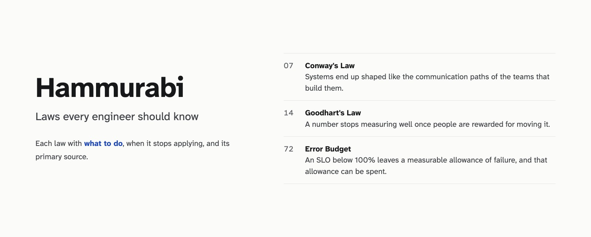
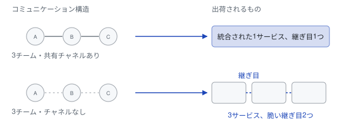
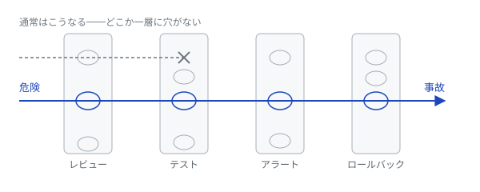
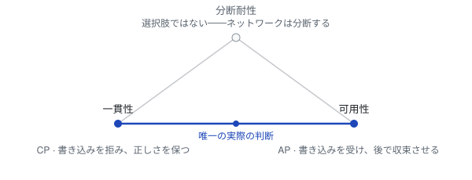
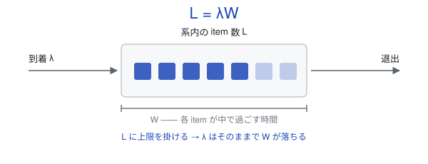
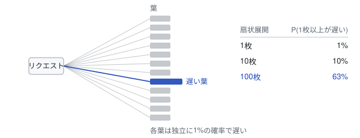
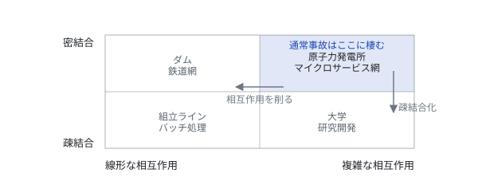

**エンジニアリングの法則と、その歯止め。** どの条にも、現場での指針と一次資料の出典を付けている。

[](https://github.com/kanywst/hammurabi/stargazers)
[](#法典)
[](https://kanywst.github.io/hammurabi/ja/)
[](../LICENSE)

[English](../README.md) • **日本語**

---

**データとして使う:** すべての法則を [JSON](https://kanywst.github.io/hammurabi/api/laws.json)、Markdown (`/ja/laws/<slug>/index.md`)、[llms.txt](https://kanywst.github.io/hammurabi/llms.txt)、[RSS](https://kanywst.github.io/hammurabi/ja/feed.xml) で公開している。どれも CC BY-SA 4.0。

## Hammurabi とは？

複雑性が増し続ける現代において、エンジニアリングの最大のボトルネックは「コード」ではなく、**「不確実な状況下での意思決定」** です。

Hammurabi は、**認知心理学**・**安全工学**・**システム設計**から選び抜いたエンジニアリング法則の法典です。人類最古の成文法典に因んで名付けました。法則が「覚えておくもの」から「引用できるもの」に変わった、その最初の瞬間に因んでいます。

法則集の多くは「解説」で終わります。しかし解説は意思決定ではありません。この法典では、各条文に次の4つが必ず付きます。

- **心得 (Stance)** — 読み終えたあとに持っておく一行。法則が何を言っているかではなく、それにどう構えるか。
- **対抗力 (Counter)** — その法則が独断に硬直するのを止める原理。ここにある法則はすべて、適用しすぎれば害を生みます。対抗力はその境界線です。フェイルファストのないポステルの法則は、破損データを黙って飲み込むシステムを生みます。心理的受容性のない最小権限は、利用者に迂回される統制を生みます。
- **現場の指針 (Guideline)** — 明日から実行できること。観察ではなく、命令形で書かれています。
- **一次資料の出典 (Source)** — その考えが実際に現れた論文・書籍・書簡・RFC。それを要約したブログ記事ではありません。全条文にリンクが付いているので、信じる前に確かめられます。

## 条文の読み方

すべての条文は、同じ6つの部分を同じ順序で持ちます。

| 部分 | 答えている問い |
| --- | --- |
| **概念** | この力は一言で言うと何か？ |
| **心得** | つまり、どう構えておけばいいのか？ |
| **メカニズム** | なぜそれが起きるのか。多くはソフトウェアではなく、人間かシステムの性質に関する事実。 |
| **対立概念** | 何がそれを独断から守るのか？ |
| **判断の指針** | 月曜日に何をすればいいのか？ |
| **出典** | それは実際どこから来たのか。どう検証するのか。 |

`§` 番号は表示用の安定したラベルで、ファイル内の順序から機械的に割り当てられます。条文の恒久的な identity は **slug** であり、ウェブサイトのパーマリンクはこれを使います。前後に条文が追加されても slug は変わりません。

## 法典

<!-- CODEX:START -->

<!-- Generated from data/laws.yaml by scripts/generate.mjs. Do not edit by hand. -->

**状況から引く**

- **見積りが毎回ずれる:** [ホフスタッターの法則 (Hofstadter's Law)](#ホフスタッターの法則-hofstadters-law) · [90対90の法則 (Ninety-Ninety Rule)](#90対90の法則-ninety-ninety-rule) · [パーキンソンの法則 (Parkinson's Law)](#パーキンソンの法則-parkinsons-law) · [ブルックスの法則 (Brooks' Law)](#ブルックスの法則-brooks-law) · [時間を固定し、スコープを変える (Fixed Time, Variable Scope)](#時間を固定しスコープを変える-fixed-time-variable-scope)
- **チームが大きくなってきた:** [ブルックスの法則 (Brooks' Law)](#ブルックスの法則-brooks-law) · [ダンバー数 (Dunbar's Number)](#ダンバー数-dunbars-number) · [リンゲルマン効果 (Ringelmann Effect)](#リンゲルマン効果-ringelmann-effect) · [コンウェイの法則 (Conway's Law)](#コンウェイの法則-conways-law) · [傍観者効果 (Bystander Effect)](#傍観者効果-bystander-effect) · [統制ではなく文脈を (Context, Not Control)](#統制ではなく文脈を-context-not-control) · [バス係数 (Bus Factor)](#バス係数-bus-factor)
- **指標が数字合わせになっている:** [グッドハートの法則 (Goodhart's Law)](#グッドハートの法則-goodharts-law) · [コブラ効果 (Cobra Effect)](#コブラ効果-cobra-effect) · [シャーキーの原理 (Shirky Principle)](#シャーキーの原理-shirky-principle)
- **決めきれない:** [タイプ 1／タイプ 2 の意思決定 (Type 1 vs Type 2 Decisions)](#タイプ-1タイプ-2-の意思決定-type-1-vs-type-2-decisions) · [反対してもコミットする (Disagree and Commit)](#反対してもコミットする-disagree-and-commit) · [パーキンソンの凡俗法則 (Law of Triviality)](#パーキンソンの凡俗法則-law-of-triviality) · [サンクコストの誤謬 (Sunk Cost Fallacy)](#サンクコストの誤謬-sunk-cost-fallacy) · [スライドではなく文章で (Narratives, Not Slides)](#スライドではなく文章で-narratives-not-slides) · [信頼度で重みづけする意思決定 (Believability-Weighted Decisions)](#信頼度で重みづけする意思決定-believability-weighted-decisions)
- **障害が起きた後:** [非難なきポストモーテム (Blameless Postmortem)](#非難なきポストモーテム-blameless-postmortem) · [スイスチーズモデル (Swiss Cheese Model)](#スイスチーズモデル-swiss-cheese-model) · [逸脱の常態化 (Normalization of Deviance)](#逸脱の常態化-normalization-of-deviance) · [通常事故理論 (Normal Accident Theory)](#通常事故理論-normal-accident-theory) · [ハンロンの剃刀 (Hanlon's Razor)](#ハンロンの剃刀-hanlons-razor) · [自動化の皮肉 (Ironies of Automation)](#自動化の皮肉-ironies-of-automation) · [なぜなぜ分析 (Five Whys)](#なぜなぜ分析-five-whys) · [善意ではなく仕組み (Mechanisms, Not Good Intentions)](#善意ではなく仕組み-mechanisms-not-good-intentions) · [殺虫剤のパラドックス (Pesticide Paradox)](#殺虫剤のパラドックス-pesticide-paradox) · [現地現物 (Genchi Genbutsu (Go and See))](#現地現物-genchi-genbutsu-go-and-see)
- **信頼性と開発速度がぶつかる:** [エラーバジェット (Error Budget)](#エラーバジェット-error-budget) · [トイル (Toil)](#トイル-toil) · [逸脱の常態化 (Normalization of Deviance)](#逸脱の常態化-normalization-of-deviance) · [マーフィーの法則 (Murphy's Law)](#マーフィーの法則-murphys-law) · [作った者が運用する (You Build It, You Run It)](#作った者が運用する-you-build-it-you-run-it) · [アンドン（ラインを止める） (Andon (Stop the Line))](#アンドンラインを止める-andon-stop-the-line) · [カオスエンジニアリング (Chaos Engineering)](#カオスエンジニアリング-chaos-engineering) · [技術的負債 (Technical Debt)](#技術的負債-technical-debt)
- **何かが遅い:** [アムダールの法則 (Amdahl's Law)](#アムダールの法則-amdahls-law) · [制約理論 (Theory of Constraints)](#制約理論-theory-of-constraints) · [早すぎる最適化 (Premature Optimization)](#早すぎる最適化-premature-optimization) · [スケールの裾野 (The Tail at Scale)](#スケールの裾野-the-tail-at-scale) · [リトルの法則 (Little's Law)](#リトルの法則-littles-law)
- **古いコードを消す・作り直す:** [チェスタトンの柵 (Chesterton's Fence)](#チェスタトンの柵-chestertons-fence) · [セカンドシステム症候群 (Second-System Effect)](#セカンドシステム症候群-second-system-effect) · [ガルの法則 (Gall's Law)](#ガルの法則-galls-law) · [ハイラムの法則 (Hyrum's Law)](#ハイラムの法則-hyrums-law) · [イーグルソンの法則 (Eagleson's Law)](#イーグルソンの法則-eaglesons-law) · [ボーイスカウトの規則 (Boy Scout Rule)](#ボーイスカウトの規則-boy-scout-rule) · [ストラングラーフィグ (Strangler Fig)](#ストラングラーフィグ-strangler-fig) · [ビヨンセ・ルール (Beyoncé Rule)](#ビヨンセルール-beyoncé-rule) · [チャーンルール (Churn Rule)](#チャーンルール-churn-rule) · [技術的負債 (Technical Debt)](#技術的負債-technical-debt) · [レーマンのソフトウェア進化の法則 (Lehman's Laws of Software Evolution)](#レーマンのソフトウェア進化の法則-lehmans-laws-of-software-evolution) · [ワン・バージョン・ルール (One-Version Rule)](#ワンバージョンルール-one-version-rule)
- **API やインタフェースを設計する:** [ハイラムの法則 (Hyrum's Law)](#ハイラムの法則-hyrums-law) · [ポステルの法則 (Postel's Law)](#ポステルの法則-postels-law) · [驚き最小の原則 (Principle of Least Astonishment)](#驚き最小の原則-principle-of-least-astonishment) · [リーキー・アブストラクション (Law of Leaky Abstractions)](#リーキーアブストラクション-law-of-leaky-abstractions) · [テスラーの複雑性保存則 (Tesler's Law)](#テスラーの複雑性保存則-teslers-law) · [ビヨンセ・ルール (Beyoncé Rule)](#ビヨンセルール-beyoncé-rule)
- **新しいものを作り始める:** [ワーキング・バックワーズ (Working Backwards)](#ワーキングバックワーズ-working-backwards) · [YAGNI (YAGNI)](#yagni-yagni) · [ガルの法則 (Gall's Law)](#ガルの法則-galls-law) · [劣っている方が勝つ (Worse is Better)](#劣っている方が勝つ-worse-is-better) · [KISS の原則 (KISS Principle)](#kiss-の原則-kiss-principle) · [XY問題 (XY Problem)](#xy問題-xy-problem)
- **技術を選ぶ:** [リンディ効果 (Lindy Effect)](#リンディ効果-lindy-effect) · [カーゴ・カルト・エンジニアリング (Cargo Cult Engineering)](#カーゴカルトエンジニアリング-cargo-cult-engineering) · [アマラの法則 (Amara's Law)](#アマラの法則-amaras-law) · [生存者バイアス (Survivorship Bias)](#生存者バイアス-survivorship-bias) · [退屈な技術を選べ (Choose Boring Technology)](#退屈な技術を選べ-choose-boring-technology)
- **分散システムを組む:** [分散コンピューティングの誤謬 (Fallacies of Distributed Computing)](#分散コンピューティングの誤謬-fallacies-of-distributed-computing) · [CAP定理 (CAP Theorem)](#cap定理-cap-theorem) · [二人の将軍問題 (Two Generals Problem)](#二人の将軍問題-two-generals-problem) · [スケールの裾野 (The Tail at Scale)](#スケールの裾野-the-tail-at-scale) · [静的安定性 (Static Stability)](#静的安定性-static-stability) · [フォールバックを避ける (Avoid Fallback)](#フォールバックを避ける-avoid-fallback) · [一定の作業量 (Constant Work)](#一定の作業量-constant-work) · [カオスエンジニアリング (Chaos Engineering)](#カオスエンジニアリング-chaos-engineering)
- **権限と秘密を設計する:** [最小権限の原則 (Principle of Least Privilege)](#最小権限の原則-principle-of-least-privilege) · [ケルクホフスの原理 (Kerckhoffs's Principle)](#ケルクホフスの原理-kerckhoffss-principle)

**コラム**

- **[チームで働く](https://kanywst.github.io/hammurabi/ja/columns/working-as-a-team/):** [ブルックスの法則 (Brooks' Law)](#ブルックスの法則-brooks-law) → [ダンバー数 (Dunbar's Number)](#ダンバー数-dunbars-number) → [リンゲルマン効果 (Ringelmann Effect)](#リンゲルマン効果-ringelmann-effect) → [傍観者効果 (Bystander Effect)](#傍観者効果-bystander-effect) → [コンウェイの法則 (Conway's Law)](#コンウェイの法則-conways-law) → [バス係数 (Bus Factor)](#バス係数-bus-factor) → [知識の呪い (Curse of Knowledge)](#知識の呪い-curse-of-knowledge) → [統制ではなく文脈を (Context, Not Control)](#統制ではなく文脈を-context-not-control) → [パーキンソンの凡俗法則 (Law of Triviality)](#パーキンソンの凡俗法則-law-of-triviality) → [スライドではなく文章で (Narratives, Not Slides)](#スライドではなく文章で-narratives-not-slides) → [反対してもコミットする (Disagree and Commit)](#反対してもコミットする-disagree-and-commit)

**すべての法則**

| § | 法則 | カテゴリ | 核心 |
| --- | --- | --- | --- |
| `01` | [タイプ 1／タイプ 2 の意思決定 (Type 1 vs Type 2 Decisions)](#タイプ-1タイプ-2-の意思決定-type-1-vs-type-2-decisions) | 意思決定 | やり直せる決定にまで、やり直せない決定と同じ慎重さを払ってしまう。 |
| `02` | [逸脱の常態化 (Normalization of Deviance)](#逸脱の常態化-normalization-of-deviance) | 安全工学 | すぐに害が出なかったルール違反は、いつの間にか当たり前になる。 |
| `03` | [チェスタトンの柵 (Chesterton's Fence)](#チェスタトンの柵-chestertons-fence) | システム | 経緯を知らないコードやルールは無駄に見え、理由も知らずに消したくなる。 |
| `04` | [正常性バイアス (Normalcy Bias)](#正常性バイアス-normalcy-bias) | 認知 | 本物の異常を前にしても、人はいつもの無害な説明に飛びつく。 |
| `05` | [パーキンソンの凡俗法則 (Law of Triviality)](#パーキンソンの凡俗法則-law-of-triviality) | 組織 | 議論は重要な部分ではなく、誰でも口を出せる簡単な部分に集中する。 |
| `06` | [ガルの法則 (Gall's Law)](#ガルの法則-galls-law) | システム | 動く複雑なシステムは、たいてい動く単純なシステムから育ったものだ。最初から設計したものが動くことはまれだ。 |
| `07` | [コンウェイの法則 (Conway's Law)](#コンウェイの法則-conways-law) | 組織 | システムの構造は、作るチーム同士の意思疎通の形に似てくる。 |
| `08` | [ハイラムの法則 (Hyrum's Law)](#ハイラムの法則-hyrums-law) | システム | 利用者が十分に多ければ、バグも含めた観測可能な挙動すべてに誰かが依存する。 |
| `09` | [ブルックスの法則 (Brooks' Law)](#ブルックスの法則-brooks-law) | 組織 | 遅れたプロジェクトに人を足すと、立ち上がりと調整にかかる手間が、増えた人の働きを上回り、かえって遅れがちだ。 |
| `10` | [XY問題 (XY Problem)](#xy問題-xy-problem) | 認知 | 人は本当の問題ではなく、自分が試している解決策について助けを求める。 |
| `11` | [ポステルの法則 (Postel's Law)](#ポステルの法則-postels-law) | 分散システム | 相手が仕様どおりに動く前提のシステムは、最初の逸脱にもろくなりがちだ。 |
| `12` | [ハンロンの剃刀 (Hanlon's Razor)](#ハンロンの剃刀-hanlons-razor) | 組織 | 疲労や文脈不足で説明がつく遅れやバグに、人は悪意を読み取ってしまう。 |
| `13` | [ホフスタッターの法則 (Hofstadter's Law)](#ホフスタッターの法則-hofstadters-law) | 見積り | 作業は見積りより長くかかる。それを織り込んで見積もっても、やはり長くかかる。 |
| `14` | [グッドハートの法則 (Goodhart's Law)](#グッドハートの法則-goodharts-law) | インセンティブ | 数字を動かすことに報酬がつくと、その数字は実態を測らなくなる。 |
| `15` | [リンディ効果 (Lindy Effect)](#リンディ効果-lindy-effect) | システム | アイデアやソフトウェアは、長く生き残ったものほどこの先も長く残る可能性が高い。 |
| `16` | [サンクコストの誤謬 (Sunk Cost Fallacy)](#サンクコストの誤謬-sunk-cost-fallacy) | 意思決定 | すでに注ぎ込んだ分が惜しくて、失敗しているプロジェクトに投資し続ける。 |
| `17` | [カーゴ・カルト・エンジニアリング (Cargo Cult Engineering)](#カーゴカルトエンジニアリング-cargo-cult-engineering) | 認知 | うまくいった理由を理解しないまま、他社のやり方の形だけを真似る。 |
| `18` | [アムダールの法則 (Amdahl's Law)](#アムダールの法則-amdahls-law) | 性能 | ボトルネックが別の場所にあれば、一部を速くしても全体はほとんど速くならない。 |
| `19` | [リーキー・アブストラクション (Law of Leaky Abstractions)](#リーキーアブストラクション-law-of-leaky-abstractions) | システム | 込み入った抽象化はいずれ、隠したはずの下の層の詳細を露出させる。 |
| `20` | [パレートの法則 (Pareto Principle)](#パレートの法則-pareto-principle) | 意思決定 | 結果の大半は少数の原因から生まれる。たとえば、バグは一部のモジュールに集中する。 |
| `21` | [生存者バイアス (Survivorship Bias)](#生存者バイアス-survivorship-bias) | 認知 | 成功例だけから結論を出すと、同じやり方で失敗した例が見えなくなる。 |
| `22` | [カーニハンの法則 (Kernighan's Law)](#カーニハンの法則-kernighans-law) | 保守性 | デバッグは書くより難しい。だから、最大限に凝って書いたコードは自分でもデバッグできない。 |
| `23` | [コブラ効果 (Cobra Effect)](#コブラ効果-cobra-effect) | インセンティブ | 問題を減らすための報酬が、問題を増やす行動に報いてしまう。 |
| `24` | [ダンバー数 (Dunbar's Number)](#ダンバー数-dunbars-number) | 組織 | 人が安定して保てる関係は150人ほどだ。エンジニアリングではそこから、文脈を共有できる規模を超えると増員分は調整に消えると類推している。 |
| `25` | [劣っている方が勝つ (Worse is Better)](#劣っている方が勝つ-worse-is-better) | システム | 作りやすく広めやすい単純な設計は、正しいが複雑な設計に勝ちやすい。 |
| `26` | [カニンガムの法則 (Cunningham's Law)](#カニンガムの法則-cunninghams-law) | 組織 | 人は質問に答えるより、間違った答えを訂正するほうに熱心だ。 |
| `27` | [傍観者効果 (Bystander Effect)](#傍観者効果-bystander-effect) | 組織 | 問題を目にする人が多いほど、一人ひとりが自分から動く可能性は下がる。 |
| `28` | [マーフィーの法則 (Murphy's Law)](#マーフィーの法則-murphys-law) | 安全工学 | 時間と負荷が十分にあれば、起こりうる故障はいずれ起きる。 |
| `29` | [ボーイスカウトの規則 (Boy Scout Rule)](#ボーイスカウトの規則-boy-scout-rule) | 保守性 | コードが劣化するのは、片付けが、めったに実施されないリファクタリングに先送りされがちだからだ。 |
| `30` | [テスラーの複雑性保存則 (Tesler's Law)](#テスラーの複雑性保存則-teslers-law) | システム | システムに本来備わる複雑さは消せない。誰か別の人に移るだけだ。 |
| `31` | [ダニング・クルーガー効果 (Dunning-Kruger Effect)](#ダニングクルーガー効果-dunning-kruger-effect) | 認知 | ある分野に疎い人ほど、自分の能力を過大評価しがちだ。 |
| `32` | [知識の呪い (Curse of Knowledge)](#知識の呪い-curse-of-knowledge) | 認知 | 一度知ってしまうと、知らなかったときの感覚を想像できなくなる。 |
| `33` | [スイスチーズモデル (Swiss Cheese Model)](#スイスチーズモデル-swiss-cheese-model) | 安全工学 | どの防御層にも穴がある。事故は複数の層の穴がそろったときに起きる。 |
| `34` | [早すぎる最適化 (Premature Optimization)](#早すぎる最適化-premature-optimization) | 性能 | 計測する前に最適化すると、ボトルネックでない箇所に工数を使ってしまう。 |
| `35` | [リーナスの法則 (Linus's Law)](#リーナスの法則-linuss-law) | 保守性 | 一人では見つからないバグも、同じコードを見る別の人にはあっさり分かることが多い。 |
| `36` | [CAP定理 (CAP Theorem)](#cap定理-cap-theorem) | 分散システム | ネットワーク分断が起きたら、データストアは一貫性か可用性のどちらかを捨てる。 |
| `37` | [リトルの法則 (Little's Law)](#リトルの法則-littles-law) | 性能 | 安定した系では、系の中にある件数の平均は、到着率と平均滞在時間の積に等しい。 |
| `38` | [二人の将軍問題 (Two Generals Problem)](#二人の将軍問題-two-generals-problem) | 分散システム | 信頼できない通信路では、二者は合意できたと確信できない。 |
| `39` | [ピーターの法則 (Peter Principle)](#ピーターの法則-peter-principle) | 組織 | 人は苦手な役職にたどり着くまで昇進し、そこにとどまりがちだ。 |
| `40` | [パーキンソンの法則 (Parkinson's Law)](#パーキンソンの法則-parkinsons-law) | 組織 | 仕事は、完了までに使える時間をすべて使い切るまで膨らむ。 |
| `41` | [ヴィルトの法則 (Wirth's Law)](#ヴィルトの法則-wirths-law) | 性能 | ソフトウェアが遅くなる速さは、ハードウェアが速くなる速さを上回る。 |
| `42` | [90対90の法則 (Ninety-Ninety Rule)](#90対90の法則-ninety-ninety-rule) | 見積り | 残り1割の作業に、最初の9割と同じくらいの時間がかかりがちだ。 |
| `43` | [イーグルソンの法則 (Eagleson's Law)](#イーグルソンの法則-eaglesons-law) | 保守性 | 半年見ていない自分のコードは、他人が書いたコードも同然だ。 |
| `44` | [ヒックの法則 (Hick's Law)](#ヒックの法則-hicks-law) | ヒューマンインタフェース | 選択肢が増えるほど、人は一つを選ぶのに時間がかかる。 |
| `45` | [フィッツの法則 (Fitts's Law)](#フィッツの法則-fittss-law) | ヒューマンインタフェース | 小さく遠いターゲットほど、押すのに時間がかかり、押し間違えも増える。 |
| `46` | [ミラーの法則 (Miller's Law)](#ミラーの法則-millers-law) | 認知 | 作業記憶に保てるのは数個のまとまりだけだ（Miller は7前後とし、後の研究はもっと少ないとする）。 |
| `47` | [分散コンピューティングの誤謬 (Fallacies of Distributed Computing)](#分散コンピューティングの誤謬-fallacies-of-distributed-computing) | 分散システム | ネットワーク越しのコードは、本番では成り立たない8つの前提を暗に置いている。 |
| `48` | [自動化の皮肉 (Ironies of Automation)](#自動化の皮肉-ironies-of-automation) | 安全工学 | 自動化は人に最も難しい例外だけを残し、その対応に要る腕は使わないうちに鈍る。 |
| `49` | [最小権限の原則 (Principle of Least Privilege)](#最小権限の原則-principle-of-least-privilege) | セキュリティ | 不要な権限を持つ部品ほど、問題が起きたときの被害範囲が広がる。 |
| `50` | [ケルクホフスの原理 (Kerckhoffs's Principle)](#ケルクホフスの原理-kerckhoffss-principle) | セキュリティ | 設計が秘密である間だけ安全なシステムは、安全ではない。 |
| `51` | [グスタフソンの法則 (Gustafson's Law)](#グスタフソンの法則-gustafsons-law) | 性能 | 問題の規模が計算機とともに大きくなるなら、並列化の効果はほぼ比例して伸びる。 |
| `52` | [スケールの裾野 (The Tail at Scale)](#スケールの裾野-the-tail-at-scale) | 分散システム | 一つのリクエストが多数のサーバに分かれると、最も遅いサーバが応答時間を決める。 |
| `53` | [アシュビーの必要多様性の法則 (Ashby's Law of Requisite Variety)](#アシュビーの必要多様性の法則-ashbys-law-of-requisite-variety) | システム | 制御側は、対象がとりうる状態と同じだけの対応を持たないと制御できない。 |
| `54` | [デメテルの法則 (Law of Demeter)](#デメテルの法則-law-of-demeter) | 保守性 | 他のオブジェクトの内部をたどるコードは、その連鎖のどこが変わっても壊れる。 |
| `55` | [ジェヴォンズのパラドックス (Jevons Paradox)](#ジェヴォンズのパラドックス-jevons-paradox) | インセンティブ | 資源を安く使えるようにすると、かえって総使用量が増えることがある。 |
| `56` | [通常事故理論 (Normal Accident Theory)](#通常事故理論-normal-accident-theory) | 安全工学 | 複雑で密に結合したシステムでは、事故は構造そのものから生じる。 |
| `57` | [割れ窓理論 (Broken Windows Theory)](#割れ窓理論-broken-windows-theory) | 安全工学 | 放置された小さな乱れは、基準は守らなくてよいという合図になり、さらに乱れを呼びやすい。 |
| `58` | [YAGNI (YAGNI)](#yagni-yagni) | 保守性 | 想像した将来のために書いたコードは、今の工数を食い、実際の要件に合うこともまれだ。 |
| `59` | [KISS の原則 (KISS Principle)](#kiss-の原則-kiss-principle) | 保守性 | システムは、普通の人が悪条件の中でも直せる程度に単純である必要がある。 |
| `60` | [DRY 原則 (DRY Principle)](#dry-原則-dry-principle) | 保守性 | 同じ知識を二か所に置くと、一緒に変わる保証がないので食い違っていく。 |
| `61` | [制約理論 (Theory of Constraints)](#制約理論-theory-of-constraints) | 性能 | システムの処理量は、最も詰まっている一か所で決まる。 |
| `62` | [オッカムの剃刀 (Occam's Razor)](#オッカムの剃刀-occams-razor) | 認知 | 検証されていない仮定が最も少ない説明が、たいてい正しい。 |
| `63` | [単一責任の原則 (Single Responsibility Principle)](#単一責任の原則-single-responsibility-principle) | 保守性 | 二つの利用者グループに使われるモジュールには、両方から食い違う変更要求が届く。 |
| `64` | [驚き最小の原則 (Principle of Least Astonishment)](#驚き最小の原則-principle-of-least-astonishment) | ヒューマンインタフェース | 利用者を驚かせる挙動は、少し劣っても予想どおりの挙動より高くつく。 |
| `65` | [セカンドシステム症候群 (Second-System Effect)](#セカンドシステム症候群-second-system-effect) | システム | 最初の成功のあと、設計者は先送りしたアイデアを二作目に詰め込みがちだ。 |
| `66` | [ムーアの法則 (Moore's Law)](#ムーアの法則-moores-law) | 性能 | 部品単価が最も安くなるチップのトランジスタ数は、約2年ごとに倍になる。 |
| `67` | [アマラの法則 (Amara's Law)](#アマラの法則-amaras-law) | 見積り | 新しい技術は、最初の数年は過大評価され、十年単位では過小評価される。 |
| `68` | [苦い教訓 (The Bitter Lesson)](#苦い教訓-the-bitter-lesson) | システム | AIでは長い目で見ると、計算量とともに伸びる汎用手法が、人が作り込んだ知識に勝ってきた。 |
| `69` | [メトカーフの法則 (Metcalfe's Law)](#メトカーフの法則-metcalfes-law) | システム | ノードが一つ増えるたびに既存の全ノードの価値が上がり、価値は規模より速く増える。 |
| `70` | [リンゲルマン効果 (Ringelmann Effect)](#リンゲルマン効果-ringelmann-effect) | 組織 | 集団が大きくなるほど、一人ひとりが出す力は減る。誰の成果か見えないと特にそうだ。 |
| `71` | [シャーキーの原理 (Shirky Principle)](#シャーキーの原理-shirky-principle) | インセンティブ | 組織は、自分たちが存在する理由である問題を残そうとする。 |
| `72` | [エラーバジェット (Error Budget)](#エラーバジェット-error-budget) | 運用 | 100% 未満の SLO は許容できる失敗の量を決める。その量は使ってよい予算だ。 |
| `73` | [トイル (Toil)](#トイル-toil) | 運用 | 手作業の繰り返し運用はサービスと一緒に増え、放っておけば開発の時間を食い尽くす。 |
| `74` | [非難なきポストモーテム (Blameless Postmortem)](#非難なきポストモーテム-blameless-postmortem) | 運用 | 障害のいちばん近くにいた人を罰すると、人は自分のしたことを隠すようになる。 |
| `75` | [ワーキング・バックワーズ (Working Backwards)](#ワーキングバックワーズ-working-backwards) | 意思決定 | 解決策から始めると、誰も必要としないものを作ることが多い。発表文から始めれば早く気づける。 |
| `76` | [反対してもコミットする (Disagree and Commit)](#反対してもコミットする-disagree-and-commit) | 意思決定 | 全員の同意を待つより、決めて実行し、誤りなら軌道修正するほうが速いことが多い。 |
| `77` | [作った者が運用する (You Build It, You Run It)](#作った者が運用する-you-build-it-you-run-it) | 運用 | サービスを作るチームが運用も担えば、運用上の弱点のコストは、それを直せる人のところに落ちる。 |
| `78` | [静的安定性 (Static Stability)](#静的安定性-static-stability) | 分散システム | 障害を乗り切るのに新しい動作が必要なシステムは、状況がいちばん悪いときにその動作が成功することに頼っている。 |
| `79` | [フォールバックを避ける (Avoid Fallback)](#フォールバックを避ける-avoid-fallback) | 分散システム | フォールバック経路は何かがすでに失敗したあとでしか動かない。だから、システムでいちばん試されていないコードが最悪の条件で動く。 |
| `80` | [一定の作業量 (Constant Work)](#一定の作業量-constant-work) | 分散システム | 変更や障害の数に応じて仕事が増えるシステムは、余力がいちばん少ないときにいちばん多くの仕事をする。 |
| `81` | [善意ではなく仕組み (Mechanisms, Not Good Intentions)](#善意ではなく仕組み-mechanisms-not-good-intentions) | 組織 | 失敗のあとで「もっと気をつけろ」と求めても、ほとんど何も変わらない。失敗した人は、もともと気をつけていたからだ。 |
| `82` | [アンドン（ラインを止める） (Andon (Stop the Line))](#アンドンラインを止める-andon-stop-the-line) | 運用 | 異常に気づいた人が誰でもラインを止められれば、欠陥は下流へ流れない。下流で見つかれば、見つけるのも直すのも高くつく。 |
| `83` | [なぜなぜ分析 (Five Whys)](#なぜなぜ分析-five-whys) | 運用 | 「なぜ失敗したか」への最初の答えはたいてい症状だ。症状だけを直しても原因は残り、また同じ失敗が起きる。 |
| `84` | [カオスエンジニアリング (Chaos Engineering)](#カオスエンジニアリング-chaos-engineering) | 運用 | 一度も試されていない耐障害性は仮説にすぎない。予定を組もうと組むまいと、本番がいずれそれを試す。 |
| `85` | [統制ではなく文脈を (Context, Not Control)](#統制ではなく文脈を-context-not-control) | 組織 | 組織が大きくなるほど、ルールと承認は共有された理解ほどにはスケールしにくい。手順を渡された人より目標の背景を渡された人のほうが現場でよい判断をする、というのが Netflix の主張だ。 |
| `86` | [コードの健全性を上げるなら承認する (Approve What Improves Code Health)](#コードの健全性を上げるなら承認する-approve-what-improves-code-health) | 保守性 | すべての変更に完璧を求めるとレビューが遅くなり、遅いレビューはコードベースを良くするどころか悪くする。 |
| `87` | [ビヨンセ・ルール (Beyoncé Rule)](#ビヨンセルール-beyoncé-rule) | 保守性 | 共有コードベースでは、どのテストも確かめていない挙動こそが予告なく変わる。 |
| `88` | [チャーンルール (Churn Rule)](#チャーンルール-churn-rule) | 組織 | 共有基盤を変えるチームが移行作業を利用者に押しつけられると、変更のコストは利用者の数だけ膨らむ。 |
| `89` | [時間を固定し、スコープを変える (Fixed Time, Variable Scope)](#時間を固定しスコープを変える-fixed-time-variable-scope) | 見積り | スコープを固定して時間を固定しないと、ずれるのは期日で、スコープは残る。時間を固定すれば、何が大事かを選ばざるを得なくなる。 |
| `90` | [ストラングラーフィグ (Strangler Fig)](#ストラングラーフィグ-strangler-fig) | 保守性 | 稼働中のシステムは、一度に置き換えるより、周縁から少しずつ置き換えるほうがたいてい安全だ。 |
| `91` | [退屈な技術を選べ (Choose Boring Technology)](#退屈な技術を選べ-choose-boring-technology) | 意思決定 | 不慣れな技術を採り入れるたびに、未知の故障モードと恒久的な運用コストが付いてくる。チームが抱えられる数は多くない。 |
| `92` | [技術的負債 (Technical Debt)](#技術的負債-technical-debt) | 保守性 | 問題を十分に理解する前に出したコードは、誰かが書き直すまで、そのコードをその後変えるたびに余計なコストを生む。 |
| `93` | [レーマンのソフトウェア進化の法則 (Lehman's Laws of Software Evolution)](#レーマンのソフトウェア進化の法則-lehmans-laws-of-software-evolution) | 保守性 | 実際に使われているプログラムは、変わり続けなければ役に立たなくなる。そして変えるたびに、手をかけて単純にしない限り複雑になっていく。 |
| `94` | [バス係数 (Bus Factor)](#バス係数-bus-factor) | 組織 | システムを動かし続けられる人が少ないほど、その将来は一人ひとりが辞めずにいることにかかってくる。 |
| `95` | [殺虫剤のパラドックス (Pesticide Paradox)](#殺虫剤のパラドックス-pesticide-paradox) | 保守性 | バグを見つける方法はどれも、その方法では見つからないバグを残す。だから変わらないテストスイートが見つけるバグは減っていく。 |
| `96` | [スライドではなく文章で (Narratives, Not Slides)](#スライドではなく文章で-narratives-not-slides) | 意思決定 | スライドと箇条書きに縮めた議論は、論点どうしのつながりを失う。文章なら露わになったはずの穴や警告が、気づかれないままレビューを通り抜ける。 |
| `97` | [ワン・バージョン・ルール (One-Version Rule)](#ワンバージョンルール-one-version-rule) | 保守性 | 共有する依存先のどのバージョンを使うかを利用者が選べると、選ぶたびに、選んでいない誰かが衝突を抱える。 |
| `98` | [現地現物 (Genchi Genbutsu (Go and See))](#現地現物-genchi-genbutsu-go-and-see) | 意思決定 | 報告をもとに下す判断は、実際に起きていることから離れていく。要約が一段挟まるたびに、その形式に収まらなかった細部が落ちるからだ。 |
| `99` | [信頼度で重みづけする意思決定 (Believability-Weighted Decisions)](#信頼度で重みづけする意思決定-believability-weighted-decisions) | 意思決定 | 集団がどの意見も同じ一票と数えたり、役職に従ったりすると、実際にそれをやったことのある人が、やったことのない人に多数決で負ける。 |
| `100` | [ブレイントラスト (権限を持たない助言) (Braintrust (Notes Without Authority))](#ブレイントラスト-権限を持たない助言-braintrust-notes-without-authority) | 組織 | オーナーを覆せる人からの意見は、活かされるより先に防御の対象になる。修正を強制できない仲間なら率直に言えるし、オーナーも落ち着いて聞ける。 |

### タイプ 1／タイプ 2 の意思決定 (Type 1 vs Type 2 Decisions)

`§ 01` · 意思決定

- **概念:** やり直せる決定にまで、やり直せない決定と同じ慎重さを払ってしまう。
- **心得:** 確信の度合いより先に、やり直せるかを問う
- **メカニズム:** Bezos の手紙は組織について論じている。会社は大きくなるにつれ、取り返しのつかない決定（タイプ1）向けの重い手順を、やり直せる決定（タイプ2）も含めたほとんどの決定に使うようになる。手紙によれば、その結果は「遅さ、考えなしのリスク回避、実験の不足、そしてその帰結としての発明の減少」だ。
- **対立概念:** **隠れた一方通行のドア** — やり直せるように見えて実はやり直せない決定は多い（公開 API、ディスクに書いたデータ形式、顧客に告知した価格）。こうした決定を速く通すと、取り消せない約束を世に出してしまう。
- **判断の指針:** 議論の予定を組む前に、その決定がどちらの種類かを見極める。1スプリント以内に、受け入れられるコストでやり直せるなら、一人か少人数が今週中に決める。完全なレビューは、永続化するデータ、公開インタフェース、セキュリティ、顧客にすでに約束したことに関わる決定に限る。
- **出典:** Jeff Bezos『2015 年 株主への手紙』(Amazon.com, Inc., 2016 年 4 月提出)。"Type 1 / Type 2 decisions" という枠組みの出典。1997 年の手紙は「Day 1」の手紙で、この枠組みは含まれていない。 — [原典 ↗](https://www.sec.gov/Archives/edgar/data/1018724/000119312516530910/d168744dex991.htm)
- **関連:** [サンクコストの誤謬 (Sunk Cost Fallacy)](#サンクコストの誤謬-sunk-cost-fallacy) · [パーキンソンの法則 (Parkinson's Law)](#パーキンソンの法則-parkinsons-law) · [反対してもコミットする (Disagree and Commit)](#反対してもコミットする-disagree-and-commit) · [スライドではなく文章で (Narratives, Not Slides)](#スライドではなく文章で-narratives-not-slides)

### 逸脱の常態化 (Normalization of Deviance)

`§ 02` · 安全工学

- **概念:** すぐに害が出なかったルール違反は、いつの間にか当たり前になる。
- **心得:** 何も起きなかった例外は、安全の証明ではない
- **メカニズム:** Vaughan が NASA で見つけたのは、ルールを破る悪人ではなかった。O リングの侵食が見つかってもシャトルが無事に戻るたびに、技術者はそれを記録し、許容範囲内と判断し、次の飛行で許容する範囲を広げた。どの段階にも理由があり、承認も通っていた。逸脱は組織の通常の手続きを経て標準になったので、誰もリスクを取っているとは感じなかった。
- **対立概念:** **エラーバジェット** — 逸脱がすべて前兆とは限らない。一つ残らず調べるチームは出荷が止まり、やがて調査そのものを無視し始める。許容量を合意しておけば、本物の警報が埋もれない。
- **判断の指針:** チェックが失敗したまま出荷するなら、誰がなぜ決めたか、いつ見直すかを書き残す。ポストモーテムでは、過去のどの例外のせいで今回が当たり前に見えたのかを問う。
- **実例:** 2003年のスペースシャトル・コロンビア喪失を調べた事故調査委員会は、断熱材の剥落がそれ以前の多くの飛行で起きており、目視で確認できた飛行の10%では左バイポッド部の断熱材が剥がれていたと指摘した。NASA はこれを普通のことと見なすようになっていた。2002年10月の STS-112 で大きな断熱材片が固体ロケットブースターに当たったときも、経営陣は飛行中異常に指定せず、格下げした「対応事項」として扱った。 [記録 ↗](https://govinfo.library.unt.edu/caib/news/report/pdf/vol1/chapters/chapter8.pdf)
- **出典:** Diane Vaughan『The Challenger Launch Decision: Risky Technology, Culture, and Deviance at NASA』(University of Chicago Press, 1996、増補版 2016、本項のリンク先)。チャレンジャー号の O リングをめぐる判断の分析から生まれたこの用語の出典。 — [原典 ↗](https://www.press.uchicago.edu/ucp/books/book/chicago/C/bo22781921.html)
- **関連:** [スイスチーズモデル (Swiss Cheese Model)](#スイスチーズモデル-swiss-cheese-model) · [通常事故理論 (Normal Accident Theory)](#通常事故理論-normal-accident-theory) · [ボーイスカウトの規則 (Boy Scout Rule)](#ボーイスカウトの規則-boy-scout-rule) · [正常性バイアス (Normalcy Bias)](#正常性バイアス-normalcy-bias) · [割れ窓理論 (Broken Windows Theory)](#割れ窓理論-broken-windows-theory) · [非難なきポストモーテム (Blameless Postmortem)](#非難なきポストモーテム-blameless-postmortem) · [エラーバジェット (Error Budget)](#エラーバジェット-error-budget) · [アンドン（ラインを止める） (Andon (Stop the Line))](#アンドンラインを止める-andon-stop-the-line)

### チェスタトンの柵 (Chesterton's Fence)

`§ 03` · システム

- **概念:** 経緯を知らないコードやルールは無駄に見え、理由も知らずに消したくなる。
- **心得:** 理由を知ってから消す。ただし探すのは期限つきで
- **メカニズム:** ルールやコードの分岐に残っているのは問題への答えで、問題そのものは残っていない。それが防いでいる障害も、誰のために書かれたかも、誰が足したかも、ファイルにはまず書かれていないので、答えは雑音に見える。消すのは安く、一瞬で済む。そのコストは、元の問題が戻ってきたときに、たいてい別の誰かに回ってくる。
- **対立概念:** **期限付きの経緯調査** — この規則を絶対視すると何ひとつ消せなくなる。理由を知っていた人がいなくなり、理由ごと失われていることもあるからだ。
- **判断の指針:** その「柵」（コードやルール）がなぜ立てられたのかを説明できるまで、取り除かない。ただし調べる期限は決めておく。期限が来たら、ロールバックを用意してフラグの裏で外し、どこから苦情が出るかを見る。
- **実例:** 2006年、Debian のメンテナが OpenSSL の乱数生成器から1行を削除した。Valgrind が未初期化メモリの読み取りとして警告していたからで、本人は「乱数生成器に実際どう影響するのか見当がつかない」と書いていた。その行こそが呼び出し側のデータをエントロピープールに加える処理で、削除後に予測不能な入力として残ったのはプロセス ID だけだった。2008年5月に欠陥が公表されるまで、Debian 系の ssh-keygen は鍵の種類と長さごとに約32,767通りの鍵しか作れなかった。 [記録 ↗](https://research.swtch.com/openssl)
- **出典:** G. K. Chesterton『The Thing』(1929)。道に立つ柵の寓話の出典。 — [原典 ↗](https://www.chesterton.org/taking-a-fence-down/)
- **関連:** [イーグルソンの法則 (Eagleson's Law)](#イーグルソンの法則-eaglesons-law) · [YAGNI (YAGNI)](#yagni-yagni)

### 正常性バイアス (Normalcy Bias)

`§ 04` · 認知

- **概念:** 本物の異常を前にしても、人はいつもの無害な説明に飛びつく。
- **心得:** 打ち消す前に、本物だったら何が起きるかを考える
- **メカニズム:** たいていの異常は本当にいつものことなので、いつもの説明はたいてい当たる。だから人はその説明に飛びつく癖がつく。本物の緊急事態では、この癖が対応を遅らせる。人は確証を探し、周りに確かめ、やりかけの作業を片付けてから動く。障害対応では、データベースの破損が進んでいる最中に「たぶん一時的なネットワークの瞬断だろう」という声が上がる。
- **対立概念:** **アラーム疲れ** — 異常のたびに崩壊の始まりとして扱えばオンコールが燃え尽き、何でもエスカレーションする人はやがて相手にされなくなる。たいていの異常は本当にいつものことだ。
- **判断の指針:** 異常が起きたら、「これがシステム全体の崩壊の始まりだとしたら、この先10分で何が起きるか」を考える。その答えが怖いなら、すぐに調査する。
- **出典:** 特定の提唱者はいない。避難が遅れる理由を調べた災害研究から生まれた言葉である。Amanda Ripley『The Unthinkable: Who Survives When Disaster Strikes — and Why』(Crown, 2008) が本項の拠り所で、世界貿易センターでの避難の遅れも扱う。広瀬弘忠『人はなぜ逃げおくれるのか ―災害の心理学』(集英社新書, 2004) も同じ現象を扱う。 — [原典 ↗](https://en.wikipedia.org/wiki/Normalcy_bias)
- **関連:** [マーフィーの法則 (Murphy's Law)](#マーフィーの法則-murphys-law) · [逸脱の常態化 (Normalization of Deviance)](#逸脱の常態化-normalization-of-deviance) · [オッカムの剃刀 (Occam's Razor)](#オッカムの剃刀-occams-razor)

### パーキンソンの凡俗法則 (Law of Triviality)

`§ 05` · 組織

- **概念:** 議論は重要な部分ではなく、誰でも口を出せる簡単な部分に集中する。
- **心得:** 議論は、意見の多いところでなくリスクの大きいところに使う
- **メカニズム:** Parkinson の委員会は原子炉の計画を数分で承認し、自転車置き場には45分かける。自転車置き場なら誰でも思い描けるが、原子炉を判断できる人は少ないからだ。分かることに口を出すと役に立った気になれるし、議論のコストは議題によらず変わらない。そのため注意は、最も重要な議題ではなく、最も口を出しやすい議題に流れる。
- **対立概念:** **名前はインタフェースである** — 議論しやすい小さなことが、後から変えられないこともある。公開 API の名前や設定キーは、議論するのは安いが、リリース後に変えるのは高くつく。
- **判断の指針:** ツールで決められること（整形、import の順序、lint ルール）は人のレビューから外す。レビューのやり取りがスタイルの話ばかりになったら打ち切り、変更のうち最もリスクの高い部分について一つ質問する。会議では、金額やリスクの最も大きい議題を最初に置く。
- **実例:** 1999年10月2日、FreeBSD 開発者の Poul-Henning Kamp は、sleep(1)に小数の秒数を渡せるようにするかで延々と続いた議論のあと、プロジェクトのメーリングリストに投稿した。彼はこのスレッドを「FreeBSD でこれまでにあった中で最もあからさまな自転車置き場の議論」と呼び、誰でもわかる小さな変更ほど議論が尽きず、複雑な変更はほとんど意見が出ないまま通ると書いた。 [記録 ↗](https://phk.freebsd.dk/sagas/bikeshed/)
- **出典:** C. Northcote Parkinson『Parkinson's Law and Other Studies in Administration』(Houghton Mifflin, 1957) 所収「High Finance, or the Point of Vanishing Interest」。自転車置き場の委員会の寓話の出典。英国版は『Parkinson's Law: The Pursuit of Progress』(John Murray, 1958)。 — [原典 ↗](https://en.wikipedia.org/wiki/Law_of_triviality)
- **関連:** [パーキンソンの法則 (Parkinson's Law)](#パーキンソンの法則-parkinsons-law) · [反対してもコミットする (Disagree and Commit)](#反対してもコミットする-disagree-and-commit) · [コードの健全性を上げるなら承認する (Approve What Improves Code Health)](#コードの健全性を上げるなら承認する-approve-what-improves-code-health) · [信頼度で重みづけする意思決定 (Believability-Weighted Decisions)](#信頼度で重みづけする意思決定-believability-weighted-decisions)

### ガルの法則 (Gall's Law)

`§ 06` · システム

- **概念:** 動く複雑なシステムは、たいてい動く単純なシステムから育ったものだ。最初から設計したものが動くことはまれだ。
- **心得:** 一度に全部動かないと動かない設計を疑う
- **メカニズム:** ゼロから書いた設計は、部品同士のあらゆる相互作用を前もって見込んでおく必要がある。だが複雑なシステムでは、相互作用のほとんどは動かしてみて初めて分かる。うまく動く単純なシステムは、使われるなかで相互作用がすでに試されており、そこに何かを足すのは分かっているものへの小さな変更で済む。丸ごと設計したシステムは、投資を済ませた後で、すべての相互作用を一度に見つけることになる。
- **対立概念:** **おもちゃから育てられないシステムもある** — 決済の元帳、安全インターロック、独立した実装が多いプロトコルは、最初の版から正しくなければならない。こうしたものを本番で育てると、誤った版を本物のお金や人に対して動かすことになる。
- **判断の指針:** 本物の仕事を端から端まで一つこなせる最小の版を出し、動く状態を保ったまま段階的に育てる。書き直しが提案されたら、どの動いているシステムから育てるのかを問う。
- **実例:** 2005年3月、FBI は Virtual Case File を打ち切った。紙中心の事件管理を一つのシステムで置き換えようとした3年がかり、1億7000万ドルの計画で、ある支局での試験運用でもうまくいかないことが確かめられていた。司法省監察総監の報告によれば、後継の Sentinel はそれぞれ別の機能を提供する4つの段階に分けて、まず Web ポータルから順に作る方針に変わった。 [記録 ↗](https://oig.justice.gov/sites/default/files/legacy/reports/FBI/a0614/final.pdf)
- **出典:** John Gall『General Systemantics: An Essay on How Systems Work, and Especially How They Fail』(General Systemantics Press, 1975)。『Systemantics: How Systems Work and Especially How They Fail』(Quadrangle, 1977) として再刊。「うまく動く複雑なシステムは、例外なく、うまく動く単純なシステムから進化したものである」の出典。 — [原典 ↗](https://en.wikipedia.org/wiki/John_Gall_(author))
- **関連:** [劣っている方が勝つ (Worse is Better)](#劣っている方が勝つ-worse-is-better) · [YAGNI (YAGNI)](#yagni-yagni) · [セカンドシステム症候群 (Second-System Effect)](#セカンドシステム症候群-second-system-effect) · [ストラングラーフィグ (Strangler Fig)](#ストラングラーフィグ-strangler-fig)

### コンウェイの法則 (Conway's Law)

`§ 07` · 組織

- **概念:** システムの構造は、作るチーム同士の意思疎通の形に似てくる。
- **心得:** アーキテクチャを変えたいなら、先にチームを変える
- **メカニズム:** システムのインタフェースは、どれもその両側にいる人たちの合意で決まる。毎日話す相手となら、インタフェースは細かくでき、頻繁に変えられる。めったに話さない相手となら、粗く、形式張った、変えにくいものになる。だから作りやすい境界は意思疎通の経路に沿った境界で、誰かが意図したかどうかに関係なく、設計はそこに落ち着く。
- **対立概念:** **まずモノリス** — チームごとにサービスを持たせると、分散システムのコストまで抱え込む。組織図がどうであれ、一つのチームが一つのデプロイ単位を持つべき場合もある。
- **判断の指針:** モジュール化されたアーキテクチャが欲しいなら、先にチームを独立したモジュールとして編成する。組織構造にコードで逆らわない。
- **実例:** 2008年、ハーバード・ビジネス・スクールの Alan MacCormack、John Rusnak、Carliss Baldwin は、同じ役割を果たすソフトウェアを対にして比べた。一方は結びつきの強い商用企業が、もう一方は結びつきの緩いオープンソースのコミュニティが作ったものだ。どの対でもオープンソース側のほうがはっきりモジュール化されており、ある部品への変更が他へ波及する度合いは商用側で最大8倍あった。著者らはこれを、製品の構造が作り手の組織構造を映すことと整合する証拠とした。 [記録 ↗](https://ideas.repec.org/p/hbs/wpaper/08-039.html)
- **出典:** Melvin E. Conway『How Do Committees Invent?』(Datamation, 1968 年 4 月号)。 — [原典 ↗](https://www.melconway.com/Home/Committees_Paper.html)
- **関連:** [ダンバー数 (Dunbar's Number)](#ダンバー数-dunbars-number) · [ブルックスの法則 (Brooks' Law)](#ブルックスの法則-brooks-law) · [単一責任の原則 (Single Responsibility Principle)](#単一責任の原則-single-responsibility-principle) · [作った者が運用する (You Build It, You Run It)](#作った者が運用する-you-build-it-you-run-it) · [統制ではなく文脈を (Context, Not Control)](#統制ではなく文脈を-context-not-control)

<picture>
  <source media="(prefers-color-scheme: dark)" srcset="../assets/diagrams/conways-law-ja-dark.svg">
  
</picture>

アーキテクチャはコミュニケーション構造の下流にある。紙の上の組織図ではなく、実際に誰が誰と話しているかのほうだ。チームを引き直せば継ぎ目もついてくる。図だけを引き直せば、古い継ぎ目が生えてくる。

### ハイラムの法則 (Hyrum's Law)

`§ 08` · システム

- **概念:** 利用者が十分に多ければ、バグも含めた観測可能な挙動すべてに誰かが依存する。
- **心得:** 見えているものは、すべて約束したものとみなす
- **メカニズム:** 契約に書かれているのは約束したことで、利用者が見ているのは実際に起きていることだ。応答の順序、タイミング、エラーメッセージの文面、丸め方の細部は、どれも外から観測できる。利用者が十分に多ければ、そのどれかに依存する人が出てくる。たいていは、それが約束されていなかったことを知らないままだ。コストを負うのは保守する側で、「安全な」はずの内部変更で顧客側が動かなくなって初めて依存に気づく。
- **対立概念:** **意図的なゆらぎ** — 観測できる挙動をすべて不可侵にすると、何も変えられなくなる。約束していない部分は、反復順序のランダム化や計画的な停止のように意図的に揺らしておく。そうすれば依存はそもそも生まれない。
- **判断の指針:** 利用者がいる以上、「内部実装」というものはない。約束した部分はバージョニングと機能フラグで守り、約束していない部分は意図的に揺らして、そもそも依存されないようにする。
- **実例:** 2010年、Fedora 14開発版の glibc に、一部の Intel CPU 向けに後ろからコピーする高速な memcpy が入ると、Adobe の64ビット版 Flash プラグインの音声がノイズになった。Flash は重なり合うバッファに memcpy を使っていた。C 標準では未定義の動作だが、以前の前からコピーする実装ではたまたま動いていた。バグ報告では、glibc が古い挙動を守るべきかで意見が割れ、Linus Torvalds は memcpy を memmove と同じように動かせばよいと主張した。 [記録 ↗](https://bugzilla.redhat.com/show_bug.cgi?id=638477)
- **出典:** Hyrum Wright『hyrumslaw.com』。『Software Engineering at Google』(Winters, Manshreck, Wright, 2020) で正式化された。 — [原典 ↗](https://www.hyrumslaw.com/)
- **関連:** [ポステルの法則 (Postel's Law)](#ポステルの法則-postels-law) · [驚き最小の原則 (Principle of Least Astonishment)](#驚き最小の原則-principle-of-least-astonishment) · [ビヨンセ・ルール (Beyoncé Rule)](#ビヨンセルール-beyoncé-rule) · [チャーンルール (Churn Rule)](#チャーンルール-churn-rule) · [ワン・バージョン・ルール (One-Version Rule)](#ワンバージョンルール-one-version-rule)

### ブルックスの法則 (Brooks' Law)

`§ 09` · 組織

- **概念:** 遅れたプロジェクトに人を足すと、立ち上がりと調整にかかる手間が、増えた人の働きを上回り、かえって遅れがちだ。
- **心得:** 遅れたら、人を足す前に範囲か期限を動かす
- **メカニズム:** 遅れているプロジェクトに人を足すと、意思疎通のコストは人数のほぼ二乗で増える（n人ならn(n-1)/2本の経路）。新しく入った人は、しばらくの間、自分がこなす仕事より多くの時間をベテランから奪う。
- **対立概念:** **分割できる仕事** — Brooks 自身、この法則を「とんでもなく単純化すれば」と断って述べている。早い段階で、ほとんど意思疎通なしにきれいに分けられる仕事に人を足せば、速くなる。
- **判断の指針:** プロジェクトが遅れたら、まずスコープを削るか期限を動かす。人を足すのは、きれいに分けられて、ベテランの日々の手助けなしに始められる仕事に限る。それも最後の月ではなく、早いうちに足す。
- **出典:** Fred Brooks『人月の神話 (The Mythical Man-Month)』(Addison-Wesley, 1975、20 周年記念版 1995) 第 2 章。この法則が述べられた箇所の出典。 — [原典 ↗](https://en.wikipedia.org/wiki/Brooks%27s_law)
- **関連:** [コンウェイの法則 (Conway's Law)](#コンウェイの法則-conways-law) · [ダンバー数 (Dunbar's Number)](#ダンバー数-dunbars-number) · [セカンドシステム症候群 (Second-System Effect)](#セカンドシステム症候群-second-system-effect) · [メトカーフの法則 (Metcalfe's Law)](#メトカーフの法則-metcalfes-law)

### XY問題 (XY Problem)

`§ 10` · 認知

- **概念:** 人は本当の問題ではなく、自分が試している解決策について助けを求める。
- **心得:** 質問された手段より、その先の目的を見る
- **メカニズム:** いったん手段を選ぶと、頭の中ではその手段が問題そのものになる。そのため目的ではなく、つまずいた一歩について質問する。助ける側には Y しか見えないので Y に答える。こうして、X の段階で別のやり方を選べば消えていた問題に、双方が1時間を費やすことになる。
- **対立概念:** **聞かれたことに答える** — 質問者が X をすでに検討したうえで、こちらに説明する義理のない理由で Y を必要としていることもある。毎回問いただすのは相手を見下す態度で、分かっている人の足を引っ張る。
- **判断の指針:** 「Y はどうやるのか」と聞かれたら、手早く答えられるなら Y に答える。そのうえで、何を達成したいのかを一度だけ聞く。
- **出典:** Perl IRC やシステム管理者コミュニティ発の口承。標準的な解説は『xyproblem.info』。 — [原典 ↗](https://xyproblem.info/)
- **関連:** [知識の呪い (Curse of Knowledge)](#知識の呪い-curse-of-knowledge) · [ワーキング・バックワーズ (Working Backwards)](#ワーキングバックワーズ-working-backwards) · [なぜなぜ分析 (Five Whys)](#なぜなぜ分析-five-whys)

### ポステルの法則 (Postel's Law)

`§ 11` · 分散システム

- **概念:** 相手が仕様どおりに動く前提のシステムは、最初の逸脱にもろくなりがちだ。
- **心得:** 送るものは厳密に、受け入れる逸脱は明示して
- **メカニズム:** 仕様は不完全で、実装は別々の人が別々の時期に書く。少しでも外れた入力を拒む受信側は、仕様を違うふうに読んだ最初の相手に対して動かなくなる。仕様に厳密に沿った部分だけを送る送信側は、受信側が解釈で食い違う余地をいちばん小さくする。Postel のこの非対称な原則は、仕様が固まる前の初期インターネットで、実装同士の相互運用を助けた。
- **対立概念:** **堅牢なプロトコルの維持（RFC 9413）** — 不正な入力を許すと、壊れた送信側がそのまま出荷される。受信側はみな同じ寛容さを真似るしかなくなり、事実上のプロトコルが仕様から離れていく。IAB は現在、寛容さが恒久化しないよう仕様を保守し続けることを設計者に求めており、不正な入力を無視するのはほぼ常に誤った対処だとしている。
- **判断の指針:** 送るものは仕様どおりにする。受け取る側の小さな逸脱は、文書化してログに残すときに限って境界で受け入れ、受け入れをやめる期日を決めておく。
- **実例:** 堅牢性原則を見直すために2023年に Martin Thomson と David Schinazi が書いた RFC 9413は、広く使われていた一部の TLS サーバーが、空の拡張で終わる ClientHello を受け取ると接続を切っていた例を挙げている。TLS では拡張をどの順序で並べてもよいことになっている。仕様どおりに動くクライアントはこうしたサーバーとつながらず、その並び順を避けて回避するしかなかった。 [記録 ↗](https://www.rfc-editor.org/rfc/rfc9413.html)
- **出典:** Jon Postel『RFC 761』(DoD Standard TCP, 1980 年 1 月) §2.10。"be conservative in what you do, be liberal in what you accept from others" の出典。同じ趣旨は『RFC 760』(IP) §3.2 に別の言い回しで、『RFC 793』(1981) に同文で再掲される。 — [原典 ↗](https://www.rfc-editor.org/rfc/rfc761)
- **関連:** [ハイラムの法則 (Hyrum's Law)](#ハイラムの法則-hyrums-law) · [分散コンピューティングの誤謬 (Fallacies of Distributed Computing)](#分散コンピューティングの誤謬-fallacies-of-distributed-computing)

### ハンロンの剃刀 (Hanlon's Razor)

`§ 12` · 組織

- **概念:** 疲労や文脈不足で説明がつく遅れやバグに、人は悪意を読み取ってしまう。
- **心得:** 悪意を疑う前に、相手に何が見えていなかったかを探す
- **メカニズム:** チームの中では、自分の仕事に影響する人たちの事情はほとんど見えない。見えるのは壊れたビルドで、午前4時に彼らを起こした呼び出しや、彼らが知らされていなかった要件は見えない。見えない部分は意図で補われ、いちばん思い浮かびやすい意図が悪意だ。悪意を前提に動くと、直せたはずの文脈の欠落が、人と人との対立に変わる。
- **対立概念:** **侵害を前提にする** — 悪意による失敗もあり、攻撃者は正直なミスに見えることを当てにしている。xz utils のバックドア（2024年）は、親切で辛抱強い貢献者が持ち込んだものだった。
- **判断の指針:** 失敗を意図のせいにする前に、その人がその時点で何を見られたかを確かめ、欠けていたものを補う。意図を問題にするのは証拠があるときだけにし、その場合も一対一で話す。
- **実例:** 2025年11月18日に Cloudflare のネットワークが障害を起こしたとき、チームは当初、超大規模な DDoS 攻撃を疑った。別の場所で運用していたステータスページが偶然同時に落ちたことで、その疑いは強まった。実際の原因はデータベースの権限変更で、クエリが重複行を返すようになり、Bot Management の特徴量ファイルが倍の大きさになってルーティングソフトウェアのサイズ上限を超えた。Cloudflare の事後報告は、攻撃や悪意ある行為によるものではなかったと明記している。 [記録 ↗](https://blog.cloudflare.com/18-november-2025-outage/)
- **出典:** Robert J. Hanlon が『Murphy's Law Book Two』(Arthur Bloch 編, 1980) に寄稿した格言。 — [原典 ↗](https://en.wikipedia.org/wiki/Hanlon%27s_razor)
- **関連:** [傍観者効果 (Bystander Effect)](#傍観者効果-bystander-effect) · [オッカムの剃刀 (Occam's Razor)](#オッカムの剃刀-occams-razor) · [非難なきポストモーテム (Blameless Postmortem)](#非難なきポストモーテム-blameless-postmortem)

### ホフスタッターの法則 (Hofstadter's Law)

`§ 13` · 見積り

- **概念:** 作業は見積りより長くかかる。それを織り込んで見積もっても、やはり長くかかる。
- **心得:** 見積りは、いまの見た目より過去の実績を信じる
- **メカニズム:** 「ホフスタッターの法則を考慮に入れても、いつも予想より長くかかる」。見積りは思い描ける手順から組み立てるので、思い描けない手順（統合時の想定外、手戻り、他人待ち）がそっくり抜け落ちる。見積もる本人がそれを補正しようとしても、同じ理由でうまくいかない。補正できるのは、すでに想像できる想定外だけだからだ。
- **対立概念:** **パーキンソンの法則** — 見積りに余裕を足しても、その余裕は貯金されない。仕事のほうが膨らんで埋めるので、余裕のある見積りもきつい見積りと同じくらい遅れる。
- **判断の指針:** 見積りは、今どう見えるかではなく、似た過去の作業に実際にかかった時間から出す。期限が危うくなったときに削るスコープは最初に書いておく。終盤だけでなく、マイルストーンを終えるたびに見積り直す。
- **実例:** 2011年に NASA がジェイムズ・ウェッブ宇宙望遠鏡の計画を立て直したとき、打ち上げを2018年10月とし、予算の裏づけのある13か月のスケジュール予備を組み込んだ。予備はのちに14か月に増えた。それでも2018年初めの GAO 報告によれば、振動試験での異常などの技術的問題で予備を使い切り、打ち上げは少なくとも5か月遅い時期にずれ込み、さらに遅れる見込みだった。 [記録 ↗](https://www.gao.gov/assets/gao-18-273.pdf)
- **出典:** Douglas Hofstadter『ゲーデル、エッシャー、バッハ — あるいは不思議の環 (Gödel, Escher, Bach)』(Basic Books, 1979)。この法則が述べられた箇所の出典。 — [原典 ↗](https://en.wikipedia.org/wiki/Hofstadter%27s_law)
- **関連:** [90対90の法則 (Ninety-Ninety Rule)](#90対90の法則-ninety-ninety-rule) · [パーキンソンの法則 (Parkinson's Law)](#パーキンソンの法則-parkinsons-law) · [時間を固定し、スコープを変える (Fixed Time, Variable Scope)](#時間を固定しスコープを変える-fixed-time-variable-scope)

### グッドハートの法則 (Goodhart's Law)

`§ 14` · インセンティブ

- **概念:** 数字を動かすことに報酬がつくと、その数字は実態を測らなくなる。
- **心得:** 数字ではなく、数字が表しているはずの結果を見る
- **メカニズム:** Marilyn Strathern の言い方では「ある指標が目標になると、それは良い指標ではなくなる」。数字が役に立つのは、気にしている実態と一緒に動くからだ。数字に報酬がつくと、人は実態を変えずに数字だけを動かす安上がりな方法を見つける。「コミット数」で評価すれば、意味のない小さなコミットが量産される。
- **対立概念:** **バランスト・スコアカード** — それでも数字なしでは舵を取れない。まとめて操作するのが難しい複数の指標を、仕事そのものと並べて読めば、測るのをやめるよりも長く信号を保てる。
- **判断の指針:** 単一の指標で成果を評価しない。代わりの指標ではなく、システムが実際に出しているものを見る。
- **実例:** 2016年9月、米消費者金融保護局(CFPB)は Wells Fargo に1億ドルの制裁金を科した。銀行自身の分析で、顧客が承認していない可能性のある預金口座とクレジットカード口座が200万件以上、従業員によって開設されていたことがわかったからだ。CFPB はこの行為が販売目標と報酬のインセンティブに後押しされたもので、従業員は販売目標を達成すると報酬を得ていたとした。 [記録 ↗](https://www.consumerfinance.gov/about-us/newsroom/consumer-financial-protection-bureau-fines-wells-fargo-100-million-widespread-illegal-practice-secretly-opening-unauthorized-accounts/)
- **出典:** Charles Goodhart『Problems of Monetary Management: The U.K. Experience』(Papers in Monetary Economics, Reserve Bank of Australia, 1975)。元の法則の出典。よく引用される「指標が目標になると」の言い回しは Marilyn Strathern『'Improving ratings': audit in the British University system』(European Review, 1997) による。 — [原典 ↗](https://en.wikipedia.org/wiki/Goodhart%27s_law)
- **関連:** [コブラ効果 (Cobra Effect)](#コブラ効果-cobra-effect) · [シャーキーの原理 (Shirky Principle)](#シャーキーの原理-shirky-principle) · [エラーバジェット (Error Budget)](#エラーバジェット-error-budget) · [善意ではなく仕組み (Mechanisms, Not Good Intentions)](#善意ではなく仕組み-mechanisms-not-good-intentions) · [現地現物 (Genchi Genbutsu (Go and See))](#現地現物-genchi-genbutsu-go-and-see)

### リンディ効果 (Lindy Effect)

`§ 15` · システム

- **概念:** アイデアやソフトウェアは、長く生き残ったものほどこの先も長く残る可能性が高い。
- **心得:** 長く使うものは、すでに長く生き残ったものから選ぶ
- **メカニズム:** 摩耗しないものにとって、生き延びた1年1年は、ほかの選択肢を消してきた試練をくぐり抜けた証拠になる。試練とは、ハードウェアの変化、流行、保守者の交代、規模の変化だ。20年続いたソフトウェアは、バグが見つかり、エッジケースが文書化され、運用者も育っている。新しい道具はまだ試されていないので、どれほど良く見えても、この先残る見込みは短い。
- **対立概念:** **土台は変わる** — 年数が示すのは、過去の条件で生き延びたことだ。ハードウェアや規模、脅威モデルが変われば、長く使われてきた選択肢こそが、もうない世界に合わせて最適化されていることもある。
- **判断の指針:** 10年安定して動くシステムが必要なら、すでに10年使われてきた技術を選ぶ（例: 新しい NoSQL より PostgreSQL）。
- **出典:** Albert Goldman が命名 (New Republic, 1964)。Benoit Mandelbrot が形式化し、Nassim Taleb『Antifragile』(2012) で広まった。 — [原典 ↗](https://en.wikipedia.org/wiki/Lindy_effect)
- **関連:** [劣っている方が勝つ (Worse is Better)](#劣っている方が勝つ-worse-is-better) · [アマラの法則 (Amara's Law)](#アマラの法則-amaras-law) · [退屈な技術を選べ (Choose Boring Technology)](#退屈な技術を選べ-choose-boring-technology)

### サンクコストの誤謬 (Sunk Cost Fallacy)

`§ 16` · 意思決定

- **概念:** すでに注ぎ込んだ分が惜しくて、失敗しているプロジェクトに投資し続ける。
- **心得:** 使ったコストではなく、この先の見込みで決める
- **メカニズム:** プロジェクトを止めると、使ったお金は「投資」から「損失」に変わり、誰かがその損失を公に認めなければならない。続ければ認めるのを先送りでき、自分が正しかったと証明される望みも残る。Arkes と Blumer は、自分のお金で劇場のチケットを買う人にもこの効果を見つけた。定価で買った人は、割引で買った人よりも多く劇場に足を運んだ。
- **対立概念:** **J カーブ** — 価値あるプロジェクトの多くは、途中でいちばん悪く見える。最初の谷で何でも打ち切るチームは、何も完成させられない。過去の投資は判断材料にならないが、完成までに残るコストは小さいかもしれない。
- **判断の指針:** 「今日、何も投資していない状態から始めるとしたら、この道を選ぶか」と問う。選ばないなら、やめる。
- **出典:** Hal R. Arkes & Catherine Blumer『The Psychology of Sunk Cost』(Organizational Behavior and Human Decision Processes, 1985)。 — [原典 ↗](https://doi.org/10.1016/0749-5978(85)90049-4)
- **関連:** [タイプ 1／タイプ 2 の意思決定 (Type 1 vs Type 2 Decisions)](#タイプ-1タイプ-2-の意思決定-type-1-vs-type-2-decisions) · [時間を固定し、スコープを変える (Fixed Time, Variable Scope)](#時間を固定しスコープを変える-fixed-time-variable-scope)

### カーゴ・カルト・エンジニアリング (Cargo Cult Engineering)

`§ 17` · 認知

- **概念:** うまくいった理由を理解しないまま、他社のやり方の形だけを真似る。
- **心得:** その手法が解いた問題を抱えているときだけ真似る
- **メカニズム:** やり方は目に見えるが、それをうまくいかせた条件は見えない。他社のプロセスや道具、チームの組み方は「何をしているか」の説明として公開され、元が取れた理由である規模や人、抱えていた問題は書かれない。だから真似しても再現されるのは形だけで、条件は再現されない。Feynman が描いた島の人々は、滑走路と管制官の小屋と木製のヘッドフォンを作ったが、飛行機は降りてこなかった。
- **対立概念:** **実績あるやり方** — すべてを第一原理から導くと、他人が苦労して得た教訓を捨てることになる。うまくいくと広く知られたやり方を真似るほうが、作り直すよりたいてい安い。
- **判断の指針:** Google が使っているという理由で道具やプロセスを導入しない。導入するのは、Google があの規模で抱えていたのと同じ問題を自分たちが抱えているときに限る。
- **出典:** Richard P. Feynman『Cargo Cult Science』(Caltech 卒業式講演, 1974)。 — [原典 ↗](https://calteches.library.caltech.edu/51/2/CargoCult.htm)
- **関連:** [生存者バイアス (Survivorship Bias)](#生存者バイアス-survivorship-bias) · [苦い教訓 (The Bitter Lesson)](#苦い教訓-the-bitter-lesson)

### アムダールの法則 (Amdahl's Law)

`§ 18` · 性能

- **概念:** ボトルネックが別の場所にあれば、一部を速くしても全体はほとんど速くならない。
- **心得:** 何かを速くする前に、ボトルネックを見つける
- **メカニズム:** 仕事のうち割合 s が並列化も高速化もできないなら、残りをどれだけ改善しても、全体は1/s倍より速くならない。逐次部分が5%なら、プロセッサを無限に足しても速くなるのは最大20倍だ。並列化できる部分に労力をかけても効果は次第に小さくなり、上限は逐次部分で決まる。
- **対立概念:** **グスタフソンの法則** — 問題の規模が計算機とともに大きくなるなら、逐次部分の割合は縮み、速度向上は伸び続ける。
- **判断の指針:** まずプロファイルを取る。時間はたいていコードのごく一部に集中していて、1%のコードが90%の時間を占めることも多い。最適化するのはその部分だけにして、残りは気にしなくてよい。
- **出典:** Gene Amdahl『Validity of the Single Processor Approach to Achieving Large Scale Computing Capabilities』(AFIPS, 1967)。 — [原典 ↗](https://doi.org/10.1145/1465482.1465560)
- **関連:** [グスタフソンの法則 (Gustafson's Law)](#グスタフソンの法則-gustafsons-law) · [早すぎる最適化 (Premature Optimization)](#早すぎる最適化-premature-optimization) · [制約理論 (Theory of Constraints)](#制約理論-theory-of-constraints)

### リーキー・アブストラクション (Law of Leaky Abstractions)

`§ 19` · システム

- **概念:** 込み入った抽象化はいずれ、隠したはずの下の層の詳細を露出させる。
- **心得:** 抽象化には乗る。ただし下の層を知る人を残す
- **メカニズム:** 抽象化は、下の層がおとなしく動くと仮定して詳細を隠す。だが下の層がおとなしいのは、たいていの場合に限られる。TCP はケーブルが切れるまでパケットの喪失を隠し、SQL はインデックスがなくてクエリが数ミリ秒から数分になるまでアクセス経路を隠す。仮定が崩れると、問題は隠していた層の言葉で現れ、それを読めるのはその層を理解している人だけだ。
- **対立概念:** **情報隠蔽** — 抽象化の利用者のほとんどは漏れに出くわさない。下に何があるかを大半の人が学ばずに済むことが、層を設ける意味だ（Parnas, 1972）。
- **判断の指針:** 抽象化を使って速く進める。ただし、その下の層を理解している人をチームに少なくとも一人置く。
- **実例:** 2017年1月1日0時(UTC)、うるう秒で時計が巻き戻り、Cloudflare の DNS ソフトウェア RRDNS が負の応答時間を計算した。開始時刻を Go の time.Now()から引いて測っていたが、当時の time.Now()は単調増加を保証していなかった。負の値はやがて rand.Int63n()に渡ってパニックを起こし、CNAME レコードを使う顧客の一部で DNS 解決が失敗した。ピーク時には問い合わせの約0.2%が失敗した。 [記録 ↗](https://blog.cloudflare.com/how-and-why-the-leap-second-affected-cloudflare-dns/)
- **出典:** Joel Spolsky『The Law of Leaky Abstractions』(Joel on Software, 2002)。 — [原典 ↗](https://www.joelonsoftware.com/2002/11/11/the-law-of-leaky-abstractions/)
- **関連:** [テスラーの複雑性保存則 (Tesler's Law)](#テスラーの複雑性保存則-teslers-law) · [デメテルの法則 (Law of Demeter)](#デメテルの法則-law-of-demeter)

### パレートの法則 (Pareto Principle)

`§ 20` · 意思決定

- **概念:** 結果の大半は少数の原因から生まれる。たとえば、バグは一部のモジュールに集中する。
- **心得:** 効いている少数の原因を見つけて、そこから手をつける
- **メカニズム:** 原因が均等に散らばることはめったにない。Pareto はイタリアの土地所有でこれに気づき、Juran は品質管理に一般化して「重要な少数と些細な多数」と呼んだ。ソフトウェアでも、欠陥や負荷、問い合わせは一部のモジュール、エンドポイント、顧客に集中しやすい。比率がちょうど80対20になることはまれだが、偏りはたいてい大きいので、均等に手をかけるより順位を付けて取り組むほうが効果が大きい。
- **対立概念:** **ロングテール** — 小さな原因も数が多ければ、少数の大きな原因を合計で上回ることがある。可用性やセキュリティでは、後回しにしたまれな経路から障害や侵害が起きる。
- **判断の指針:** 品質改善を始める前に、直近の四半期の欠陥やインシデントの件数でモジュールを並べ、上から手を付ける。重要な少数は入れ替わるので、順位は四半期ごとに付け直す。
- **実例:** 約10億台のマシンから集まるクラッシュ報告をもとにした Microsoft の2009年の SOSP 論文は、Windows Error Reporting のエラー報告が「パレート分布に従い、少数のバグが報告の大半を占める」と述べている。Windows Vista では上位500のバケットが全エラー報告の65%を占め、件数順に並べると報告の最初の4分の1は全バケットの1%にはるかに満たない数から来ていた。 [記録 ↗](https://www.microsoft.com/en-us/research/wp-content/uploads/2016/02/sosp153-glerum-web.pdf)
- **出典:** Vilfredo Pareto『Cours d'Économie Politique』(1896)。品質工学への応用は Joseph M. Juran『Quality Control Handbook』(1951)。 — [原典 ↗](https://en.wikipedia.org/wiki/Pareto_principle)
- **関連:** [早すぎる最適化 (Premature Optimization)](#早すぎる最適化-premature-optimization)

### 生存者バイアス (Survivorship Bias)

`§ 21` · 認知

- **概念:** 成功例だけから結論を出すと、同じやり方で失敗した例が見えなくなる。
- **心得:** 成功例を真似る前に、同じことをして消えた例を数える
- **メカニズム:** 成功談が見つけやすいのは、成功した側が今も残っていて語れるからだ。同じやり方で失敗したプロジェクトは、ブログ記事も講演も事例研究も残さない。生き残ったものだけで作った標本は、生き残ったものの特徴に偏る。典型例は Wald の爆撃機だ。帰還した機体が示していたのは、被弾しても戻れる場所だった。だから装甲が要るのは、帰還機に穴がなかった場所だった。
- **対立概念:** **成功から学ぶ（Safety-II）** — 失敗だけを調べると、なぜ普段はうまくいくのかを見落とす。たいていは同じ雑なやり方で成功しており、それも証拠になる。
- **判断の指針:** 「X社がこの方法で成功した」を根拠に採用する前に、同じ方法で失敗した企業がどれだけあるかを調べる。死者はブログ記事を書かない。
- **出典:** Abraham Wald『A Method of Estimating Plane Vulnerability Based on Damage of Survivors』(Statistical Research Group, Columbia University, 1943、Center for Naval Analyses が 1980 年に再刊)。第二次大戦時の爆撃機の装甲分析の出典。 — [原典 ↗](https://en.wikipedia.org/wiki/Survivorship_bias)
- **関連:** [カーゴ・カルト・エンジニアリング (Cargo Cult Engineering)](#カーゴカルトエンジニアリング-cargo-cult-engineering) · [アマラの法則 (Amara's Law)](#アマラの法則-amaras-law)

### カーニハンの法則 (Kernighan's Law)

`§ 22` · 保守性

- **概念:** デバッグは書くより難しい。だから、最大限に凝って書いたコードは自分でもデバッグできない。
- **心得:** 疲れた他人でもデバッグできるコードを書く
- **メカニズム:** Kernighan と Plauger の原文はこうだ。「デバッグがそもそもプログラムを書くことの2倍難しいのは誰でも知っている。だから、書くときに精一杯賢く書いたら、いったいどうやってデバッグするのか」。書くときは設計全体が頭に入っている。デバッグは症状から始まり、たいていは数か月後で、別の人が担当することも多い。その人はコードだけを手がかりに文脈を組み立て直さなければならない。書く手間を減らす技巧は、どれもこの組み立て直しを長引かせる。
- **対立概念:** **抽象化の力** — 凝った版のほうが、短くて正しいこともある。うまく選んだデータ構造やライブラリは、「単純な」手書きのループに残り続ける種類のバグを丸ごとなくせる。
- **判断の指針:** レビューでは、次のオンコール担当が作者に聞かずにそのコードを説明できるかを確かめる。残す価値のある技巧なら、名前を付け、解説へのリンクを置き、振る舞いを固定するテストを足す。
- **出典:** Brian W. Kernighan & P. J. Plauger『The Elements of Programming Style』第 2 版 (McGraw-Hill, 1978) 第 2 章。原文の出典。「定義上、デバッグするだけの賢さが足りない」という形は後世の言い換えである。 — [原典 ↗](https://en.wikipedia.org/wiki/The_Elements_of_Programming_Style)
- **関連:** [イーグルソンの法則 (Eagleson's Law)](#イーグルソンの法則-eaglesons-law) · [KISS の原則 (KISS Principle)](#kiss-の原則-kiss-principle)

### コブラ効果 (Cobra Effect)

`§ 23` · インセンティブ

- **概念:** 問題を減らすための報酬が、問題を増やす行動に報いてしまう。
- **心得:** どの報酬も、問題を解かずに稼ぐ道がないか疑う
- **メカニズム:** 報奨金が支払われるのは問題の証拠に対してで、問題が消えたことに対してではない。そして証拠は、たいてい成果より安く作れる。Siebert はこの効果を、英領インドのデリーでコブラに懸賞金をかけたら養殖が始まったという逸話から名付けたが、この逸話には記録上の裏付けがない。記録に残っている例は1902年のハノイだ。フランス当局がネズミの尻尾に報奨金を出すと、人々は尻尾だけを切ってネズミを放し、繁殖させた。市外ではネズミの養殖まで始まった。報奨金をやめると、それまでに増やされた分が放たれ、問題は前より大きくなる。
- **対立概念:** **インセンティブはたいてい効く** — 報奨金や目標の多くは、意図した方向に行動を動かす。悪用されうるからといって成果に報いなければ、問題の解決に誰もお金を払わないままになる。
- **判断の指針:** インセンティブを作るたびに、問題を直さずに報酬を得る方法がないかを考える。できるなら証拠ではなく成果に支払い、終わらせ方を先に決めておく。
- **実例:** 京都議定書のクリーン開発メカニズム(CDM)では、冷媒 HCFC-22 を作る工場が、その製造で出る強力な温室効果ガス HFC-23 を破壊すると排出削減クレジットを得られた。Lambert Schneider が2011年に Climate Policy 誌で発表した研究によれば、こうした工場はクレジットを請求できない期間には HFC-23 の発生量がはっきり少なく、HCFC-22 の生産量もおもに CDM のルールで決まっているように見えた。Schneider は、この制度が HFC-23 を余計に生み出すゆがんだ動機を与えていると結論づけた。 [記録 ↗](https://ideas.repec.org/a/taf/tcpoxx/v11y2011i2p851-864.html)
- **出典:** Horst Siebert『Der Kobra-Effekt: Wie man Irrwege der Wirtschaftspolitik vermeidet』(DVA, 2001)。この効果の命名の出典。記録に残るハノイの例は Michael G. Vann『Of Rats, Rice, and Race: The Great Hanoi Rat Massacre』(French Colonial History, 2003) による。 — [原典 ↗](https://en.wikipedia.org/wiki/Perverse_incentive)
- **関連:** [グッドハートの法則 (Goodhart's Law)](#グッドハートの法則-goodharts-law) · [ジェヴォンズのパラドックス (Jevons Paradox)](#ジェヴォンズのパラドックス-jevons-paradox)

### ダンバー数 (Dunbar's Number)

`§ 24` · 組織

- **概念:** 人が安定して保てる関係は150人ほどだ。エンジニアリングではそこから、文脈を共有できる規模を超えると増員分は調整に消えると類推している。
- **心得:** 互いの仕事が見えなくなったら、分けどきだ
- **メカニズム:** 人間が安定した社会関係を保てるのはおよそ150人とされる。ダンバーの結果は霊長類全般の新皮質の大きさと群れの大きさの関係を扱ったもので、仕事のチームの話ではない。エンジニアリングがそこから類推しているのは別の議論だ。意思疎通の経路は n(n-1)/2 で増えるので、全員が全員の文脈をまだ把握できる規模を超えると、増えた人員は成果ではなく調整に消える。
- **対立概念:** **インタフェースによる協調** — 部品間のインタフェースが十分に安定していて、ほとんどの人が互いの文脈を必要としないなら、大きな集団でも一貫したシステムを出せる（Linux カーネルには数千人の貢献者がいる）。
- **判断の指針:** 人数ではなく症状を見る。チームの誰もが他の全員の作業内容を言えなくなったり、状況共有の会議が増え始めたりしたら、システムの継ぎ目に沿ってチームを分ける。具体的な人数の上限は、知見ではなく慣習として扱う。
- **出典:** Robin I. M. Dunbar『Neocortex size as a constraint on group size in primates』(Journal of Human Evolution, 1992)。併せて引かれる小さいチーム規模の数字はダンバーの知見ではない。7±2 は通俗的な外挿で、ツー・ピザ・ルールは Jeff Bezos の言葉とされる Amazon の慣行だ ("We try to create teams that are no larger than can be fed by two pizzas"、AWS『Introduction to DevOps on AWS』)。 — [原典 ↗](https://doi.org/10.1016/0047-2484(92)90081-J)
- **関連:** [コンウェイの法則 (Conway's Law)](#コンウェイの法則-conways-law) · [ブルックスの法則 (Brooks' Law)](#ブルックスの法則-brooks-law) · [ミラーの法則 (Miller's Law)](#ミラーの法則-millers-law) · [メトカーフの法則 (Metcalfe's Law)](#メトカーフの法則-metcalfes-law) · [リンゲルマン効果 (Ringelmann Effect)](#リンゲルマン効果-ringelmann-effect)

### 劣っている方が勝つ (Worse is Better)

`§ 25` · システム

- **概念:** 作りやすく広めやすい単純な設計は、正しいが複雑な設計に勝ちやすい。
- **心得:** 実装は単純に出し、手間はインタフェースにかける
- **メカニズム:** 実装しやすく広めやすい、単純で「劣った」設計は、理論的には「正しい」が複雑な設計に、現実では勝つ。Unix は Lisp に勝ち、HTTP は CORBA に勝った。
- **対立概念:** **正しいもの（The Right Thing）** — Gabriel 自身が対置した考え方。プロトコル、ファイル形式、セキュリティ境界のように後から変えにくいインタフェースでは、先に出すことより先に正しく作ることのほうが大事になる場合がある。
- **判断の指針:** 利用者がその上に何かを作るものは、何年も付き合えるインタフェースを備えた最も単純な版で出す。実装は単純に保ち、手間はインタフェースにかける。
- **実例:** 1980年代、OSI のネットワーク標準は国際委員会が作っていた。委員会はコンピュータ業界と通信業界の対立を解消できず、両方の設計を選択肢として標準に盛り込んだため、規格は大きく複雑になった。一方の TCP/IP はすでに ARPA のネットワークで動いており、仕様は無料で手に入った。OSI の文書は ISO から1部ずつ買う必要があった。1990年代初めには TCP/IP が勝ち、1992年には IP の後継として提案された ISO のプロトコルをインターネットの技術者たちが強く拒んだ。 [記録 ↗](https://spectrum.ieee.org/osi-the-internet-that-wasnt)
- **出典:** Richard P. Gabriel『Lisp: Good News, Bad News, How to Win Big』(1991)。「Worse is Better」の節の出典。 — [原典 ↗](https://www.dreamsongs.com/RiseOfWorseIsBetter.html)
- **関連:** [ガルの法則 (Gall's Law)](#ガルの法則-galls-law) · [リンディ効果 (Lindy Effect)](#リンディ効果-lindy-effect) · [セカンドシステム症候群 (Second-System Effect)](#セカンドシステム症候群-second-system-effect)

### カニンガムの法則 (Cunningham's Law)

`§ 26` · 組織

- **概念:** 人は質問に答えるより、間違った答えを訂正するほうに熱心だ。
- **心得:** 正解がほしければ、まず自分の答えを出して直してもらう
- **メカニズム:** 一つの解釈として、質問に答えるのは、見知らぬ人を助ける暇があると認めることになる。間違いを正すのは記録を守る行為のように感じられ、しかも間違った答えがすでに骨組みを示しているので手間も少ない。だから自信ありげな誤りには、答えの出ていない質問には来ない返事が集まる。この法則自体がその例で、Cunningham 本人は否定しているのに、今も彼の名前で出回っている。
- **対立概念:** **誤答は残る** — 訂正が来るとは限らず、その間に誤答は複製され、検索に載る。共有ドキュメントでは、推測は推測だと明記しなければならない。
- **判断の指針:** ドキュメントがないときは、自分の理解を書いて未確認だと明記し、知っていそうな人に送る。
- **出典:** Steven McGeady が 2010 年に New York Times のブログに寄せたコメント。1980 年代初めに Ward Cunningham から Usenet について受けた助言として紹介した。Cunningham 本人は「インターネット上で Cunningham の法則として広まることで、自らの誤りを証明している誤引用だ」と否定している。 — [原典 ↗](https://meta.wikimedia.org/wiki/Cunningham%27s_Law)
- **関連:** [リーナスの法則 (Linus's Law)](#リーナスの法則-linuss-law)

### 傍観者効果 (Bystander Effect)

`§ 27` · 組織

- **概念:** 問題を目にする人が多いほど、一人ひとりが自分から動く可能性は下がる。
- **心得:** 全員の担当は誰の担当でもない。一人を名指しする
- **メカニズム:** 緊急時には、居合わせる人が多いほど、一人ひとりが動く可能性は下がる。「誰かが対応するだろう」と思うからだ。50年分の研究をまとめたメタ分析（Fischer ら、Psychological Bulletin、2011年）によれば、危険が明白な場面ではこの効果は弱まる。だが、人の多いチャンネルへの呼び出しが危険に見えることはまれだ。エンジニアリングでは、グループチャンネルに送った呼び出しには誰も応答しないことが多い。
- **対立概念:** **単一障害点** — 毎回一人を名指しすると、その人がボトルネックになり、いなくなれば止まる。担当者は対応を調整する役であって、全部を自分でやる役ではない。
- **判断の指針:** 「誰か見てもらえますか」とは言わない。「@名前 さん、これの調査をお願いします」と名指しで頼む。インシデントには必ず、名前のついた担当者を一人割り当てる。
- **出典:** John M. Darley & Bibb Latané『Bystander Intervention in Emergencies: Diffusion of Responsibility』(Journal of Personality and Social Psychology, 1968)。 — [原典 ↗](https://doi.org/10.1037/h0025589)
- **関連:** [ハンロンの剃刀 (Hanlon's Razor)](#ハンロンの剃刀-hanlons-razor) · [リンゲルマン効果 (Ringelmann Effect)](#リンゲルマン効果-ringelmann-effect) · [非難なきポストモーテム (Blameless Postmortem)](#非難なきポストモーテム-blameless-postmortem) · [バス係数 (Bus Factor)](#バス係数-bus-factor)

### マーフィーの法則 (Murphy's Law)

`§ 28` · 安全工学

- **概念:** 時間と負荷が十分にあれば、起こりうる故障はいずれ起きる。
- **心得:** 失敗する経路は、いつか通るものとして作る
- **メカニズム:** よく知られた形は「うまくいかない可能性のあることは、必ずうまくいかない」だ。時間、トラフィック、想定外の入力が十分にあれば、潜んでいる故障モードはいずれ必ず表に出る。ハッピーパスだけを設計するエンジニアは、ネットワークが一瞬揺れただけで崩れるシステムを作る。
- **対立概念:** **リスクの予算化** — 考えうる故障すべてに備えると、故障の一部が起きたときの損失より高くつく。故障モードを起こりやすさとコストで並べ、安くてまれなものは受け入れる。
- **判断の指針:** 外部依存、リトライ、タイムアウトはすべて、本番でいつか必ず失敗するものとして扱う。成功パスより先に失敗パスを作る。
- **実例:** 2017年2月28日、AWS のエンジニアが US-EAST-1 の S3 課金系サブシステムから数台のサーバーを外す手順を実行した際、入力を1つ打ち間違え、コマンドは S3 のインデックスと配置のサブシステムが頼るサーバーまで大量に外してしまった。そのリージョンの S3 は、これらのサブシステムが再起動するまでおよそ4時間リクエストを処理できなかった。AWS はツールを改め、容量の削除をゆっくりにし、どのサブシステムも必要最小限の容量を下回るような削除は拒むようにした。 [記録 ↗](https://aws.amazon.com/message/41926/)
- **出典:** Capt. Edward A. Murphy Jr. (USAF MX981 計画, 1949)。Maj. John Paul Stapp により広まった。原文の言い回しについては証言が食い違う。Nick T. Spark『A History of Murphy's Law』(2006) を参照。 — [原典 ↗](https://en.wikipedia.org/wiki/Murphy%27s_law)
- **関連:** [正常性バイアス (Normalcy Bias)](#正常性バイアス-normalcy-bias) · [分散コンピューティングの誤謬 (Fallacies of Distributed Computing)](#分散コンピューティングの誤謬-fallacies-of-distributed-computing) · [カオスエンジニアリング (Chaos Engineering)](#カオスエンジニアリング-chaos-engineering)

### ボーイスカウトの規則 (Boy Scout Rule)

`§ 29` · 保守性

- **概念:** コードが劣化するのは、片付けが、めったに実施されないリファクタリングに先送りされがちだからだ。
- **心得:** 触ったところは、同じ差分の中で少しだけきれいにする
- **メカニズム:** コードベースが劣化するのは、片付けがいつも「誰か別の人の仕事」になるからだ。エンジニアはそれぞれ散らかった状態の影響を受けながら、直すのは将来のリファクタリングに回し、そのリファクタリングは結局来ない。グラフは右肩下がりになる。
- **対立概念:** **1つの差分に1つの理由** — 振る舞いの変更に片付けが相乗りすると、変更そのものが埋もれる。ついでに40箇所をリネームした PR は、誰もレビューしない。
- **判断の指針:** コードは必ず来たときよりもきれいにして去る。ただし片付けは、同じ差分の中で読み切れる大きさにとどめる。1行のリネーム、分かりやすくしたコメント、使われていない分岐の削除くらいだ。それより大きい片付けは別のコミットにする。
- **出典:** Robert C. Martin『The Boy Scout Rule』(Kevlin Henney 編『97 Things Every Programmer Should Know』O'Reilly, 2010 所収)。ベーデン＝パウエルの「この世界を来たときより少しだけ良くして去れ」を翻案した規則の出典。『Clean Code』(2008) にも記述がある。 — [原典 ↗](https://www.oreilly.com/library/view/97-things-every/9780596809515/ch08.html)
- **関連:** [逸脱の常態化 (Normalization of Deviance)](#逸脱の常態化-normalization-of-deviance) · [割れ窓理論 (Broken Windows Theory)](#割れ窓理論-broken-windows-theory) · [コードの健全性を上げるなら承認する (Approve What Improves Code Health)](#コードの健全性を上げるなら承認する-approve-what-improves-code-health) · [技術的負債 (Technical Debt)](#技術的負債-technical-debt) · [レーマンのソフトウェア進化の法則 (Lehman's Laws of Software Evolution)](#レーマンのソフトウェア進化の法則-lehmans-laws-of-software-evolution)

### テスラーの複雑性保存則 (Tesler's Law)

`§ 30` · システム

- **概念:** システムに本来備わる複雑さは消せない。誰か別の人に移るだけだ。
- **心得:** 複雑さは消えない。誰に移したかを把握する
- **メカニズム:** どのシステムにも取り除けない複雑さがあり、それは消えずに場所を移すだけだ。利用者から隠せば開発者が抱え、開発者から隠せば運用者が抱え、運用者から隠せば午前3時の顧客が抱えることになる。
- **対立概念:** **偶有的な複雑さ** — Brooks は複雑さを本質的なものと偶有的なものに分けた。システムが抱える複雑さの多くは偶有的なもので、それは移すのではなく消せる。
- **判断の指針:** 「シンプルな API」がきれいすぎると感じたら、自分が取り除いた複雑さを誰が引き受けたのかを問う。答えられないなら、単純化したのではなく、よそへ移しただけだ。
- **出典:** Dan Saffer『Designing for Interaction』(New Riders, 2006) 所収の Larry Tesler へのインタビュー。1980 年代半ば、Apple で MacApp を推していた時期に「複雑性保存の法則」を唱えたと本人が語っている。 — [原典 ↗](https://en.wikipedia.org/wiki/Law_of_conservation_of_complexity)
- **関連:** [リーキー・アブストラクション (Law of Leaky Abstractions)](#リーキーアブストラクション-law-of-leaky-abstractions) · [アシュビーの必要多様性の法則 (Ashby's Law of Requisite Variety)](#アシュビーの必要多様性の法則-ashbys-law-of-requisite-variety)

### ダニング・クルーガー効果 (Dunning-Kruger Effect)

`§ 31` · 認知

- **概念:** ある分野に疎い人ほど、自分の能力を過大評価しがちだ。
- **心得:** 自信は根拠ではなく、実績を確かめるきっかけにする
- **メカニズム:** ある分野の専門性がない人は、自分の無能さに気づくためのメタスキルも持っていない。元の研究では、下位四分位の被験者は実際の成績が12パーセンタイル程度だったのに、自己評価は60パーセンタイル付近だった。逆に上位の被験者は、他人にも同じくらい簡単だろうと考えて自分を過小評価した。
- **対立概念:** **較正された自信** — この効果には異論がある。古典的なパターンの多くは、ノイズの多い自己評価で起きる平均への回帰でも再現できる。だから過信は診断としてではなく、実績を確かめるきっかけとして扱う。
- **判断の指針:** 誰かが難しい問題を「簡単」と言い切ったら、その見積りを信じる前にその分野での実績を確認する。スコープを決める段階では、自信のある新人と口数の少ないベテランを組ませ、口数の少ない側の意見を重く見る。
- **出典:** Justin Kruger & David Dunning『Unskilled and Unaware of It』(Journal of Personality and Social Psychology, 1999)。 — [原典 ↗](https://doi.org/10.1037/0022-3514.77.6.1121)
- **関連:** [知識の呪い (Curse of Knowledge)](#知識の呪い-curse-of-knowledge) · [ピーターの法則 (Peter Principle)](#ピーターの法則-peter-principle) · [信頼度で重みづけする意思決定 (Believability-Weighted Decisions)](#信頼度で重みづけする意思決定-believability-weighted-decisions)

### 知識の呪い (Curse of Knowledge)

`§ 32` · 認知

- **概念:** 一度知ってしまうと、知らなかったときの感覚を想像できなくなる。
- **心得:** 自分の前提は自分には見えない。初めての人に試してもらう
- **メカニズム:** 一度知ってしまうと、知らなかった頃の状態はなかなか想像できない。エンジニアは、自分には自明でも次に使う人には分かりにくいドキュメントやエラーメッセージ、API を書いてしまう。
- **対立概念:** **読み手に合わせて書く** — 何もかも説明する文書では、熟練した読み手が必要な情報にたどり着けない。午前3時の運用担当に必要なのはチュートリアルではなくコマンドだ。
- **判断の指針:** ドキュメントや公開 API を出す前に、システムを触ったことのない人にその作業を実際にやってもらい、自分は黙って見る。その人がつまずいた箇所が、そのまま書き忘れた前提を示している。
- **出典:** Colin Camerer, George Loewenstein & Martin Weber『The Curse of Knowledge in Economic Settings: An Experimental Analysis』(Journal of Political Economy, 1989)。 — [原典 ↗](https://doi.org/10.1086/261651)
- **関連:** [XY問題 (XY Problem)](#xy問題-xy-problem) · [ダニング・クルーガー効果 (Dunning-Kruger Effect)](#ダニングクルーガー効果-dunning-kruger-effect) · [驚き最小の原則 (Principle of Least Astonishment)](#驚き最小の原則-principle-of-least-astonishment) · [統制ではなく文脈を (Context, Not Control)](#統制ではなく文脈を-context-not-control) · [バス係数 (Bus Factor)](#バス係数-bus-factor) · [スライドではなく文章で (Narratives, Not Slides)](#スライドではなく文章で-narratives-not-slides) · [ブレイントラスト (権限を持たない助言) (Braintrust (Notes Without Authority))](#ブレイントラスト-権限を持たない助言-braintrust-notes-without-authority)

### スイスチーズモデル (Swiss Cheese Model)

`§ 33` · 安全工学

- **概念:** どの防御層にも穴がある。事故は複数の層の穴がそろったときに起きる。
- **心得:** 失敗した一層で止まらず、すべての層の穴を見る
- **メカニズム:** レビュー、テスト、アラート、ランブック、ロールバックといった防御層には、どれも穴がある。事故は、独立した複数の層の穴がたまたま一列にそろったときに起きる。どの層も完璧にはできないので、信頼性は、それぞれ別の理由で失敗する層を重ねることで得る。
- **対立概念:** **通常事故理論** — 層は互いに独立しておらず、層を足すたびにその層の相互作用も増える。ある程度を超えると、安全策を一つ足すことは失敗の経路を一つ足すことになる。
- **判断の指針:** インシデントレビューでは「失敗した一か所」で終わらせない。その失敗を止めるはずだった層をすべて挙げ、なぜその瞬間に各層の穴が開いていたのかを問う。一つの層を直すだけで済むことはまれだ。層同士が互いに独立して失敗するようにする変更を優先する。
- **実例:** 2017年1月31日、GitLab.com のエンジニアは遅れていた PostgreSQL のレプリカのデータディレクトリを消すつもりで、プライマリで消してしまった。そこから先の防御にもそれぞれ穴があった。毎日の pg_dump バックアップはバージョンの不一致で失敗し続けており、その失敗通知のメールは受信側で拒否されて誰も気づかず、データベースサーバーではディスクのスナップショットも有効になっていなかった。GitLab は6時間前のステージング用スナップショットから復旧し、その間に作られた約5,000のプロジェクト、約5,000のコメント、約700のユーザーアカウントを失った。 [記録 ↗](https://about.gitlab.com/blog/2017/02/10/postmortem-of-database-outage-of-january-31/)
- **出典:** James Reason『Human Error』(Cambridge University Press, 1990) が多層防護のモデルを示した。スイスチーズの図は Reason『Human error: models and management』(BMJ, 2000、本項のリンク先) から。チーズの比喩そのものは Rob Lee によるものだと Larouzée & Le Coze (Safety Science, 2020) が跡づけている。 — [原典 ↗](https://doi.org/10.1136/bmj.320.7237.768)
- **関連:** [逸脱の常態化 (Normalization of Deviance)](#逸脱の常態化-normalization-of-deviance) · [通常事故理論 (Normal Accident Theory)](#通常事故理論-normal-accident-theory) · [非難なきポストモーテム (Blameless Postmortem)](#非難なきポストモーテム-blameless-postmortem) · [なぜなぜ分析 (Five Whys)](#なぜなぜ分析-five-whys)

<picture>
  <source media="(prefers-color-scheme: dark)" srcset="../assets/diagrams/swiss-cheese-model-ja-dark.svg">
  
</picture>

どの層にも穴があり、穴は動く。事故とは「ある層が失敗したこと」ではなく、独立した4つの穴がたまたま一直線に並んだ瞬間である。だから対策は、最後に破れた層とは限らない。

### 早すぎる最適化 (Premature Optimization)

`§ 34` · 性能

- **概念:** 計測する前に最適化すると、ボトルネックでない箇所に工数を使ってしまう。
- **心得:** 測ってから直す。後で直せない設計だけは先に考える
- **メカニズム:** Knuth の原文は「小さな効率のことは、まあ 97% の場面では忘れるべきだ。早すぎる最適化は諸悪の根源である。とはいえ、決定的な 3% での機会は逃すべきではない」だ。時間がどこで使われているかの勘はたいてい外れるので、計測前の最適化はホットでないコードに工数を使うことになる。そのうえ複雑さが増え、ホットパスとコールドパスが絡み合って、本当に必要な最適化が後からやりにくくなる。
- **対立概念:** **性能は設計で決まる** — 性能の一部は初期の設計（データ配置、往復回数、同期か非同期か）で決まり、後からプロファイルしても直せない。そうした判断では、測れるものができる前から速さを考える。
- **判断の指針:** まず素直なコードを書く。最適化するのは、プロファイラでボトルネックだと確かめたホットパスだけにする。残り97%のクリティカルでないコードは単純なまま残す。次のメンテナーが日々触るのはそこだ。
- **実例:** GTA Online は長年、読み込みに何分もかかっていた。2021年、t0st と名乗るプレイヤーがプロファイルを取ると、時間のほとんどは平凡な2か所のコードで使われていた。10MB の JSON を読むパーサーが sscanf を、その中で strlen を何度も呼んでいたことと、6万3,000件の項目を1件ずつそれまでの全項目と比べる重複チェックだ。この2か所を直すだけで読み込みは約6分から1分50秒に縮み、Rockstar も2021年3月に修正を出した。 [記録 ↗](https://nee.lv/2021/02/28/How-I-cut-GTA-Online-loading-times-by-70/)
- **出典:** Donald E. Knuth『Structured Programming with go to Statements』(Computing Surveys, 1974)。 — [原典 ↗](https://doi.org/10.1145/356635.356640)
- **関連:** [アムダールの法則 (Amdahl's Law)](#アムダールの法則-amdahls-law) · [パレートの法則 (Pareto Principle)](#パレートの法則-pareto-principle)

### リーナスの法則 (Linus's Law)

`§ 35` · 保守性

- **概念:** 一人では見つからないバグも、同じコードを見る別の人にはあっさり分かることが多い。
- **心得:** 同じ種類のバグが抜けるなら、目を凝らすより違う目を足す
- **メカニズム:** 「十分な目玉があれば、あらゆるバグは浅い。」一人では手に負えないように見える欠陥も、独立した多くの視点が加わると簡単な問題に変わることが多い。ただし、その人たちが実際にコードを見られることが前提だ。
- **対立概念:** **目は多くても見ていない** — 公開されていることとレビューされていることは別だ。Heartbleed のバグは2014年に公表されるまで、2年間 OpenSSL の公開ソースに残っていた。コードによっては、気軽に眺める大勢より、報酬を受けた少数の専門家の目が必要になる。
- **判断の指針:** 同じ種類のバグが何度もすり抜けるなら、同じ人がもっと慎重にレビューしても解決しない。視点の違う多くの人にコードを見せる。レビュアーを入れ替え、社内ライブラリを公開し、バグバウンティを実施する。
- **実例:** Heartbleed のバグは2011年12月に OpenSSL に入り、2012年3月の OpenSSL 1.0.1 で出荷された。誰でも読めるコードで、ウェブの多くのサーバーで動いていた。それでも公になったのは2014年4月7日で、Codenomicon のエンジニアたちと Google Security の Neel Mehta がそれぞれ独立に見つけてからだった。読める目が多いことと、実際に読む人が多いことは違う。 [記録 ↗](https://heartbleed.com/)
- **出典:** Eric S. Raymond『The Cathedral and the Bazaar』(1999)。Linus Torvalds にちなんで名付けられた法則の出典。 — [原典 ↗](https://web.archive.org/web/2024/http://www.catb.org/~esr/writings/cathedral-bazaar/cathedral-bazaar/)
- **関連:** [カニンガムの法則 (Cunningham's Law)](#カニンガムの法則-cunninghams-law)

### CAP定理 (CAP Theorem)

`§ 36` · 分散システム

- **概念:** ネットワーク分断が起きたら、データストアは一貫性か可用性のどちらかを捨てる。
- **心得:** 分断が来る前に、何を諦めるか決めておく
- **メカニズム:** ネットワーク越しに使うデータストアは、**一貫性 (C)**・**可用性 (A)**・**分断耐性 (P)** を同時には保証できない。現実にはネットワーク分断を避けられないので、実際に選ぶのは*分断が起きたときに*一貫性と可用性のどちらを取るかだ。
- **対立概念:** **PACELC / 調整可能な一貫性** — 分断はまれだ。毎日払っているのは、レイテンシと一貫性のトレードオフのほうだ（Abadi, 2012）。CAP の言葉だけで議論した設計は、平常時を考えていない。
- **判断の指針:** 障害が起きる*前*に、操作ごとに一貫性と可用性のどちらを優先するかを決めておく。分断はいずれ起きる。問題は、そのときシステムがどう動くかだけだ。
- **実例:** 2018年10月21日、GitHub の東海岸のネットワーク拠点と東海岸のメインのデータセンターの間で通信が43秒途切れ、MySQL のフェイルオーバーの仕組みが西海岸のデータベースを昇格させた。その結果、両方のサイトに相手にない書き込みが残った。GitHub はサイトを完全に動かし続けるよりデータの一貫性を守ることを選び、Webhook と Pages のビルドを止め、データを突き合わせる間、24時間11分にわたって機能を落として運用した。ポストモーテムには、長い機能低下はユーザーのデータの一貫性を守るためなら払う価値があったと書かれている。 [記録 ↗](https://github.blog/news-insights/company-news/oct21-post-incident-analysis/)
- **出典:** Eric Brewer『Towards Robust Distributed Systems』(PODC 基調講演, 2000)。Seth Gilbert & Nancy Lynch が証明した (SIGACT News, 2002)。 — [原典 ↗](https://doi.org/10.1145/564585.564601)
- **関連:** [二人の将軍問題 (Two Generals Problem)](#二人の将軍問題-two-generals-problem) · [分散コンピューティングの誤謬 (Fallacies of Distributed Computing)](#分散コンピューティングの誤謬-fallacies-of-distributed-computing)

<picture>
  <source media="(prefers-color-scheme: dark)" srcset="../assets/diagrams/cap-theorem-ja-dark.svg">
  
</picture>

この三角形はよく「3つから2つを選ぶ」と描かれるが、それは誤解を招く。分断を断る権利はこちらにはなく、ネットワークが勝手に断ってくる。P は選択ではなく世界の事実である。実際に選べるのは底辺の上の一点だけで、しかもそれを選ぶのは分断の最中ではなく、その前だ。

### リトルの法則 (Little's Law)

`§ 37` · 性能

- **概念:** 安定した系では、系の中にある件数の平均は、到着率と平均滞在時間の積に等しい。
- **心得:** 早く終わらせたければ、始める数を減らす
- **メカニズム:** 安定したシステムでは、系内の平均件数 (L) は平均到着率 (λ) と平均滞在時間 (W) の積に等しく、**L = λW** となる。到着の分布やサービス規律に関係なく成り立つ。
- **対立概念:** **稼働率** — 仕掛りを削りすぎると到着の合間にサーバが遊び、スループットが落ちる。断った仕事も、どこかで誰かがやらなければならない。
- **判断の指針:** 容量を増やさずに滞在時間を縮めたいなら、始める仕事を減らす。仕掛りに上限を設け、上限を超えた分は捨てるか断るか後回しにする。そうすれば超過分は行列で長く待たされず、すぐに断られる。捨てずに上限だけ設けても、行列は測っていない場所に移るだけだ。
- **実例:** Netflix は以前、サービスごとの同時実行数の上限を手間のかかる性能試験で決めて固定していた。だがオートスケールする環境ではその値がすぐ古くなり、サービスは余分な負荷を捨てられずに落ちることがあった。そこでオープンソースの concurrency-limits ライブラリでは、リトルの法則（上限 = 平均 RPS × 平均レイテンシ）から上限を求め、計測したレイテンシをもとに実行中に調整するようにした。 [記録 ↗](https://github.com/Netflix/concurrency-limits)
- **出典:** John D. C. Little『A Proof for the Queuing Formula L = λW』(Operations Research, 1961)。 — [原典 ↗](https://doi.org/10.1287/opre.9.3.383)
- **関連:** [スケールの裾野 (The Tail at Scale)](#スケールの裾野-the-tail-at-scale) · [制約理論 (Theory of Constraints)](#制約理論-theory-of-constraints)

<picture>
  <source media="(prefers-color-scheme: dark)" srcset="../assets/diagrams/littles-law-ja-dark.svg">
  
</picture>

L = λW は3つの量を縛り合う。ひとつを動かせば必ず別のものが動く。到着率を決めるのは利用者であってこちらではない。残る、実際に握れているレバーはひとつ——仕掛りに上限を掛ければ、レイテンシは算術として落ちる。速いサーバは要らない。

### 二人の将軍問題 (Two Generals Problem)

`§ 38` · 分散システム

- **概念:** 信頼できない通信路では、二者は合意できたと確信できない。
- **心得:** 送ったことは届いたことではない。再送を前提に作る
- **メカニズム:** 信頼できない通信路でやりとりする二者は、合意できたと決して*確信*できない。どのメッセージにも確認応答が要り、その応答にも確認応答が要り、これが永遠に続く。何往復しても共有知識には届かない。
- **対立概念:** **十分な確からしさ** — 確実さは得られないが、必要になることもまれだ。TCP も決済もあらゆる RPC も、高い確率と後から突き合わせる手段で動いている。証明を待っていたら何もできない。
- **判断の指針:** 「送ったから届いた」とは決して考えない。ネットワークをまたぐ操作はすべて安全に再試行できるようにべき等にし、一往復の結果を信じるのではなく状態を突き合わせる。
- **実例:** Stripe が2017年に書いた API の冪等性についての記事は、クライアントには判断のつかない状況から始まる。サーバー側では呼び出しが成功していても、応答が届く前に接続が切れれば、クライアントには課金が済んだかどうか分からない。Stripe は確実さを得ようとするのをやめ、クライアントにリクエストごとの冪等キーを送らせる。同じキーで再送すれば、二重に課金せず保存済みの結果を返す。 [記録 ↗](https://stripe.com/blog/idempotency)
- **出典:** E. A. Akkoyunlu, K. Ekanadham & R. V. Huber『Some Constraints and Tradeoffs in the Design of Network Communications』(SOSP, 1975)。この問題を初めて述べた論文。「二人の将軍問題」と名付け、データベースの問題として定式化したのは Jim Gray『Notes on Data Base Operating Systems』(1978)。 — [原典 ↗](https://doi.org/10.1145/800213.806523)
- **関連:** [CAP定理 (CAP Theorem)](#cap定理-cap-theorem)

### ピーターの法則 (Peter Principle)

`§ 39` · 組織

- **概念:** 人は苦手な役職にたどり着くまで昇進し、そこにとどまりがちだ。
- **心得:** 昇進は、いまの役の褒美でなく次の役への適性で決める
- **メカニズム:** 階層組織では、人は*一つ上*の職務ではなく*今の*職務の成績で昇進する。そのため誰もが、自分に向かない職位に着くまで昇進を続け、そこにとどまる。有能な人は昇進して今の職務からいなくなり、無能が積み上がっていく。
- **対立概念:** **人は役職に合わせて育つ** — 一つ上の職務ですでに実績がある人しか昇進させなければ、誰もその職務を学ぶ機会を得られない。良いマネージャーの多くは、支援と戻り道のある背伸びの役割から育ってきた。
- **判断の指針:** 一番優秀なエンジニアを、褒美としてマネジメントに昇進させない。優秀なエンジニアを一人失ううえに、力不足のマネージャーを生むおそれがある。技術職のキャリアラダーを用意し、候補者は、すでに習熟した職務ではなく一つ上の職務への適性で評価する。
- **実例:** Alan Benson、Danielle Li、Kelly Shue の3人は米国131社の営業職のデータを分析し、2019年に結果を発表した。企業は、管理職としての適性をよく予測する別の特徴があっても、売上の高い営業担当者を管理職に昇進させていた。管理職としての適性が低い人を昇進させるコストは大きいと推計している。管理職の責任が重い場合には、企業は売上の数字に頼る度合いを下げていた。 [記録 ↗](https://doi.org/10.1093/qje/qjz017)
- **出典:** Laurence J. Peter & Raymond Hull『The Peter Principle』(1969)。 — [原典 ↗](https://en.wikipedia.org/wiki/Peter_principle)
- **関連:** [ダニング・クルーガー効果 (Dunning-Kruger Effect)](#ダニングクルーガー効果-dunning-kruger-effect) · [シャーキーの原理 (Shirky Principle)](#シャーキーの原理-shirky-principle)

### パーキンソンの法則 (Parkinson's Law)

`§ 40` · 組織

- **概念:** 仕事は、完了までに使える時間をすべて使い切るまで膨らむ。
- **心得:** 終わりの見えない仕事には、短い箱を与える
- **メカニズム:** 「仕事は、それを完了するために与えられた時間を満たすまで膨張する。」一週間与えれば一週間かかり、同じ作業でも締切が二日なら二日で終わる。余った時間 (slack) は貯まらず、使い切られる。
- **対立概念:** **余裕** — いつも最短の箱に押し込まれる仕事には、品質を保つための思考、学習、回復の余地がない（DeMarco『Slack』2001年）。
- **判断の指針:** 終わりの見えない作業には、あえて短いタイムボックスを設け、締切の時点で見直す。期限がきついと、ゆるい期限ならいつまでも先送りできるスコープの判断をその場で下すことになる。
- **出典:** C. Northcote Parkinson『Parkinson's Law』(The Economist, 1955 年 11 月 19 日)。『Parkinson's Law and Other Studies in Administration』(Houghton Mifflin, 1957) に発展した。 — [原典 ↗](https://www.economist.com/news/1955/11/19/parkinsons-law)
- **関連:** [タイプ 1／タイプ 2 の意思決定 (Type 1 vs Type 2 Decisions)](#タイプ-1タイプ-2-の意思決定-type-1-vs-type-2-decisions) · [パーキンソンの凡俗法則 (Law of Triviality)](#パーキンソンの凡俗法則-law-of-triviality) · [ホフスタッターの法則 (Hofstadter's Law)](#ホフスタッターの法則-hofstadters-law) · [時間を固定し、スコープを変える (Fixed Time, Variable Scope)](#時間を固定しスコープを変える-fixed-time-variable-scope)

### ヴィルトの法則 (Wirth's Law)

`§ 41` · 性能

- **概念:** ソフトウェアが遅くなる速さは、ハードウェアが速くなる速さを上回る。
- **心得:** ハードの進歩は、使い切らずに守る予算と考える
- **メカニズム:** 「ソフトウェアは、ハードウェアが速くなるよりも速く遅くなっている。」ハードウェアが速くなるたびに、その分は抽象層や機能の追加と不注意に吸収され、利用者が体感する速度は変わらないか、むしろ悪くなる。
- **対立概念:** **機械の時間より人の時間** — ハードウェアは安く、エンジニアは高い。「肥大」の多くは、機能を数か月ではなく数週間で出すための抽象化だ。
- **判断の指針:** マシンが速くなって得た余裕は、使ってよい分ではなく守るべき予算として扱う。性能予算を決め、リリースがそれより遅くなったらビルドを失敗させる。
- **出典:** Niklaus Wirth『A Plea for Lean Software』(IEEE Computer, 1995 年 2 月)。Wirth 自身は同僚 Martin Reiser の言葉として「Reiser の法則」の名で引いている。「Wirth の法則」という呼び名は後から付いた。 — [原典 ↗](https://doi.org/10.1109/2.348001)
- **関連:** [ジェヴォンズのパラドックス (Jevons Paradox)](#ジェヴォンズのパラドックス-jevons-paradox) · [ムーアの法則 (Moore's Law)](#ムーアの法則-moores-law)

### 90対90の法則 (Ninety-Ninety Rule)

`§ 42` · 見積り

- **概念:** 残り1割の作業に、最初の9割と同じくらいの時間がかかりがちだ。
- **心得:** 「ほぼ終わり」の先に、同じだけの仕事があると見込む
- **メカニズム:** 「最初の90%のコードが、開発時間の最初の90%を占める。残り10%のコードが、もう90%を占める。」目に見える作業の裏には、統合、エッジケース、仕上げという同じくらい大きな作業がもう一つ隠れている。
- **対立概念:** **出せる程度で十分** — 最後の1割は、やる価値がないこともある。誰も使わない仕上げや誰も踏まないエッジケースは削れる。難しいのは、どれを削るかの判断だ。
- **判断の指針:** 「ほぼ完成」に見えたら、プロジェクトがもう一つ丸ごと残っていると考える。残りの10%にあたる堅牢化、エッジケース、統合だ。誤差として片づけず、スケジュールにはっきり組み込む。
- **出典:** Tom Cargill (Bell Labs)。Jon Bentley が『Programming Pearls』(CACM, 1985) で広めた。 — [原典 ↗](https://en.wikipedia.org/wiki/Ninety%E2%80%93ninety_rule)
- **関連:** [ホフスタッターの法則 (Hofstadter's Law)](#ホフスタッターの法則-hofstadters-law) · [ストラングラーフィグ (Strangler Fig)](#ストラングラーフィグ-strangler-fig)

### イーグルソンの法則 (Eagleson's Law)

`§ 43` · 保守性

- **概念:** 半年見ていない自分のコードは、他人が書いたコードも同然だ。
- **心得:** 半年後の、他人になった自分に向けて書く
- **メカニズム:** 「半年見ていない自分のコードは、他人が書いたも同然である。」コードについての頭の中のモデルは、コードそのものよりずっと早く消えていく。文脈はソースには残らない。
- **対立概念:** **コメントは腐る** — 最新だと確実に言えるのはコードだけだ。保守されないコメントや ADR は自信ありげな嘘になり、何もないより悪い。
- **判断の指針:** コードとコミットメッセージは、半年後には他人同然になる自分に向けて書く。コードを読んでも分からない判断は、その「なぜ」を頭の中だけにとどめず、コメントか ADR に残す。
- **出典:** 出所は不明。Peter Eagleson という人物に帰されるプログラミングの口伝だが、その人物について他の記録はなく、初出も見つかっていない。プログラミングの法則集の中で流布している。 — [原典 ↗](https://wiki.c2.com/?EaglesonsLaw)
- **関連:** [チェスタトンの柵 (Chesterton's Fence)](#チェスタトンの柵-chestertons-fence) · [カーニハンの法則 (Kernighan's Law)](#カーニハンの法則-kernighans-law)

### ヒックの法則 (Hick's Law)

`§ 44` · ヒューマンインタフェース

- **概念:** 選択肢が増えるほど、人は一つを選ぶのに時間がかかる。
- **心得:** どの選択肢にも、そこにある理由を求める
- **メカニズム:** 決定にかかる時間は、選択肢の数の対数に比例して増え、式は **T = b·log₂(n+1)** になる。選択肢が増えると見た目が散らかるだけでなく、どの利用者も測れるほど遅くなる。Hick が測ったのは等確率の選択肢から選ぶ場面だ。見慣れたメニューでは人は選ぶのではなく探すので、この法則が一番よく当てはまるのは見慣れない画面だ。
- **対立概念:** **熟練者の効率** — 選択肢をメニューや既定値の裏に隠すと、よく使う人のクリック数が増え、機能が見つけにくくなる。熟練者が一度覚えれば済む密な画面は、すかすかの画面より速いことがある。
- **判断の指針:** 画面や API で見せる選択肢は、本当に必要な少数に絞る。残りは既定値や段階的開示の裏に回す。入口が少ないほど、決定は速い。
- **出典:** William E. Hick (1952) と Ray Hyman (1953)。「ヒック・ハイマンの法則」の出典。 — [原典 ↗](https://doi.org/10.1080/17470215208416600)
- **関連:** [ミラーの法則 (Miller's Law)](#ミラーの法則-millers-law) · [フィッツの法則 (Fitts's Law)](#フィッツの法則-fittss-law)

### フィッツの法則 (Fitts's Law)

`§ 45` · ヒューマンインタフェース

- **概念:** 小さく遠いターゲットほど、押すのに時間がかかり、押し間違えも増える。
- **心得:** よく使う操作は近く大きく、危ない操作は遠く小さく
- **メカニズム:** ターゲットまで動かす時間は、その距離と大きさで決まる。遠くて小さいターゲットは時間がかかって外しやすく、近くて大きいターゲットは速い。ポインティングは、測れるコストを伴う身体の動作だ。
- **対立概念:** **意図的な摩擦** — ボタンが押しやすくなれば、同じ理屈で誤って押すことも増える。取り消せない操作では、遅くて押しにくいことこそが狙いだ。
- **判断の指針:** よく使う操作は大きくし、ポインタが今ある場所の近くに置く。破壊的な操作は小さくし、よく使う操作から離して、確認を挟む。画面の端と角はカーソルがそこで止まるので、無限に大きいターゲットに近くなる。だから主要な操作はそこに置く。
- **実例:** Apple は Macintosh のメニューバーを画面の上端に置き、Microsoft や Sun などはメニューバーをウィンドウごとに付けた。Apple の初期のインターフェースガイドラインを書いた Bruce Tognazzini は1999年、画面の端にあるメニューはポインタがそこで止まるので実質的に高さが無限になり、狙わずにマウスを上へ放り投げればよいと説明し、Mac のメニューには少なくとも5倍速く届くと書いた。彼が Apple で行った試験では、上にもう1台モニタを重ねてメニューバーが端でなくなると、利用者は行き過ぎてから減速するようになり、操作時間は Windows の利用者並みに落ちた。 [記録 ↗](https://www.asktog.com/columns/022DesignedToGiveFitts.html)
- **出典:** Paul M. Fitts『The Information Capacity of the Human Motor System in Controlling the Amplitude of Movement』(Journal of Experimental Psychology, 1954)。 — [原典 ↗](https://doi.org/10.1037/h0055392)
- **関連:** [ヒックの法則 (Hick's Law)](#ヒックの法則-hicks-law)

### ミラーの法則 (Miller's Law)

`§ 46` · 認知

- **概念:** 作業記憶に保てるのは数個のまとまりだけだ（Miller は7前後とし、後の研究はもっと少ないとする）。
- **心得:** 人に一度に覚えさせるのは、数個までにする
- **メカニズム:** Miller は即時記憶の範囲を約7チャンクとした。後の研究、特に Cowan (2001) は作業記憶を4前後とする。どちらにしても限界は小さく、それを超えると人は遅くなるのではなく、項目を取りこぼす。
- **対立概念:** **まとめすぎ** — まとめるたびに間接参照が一段増える。短い一覧を名前付きのグループに分けると、グループ名まで覚えなければならなくなる。
- **判断の指針:** 関数の引数、フォーム項目、メニューのグループ、オンコール手順のように、人が状態を頭の中に保たなければならない場所では、関連する項目を電話番号のように少数の名前付きチャンクにまとめる。
- **出典:** George A. Miller『The Magical Number Seven, Plus or Minus Two』(Psychological Review, 1956)。低い見積りは Nelson Cowan『The magical number 4 in short-term memory: A reconsideration of mental storage capacity』(Behavioral and Brain Sciences, 2001) の出典。 — [原典 ↗](https://doi.org/10.1037/h0043158)
- **関連:** [ダンバー数 (Dunbar's Number)](#ダンバー数-dunbars-number) · [ヒックの法則 (Hick's Law)](#ヒックの法則-hicks-law)

### 分散コンピューティングの誤謬 (Fallacies of Distributed Computing)

`§ 47` · 分散システム

- **概念:** ネットワーク越しのコードは、本番では成り立たない8つの前提を暗に置いている。
- **心得:** ネットワークは落ちるし遅いしタダではない、と思って書く
- **メカニズム:** 分散システムに慣れていない人は、ネットワークは信頼できる、遅延はゼロ、帯域は無限、通信は安全、構成は変わらない、管理者は一人、転送コストはゼロ、ネットワークは均質だ、と無意識に仮定する。この8つの仮定はどれも本番で崩れうるし、崩れればそれを前提にしたコードも一緒に壊れる。
- **対立概念:** **分散させない** — Fowler の分散オブジェクト設計の第一法則。8つの誤謬を乗り切る一番安い方法は、そもそも呼び出しをリモートにしないことだ。
- **判断の指針:** プロセス間呼び出しを出す前に、8つの仮定のどれに頼っているかを書き出し、それぞれにタイムアウト、リトライ、失敗時の処理を明示的に用意する。
- **出典:** L. Peter Deutsch が 1994 年に Sun Microsystems で 7 つにまとめた。そこには Bill Joy と Lyon (出典では Dave Lyon、Tom Lyon とされることも多い) が同社ですでに挙げていた「Fallacies of Networked Computing」の 4 つが含まれる。8 つ目は 1997 年頃に James Gosling が加えた。Ingrid Van Den Hoogen『Deutsch's Fallacies, 10 Years After』(Java Developer's Journal, 2004) が経緯の出典。解説の定番は Arnon Rotem-Gal-Oz『Fallacies of Distributed Computing Explained』(2006)。 — [原典 ↗](https://en.wikipedia.org/wiki/Fallacies_of_distributed_computing)
- **関連:** [ポステルの法則 (Postel's Law)](#ポステルの法則-postels-law) · [マーフィーの法則 (Murphy's Law)](#マーフィーの法則-murphys-law) · [CAP定理 (CAP Theorem)](#cap定理-cap-theorem) · [静的安定性 (Static Stability)](#静的安定性-static-stability) · [カオスエンジニアリング (Chaos Engineering)](#カオスエンジニアリング-chaos-engineering)

### 自動化の皮肉 (Ironies of Automation)

`§ 48` · 安全工学

- **概念:** 自動化は人に最も難しい例外だけを残し、その対応に要る腕は使わないうちに鈍る。
- **心得:** 自動化するほど、手で扱う練習が要る
- **メカニズム:** 作業の定型部分を自動化すると、人には一番まれで難しい例外だけが残る。しかも手作業の技能と状況の把握は、使わないうちに衰えていく。自動化システムが失敗して制御を人に返すのは、ちょうどそういうときだ。
- **対立概念:** **トイル** — 腕を鈍らせないためだけに定型作業を人に続けさせるのにもコストがある。負荷に比例して増える繰り返し作業は時間を食い、ミスを招くので、自動化を進める理由は確かにある。この対立は、自動化を減らすことではなく、人と機械の連携をよくすることで解く。
- **判断の指針:** 定期的なゲームデーと実地訓練で、運用担当の勘を保つ。引き継ぎは、人が何も知らないままいきなり引き取るのではなく、状況を把握したうえで引き取れるように設計する。
- **実例:** 2009年6月1日、大西洋上のエールフランス447便で、ピトー管が氷晶でふさがったとみられ、速度の計測値が食い違って自動操縦が切れた。乗員の手動操作は飛行経路を不安定にし、その後の失速にも気づかなかった。フランスの事故調査機関 BEA は、高高度での手動操縦の訓練がなかったことを原因の一つに挙げた。 [記録 ↗](https://bea.aero/fileadmin/uploads/tx_elyextendttnews/presentation.rapport.final.05juillet2012.en_04.pdf)
- **出典:** Lisanne Bainbridge『Ironies of Automation』(Automatica, 1983)。 — [原典 ↗](https://doi.org/10.1016/0005-1098(83)90046-8)
- **関連:** [通常事故理論 (Normal Accident Theory)](#通常事故理論-normal-accident-theory) · [トイル (Toil)](#トイル-toil) · [フォールバックを避ける (Avoid Fallback)](#フォールバックを避ける-avoid-fallback)

### 最小権限の原則 (Principle of Least Privilege)

`§ 49` · セキュリティ

- **概念:** 不要な権限を持つ部品ほど、問題が起きたときの被害範囲が広がる。
- **心得:** 権限はゼロから始め、必要と示せたものだけ足す
- **メカニズム:** 必要な分を超える権限を与えられた部品は、バグや侵害、事故が起きたときの被害範囲を広げ、監査する人が考えなければならない相互作用も増やす。
- **対立概念:** **心理的受容性** — 利用者が回避するほど厳しい制限は、かえって守りを崩す。
- **判断の指針:** プロセス、サービスアカウント、トークンはすべて既定で拒否にし、その仕事に必要だと確かめられた最小限のスコープだけを加える。仕事の内容が変わったら、そのたびに権限を監査し直す。
- **実例:** 2019年の Capital One の情報流出では、ファイアウォールの設定ミスにより、外部の人物が一つのサーバ上でコマンドを実行し、Web アプリケーションファイアウォールが使うロールの認証情報を手に入れた。司法省の訴状によれば、このロールはCapital One のクラウドストレージにある700を超えるフォルダやバケットを一覧でき、権限のあるものからデータをコピーできた。 [記録 ↗](https://www.justice.gov/media/1019711/dl?inline)
- **出典:** Jerome Saltzer & Michael Schroeder『The Protection of Information in Computer Systems』(Proceedings of the IEEE, 1975)。 — [原典 ↗](https://web.mit.edu/Saltzer/www/publications/protection/)
- **関連:** [ケルクホフスの原理 (Kerckhoffs's Principle)](#ケルクホフスの原理-kerckhoffss-principle)

### ケルクホフスの原理 (Kerckhoffs's Principle)

`§ 50` · セキュリティ

- **概念:** 設計が秘密である間だけ安全なシステムは、安全ではない。
- **心得:** 設計は読まれている前提で、秘密は鍵だけに置く
- **メカニズム:** 暗号方式は、鍵以外のすべてが公開されても安全であるべきだ。アルゴリズムを秘密にして守るやり方はもろい。仕組みは漏れるし、リバースエンジニアリングされるし、他のシステムで使い回される。
- **対立概念:** **多層防御** — 秘匿は薄い追加の一層にはなっても、土台には決してならない。
- **判断の指針:** 攻撃者はソースコードも設計もすべて手にしている前提で考える。秘密はすべて交換できる鍵に寄せ、隠したアルゴリズムで何かを守ろうとしない。
- **実例:** NXP は MIFARE Classic カードに使う48ビットの暗号 CRYPTO1 の設計を非公開にしていた。このカードはロンドンの Oyster カードやオランダの OV-chipkaart などの交通システムで使われていた。2008年、ラドバウド大学ナイメーヘンの研究者たちはカードと読み取り機の通信を記録して暗号と認証プロトコルを解析した。本物の読み取り機との1、2回の認証から1秒足らずで秘密鍵を取り出せる攻撃を示し、カードの複製も可能になった。 [記録 ↗](https://doi.org/10.1007/978-3-540-88313-5_7)
- **出典:** Auguste Kerckhoffs『La cryptographie militaire』(Journal des sciences militaires, 1883 年 1 月・2 月)。6 つの要件の 2 番目としてこの原理を述べた論文の出典。リンク先に両号のスキャンがある。 — [原典 ↗](https://www.petitcolas.net/kerckhoffs/)
- **関連:** [最小権限の原則 (Principle of Least Privilege)](#最小権限の原則-principle-of-least-privilege)

### グスタフソンの法則 (Gustafson's Law)

`§ 51` · 性能

- **概念:** 問題の規模が計算機とともに大きくなるなら、並列化の効果はほぼ比例して伸びる。
- **心得:** マシンと一緒に問題も大きくなるかを問う
- **メカニズム:** 使える時間を固定すると、大きな計算機ではそれに比例して大きな問題を解ける。そのため規模が大きくなるほど逐次部分の割合は小さくなり、速度向上はほぼ線形に伸びる。作業量を固定して考えるアムダールの悲観的な見方に対する、楽観的な側の見方だ。
- **対立概念:** **アムダールの法則** — 作業量の大きさが固定なら、やはり逐次部分が速度向上の上限を決める。
- **判断の指針:** コアの追加を求める前に、問題の規模がハードウェアに合わせて大きくなるかを確かめる。作業量が固定ならアムダールで考え、規模とともに増えるならグスタフソンで考える。
- **実例:** 2023年の論文で、AMD の技術者たちはスーパーコンピュータ Frontier 向けの Linpack 実装 rocHPL を、Frontier の先行利用システム Crusher の1から128ノードで動かした。ノード数を増やすたびに、問題サイズ N を固定せず、GPU のメモリをまた埋めるところまで大きくした。性能は1ノードの153 TFLOPS から128ノードの17.75 PFLOPS まで伸び、弱スケーリング効率は90%を超えた。 [記録 ↗](https://arxiv.org/abs/2304.10397)
- **出典:** John L. Gustafson『Reevaluating Amdahl's Law』(Communications of the ACM, 1988)。 — [原典 ↗](https://doi.org/10.1145/42411.42415)
- **関連:** [アムダールの法則 (Amdahl's Law)](#アムダールの法則-amdahls-law) · [ムーアの法則 (Moore's Law)](#ムーアの法則-moores-law)

### スケールの裾野 (The Tail at Scale)

`§ 52` · 分散システム

- **概念:** 一つのリクエストが多数のサーバに分かれると、最も遅いサーバが応答時間を決める。
- **心得:** ファンアウトでは、平均でなく遅い裾を見る
- **メカニズム:** 多数の部品に処理を広げるサービスでは、ノードごとにはまれな遅延（GC の停止、競合、故障しかけのディスク）が、ほぼすべてのリクエストでどこかのノードに当たる。そのため中央値が健全に見えても、テールレイテンシ（p99、p99.9）が利用者の体感を左右する。
- **対立概念:** **冗長化には代償がある** — ヘッジドリクエストや連動リクエストは負荷を増やす。利用者の体感を決めるのが中央値なら、テールを追いかけない。
- **判断の指針:** SLO は平均ではなく p99／p99.9 に設定する。すべてのノードを同じように速くしようとするのではなく、ヘッジドリクエストやマイクロパーティショニングのようなテール対策を入れる。
- **実例:** 2021年8月、Grafana のトレーシング基盤 Tempo 1.1 はヘッジドリクエストを加えた。オブジェクトストレージへの読み出しが設定したしきい値より長くかかると、もう一度リクエストを送り、先に返ってきた方を使う。しきい値をバックエンドの p99 にすれば、再送されるのは最も遅い1%のリクエストだけになる。Grafana によると、p99 は約4.5秒から2.5秒に下がり、45%改善した。 [記録 ↗](https://grafana.com/blog/2021/08/27/grafana-tempo-1.1-released-new-hedged-requests-reduce-latency-by-45/)
- **出典:** Jeffrey Dean & Luiz André Barroso『The Tail at Scale』(Communications of the ACM, 2013)。 — [原典 ↗](https://doi.org/10.1145/2408776.2408794)
- **関連:** [リトルの法則 (Little's Law)](#リトルの法則-littles-law) · [エラーバジェット (Error Budget)](#エラーバジェット-error-budget)

<picture>
  <source media="(prefers-color-scheme: dark)" srcset="../assets/diagrams/tail-at-scale-ja-dark.svg">
  
</picture>

100回に1回だけ遅い葉は、単体では見えない。それを100枚に扇状展開すると、同じ葉レベルの p99 が利用者の体感の中央値になる——63%のリクエストが遅れた1枚を待つ。スケールにおける裾野レイテンシは、ノード単体の性質ではなく、扇状展開の算術的な帰結である。

### アシュビーの必要多様性の法則 (Ashby's Law of Requisite Variety)

`§ 53` · システム

- **概念:** 制御側は、対象がとりうる状態と同じだけの対応を持たないと制御できない。
- **心得:** システムの多様さに見合う手を持つか、多様さを減らす
- **メカニズム:** 制御する側が系を調整できるのは、その系が生み出しうる状態の多様さに見合うだけの対応を持つときだけだ。制御が力不足なら、十分に複雑な環境にはそもそも対処できない。
- **対立概念:** **環境そのものを制約する** — 制御側の多様さが過剰なら、それ自体がコストと複雑さになる。
- **判断の指針:** 障害がアラートや手順書を何度もすり抜けるなら、それに見合うだけ対応能力を増やすか、設定を減らし入力を厳しくして、系がとりうる状態をあえて減らす。
- **出典:** W. Ross Ashby『An Introduction to Cybernetics』(Chapman & Hall, 1956。リンク先のスキャンは同年の Wiley, New York 版) 第 11 章。必要多様性の法則の出典。 — [原典 ↗](https://archive.org/details/introductiontocy00ashb)
- **関連:** [テスラーの複雑性保存則 (Tesler's Law)](#テスラーの複雑性保存則-teslers-law) · [通常事故理論 (Normal Accident Theory)](#通常事故理論-normal-accident-theory) · [KISS の原則 (KISS Principle)](#kiss-の原則-kiss-principle)

### デメテルの法則 (Law of Demeter)

`§ 54` · 保守性

- **概念:** 他のオブジェクトの内部をたどるコードは、その連鎖のどこが変わっても壊れる。
- **心得:** 隣とだけ話し、隣の隣には手を伸ばさない
- **メカニズム:** 他のオブジェクトの内部をたどって呼び出すコード（`a.getB().getC().doThing()`）は、依存の連鎖全体と結びついてしまう。そのため連鎖のどこかが変わると、その影響が伝わってこのコードが壊れる。
- **対立概念:** **教条より実用** — 厳密に適用すると、転送メソッドやラッパーが増えすぎる。
- **判断の指針:** メソッドを呼ぶ相手は、直接の協力オブジェクト、引数、自分で生成したオブジェクト、自分のフィールドに限る。getter をつなげて呼んでいるなら、データを持っているオブジェクトの側にメソッドを足す。
- **出典:** Karl Lieberherr & Ian Holland『Assuring Good Style for Object-Oriented Programs』(IEEE Software, 1989)。 — [原典 ↗](https://doi.org/10.1109/52.35588)
- **関連:** [リーキー・アブストラクション (Law of Leaky Abstractions)](#リーキーアブストラクション-law-of-leaky-abstractions) · [DRY 原則 (DRY Principle)](#dry-原則-dry-principle) · [単一責任の原則 (Single Responsibility Principle)](#単一責任の原則-single-responsibility-principle)

### ジェヴォンズのパラドックス (Jevons Paradox)

`§ 55` · インセンティブ

- **概念:** 資源を安く使えるようにすると、かえって総使用量が増えることがある。
- **心得:** 安くすれば、使われる量は増えると見込む
- **メカニズム:** 資源を単位あたり安く使えるようになると実効価格が下がり、総消費量は減るどころか増えることがある。効率化で浮いた分は節約として残らず、さらなる利用に回る。
- **対立概念:** **反動に上限を設ける** — 効率化には割当、上限、価格シグナルを組み合わせ、節約分を実際に手元に残す。
- **判断の指針:** 計算資源、ストレージ、社内 API などを安くしたら、需要が大きく膨らむと見込む。全体として減ると決めつけず、反動を見込んで容量と予算を確保する。
- **実例:** サンディア国立研究所の Jeff Tsao らは、3世紀、6大陸、5つの照明技術にわたる照明のデータを集めた。効率が上がるたびに使う光の量が増え、照明に使う世界のエネルギーは100%のリバウンドを示した。効率化の分はすべて相殺され、照明のエネルギー消費は減らなかった。それでも著者らは照明技術の改良を進めるべきだとし、この結果が効率化は逆効果だという意味に誤読されていると述べている。 [記録 ↗](https://www.sandia.gov/-jytsao/energy/)
- **出典:** William Stanley Jevons『The Coal Question』(Macmillan, 1865) 第 7 章。「燃料を経済的に使うことが消費の減少に等しいと考えるのは、まったくの考え違いである」の出典。 — [原典 ↗](https://archive.org/details/in.ernet.dli.2015.224624)
- **関連:** [コブラ効果 (Cobra Effect)](#コブラ効果-cobra-effect) · [ヴィルトの法則 (Wirth's Law)](#ヴィルトの法則-wirths-law)

### 通常事故理論 (Normal Accident Theory)

`§ 56` · 安全工学

- **概念:** 複雑で密に結合したシステムでは、事故は構造そのものから生じる。
- **心得:** 安全装置を足す前に、結合を緩める
- **メカニズム:** 相互作用が複雑で、しかも密に結合した系では、独立した小さな故障が設計者の予想しない形で絡み合い、運用者が手を打つより速く広がる。そのため事故は運の悪さではなく、構造がもつ性質になる。
- **対立概念:** **高信頼性組織（HRO）** — 空母や航空管制のような組織は、冗長性、専門性への敬意、小さな失敗への絶え間ない注意によって、密結合で複雑な系をごく少ない事故で動かしている。
- **判断の指針:** 安全のための連動装置を足す前に、バッファ、タイムアウト、バルクヘッド、サーキットブレーカで結合を緩め、複雑さを減らす。連動装置そのものも相互作用を増やす。
- **出典:** Charles Perrow『Normal Accidents: Living with High-Risk Technologies』(Basic Books, 1984)。 — [原典 ↗](https://en.wikipedia.org/wiki/Normal_Accidents)
- **関連:** [逸脱の常態化 (Normalization of Deviance)](#逸脱の常態化-normalization-of-deviance) · [スイスチーズモデル (Swiss Cheese Model)](#スイスチーズモデル-swiss-cheese-model) · [自動化の皮肉 (Ironies of Automation)](#自動化の皮肉-ironies-of-automation) · [アシュビーの必要多様性の法則 (Ashby's Law of Requisite Variety)](#アシュビーの必要多様性の法則-ashbys-law-of-requisite-variety) · [なぜなぜ分析 (Five Whys)](#なぜなぜ分析-five-whys)

<picture>
  <source media="(prefers-color-scheme: dark)" srcset="../assets/diagrams/normal-accident-theory-ja-dark.svg">
  
</picture>

ペローは系を2軸に置いた。誰も設計せず、誰も間に合わないタイプの事故が出るのは右上の象限だけである。どちらの軸も動かせる——バッファ・タイムアウト・隔壁で疎結合にするか、相互作用そのものを削るか。安全連動装置を足す対策は、横軸を悪い方向に動かす。

### 割れ窓理論 (Broken Windows Theory)

`§ 57` · 安全工学

- **概念:** 放置された小さな乱れは、基準は守らなくてよいという合図になり、さらに乱れを呼びやすい。
- **心得:** 目の前の小さな乱れは、それが基準になる前に直す
- **メカニズム:** 割れたまま放置された窓は「誰も見ていない」という合図になり、次の違反のハードルを下げる。コードベースでも、見逃されたハック、飛ばされたテスト、ずっとミュートされたままのアラートが一つずつあれば、合わせて「この基準は守らなくてよい」と知らせることになる。
- **対立概念:** **修繕もタダではない** — 塗装に注意を向ければ、その分だけ土台への注意が減る。そもそも元の犯罪学的な主張を裏づける証拠には異論がある。
- **判断の指針:** いま触っているファイルに目に見える欠陥があれば、最初の一つを直す。黙認する例外にはすべて担当者と期限を付ける。自分がいま手を入れていない場所の窓を直すために、リファクタリングを始めない。
- **実例:** 2008年、オランダのフローニンゲンで行われた実地実験では、ゴミ箱のない路地に停めた自転車にチラシを付け、壁の状態だけを変えた。壁がきれいなときと、落書き禁止の掲示の横に落書きがあるときである。壁がきれいなときにチラシを捨てたのは33%、落書きがあるときは69%だった。目に見える違反が一つあると、人は別のルールも破りやすくなった。 [記録 ↗](https://www.rug.nl/staff/e.m.steg/keizerlindenbergstegdisorder.pdf)
- **出典:** James Q. Wilson & George L. Kelling『Broken Windows』(The Atlantic, 1982 年 3 月号)。 — [原典 ↗](https://www.theatlantic.com/magazine/archive/1982/03/broken-windows/304465/)
- **関連:** [逸脱の常態化 (Normalization of Deviance)](#逸脱の常態化-normalization-of-deviance) · [ボーイスカウトの規則 (Boy Scout Rule)](#ボーイスカウトの規則-boy-scout-rule) · [コードの健全性を上げるなら承認する (Approve What Improves Code Health)](#コードの健全性を上げるなら承認する-approve-what-improves-code-health)

### YAGNI (YAGNI)

`§ 58` · 保守性

- **概念:** 想像した将来のために書いたコードは、今の工数を食い、実際の要件に合うこともまれだ。
- **心得:** 想像した将来ではなく、いまある要件のために作る
- **メカニズム:** 推測で一般化したコードには、3回コストを払う。抽象を書くとき、使われないまま抱えているとき、そして予想した要件が実際には違う形で来て、抽象をほどくときだ。将来の要件の予測は、たいていその抽象が固定してしまった細部で外れる。
- **対立概念:** **チェスタトンの柵** — YAGNI が認めるのは作らないことだけで、目的を確かめていないものを消すことまでは認めていない。
- **判断の指針:** 実装するのは、いま実際にあるケースだけにする。一般化したくなったら、まず2つ目の具体的なケースを挙げる。挙げられないなら、それはパターンではなく当て推量だ。
- **出典:** Ron Jeffries による Extreme Programming の実践ノート。"You Aren't Gonna Need It" として命名され、Kent Beck『Extreme Programming Explained』(1999) で広まった。 — [原典 ↗](https://ronjeffries.com/xprog/articles/practices/pracnotneed/)
- **関連:** [チェスタトンの柵 (Chesterton's Fence)](#チェスタトンの柵-chestertons-fence) · [ガルの法則 (Gall's Law)](#ガルの法則-galls-law) · [ワーキング・バックワーズ (Working Backwards)](#ワーキングバックワーズ-working-backwards)

### KISS の原則 (KISS Principle)

`§ 59` · 保守性

- **概念:** システムは、普通の人が悪条件の中でも直せる程度に単純である必要がある。
- **心得:** 単純とは、夜中の3時に他人が直せることだ
- **メカニズム:** "Keep it simple, stupid" は航空機設計から出た言葉で、要件は「平均的な整備兵が、基本的な工具だけで、野戦で直せること」だった。問われたのは優雅さではなく、その機体が実際に出会う最悪の状況で、普通の人が直せるかどうかだった。
- **対立概念:** **アシュビーの必要多様性の法則** — 制御すべき問題より単純な系は、その問題に対処できない。その下限を下回る単純さは、複雑さを減らしたのではなく、よそへ移しただけだ。
- **判断の指針:** 設計は、レビューでの読みやすさではなく「午前3時に誰が直せるか」で評価する。オンコール担当が作者を呼ばないと直せないなら、それは単純なのではなく、一人が慣れているだけだ。
- **出典:** Lockheed Skunk Works の Kelly Johnson に帰される (1960 年頃)。戦闘機の野戦整備性の要求として。 — [原典 ↗](https://en.wikipedia.org/wiki/KISS_principle)
- **関連:** [カーニハンの法則 (Kernighan's Law)](#カーニハンの法則-kernighans-law) · [アシュビーの必要多様性の法則 (Ashby's Law of Requisite Variety)](#アシュビーの必要多様性の法則-ashbys-law-of-requisite-variety) · [退屈な技術を選べ (Choose Boring Technology)](#退屈な技術を選べ-choose-boring-technology)

### DRY 原則 (DRY Principle)

`§ 60` · 保守性

- **概念:** 同じ知識を二か所に置くと、一緒に変わる保証がないので食い違っていく。
- **心得:** 重複をなくすのは、テキストではなく知識
- **メカニズム:** 重複した知識はいずれずれる。コピー同士を一緒に変えさせるものが何もないからだ。問題は余分な文字数ではない。将来誰かが片方だけを直し、気づかないうちに矛盾を抱えたシステムを出してしまうことだ。
- **対立概念:** **誤った抽象より重複のほうが安い** — 今たまたま似ているだけの2つのブロックは、別々に変える必要が出たとたんに互いの足かせになる。
- **判断の指針:** なくすのはテキストの重複ではなく知識の重複だ。似た2つのブロックをまとめる前に、同じ理由で、同じ人の要求によって変わるかを確かめる。そうでなければ分けたままにする。
- **出典:** Andrew Hunt & David Thomas『The Pragmatic Programmer』(Addison-Wesley, 1999)。「あらゆる知識は、システムの中で単一かつ明確で権威ある表現を持たねばならない」の出典。 — [原典 ↗](https://pragprog.com/titles/tpp20/the-pragmatic-programmer-20th-anniversary-edition/)
- **関連:** [デメテルの法則 (Law of Demeter)](#デメテルの法則-law-of-demeter) · [単一責任の原則 (Single Responsibility Principle)](#単一責任の原則-single-responsibility-principle)

### 制約理論 (Theory of Constraints)

`§ 61` · 性能

- **概念:** システムの処理量は、最も詰まっている一か所で決まる。
- **心得:** 改善はボトルネックに集める。ほかはそれを待っているだけだ
- **メカニズム:** 鎖には必ずいちばん弱い環が一つある。それ以外のどこを改善しても、その場所の効率は上がるが、全体のスループットは変わらない。むしろ悪化することが多い。速くなった上流工程が、本当のボトルネックの前に仕掛品をさらに積み上げるからだ。
- **対立概念:** **制約は移動する** — 一つを緩めれば別のものが制約になる。昨日のボトルネックに合わせて恒久的に最適化した工程は、新しい制約の前で立ち往生する。
- **判断の指針:** 制約を特定し、能力を買い足す前にまずそれを目一杯使い切り、他の全工程をそれに従わせる。そのあと測り直す。今の改善で、別の場所に新しいボトルネックができているからだ。
- **実例:** 2001年、ジョージア州オールバニの海兵隊整備センターは、月10台の需要に対して大型輸送車両 MK-48 を月5台しか整備できず、ほぼすべての工程がボトルネックだと思われていた。制約理論による分析では、物理的な能力は十分にあり、本当の制約は資源の状況に関係なく作業を投入するプッシュ型の計画方針だった。プル型の計画に切り替えると、MK-48 の修理リードタイムは平均167日から58日に縮んだ。 [記録 ↗](https://www.dbrmfg.co.nz/Critical%20Chain%20in%20Marine%20Corps%20Depot.pdf)
- **出典:** Eliyahu M. Goldratt & Jeff Cox『The Goal: A Process of Ongoing Improvement』(North River Press, 1984)。 — [原典 ↗](https://en.wikipedia.org/wiki/Theory_of_constraints)
- **関連:** [アムダールの法則 (Amdahl's Law)](#アムダールの法則-amdahls-law) · [リトルの法則 (Little's Law)](#リトルの法則-littles-law)

### オッカムの剃刀 (Occam's Razor)

`§ 62` · 認知

- **概念:** 検証されていない仮定が最も少ない説明が、たいてい正しい。
- **心得:** 仮定の少ない説明から確かめる
- **メカニズム:** インシデント対応で追い込まれると、人は面白い仮説に飛びつく。カーネルのバグ、壊れたディスク、攻撃者。だが、未検証の仮定がいちばん少なくて済む説明は、多くの場合「20分前に出たデプロイ」だ。
- **対立概念:** **ヒッカムの格言** — システムは独立した障害を同時にいくつも抱えることがある。症状に合ういちばん単純な説明が、そのまま真実とは限らない。
- **判断の指針:** 仮説を「未検証の仮定がいくつ必要か」で並べ、安く確かめられるものから検証する。「何が壊れたか」より先に「何が変わったか」を聞く。
- **出典:** オッカムのウィリアム (1287 年頃–1347) に帰される。「剃刀」の比喩も、定式 *entia non sunt multiplicanda praeter necessitatem* も、彼の倹約の原理に対する後世の注釈である。 — [原典 ↗](https://en.wikipedia.org/wiki/Occam%27s_razor)
- **関連:** [正常性バイアス (Normalcy Bias)](#正常性バイアス-normalcy-bias) · [ハンロンの剃刀 (Hanlon's Razor)](#ハンロンの剃刀-hanlons-razor)

### 単一責任の原則 (Single Responsibility Principle)

`§ 63` · 保守性

- **概念:** 二つの利用者グループに使われるモジュールには、両方から食い違う変更要求が届く。
- **心得:** コードは、変更を頼んでくる人の境目で分ける
- **メカニズム:** 一つのモジュールを二つの利用者グループが使っていると、それぞれの変更要求は別々のタイミングで届き、同じファイルの上でぶつかる。結合の問題は、実はモジュール間の呼び出しではなく、誰があなたにそのモジュールの修正を迫れるかにある。
- **対立概念:** **早すぎる分解** — 想像した責務で分割すると、メソッドが一つしかないクラスが散らばり、複雑さはすべてクラス同士のつなぎ込みに移るだけになる。
- **判断の指針:** 責務は、コードが何をするかではなく、誰が変更を求めてくるかで決める。同じモジュールに対して別々の人がそれぞれ修正を求められるなら、その線で分割し、それ以外では分けない。
- **出典:** Robert C. Martin『Agile Software Development: Principles, Patterns, and Practices』(2002)。『The Single Responsibility Principle』(The Clean Code Blog, 2014 年 5 月 8 日、本項のリンク先) で「モジュールはただ一人のアクターに対して責任を負う」と鋭くされ、『Clean Architecture』(2017) で再掲された。 — [原典 ↗](https://blog.cleancoder.com/uncle-bob/2014/05/08/SingleReponsibilityPrinciple.html)
- **関連:** [DRY 原則 (DRY Principle)](#dry-原則-dry-principle) · [デメテルの法則 (Law of Demeter)](#デメテルの法則-law-of-demeter) · [コンウェイの法則 (Conway's Law)](#コンウェイの法則-conways-law)

### 驚き最小の原則 (Principle of Least Astonishment)

`§ 64` · ヒューマンインタフェース

- **概念:** 利用者を驚かせる挙動は、少し劣っても予想どおりの挙動より高くつく。
- **心得:** 迷ったら、利用者が予想するとおりに動かす
- **メカニズム:** 利用者は、これまで使ってきた似たものすべてから組み立てたモデルを持ってやって来る。筋は通っていても意外な挙動は、少し劣っていても予想どおりの挙動より高くつく。驚きのコストは、すべての利用者が毎回、いつまでも払い続けるからだ。
- **対立概念:** **驚きは相対的である** — 今日の期待だけに合わせて設計すると、悪い慣習がそのまま固定される。移行手順を用意したうえで、一度だけ大々的に全員を驚かせるのが正しいこともある。
- **判断の指針:** 2つの設計が拮抗したら、フラグ名、終了コード、並び順など、利用者がすでに知っている慣習に合うほうを選ぶ。意図した驚きは、告知するコストを払える場所でだけ使う。
- **実例:** 2020年8月11日、Citibank は Revlon の貸し手に利息だけを払うつもりで、元本約8億9400万ドルを含む約9億ドルを送金してしまった。同行の Flexcube というソフトでは、元本の支払いを止めるには FRONT、FUND、PRINCIPAL の三つの欄をすべて社内の振替口座に設定する必要があった。しかし支払いを作成し承認した3人とも、PRINCIPAL だけを設定すれば足りると思っていた。承認者は「元本は振替口座へ回る」と書いていた。 [記録 ↗](https://www.nysd.uscourts.gov/sites/default/files/2021-02/20cv6539%20Citibank%20Opinion.pdf)
- **出典:** 言語・インタフェース設計の古くからの言い伝え。Michael F. Cowlishaw『The Design of the REXX Language』(IBM Systems Journal, 1984) に明示的な記述がある。 — [原典 ↗](https://en.wikipedia.org/wiki/Principle_of_least_astonishment)
- **関連:** [ハイラムの法則 (Hyrum's Law)](#ハイラムの法則-hyrums-law) · [知識の呪い (Curse of Knowledge)](#知識の呪い-curse-of-knowledge)

### セカンドシステム症候群 (Second-System Effect)

`§ 65` · システム

- **概念:** 最初の成功のあと、設計者は先送りしたアイデアを二作目に詰め込みがちだ。
- **心得:** 作り直しで持ち越すのは、願望リストではなく制約
- **メカニズム:** 最初のシステムは、足場がどれだけ固いか分からない人が慎重に作る。それが成功すると慎重さは自信に変わり、1回目に見送ったアイデアがまとめて書き直しに注ぎ込まれる。Brooks によれば、そうしてできるのは設計者が作るものの中でいちばん危険なシステムで、汎用にしすぎたうえに遅れる。
- **対立概念:** **行き止まりのアーキテクチャ** — 育てようのない最初のシステムもある。データモデル、プラットフォーム、セキュリティ境界が次の一歩を完全に塞いでいるなら、範囲を絞って意図的に作る2番目のシステムが正しい判断になる。
- **判断の指針:** 書き直すときは、やりたいことの一覧だけでなく制約も引き継ぐ。見送っていた機能は、実際に利用者の妨げになっていた少数まで削り、元のシステムを一つずつ置き換える。
- **出典:** Fred Brooks『人月の神話』(Addison-Wesley, 1975) 第 5 章。 — [原典 ↗](https://en.wikipedia.org/wiki/Second-system_effect)
- **関連:** [ブルックスの法則 (Brooks' Law)](#ブルックスの法則-brooks-law) · [ガルの法則 (Gall's Law)](#ガルの法則-galls-law) · [劣っている方が勝つ (Worse is Better)](#劣っている方が勝つ-worse-is-better) · [ストラングラーフィグ (Strangler Fig)](#ストラングラーフィグ-strangler-fig)

### ムーアの法則 (Moore's Law)

`§ 66` · 性能

- **概念:** 部品単価が最も安くなるチップのトランジスタ数は、約2年ごとに倍になる。
- **心得:** 来年のハードが設計を救ってくれると当てにしない
- **メカニズム:** ムーアの観察は物理ではなく経済の話だった。部品あたりのコストが最小になる集積度が、およそ2年で倍になるというものだ。これは半世紀にわたって成り立ち、「いずれハードウェアが何とかしてくれる」と見込んだあらゆる計画を暗黙のうちに支えてきた。だが2005年頃にデナードスケーリングが終わってから、シングルスレッド性能はこの曲線に乗らなくなった。
- **対立概念:** **ヴィルトの法則** — 得られた余力は貯めておかれずに使い切られる。しかもクロック速度は、トランジスタ数よりずっと早く頭打ちになった。
- **判断の指針:** 設計の問題をハードウェアが救ってくれる前提で予算を組まない。ワークロードがシングルスレッドでレイテンシ律速なら、来年のマシンでも解決しない。並列化するか、処理の量を減らすしかない。
- **出典:** Gordon E. Moore『Cramming More Components onto Integrated Circuits』(Electronics, 1965 年 4 月 19 日、IEEE Solid-State Circuits Society Newsletter 2006 年の再録が本項のリンク先) は毎年の倍増を予測した。2 年ごとへの修正は『Progress in Digital Integrated Electronics』(IEDM, 1975)。 — [原典 ↗](https://doi.org/10.1109/N-SSC.2006.4785860)
- **関連:** [ヴィルトの法則 (Wirth's Law)](#ヴィルトの法則-wirths-law) · [グスタフソンの法則 (Gustafson's Law)](#グスタフソンの法則-gustafsons-law) · [苦い教訓 (The Bitter Lesson)](#苦い教訓-the-bitter-lesson)

### アマラの法則 (Amara's Law)

`§ 67` · 見積り

- **概念:** 新しい技術は、最初の数年は過大評価され、十年単位では過小評価される。
- **心得:** 二年先の熱狂は割り引き、十年先の変化は侮らない
- **メカニズム:** 新技術はデモで評価され、デモは技術を実際より良く見せる。そのうえ導入先には既存の設備があり、それが新技術を受け入れない。だから最初の2年は期待外れに終わる。その後、初期の予測を外させたのと同じ複利が10年かけて逆向きに働き、10年予測も外れる。今度は低すぎる方向にだ。
- **対立概念:** **そもそも来ないものもある** — 生存者バイアスのせいで、この法則は必然に見える。長く続かなかった技術は、あとから引き合いに出されないからだ。
- **判断の指針:** 新技術の2年予測は割り引き、10年予測は真剣に受け止める。ただし計画は、デモ版ではなく実際に出荷される版を前提に立てる。
- **出典:** Institute for the Future 会長 Roy Amara に帰される。1970 年代以降に流布した言葉。 — [原典 ↗](https://en.wikipedia.org/wiki/Roy_Amara)
- **関連:** [生存者バイアス (Survivorship Bias)](#生存者バイアス-survivorship-bias) · [リンディ効果 (Lindy Effect)](#リンディ効果-lindy-effect)

### 苦い教訓 (The Bitter Lesson)

`§ 68` · システム

- **概念:** AIでは長い目で見ると、計算量とともに伸びる汎用手法が、人が作り込んだ知識に勝ってきた。
- **心得:** 予算が倍になったとき、勝手に良くなるほうに賭ける
- **メカニズム:** AI研究の70年を通じて勝ってきたのは、使える計算量に合わせてスケールする探索と学習で、その分野についての人間の知見を組み込んだ手法ではなかった。作り込んだ知識は短期的には役に立つが、長期的には天井になる。計算資源と違って、毎年安くなるわけではないからだ。
- **対立概念:** **計算資源はタダではない** — 予算が固定されていれば、使える手段が領域知識しかないことも多い。この教訓は分野がたどってきた流れを述べたもので、今四半期に何をすべきかを示すものではない。
- **判断の指針:** 知っていることを組み込むか、より多くのデータや計算から学ぶものを作るかで迷ったら、予算が倍になったときに手を加えなくても良くなるのはどちらかを考える。数年単位の取り組みなら、そちらに賭ける。
- **出典:** Richard S. Sutton『The Bitter Lesson』(2019 年 3 月 13 日)。 — [原典 ↗](https://web.archive.org/web/2024/http://www.incompleteideas.net/IncIdeas/BitterLesson.html)
- **関連:** [カーゴ・カルト・エンジニアリング (Cargo Cult Engineering)](#カーゴカルトエンジニアリング-cargo-cult-engineering) · [ムーアの法則 (Moore's Law)](#ムーアの法則-moores-law)

### メトカーフの法則 (Metcalfe's Law)

`§ 69` · システム

- **概念:** ノードが一つ増えるたびに既存の全ノードの価値が上がり、価値は規模より速く増える。
- **心得:** プロダクトではつながりを増やし、チームでは減らす
- **メカニズム:** n ノードのネットワークには n(n−1)/2 通りの接続がありうるので、価値は n² に比例すると言われた。指数には異論があり、実際のネットワークには n log n のほうがよく合う。それでも形は変わらない。新しいノードは既存の全ノードに価値を足す。だからネットワークは滑らかには育たず、ある時点で一気に傾く。
- **対立概念:** **同じ二次関数はコストでもある** — 接続は利用者どうしでは資産だが、同僚どうしでは負債になる。ブルックスの法則はメトカーフの法則の符号を反転させたものだ。
- **判断の指針:** 他の利用者から価値が生まれるプロダクトでは、初期の労力を機能ではなく、参加者にとってすでに役に立つ最小のネットワークづくりに注ぐ。チームでは逆に、接続を減らす。
- **実例:** 2015年、中国科学院の研究者たちは、ネットワークの価値に関する4つの法則を、Tencent と Facebook の実際の財務データと利用者数で検証した。価値は利用者数の2乗に比例するというメトカーフの法則が、両社のデータに、検証したほかの法則よりよく当てはまった。論文はコストも規模の2乗で増えていたと報告している。ただしこれは二つのソーシャル基盤での当てはめで、Briscoe、Odlyzko、Tilly による n log n の反論は今も残っている。 [記録 ↗](https://doi.org/10.1007/s11390-015-1518-1)
- **出典:** Robert Metcalfe に帰される (1980 年頃)。n log n による批判は Bob Briscoe, Andrew Odlyzko & Benjamin Tilly『Metcalfe's Law is Wrong』(IEEE Spectrum, 2006 年 7 月)。 — [原典 ↗](https://en.wikipedia.org/wiki/Metcalfe%27s_law)
- **関連:** [ダンバー数 (Dunbar's Number)](#ダンバー数-dunbars-number) · [ブルックスの法則 (Brooks' Law)](#ブルックスの法則-brooks-law)

### リンゲルマン効果 (Ringelmann Effect)

`§ 70` · 組織

- **概念:** 集団が大きくなるほど、一人ひとりが出す力は減る。誰の成果か見えないと特にそうだ。
- **心得:** 誰が何をしたかを見えるようにし、担当を決める
- **メカニズム:** リンゲルマンは、綱を一人で引かせた場合とチームで引かせた場合の力を測った。人を増やすたびに、一人あたりの力は単独のときより小さくなった。一部は連携のロスで、一部は誰がどれだけやったか分からなくなったとたんに個人の努力が減ることによる。成果が合算され、誰がどの部分を出したか見えない場所なら、どこでも起きる。
- **対立概念:** **一人ずつの仕事を見えるようにする** — この効果は人の性質ではなく、仕事の測り方から生まれる。誰がどれだけやったかが見えるようにすれば、効果の大半は消える。
- **判断の指針:** 作業の流れごとに、名前の分かる担当者を一人と、目に見える成果物を決める。結果のどの部分を誰が出したか言えないなら、その集団は全員の力の合計より少ない成果しか出さないと見ておく。
- **実例:** 1979年、オハイオ州立大学の Latané、Williams、Harkins は、学生に一人で、または集団で、できるだけ大きな声を出させた。2人組では一人のときの能力の66%、6人組では36%しか出なかった。目隠しとヘッドホンをつけ、他の人も叫んでいると思い込ませただけの条件でも、声の強さは一人のときの82%（相手が1人）と74%（相手が5人）に落ちた。損失のおよそ半分は連携のずれではなく、努力の減少から来ていた。 [記録 ↗](https://web.mit.edu/curhan/www/docs/Articles/15341_Readings/Group_Dynamics/required_reading/4Latane_et_al_1979_Many_hands_make_light_the_work.pdf)
- **出典:** Maximilien Ringelmann『Recherches sur les moteurs animés: Travail de l'homme』(Annales de l'Institut National Agronomique, 1913)。 — [原典 ↗](https://en.wikipedia.org/wiki/Ringelmann_effect)
- **関連:** [傍観者効果 (Bystander Effect)](#傍観者効果-bystander-effect) · [ダンバー数 (Dunbar's Number)](#ダンバー数-dunbars-number)

### シャーキーの原理 (Shirky Principle)

`§ 71` · インセンティブ

- **概念:** 組織は、自分たちが存在する理由である問題を残そうとする。
- **心得:** 解決役の組織には、「解けた」とは何かを問う
- **メカニズム:** ある問題を解くために作られた組織は、その問題が残り続けることで予算、人員、地位を得る。これが起きるのに、誰かが冷笑的である必要はない。チームを不要にする方向には、インセンティブが一度も向かないだけだ。時間が経つうちに、解決策はいつの間にか問題を残しておく理由に変わっていく。
- **対立概念:** **なくならない問題もある** — 長く続くチームをすべて自己保身だとみなすと、必要な保守をしているチームまでなくしてしまう。保守は、うまくいっているときほど目に見えない。
- **判断の指針:** 何かを直すために作ったチームやツールには、「直った」とはどういう状態か、いつそれを確かめるかを書き出しておく。自分たちが不要になる条件を説明できないプラットフォームチームは、自分たちの存続を目的にしている。
- **実例:** ProPublica は2019年10月、Intuit の社内文書をもとに、TurboTax を売るこの会社が20年にわたり米国の確定申告を無料で簡単にする提案に反対してきたと報じた。対象には政府が運営する無料の申告手段や、IRS が申告書を事前に記入しておく方式も含まれる。2007年の取締役会資料には「10年間、IRS の税務ソフトや ReturnFree Tax System を作る提案が出てきたが、すべて止めた」とある。ProPublica の見立てでは、面倒な手続きの手助けを売る会社が、その手続きを面倒なままにしようとしていた。 [記録 ↗](https://www.propublica.org/article/inside-turbotax-20-year-fight-to-stop-americans-from-filing-their-taxes-for-free)
- **出典:** Clay Shirky の言。Kevin Kelly『The Shirky Principle』(The Technium, 2010) で命名・引用された。 — [原典 ↗](https://kk.org/thetechnium/the-shirky-prin/)
- **関連:** [グッドハートの法則 (Goodhart's Law)](#グッドハートの法則-goodharts-law) · [ピーターの法則 (Peter Principle)](#ピーターの法則-peter-principle)

### エラーバジェット (Error Budget)

`§ 72` · 運用

- **概念:** 100% 未満の SLO は許容できる失敗の量を決める。その量は使ってよい予算だ。
- **心得:** 許された失敗は出荷に使い、尽きたら止める
- **メカニズム:** プロダクト開発は速度で、運用は信頼性で評価される。だからリリースのたびに交渉になり、声の大きい側が勝つ。ある水準を超えると利用者は違いに気づかない（信頼性 99% のスマートフォンを使う人には 99.99% と 99.999% の差は分からない）のに、最後のわずかな差にいちばんコストがかかり、いちばん変更を止める。目標を明示すれば、目標と完璧の差が予算になる。30日で 99.9% なら失敗に使えるのは約43分で、残りがいくらかを両者が同じ数字で見られる。
- **対立概念:** **逸脱の常態化** — 失敗を許す枠があると、チームは失敗をいつものことだと覚える。本来なら騒ぎになるはずの障害も予算から差し引かれるだけで、調べられずに終わる。
- **判断の指針:** SLO と、予算を使い切ったときの方針は、障害の最中ではなく事前に合意しておく。予算が残っていればリリースし、使い切ったら機能リリースを止め、回復するまで信頼性に時間を使う。データ消失とセキュリティは、そもそも予算の外に置く。
- **実例:** Evernote は Google Cloud へ移ったあと、一部のサービスに暦月ごとの稼働率99.95%という最初の SLO を置き、メンテナンス時間も停止として数えた。SLO とエラーバジェットを使って開発の手をどこに割くか決め、Google と月に一度その実績を見直したという。2017年に複雑なバグを追っていたときは、SLO の計算で顧客への影響を数字にし、週のリリース枠を5回から2回に減らした。 [記録 ↗](https://sre.google/workbook/slo-engineering-case-studies/)
- **出典:** Marc Alvidrez「Embracing Risk」(「Motivation for Error Budgets」節は Mark Roth)、Beyer, Jones, Petoff & Murphy 編『Site Reliability Engineering』(O'Reilly, 2016) 第 3 章。エラーバジェットの定義と「100% がふさわしい信頼性目標であることはおそらくない」という主張の出典。 — [原典 ↗](https://sre.google/sre-book/embracing-risk/)
- **関連:** [グッドハートの法則 (Goodhart's Law)](#グッドハートの法則-goodharts-law) · [スケールの裾野 (The Tail at Scale)](#スケールの裾野-the-tail-at-scale) · [トイル (Toil)](#トイル-toil) · [逸脱の常態化 (Normalization of Deviance)](#逸脱の常態化-normalization-of-deviance) · [アンドン（ラインを止める） (Andon (Stop the Line))](#アンドンラインを止める-andon-stop-the-line)

### トイル (Toil)

`§ 73` · 運用

- **概念:** 手作業の繰り返し運用はサービスと一緒に増え、放っておけば開発の時間を食い尽くす。
- **心得:** 繰り返す手作業は、務めではなく欠陥として扱う
- **メカニズム:** トイルとは、手作業で、繰り返し発生し、自動化でき、割り込みでやって来て、片づけてもシステムが良くならず、トラフィックや利用者数に比例して増える作業だ。一件ずつは小さく急ぎなので、その場では必ずプロジェクト作業より優先される。サービスとともに増えるのに開発の時間は増えないので、押し返さないチームは、最後にはトイルしかしなくなる。
- **対立概念:** **自動化の皮肉** — 作業を自動化すると、自動化がうまく動かなくなったときに人が対処するための慣れが失われる。作って動かし続けるコストが、置き換えたトイルより高くつく自動化もある。
- **判断の指針:** 一人ひとりの時間のうちトイルが占める割合を測り、上限を決める（Google は 50%）。同じ作業が三度目に来たら（本書ではなく経験則）開発タスクとして起票する。利用者数に比例して増える作業は、雑用ではなく欠陥として扱う。
- **実例:** Google のデータセンターネットワークでは、Saturn と Jupiter のスイッチで故障したラインカードを一枚ずつ手で処理していた。トラフィックを移せるか確かめ、スイッチを切り離し、カードを再起動か交換して、元に戻す。Jupiter はそれまでのどのファブリックより6倍以上大きく、修理の件数も同じように増えた。チームは手順を自動化し（1回目は再起動と再インストール、2回目で交換）、エンジニアを別の仕事に回せるようにした。自動化の前にメモリエラーの分析へ3年近く（2012年から2015年）かけたのは不要だったとも結論づけている。 [記録 ↗](https://sre.google/workbook/eliminating-toil/)
- **出典:** Vivek Rau「Eliminating Toil」、Beyer, Jones, Petoff & Murphy 編『Site Reliability Engineering』(O'Reilly, 2016) 第 5 章。トイルの定義と 50% 上限の出典。 — [原典 ↗](https://sre.google/sre-book/eliminating-toil/)
- **関連:** [自動化の皮肉 (Ironies of Automation)](#自動化の皮肉-ironies-of-automation) · [エラーバジェット (Error Budget)](#エラーバジェット-error-budget) · [作った者が運用する (You Build It, You Run It)](#作った者が運用する-you-build-it-you-run-it) · [チャーンルール (Churn Rule)](#チャーンルール-churn-rule)

### 非難なきポストモーテム (Blameless Postmortem)

`§ 74` · 運用

- **概念:** 障害のいちばん近くにいた人を罰すると、人は自分のしたことを隠すようになる。
- **心得:** 直すのは人ではなく、間違えやすくしていた仕組み
- **メカニズム:** 障害の現場にいた人だけが、何を見て、何を信じ、なぜその操作がその時点で妥当に思えたかを正確に語れる。語ることで不利益を被るなら、その人は話を短くする。すると組織は、ミスを起こしやすくしていた条件を直すための情報を失う。同じ誤りが、別の人の名前で繰り返される。非難しないことは、何をしても責任を問わないことではない。公正な文化は、悪い仕組みの中での正直なミスと、リスクを承知で無視したこととを区別する。
- **対立概念:** **責任の拡散** — 誰も責任を負わないと、対策項目に持ち主がいなくなり、いつの間にか立ち消える。だから責めないことと引き換えに、修正の担当者だけは名指しするチームもある。
- **判断の指針:** ポストモーテムは、各人が何を見て、なぜその操作がその時点で妥当だったかを時系列で書き、人ではなく仕組みの変更で締めくくる。変更ごとに担当者を一人決め、期日を付ける。根本原因に「ヒューマンエラー」と書くのは禁止し、何がその誤りを起こしやすくしていたかを問う。
- **出典:** John Allspaw『Blameless PostMortems and a Just Culture』(Code as Craft, Etsy, 2012)。実践としては Lunney & Lueder「Postmortem Culture」『Site Reliability Engineering』(O'Reilly, 2016) 第 15 章にまとめられている。 — [原典 ↗](https://www.etsy.com/codeascraft/blameless-postmortems)
- **関連:** [スイスチーズモデル (Swiss Cheese Model)](#スイスチーズモデル-swiss-cheese-model) · [逸脱の常態化 (Normalization of Deviance)](#逸脱の常態化-normalization-of-deviance) · [ハンロンの剃刀 (Hanlon's Razor)](#ハンロンの剃刀-hanlons-razor) · [傍観者効果 (Bystander Effect)](#傍観者効果-bystander-effect) · [善意ではなく仕組み (Mechanisms, Not Good Intentions)](#善意ではなく仕組み-mechanisms-not-good-intentions) · [なぜなぜ分析 (Five Whys)](#なぜなぜ分析-five-whys) · [ブレイントラスト (権限を持たない助言) (Braintrust (Notes Without Authority))](#ブレイントラスト-権限を持たない助言-braintrust-notes-without-authority)

### ワーキング・バックワーズ (Working Backwards)

`§ 75` · 意思決定

- **概念:** 解決策から始めると、誰も必要としないものを作ることが多い。発表文から始めれば早く気づける。
- **心得:** 顧客が何を得るか言えないうちは、作り始めない
- **メカニズム:** エンジニアは作れるものから考え始め、顧客は後から探しがちだ。コードを書く前にプレスリリースを書くと、誰が顧客で、どんな問題を抱え、既存の手段がなぜ駄目なのかを、顧客自身の言葉で書かざるを得なくなる。その一枚が書きにくいなら、製品の輪郭がぼやけている。紙一枚を書き直すほうが、製品を作り直すよりずっと安い。
- **対立概念:** **作って学ぶ** — 顧客が紙の上では判断できないもの（新しいプラットフォーム、基盤の変更、前例のないもの）では、磨いたプレスリリースより安い試作品のほうが多くを教えてくれる。
- **判断の指針:** プロジェクトを始める前に、顧客向けのプレスリリース一枚と FAQ を書き、チームでレビューする。最初の段落で顧客とその問題を言えないなら、作り始めない。
- **出典:** Werner Vogels『Working Backwards』(All Things Distributed, 2006)。Amazon の CTO がプレスリリースから書き始める手順を説明したもの。「プレスリリースが書きにくいなら、その製品はたぶんひどい」は Ian McAllister の Quora の回答「What is Amazon's approach to product development and product management?」から。PR/FAQ の全体像は Colin Bryar & Bill Carr『Working Backwards』(St. Martin's Press, 2021)。 — [原典 ↗](https://www.allthingsdistributed.com/2006/11/working_backwards.html)
- **関連:** [XY問題 (XY Problem)](#xy問題-xy-problem) · [YAGNI (YAGNI)](#yagni-yagni) · [スライドではなく文章で (Narratives, Not Slides)](#スライドではなく文章で-narratives-not-slides)

### 反対してもコミットする (Disagree and Commit)

`§ 76` · 意思決定

- **概念:** 全員の同意を待つより、決めて実行し、誤りなら軌道修正するほうが速いことが多い。
- **心得:** 反対は一度きっちり言い、戻せない決定以外は乗る
- **メカニズム:** 合意を求める集団では、決定はいちばんしつこい懐疑派の速さでしか進まない。しかも議論も終盤になると、正解はどのみち分からないことが多い。議論に負けた反対者が、決まった方針を中途半端にしか実行しないこともあり、そうなるとどちらが正しかったにせよ結果は悪くなる。「同意するか」と「コミットするか」を分ければ、反対は言い尽くしたうえで、実行には全力を注げる。
- **対立概念:** **集団浅慮** — コミットを重んじる文化では、人は早いうちに反対するのをやめるようになる。黙って従う人が増えると、誤りに気づけたはずの異論が表に出てこない。
- **判断の指針:** 反対意見は一度だけ、理由を添えて全部言う。そのうえで「反対だがコミットする」と言い、自分の案だったつもりで実行する。立場が上の人も同じようにする。チームに自分を説得させるのではなく、チームの判断を後押しする。ただし取り返しのつかない決定や、安全・倫理上のリスクがある決定では、黙ってコミットせずエスカレーションする。
- **出典:** Jeff Bezos『2016 年 株主への手紙』(Amazon.com, Inc., 2017 年)。"use the phrase 'disagree and commit'" と Amazon Studios の例。語句自体は Amazon 以前からある。Karen Southwick『High Noon』(1999) は Sun Microsystems の Scott McNealy がこの語を使っていたと記している。Andy Grove の伝記を書いた Richard Tedlow は、Grove 時代の Intel の文化の一部として "constructive confrontation" と並べて "disagree and then commit" を挙げている (「Andy Grove: A Biographer's Tale」『HBS Working Knowledge』2006)。Netflix のカルチャーメモ (jobs.netflix.com の現行版) も "disagree then commit" という同じ決まりを "informed captain" のモデルの中で使う。重要な決定はそれぞれ名指しされた一人が、"farming for dissent" (異論を集めること) を経て下す。 — [原典 ↗](https://www.aboutamazon.com/news/company-news/2016-letter-to-shareholders)
- **関連:** [タイプ 1／タイプ 2 の意思決定 (Type 1 vs Type 2 Decisions)](#タイプ-1タイプ-2-の意思決定-type-1-vs-type-2-decisions) · [パーキンソンの凡俗法則 (Law of Triviality)](#パーキンソンの凡俗法則-law-of-triviality) · [信頼度で重みづけする意思決定 (Believability-Weighted Decisions)](#信頼度で重みづけする意思決定-believability-weighted-decisions) · [統制ではなく文脈を (Context, Not Control)](#統制ではなく文脈を-context-not-control)

### 作った者が運用する (You Build It, You Run It)

`§ 77` · 運用

- **概念:** サービスを作るチームが運用も担えば、運用上の弱点のコストは、それを直せる人のところに落ちる。
- **心得:** 直せる人が、起こされる人であるべきだ
- **メカニズム:** ソフトウェアを壁の向こうの運用チームに投げ渡すと、呼び出しを受けて怒った顧客に向き合う人と、コードを変えられる人が別々になる。だから修正は遅れるか、回避策で終わる。自分のサービスで呼び出される開発者は、どの手抜きが痛いかを身をもって知り、夜中に起こされるのが自分なので障害を前提に設計する。運用していれば顧客とも日々接するので、苦情から変更までの距離も縮まる。ただしこの動機づけが働くのは、オーナーシップに実態があるときだけだ。呼び出しの原因になったものを、チーム自身が変えられなければならない。
- **対立概念:** **開発者の認知負荷** — 開発から運用までを丸ごと持つと、開発者一人が知るべきことと毎週抱える優先事項が増える。共通の道具とオンコールのローテーションがなければ燃え尽きに行き着く。このモデルを採る Netflix も、幅より深さを求める人には、そうした役割を見つける手助けをするとしている。
- **判断の指針:** サービスをリリースしたチームを、そのサービスのオンコールに就ける。呼び出しの原因を直す権限とデプロイ権限も渡す。デプロイ、可観測性、アラートの共通基盤（舗装された道）とオンコールのローテーションを用意し、一人が全部を抱えないようにする。呼び出される対象を自分で変えられないチームには適用しない。それでは所有を渡したことにならず、呼び出しを押しつけるだけだ。
- **出典:** Jim Gray「A Conversation with Werner Vogels」『ACM Queue』4(4) (2006)。Amazon の CTO が、各サービスチームが作ったものを自分で運用する理由を語ったインタビューで、"You build it, you run it." の出典。トレードオフは Philip Fisher-Ogden, Greg Burrell & Dianne Marsh『Full Cycle Developers at Netflix — Operate What You Build』(Netflix Technology Blog, 2018) から。 — [原典 ↗](https://queue.acm.org/detail.cfm?id=1142065)
- **関連:** [コンウェイの法則 (Conway's Law)](#コンウェイの法則-conways-law) · [トイル (Toil)](#トイル-toil) · [善意ではなく仕組み (Mechanisms, Not Good Intentions)](#善意ではなく仕組み-mechanisms-not-good-intentions)

### 静的安定性 (Static Stability)

`§ 78` · 分散システム

- **概念:** 障害を乗り切るのに新しい動作が必要なシステムは、状況がいちばん悪いときにその動作が成功することに頼っている。
- **心得:** 障害の最中に何かをしないと助からない作りにしない
- **メカニズム:** 障害からの復旧には、普段はしない操作がつきものだ。代わりのインスタンスを起動する、コントロールプレーンを呼ぶ、経路を切り替える、などだ。コントロールプレーンはデータプレーンより可動部が多く、そのぶん劣化しやすい。つまり復旧は、いちばん必要なときに、システムの弱いほうに頼ることになる。静的に安定した設計では、依存先が劣化しても動き続ける。必要な容量と状態が前もってそろっているからだ。Amazon はステートレスなサービスを3つのアベイラビリティーゾーンで50%の余剰を持たせて動かしており、1つを失っても残りの2つが何も起動せずに負荷を引き受けられる。
- **対立概念:** **遊休容量のコスト** — まれにしか起きない障害のための容量にも、毎日お金がかかる。復旧が遅くても許される場所では、需要に合わせて伸縮させるほうが安い。リージョン単位ではなくゾーン単位でサービスを作ると複雑さが増すことは、出典自身も認めている。
- **判断の指針:** ゾーンや依存先を一つ失ったとき、サービスが復旧のために何をしなければならないかを書き出す。コントロールプレーンを呼ぶ手順や何かを起動する手順ごとに、代わりに前もって用意しておけないかを判断する。たとえば全ゾーンに予備の容量を置く、最後に正常だった設定を手元にキャッシュする、コントロールプレーンが落ちても配信を続ける、といった形だ。これは失敗が許されない経路に限り、それ以外は需要に応じて伸縮させる。
- **実例:** 2021年12月7日、AWS の us-east-1 で内部ネットワークの障害が起き、インスタンスを起動したり一覧したりする EC2 の API が数時間使えなくなった。新規起動が戻ったのは太平洋標準時の14時40分だった。AWS のまとめには「稼働中の EC2 インスタンスはこの事象の影響を受けなかった」とある。データプレーンは止まったコントロールプレーンを必要としないので、すでに動いていたものは動き続け、回復に新しい容量の起動を必要とするものだけが止まった。 [記録 ↗](https://aws.amazon.com/message/12721/)
- **出典:** Becky Weiss & Mike Furr『Static stability using Availability Zones』(Amazon Builders' Library, 2019)。"In a statically stable design, the overall system keeps working even when a dependency becomes impaired" という定義、EC2 のコントロールプレーンとデータプレーンの区別、3 ゾーンでの 50% の余剰の出典。 — [原典 ↗](https://builder.aws.com/content/3K9SiqiJ369TGkkGzqPM95BuYWI/static-stability-using-availability-zones)
- **関連:** [フォールバックを避ける (Avoid Fallback)](#フォールバックを避ける-avoid-fallback) · [一定の作業量 (Constant Work)](#一定の作業量-constant-work) · [分散コンピューティングの誤謬 (Fallacies of Distributed Computing)](#分散コンピューティングの誤謬-fallacies-of-distributed-computing)

### フォールバックを避ける (Avoid Fallback)

`§ 79` · 分散システム

- **概念:** フォールバック経路は何かがすでに失敗したあとでしか動かない。だから、システムでいちばん試されていないコードが最悪の条件で動く。
- **心得:** 壊れたときにしか動かないコードを信用しない
- **メカニズム:** フォールバックのコードは平常時には使われないので、そのバグも、容量の限界も、データが古くなっていることも、必要になるまで誰も気づかない。そのコードが、障害の最中、つまり負荷がいつもと違い、ほかの部分も劣化しているときに動き出し、すでに挙動のおかしいシステムに新しい動作モードを一つ加える。キャッシュを迂回してデータベースへ直接向かうフォールバックや、予備のサービスに切り替えるフォールバックは、その負荷を想定していない場所に負荷を移し、部分的な障害を広げることがある。2001年頃の Amazon.com の障害はそうして始まった。Amazon は、その労力はたいてい主経路の可用性を上げるほうに使ったほうがよいと結論づけている。
- **対立概念:** **グレースフル・デグラデーション** — 縮退した経路が普段から動いているなら、エラーを返すより縮退した答えを返すほうがよい。おすすめ欄が、普段から出している固定リストに切り替える場合などだ。危ないのは縮退そのものではなく、普段一度も動かない経路のほうだ。
- **判断の指針:** フォールバックを足す前に、同じ労力で主経路の可用性を上げられないかを考える。リクエストのたびに取りに行く代わりに呼び出し側へ前もってデータをプッシュしておく、冗長化する、といった方法がある。フォールバックを残すなら、障害時だけでなく本番で常に動かし、その出力を主経路と同等に正当なデータ源として扱う。誰も動かしたことのないフォールバック経路は消す。
- **実例:** 2023年11月2日、Cloudflare のポートランドの主要データセンターで電源が落ち、コントロールプレーンと分析機能が止まった。Cloudflare は欧州の災害復旧サイトに切り替えたが、この退避がその規模で試されたことはなかった。「PDX-04 の施設全体を落とす試験はしたことがなかった」うえ、一部の新しい製品には試験済みの復旧手順がなく、ログ処理は復旧サイトでそもそも動かず、立ち上がったサービスにはクライアントの再試行が殺到した。完全な復旧は11月4日までかかった。 [記録 ↗](https://blog.cloudflare.com/post-mortem-on-cloudflare-control-plane-and-analytics-outage/)
- **出典:** Jacob Gabrielson『Avoiding fallback in distributed systems』(Amazon Builders' Library, 2019)。キャッシュが一斉に落ちてすべての Web サーバがデータベースへ直接問い合わせた、2001 年頃の Amazon.com の障害と、"At Amazon, we avoid fallback in our systems because it's difficult to prove and its effectiveness is hard to test." の出典。 — [原典 ↗](https://builder.aws.com/content/3EuS9Sakq7L3VLQIF3qzfMfke1Y/avoiding-fallback-in-distributed-systems)
- **関連:** [静的安定性 (Static Stability)](#静的安定性-static-stability) · [一定の作業量 (Constant Work)](#一定の作業量-constant-work) · [自動化の皮肉 (Ironies of Automation)](#自動化の皮肉-ironies-of-automation) · [カオスエンジニアリング (Chaos Engineering)](#カオスエンジニアリング-chaos-engineering)

### 一定の作業量 (Constant Work)

`§ 80` · 分散システム

- **概念:** 変更や障害の数に応じて仕事が増えるシステムは、余力がいちばん少ないときにいちばん多くの仕事をする。
- **心得:** 制御系では、変化の有無に関係なく同じ量の仕事をさせる
- **メカニズム:** 多くのシステムは、状況が悪くなるほど仕事が増える。再試行が増え、伝播すべき変更が増え、処理すべきヘルス状態の遷移が増える。その追加の仕事は余力がいちばん少ないときにやって来て、それを処理するのは、ふだんいちばん実行されないコードだ。一定の作業量で動く設計は、状況にかかわらず同じだけ仕事をする。Route 53 ではヘルスチェックの集約役が、全ステータスを収めた固定長の表を数秒ごとに DNS サーバーへ送り、Network Load Balancer のノードは何も変わっていなくても数秒ごとに S3 から設定全体を読み込み直す。障害が一斉に起きても仕事は増えないので、本番で初めて出会う過負荷モードがない。
- **対立概念:** **伸縮性** — 毎回すべての仕事をすれば、ほとんど何も変わっていないときには資源の無駄になる。設定やヘルス状態の伝播ならコストは無視できるが、Web サーバー群では、ピーク容量を一日中動かすより、負荷に合わせて伸縮させて節約するほうがたいてい得になる。
- **判断の指針:** 設定やヘルス状態を伝える制御ループでは、変更のたびに差分を送るのではなく、決まった間隔で状態全体を送る。ペイロードの大きさは平均ではなく最大に合わせる。仕事の量を、変わったものの数に左右させない。この方式は仕事が小さい場所で使い、リクエストを処理する容量は負荷に応じて伸縮させ、過負荷時の振る舞いを明示的に設計する。
- **出典:** Colm MacCárthaigh『Reliability, constant work, and a good cup of coffee』(Amazon Builders' Library, 2021)。コーヒーアーン (大型の給茶器) のたとえ、Route 53 のヘルスチェックと Network Load Balancer の設定配布の例、物理的な一定作業は "usually come at the cost of waste" と認めている箇所の出典。 — [原典 ↗](https://builder.aws.com/content/3F05oqNtNUWxHJ5r6L6I2HrH4rI/reliability-constant-work-and-a-good-cup-of-coffee)
- **関連:** [静的安定性 (Static Stability)](#静的安定性-static-stability) · [フォールバックを避ける (Avoid Fallback)](#フォールバックを避ける-avoid-fallback)

### 善意ではなく仕組み (Mechanisms, Not Good Intentions)

`§ 81` · 組織

- **概念:** 失敗のあとで「もっと気をつけろ」と求めても、ほとんど何も変わらない。失敗した人は、もともと気をつけていたからだ。
- **心得:** 「気をつける」を、誰も覚えていなくても効く仕組みに置き換える
- **メカニズム:** ミスの多くは、善意があってルールも知っている人が起こす。だから言い聞かせ直しても、その人に足りなかったものは何も増えない。注意力には限りがあり、時間とともに薄れる。誰かが覚えていることに頼る対策もしばしば薄れ、同じ誤りがまた起きる。行動を変えるのは仕組みだ。ここでいう仕組みは、道具、その道具が実際に使われていること（採用）、機能しているかを確かめる点検（検査）の三つがそろったものを指す。誰も読まないチェックリストは仕組みではないが、マージを止めるゲートは仕組みだ。
- **対立概念:** **代理指標に抗う** — 仕組みは、それ自体が目的として固まることがある。プロセスに従ったかどうかで評価されるようになると、人は悪い結果を「プロセスどおりにやった」と弁護し、そのプロセスがまだ結果の役に立っているかを誰も問わなくなる。
- **判断の指針:** ポストモーテムの対策項目が「注意する」「チームに周知する」「ダブルチェックする」なら、誰も覚えていなくても働く変更に置き換える。CI のチェック、安全な既定値、飛ばせない入力欄などだ。それぞれに担当者と、使われているか、効果があったかを点検する期日を付ける。もう結果を変えていない仕組みは廃止する。
- **実例:** 2019年7月2日、Cloudflare の WAF ルールに入っていた正規表現ひとつが破滅的なバックトラックを起こし、世界中の HTTP 処理用の CPU を使い切って、27分間トラフィックを止めた。Cloudflare は「もっと安全な正規表現を書こう」と呼びかけるかわりに、仕組みで直した。実行時間が保証される re2 か Rust の正規表現エンジンへの切り替え、全ルールの性能測定をテストに組み込むこと、外されていた CPU 使用量の保護を戻すこと、ルールの段階的なリリースの義務化である。 [記録 ↗](https://blog.cloudflare.com/details-of-the-cloudflare-outage-on-july-2-2019/)
- **出典:** Amazon 社内の言い回しで、Bezos の公表文書が出典ではない。Gregor Hohpe『Strategy Is a Winding Road. Mechanisms Keep You on Track.』(AWS Enterprise Strategy blog, 2021) が "At Amazon we have a common saying: 'Good intentions don't work—mechanisms do'" と記録し、仕組みを道具・採用・点検からなるものと定義している。Jeff Bezos の言葉とする説は二次資料による。対抗する力は Jeff Bezos『2016 年 株主への手紙』(Amazon.com, Inc., 2017 年) の "The process is not the thing." から。 — [原典 ↗](https://aws.amazon.com/blogs/enterprise-strategy/strategy-is-a-winding-road-mechanisms-keep-you-on-track/)
- **関連:** [非難なきポストモーテム (Blameless Postmortem)](#非難なきポストモーテム-blameless-postmortem) · [グッドハートの法則 (Goodhart's Law)](#グッドハートの法則-goodharts-law) · [作った者が運用する (You Build It, You Run It)](#作った者が運用する-you-build-it-you-run-it) · [統制ではなく文脈を (Context, Not Control)](#統制ではなく文脈を-context-not-control)

### アンドン（ラインを止める） (Andon (Stop the Line))

`§ 82` · 運用

- **概念:** 異常に気づいた人が誰でもラインを止められれば、欠陥は下流へ流れない。下流で見つかれば、見つけるのも直すのも高くつく。
- **心得:** 誰でもラインを止められるようにし、止めた人を咎めない
- **メカニズム:** 欠陥は、作られたその場で捕まえれば原因は一つで、直し方も明らかだ。三工程先で見つかった同じ欠陥は、その上に積まれた作業の下に埋もれ、事情を説明できた人はもう別の仕事をしている。ラインを動かし続けろという圧力があると、作業者は自分が見たものを軽く見積もり、下流の誰かが気づくだろうと考える。トヨタの自働化は、この判断を工程の中に移した。最初は糸が切れると自動で止まる織機で、のちには、どの作業者でも引けばラインが止まってアンドンが点灯する紐になった。止めること自体が目的なのではない。証拠が新しいうちに、異常を調べざるを得なくすることが目的だ。
- **対立概念:** **スループットの圧力** — 止めるたびに生産量は落ちる。スループットで評価されるチームでは、紐を引くことは誰かが理由を説明しなければならないコストになる。頻繁に、あるいは誤って止まる紐があると、人はそれを避けて通るようになる。
- **判断の指針:** main ブランチのビルドが赤い、カナリアが失敗した、SLO を割った、といったときには、全員のマージやデプロイが止まるようにする。その紐は誰でも許可なく引けるようにする。誤発火がめったに起きない程度に条件を絞る。誰も調べない停止は、引いた人ではなく対応する側の欠陥として扱う。
- **実例:** カリフォルニア州フリーモントにあった GM の旧工場（1982年閉鎖）では、ラインは決して止めてはならないというのが決まりで、止めたらクビになったと語る労働者もいた。GM とトヨタがここを NUMMI として再開すると、作業者にアンドンのひもが与えられた。引くとチームリーダーが駆けつけ、その場で直せないときだけラインが止まる。NUMMI の不良率は最初から米国でも最良の水準になり、1984年12月の最初の1台から数か月でほぼ完璧な品質評価を得た。 [記録 ↗](https://www.thisamericanlife.org/403/transcript)
- **出典:** トヨタ自動車『トヨタ生産方式』(global.toyota の公式ページ)。自働化、アンドン (異常表示盤)、どの作業者も引ける停止紐の出典。その源流を、緯糸切断自動停止装置を備えた豊田式汽力織機 (1896 年開発) に求めている。同ページは大野耐一 (1912–1990) がこの方式と、ジャスト・イン・タイムの枠組みを確立したとしている。 — [原典 ↗](https://global.toyota/en/company/vision-and-philosophy/production-system/)
- **関連:** [逸脱の常態化 (Normalization of Deviance)](#逸脱の常態化-normalization-of-deviance) · [エラーバジェット (Error Budget)](#エラーバジェット-error-budget) · [なぜなぜ分析 (Five Whys)](#なぜなぜ分析-five-whys) · [現地現物 (Genchi Genbutsu (Go and See))](#現地現物-genchi-genbutsu-go-and-see)

### なぜなぜ分析 (Five Whys)

`§ 83` · 運用

- **概念:** 「なぜ失敗したか」への最初の答えはたいてい症状だ。症状だけを直しても原因は残り、また同じ失敗が起きる。
- **心得:** 変えられるものに届くまで、なぜを問い続ける
- **メカニズム:** 調査は、誰かが防げたはずだと言える最初の原因で止まりがちだ。そこで止めればチケットを閉じられ、対策も一つ書けるからだ。その原因はたいてい時間的にいちばん近いもの（誤った設定の投入、ディスクの枯渇）で、直してもこの一件が消えるだけで、それを生んだものには手が付かない。答えが出るたびにもう一度「なぜ」と問えば、連鎖をさかのぼって、直せば同じ種類の失敗をまとめて防げる条件（欠けていたチェック、持ち主のいないプロセス）に行き着く。五回は目安で、その深さまで掘らなければならないわけではない。
- **対立概念:** **スイスチーズモデル** — なぜを一本の鎖でたどると、複数の経路があった事故から一本だけを選ぶことになる。各段で分析者が何を選ぶかによって、出てくる根本原因が変わる。複雑なシステムでは、単一の根本原因がそもそも存在しないことも多い。
- **判断の指針:** ポストモーテムでは、答えが出るたびに「なぜ」を問い、チームが変えられて、しかも変えていれば連鎖を断てたはずのものに行き着くまで続ける。その変更には担当者を付ける。一つの答えに原因が複数あるなら枝分かれさせ、人のところで止めない。「エンジニアがミスをした」は、なぜそのミスが起こしやすかったのかを問う合図だ。
- **出典:** 大野耐一『トヨタ生産方式：脱規模の経営をめざして』(ダイヤモンド社, 1978 年)。英訳『Toyota Production System: Beyond Large-Scale Production』(Productivity Press, 1988) 第 2 章「Evolution of the Toyota Production System」の節「Repeating Why Five Times」。トヨタの問題解決の基本としての「なぜを五回繰り返す」の出典。 — [原典 ↗](https://www.routledge.com/Toyota-Production-System-Beyond-Large-Scale-Production/Ohno/p/book/9780915299140)
- **関連:** [スイスチーズモデル (Swiss Cheese Model)](#スイスチーズモデル-swiss-cheese-model) · [通常事故理論 (Normal Accident Theory)](#通常事故理論-normal-accident-theory) · [非難なきポストモーテム (Blameless Postmortem)](#非難なきポストモーテム-blameless-postmortem) · [アンドン（ラインを止める） (Andon (Stop the Line))](#アンドンラインを止める-andon-stop-the-line) · [XY問題 (XY Problem)](#xy問題-xy-problem) · [現地現物 (Genchi Genbutsu (Go and See))](#現地現物-genchi-genbutsu-go-and-see)

### カオスエンジニアリング (Chaos Engineering)

`§ 84` · 運用

- **概念:** 一度も試されていない耐障害性は仮説にすぎない。予定を組もうと組むまいと、本番がいずれそれを試す。
- **心得:** 本番に壊される前に、自分で壊して確かめる
- **メカニズム:** フェイルオーバー、リトライ、冗長構成は、何かが壊れたときにしか動かない。だから障害と障害の間に劣化していく。設定がずれる、依存が増える、タイムアウトが変わる。そうした変化に、本物の障害が来るまで誰も気づかない。ステージングでは本番のトラフィックもデータも結合も再現できないので、そこでの試験から分かる、人が実際に使うシステムのことは期待するより少ない。定常状態についての仮説を立て、本番で意図的に障害を注入すれば、弱点は深夜3時ではなく、エンジニアが見ている平日の午後に表に出る。Netflix は AWS への移行初期に、インスタンスを無作為に落とす Chaos Monkey を作り、どのサービスにもインスタンスを一台失っても動き続けることを求めた。
- **対立概念:** **まず害をなさない** — 実際の顧客が頼っているシステムをわざと劣化させれば、その顧客の信頼を削ることになる。同じ知見の多くは、障害注入テスト、ゲームデイ、設計レビューでもっと安く得られる。もろいと分かっているシステムで実験しても分かっていたことを確かめるだけなので、まず直す。
- **判断の指針:** 依存先を一つ選び、それが落ちている間の定常状態がどうあるべきかを書き出す。そのうえで業務時間中に、中止スイッチと見張り役を用意して、本番でその依存先を取り除く。トラフィックのごく一部から始め、システムが持ちこたえてから範囲を広げる。落ちると見込んでいるサービスでは実験しない。
- **実例:** 2014年9月末、AWS は Xen の脆弱性を塞ぐため、EC2 のおよそ1割を急に再起動した。Netflix の本番 Cassandra ノード2,700台超のうち218台が再起動され、22台は戻らなかったが、その週末のダウンタイムはゼロだったと Netflix は報告した。チームはその1年前から Cassandra に Chaos Monkey を走らせていたことを理由に挙げた。それで故障ノードを見つけて置き換える自動化を作らざるをえなかったのだ。 [記録 ↗](https://www.infoq.com/news/2014/10/netflix-cassandra)
- **出典:** 『Principles of Chaos Engineering』(principlesofchaos.org, 2019 年 3 月最終更新)。定義、定常状態の仮説、本番での実験、影響範囲の最小化の出典。Netflix Technology Blog『5 Lessons We've Learned Using AWS』(2010) は Chaos Monkey を初めて紹介した記事。 — [原典 ↗](https://principlesofchaos.org/)
- **関連:** [マーフィーの法則 (Murphy's Law)](#マーフィーの法則-murphys-law) · [分散コンピューティングの誤謬 (Fallacies of Distributed Computing)](#分散コンピューティングの誤謬-fallacies-of-distributed-computing) · [フォールバックを避ける (Avoid Fallback)](#フォールバックを避ける-avoid-fallback) · [殺虫剤のパラドックス (Pesticide Paradox)](#殺虫剤のパラドックス-pesticide-paradox)

### 統制ではなく文脈を (Context, Not Control)

`§ 85` · 組織

- **概念:** 組織が大きくなるほど、ルールと承認は共有された理解ほどにはスケールしにくい。手順を渡された人より目標の背景を渡された人のほうが現場でよい判断をする、というのが Netflix の主張だ。
- **心得:** ルールを書く前に、足りなかった文脈を渡す
- **メカニズム:** ルールは、書いた人が予見できた場面についての判断を固めたものだ。だから予見できなかった場面には合わない。承認を一段挟むたびに、判断は申請者より細部を知らない人に回される。会社が大きくなると、障害のたびにルールが一つ増え、誰かが減らすより速く積み上がる。やがて人は結果を考えずに手順に従うだけになる。管理者が「なぜ」（目標、制約、何がよい状態か）に力を注げば、仕事にいちばん近い人がすばやく決め、それでも同じ方向に進める。Netflix はこの状態を「高度に整合し、疎に結合した」と呼ぶ。
- **対立概念:** **ガードレール** — 一部の失敗（認証情報の漏洩、コンプライアンス違反、取り消せない削除）は、判断に任せるには代償が大きすぎる。また文脈は、まだそれを身につけていない新人には役に立たない。
- **判断の指針:** 自分なら別の判断をしたと思う決定をチームが下したら、ルールを書く前に、チームに欠けていた文脈は何かを問い、まず文脈を補う。強い統制（承認ゲート、強制されるポリシー）は、取り返しのつかない決定、倫理に反する決定、重大なリスクを伴う決定に限る。統制ごとに存在理由を書き残し、理由がなくなったら外せるようにする。
- **出典:** Netflix『Netflix Culture Memo』(jobs.netflix.com, 2024 年頃の版)。同じ原則は Reed Hastings & Erin Meyer『No Rules Rules: Netflix and the Culture of Reinvention』(Penguin Press, 2020) にもまとめられている。「context not control」、「highly aligned and loosely coupled」、成長に伴うプロセスの肥大を避けるためにルールを最小限に保つという方針の出典。 — [原典 ↗](https://jobs.netflix.com/culture)
- **関連:** [コンウェイの法則 (Conway's Law)](#コンウェイの法則-conways-law) · [善意ではなく仕組み (Mechanisms, Not Good Intentions)](#善意ではなく仕組み-mechanisms-not-good-intentions) · [知識の呪い (Curse of Knowledge)](#知識の呪い-curse-of-knowledge) · [反対してもコミットする (Disagree and Commit)](#反対してもコミットする-disagree-and-commit)

### コードの健全性を上げるなら承認する (Approve What Improves Code Health)

`§ 86` · 保守性

- **概念:** すべての変更に完璧を求めるとレビューが遅くなり、遅いレビューはコードベースを良くするどころか悪くする。
- **心得:** 完璧でなくても、良くなるなら通す
- **メカニズム:** 完璧なコードは存在しない。あるのは、より良いコードだけだ。完璧を待つレビュアーは誰も届かない基準にこだわり、その間、変更は止まったままになる。作者は作業をまとめて大きな変更にするようになり、そのぶんレビューは粗くなる。あるいは直すべきコードに手を出さなくなり、変更に含まれていたはずの改善はいつまでも入らない。差し引きで良くなるかを基準にすれば、マージのたびにコードベースは正しい方向へ進み、それでいてレビュアーは悪くする変更を拒める。
- **対立概念:** **割れ窓理論** — 差し引きで改善だからと小さな欠点を一つずつ通していくと、見過ごされた欠点だらけのコードベースが残る。一つ通すたびに、次も通しやすくなる。
- **判断の指針:** 変更によってコードが以前より確実に健全になるなら、自分なら違う書き方をしたとしても承認する。磨き込みの指摘には「Nit:」を付けて、作者が見送れるようにする。ブロックするのはコードを悪くする点だけにする。緊急時を除き、全体としてコードの健全性を確実に悪くする変更は承認しない。
- **出典:** Google「The Standard of Code Review」『Google Engineering Practices Documentation』(2019)。"favor approving a CL once it is in a state where it definitely improves the overall code health"、"there is no such thing as 'perfect' code—there is only better code"、任意の指摘に付ける「Nit:」の出典。 — [原典 ↗](https://google.github.io/eng-practices/review/reviewer/standard.html)
- **関連:** [ボーイスカウトの規則 (Boy Scout Rule)](#ボーイスカウトの規則-boy-scout-rule) · [割れ窓理論 (Broken Windows Theory)](#割れ窓理論-broken-windows-theory) · [パーキンソンの凡俗法則 (Law of Triviality)](#パーキンソンの凡俗法則-law-of-triviality) · [ブレイントラスト (権限を持たない助言) (Braintrust (Notes Without Authority))](#ブレイントラスト-権限を持たない助言-braintrust-notes-without-authority)

### ビヨンセ・ルール (Beyoncé Rule)

`§ 87` · 保守性

- **概念:** 共有コードベースでは、どのテストも確かめていない挙動こそが予告なく変わる。
- **心得:** 頼っている挙動には、テストを置く
- **メカニズム:** コードベース全体が使う基盤を変えるチームは、呼び出し側をすべて読むことはできない。この規模で確かめられる契約は、テストスイートしかない。スイートが確かめていない挙動は変更する側から見えず、予告なく変わる。不注意のせいではなく、それが大事だと知らせるものが何もないからだ。このルールは、その死角を責任の分担に置き換える。無関係な変更が自分たちのテストを全部通ったのに製品に問題が出たなら、修正も、足りなかったテストも自分たちの仕事になる。このルールが公平なのは、誰の変更に対しても全員のテストを走らせる CI が行き渡っている場合に限られる。
- **対立概念:** **チャーンルール** — テストの形をした契約は、変更する側に何を壊したかを教えるだけで、壊してよかったことにはならない。変更するチームは、利用者の移行作業をそれでも負う。
- **判断の指針:** 共有ライブラリや依存先に頼っている挙動には、すべてテストを書く。そのテストが、他人の変更を止める CI の中で走るようにする。テストで捕まえられずに何かが壊れたら、障害を閉じる前にそのテストを足す。共有コードを持つ側なら、テストが契約だと前もって宣言する。ただし、自分の変更で利用者側のテストを実際に走らせていないなら、このルールを持ち出さない。
- **出典:** Adam Bender「Testing Overview」、Winters, Manshreck & Wright『Software Engineering at Google』(O'Reilly, 2020) 第 11 章。"If you liked it, then you shoulda put a test on it" と、コードベース全体に変更をかける基盤チームがこのルールを使うことの出典。 — [原典 ↗](https://abseil.io/resources/swe-book/html/ch11.html)
- **関連:** [ハイラムの法則 (Hyrum's Law)](#ハイラムの法則-hyrums-law) · [チャーンルール (Churn Rule)](#チャーンルール-churn-rule) · [殺虫剤のパラドックス (Pesticide Paradox)](#殺虫剤のパラドックス-pesticide-paradox) · [ワン・バージョン・ルール (One-Version Rule)](#ワンバージョンルール-one-version-rule)

### チャーンルール (Churn Rule)

`§ 88` · 組織

- **概念:** 共有基盤を変えるチームが移行作業を利用者に押しつけられると、変更のコストは利用者の数だけ膨らむ。
- **心得:** 共有のコードを変える側が、移行の費用も持つ
- **メカニズム:** 利用側のチームはどれも、初めて見る問題にゼロから取りかかり、自分の分だけ片づけて、得た知識を捨てる。チームが何百もあれば、浅い学習が何百回も繰り返され、依存するプロジェクトは追従するだけで年々多くの手間を取られる。変更したチームにはその請求書が届かないので、変更を減らしたり安くしたりする理由がない。移行を変更する側の仕事と決めれば、コストは決定を下した場所に戻り、一度問題を深く学んだ少数の専門家がそれをすべての箇所に適用できる。
- **対立概念:** **コードオーナーシップ** — 普段触っていないコードを変える人は、そのコードにある固有の事情を見落とす。だから中央で一括して行う移行でもオーナーチームのレビューは要るし、オーナーにしか安全にできない変更もある。
- **判断の指針:** ライブラリやサービス、プラットフォームを持つ側なら、移行作業を変更の一部として見積もる。呼び出し側は自分たちで移すか、後方互換を保ったままその場で変える。非推奨の告知と期限だけを移行計画として出さない。コードベースをまたぐ変更を安くする道具に投資し、変更は黙って入れず、一つずつオーナーチームのレビューに回す。
- **出典:** Titus Winters「What Is Software Engineering?」、Winters, Manshreck & Wright『Software Engineering at Google』(O'Reilly, 2020) 第 1 章。2012 年に定めた「Churn Rule」("infrastructure teams must do the work to move their internal users to new versions themselves or do the update in place, in backward-compatible fashion") の出典。 — [原典 ↗](https://abseil.io/resources/swe-book/html/ch01.html)
- **関連:** [ビヨンセ・ルール (Beyoncé Rule)](#ビヨンセルール-beyoncé-rule) · [ハイラムの法則 (Hyrum's Law)](#ハイラムの法則-hyrums-law) · [トイル (Toil)](#トイル-toil) · [ワン・バージョン・ルール (One-Version Rule)](#ワンバージョンルール-one-version-rule)

### 時間を固定し、スコープを変える (Fixed Time, Variable Scope)

`§ 89` · 見積り

- **概念:** スコープを固定して時間を固定しないと、ずれるのは期日で、スコープは残る。時間を固定すれば、何が大事かを選ばざるを得なくなる。
- **心得:** かかる時間より先に、かける価値のある時間を決める
- **メカニズム:** 見積りは設計から始まり、数字で終わる。その数字はたいてい同じ方向に外れる。未知のことは作業が進んでから初めて出てくるからだ。期日がずれてもスコープは残る。どの項目にも推す人がいて、何かを削るより時間を延ばすほうが安く感じるからだ。先に時間を固定すると（『Shape Up』はこれを「アペタイト」と呼ぶ）、問いは「どれだけかかるか」から「この時間で出せる最良の版は何か」に変わり、スコープを削るのは失敗を認めることではなく普通の判断になる。超過したプロジェクトに延長を重ねるのも同じ力が働いた結果で、そこにはサンクコストも加わっている。
- **対立概念:** **隠れた変数としての品質** — 期日が固定されてもスコープを削れない、あるいは削らないチームは、代わりにテストやレビュー、エラー処理を削る。また、プロトコルやコンプライアンス要件のように、それ以下に切っては出す意味のない下限がある仕事もある。
- **判断の指針:** 作業を始める前に、どれだけかかるかではなく、どれだけの時間をかける価値があるかを決め、スコープをそれに合わせる。時間が尽きたら原則として止める。できた部分が単独で成り立つなら出し、そうでなければ問題の切り方を作り直して、もう一度賭けるかを改めて決める。黙って延長しない。機能はテストやレビューより先に削る。筋の通った最小単位より細かく切れない仕事では、時間を固定しない。
- **出典:** Ryan Singer『Shape Up』(Basecamp, 2019) 第 3 章「Set Boundaries」。アペタイトと "fixed time, variable scope" の出典。第 8 章「The Betting Table」のサーキットブレーカー ("by default the project doesn't get an extension")。先行して 37signals『Getting Real』(2006)「Fix Time and Budget, Flex Scope」("Never throw more time or money at a problem, just scale back the scope")。 — [原典 ↗](https://basecamp.com/shapeup/1.2-chapter-03)
- **関連:** [パーキンソンの法則 (Parkinson's Law)](#パーキンソンの法則-parkinsons-law) · [ホフスタッターの法則 (Hofstadter's Law)](#ホフスタッターの法則-hofstadters-law) · [サンクコストの誤謬 (Sunk Cost Fallacy)](#サンクコストの誤謬-sunk-cost-fallacy) · [技術的負債 (Technical Debt)](#技術的負債-technical-debt)

### ストラングラーフィグ (Strangler Fig)

`§ 90` · 保守性

- **概念:** 稼働中のシステムは、一度に置き換えるより、周縁から少しずつ置き換えるほうがたいてい安全だ。
- **心得:** 移行は一歩ずつ出せる形にし、旧系の削除まで計画する
- **メカニズム:** 全面的な書き直しは、誰も書き残していない何年分もの挙動を再現しなければならない。その間も利用者は新しい機能を必要とし、それは古いシステムに足すしかないので、新システムが使えるようになる前に目標が動いていく。最後まで本番に何も出ないので、リスクも価値も切り替え日に一度に来る。しかもその日は来ないことが多い。機能を一つずつ新しいコードへ回せば、一歩ごとに検証も切り戻しもできる大きさに収まり、出したそばから元が取れ始める。その代わり、捨てる前提で作る振り分け層やアダプタなど、移行のためだけのアーキテクチャが要る。
- **対立概念:** **一括切り替え** — 古いシステムにきれいな振り分け点を置けないときや、移行用の層が書き直しより高くつくときは、計画した一度の切り替えのほうが、段階的移行のありがちな末路を避けられる。簡単な経路だけが移り、いちばん絡み合った部分はいつまでも移らず、組織は二つのシステムを運用し、その費用を払い続ける。
- **判断の指針:** レガシーシステムの前に振り分け点（プロキシ、ルーター、ファサード）を置き、挙動を一部分ずつその裏へ移す。最初は、それだけで価値を生む部分を選ぶ。「完了」の定義を最初に決め、古い経路に残っているトラフィックの割合を追う。古いコードと移行用の層を消す作業は、後片づけではなくプロジェクトの一部として見積もる。
- **出典:** Martin Fowler『Strangler Fig Application』(martinfowler.com。原題「Strangler Application」、2004 年。2024 年に書き直し)。絞め殺しのイチジクのたとえと、段階的な刷新ではリスクの低さと早く得られる価値が移行用アーキテクチャのコストを上回るという主張の出典。 — [原典 ↗](https://martinfowler.com/bliki/StranglerFigApplication.html)
- **関連:** [セカンドシステム症候群 (Second-System Effect)](#セカンドシステム症候群-second-system-effect) · [ガルの法則 (Gall's Law)](#ガルの法則-galls-law) · [90対90の法則 (Ninety-Ninety Rule)](#90対90の法則-ninety-ninety-rule) · [レーマンのソフトウェア進化の法則 (Lehman's Laws of Software Evolution)](#レーマンのソフトウェア進化の法則-lehmans-laws-of-software-evolution)

### 退屈な技術を選べ (Choose Boring Technology)

`§ 91` · 意思決定

- **概念:** 不慣れな技術を採り入れるたびに、未知の故障モードと恒久的な運用コストが付いてくる。チームが抱えられる数は多くない。
- **心得:** 新しい技術は、差がつくところにだけ使う
- **メカニズム:** 技術のコストの大半はリリース後に払う。システムを何年も安定して動かし続けるコストは、作る段階で得た便利さよりはるかに大きい。成熟した道具は、誰かがすでに落とし穴を踏んでいるので壊れ方がよく分かっている。新しい道具では「知らないことすら知らない」領域が広く、チームはそれを本番で見つけることになる。一つ増えるたびに、監視し、扱える人を採用し、パッチを当て続けなければならない対象が増え、目新しさが消えてもそのコストは残る。だから新しさは自由に選べるものではなく予算だ。McKinley は、どの会社にもイノベーショントークンはおよそ三枚しかないとする。
- **対立概念:** **目的への適合** — 退屈な技術を選ぶとは、新しいものを決して入れないことではない。今の技術スタックでは本当に仕事ができないなら、無理に使い続けるほうがトークン一枚より高くつく。まったく変わらないスタックは、誰も触りたがらないレガシーになる。
- **判断の指針:** 言語、データストア、フレームワークを足す前に、今動かしているもので同じ仕事をするには何が要り、なぜそれでは足りないのかを書き出す。そのうえで、一つのチームの中ではなく、それを運用することになる全員で決める。新しい技術は、製品を他と差別化する場所にだけ使う。何かを採り入れるなら、それが置き換えるものを廃止する計画も立てる。
- **出典:** Dan McKinley『Choose Boring Technology』(mcfunley.com, 2015)。"every company gets about three innovation tokens" の出典。Etsy 在籍時の経験に基づく。 — [原典 ↗](https://mcfunley.com/choose-boring-technology)
- **関連:** [KISS の原則 (KISS Principle)](#kiss-の原則-kiss-principle) · [リンディ効果 (Lindy Effect)](#リンディ効果-lindy-effect)

### 技術的負債 (Technical Debt)

`§ 92` · 保守性

- **概念:** 問題を十分に理解する前に出したコードは、誰かが書き直すまで、そのコードをその後変えるたびに余計なコストを生む。
- **心得:** 近道は借金として記録し、よく触るところから返す
- **メカニズム:** プログラムの最初の版には、書いた時点でチームが理解していたことが刻まれる。コードが変わらなくなった後も、理解は深まり続ける。その後の変更はどれも両者のずれをよけて進めることになり、その余計な手間は、借金の利息のように変更のたびにかかる。コストは薄く広がって次にそのコードに触る人にかかるので、どの変更から見ても返すほどではないように見え、残高はチーム全体が遅くなるまで増えていく。Cunningham は手抜きそのものを責めてはいない。問題にしたのは、小さいうちに書き直して返さない負債だ。
- **対立概念:** **早すぎる返済** — 負債を早く返すと、設計がまだ変わるかもしれないコードや、次に誰かが触る前に消えるかもしれないコードに時間を使うことになる。次の変更の前に片づけるほうが、節約できる利息より高くつくこともある。
- **判断の指針:** 問題を十分に理解する前に書いたコードは借金として扱う。どこにあり、返すには何が要るかを書き残し、コードが誰かの記憶に新しいうちに書き直しの予定を立てる。返済は、見た目が一番ひどいコードではなく、チームが一番よく変えるコードから始める。記録のないまま負債をためない。
- **出典:** Ward Cunningham『The WyCash Portfolio Management System』(OOPSLA '92 Experience Report, 1992)。"Shipping first time code is like going into debt. A little debt speeds development so long as it is paid back promptly with a rewrite." と "Every minute spent on not-quite-right code counts as interest on that debt." の出典。慎重な負債と無謀な負債の区別は Martin Fowler『Technical Debt Quadrant』(martinfowler.com, 2009)。 — [原典 ↗](https://c2.com/doc/oopsla92.html)
- **関連:** [レーマンのソフトウェア進化の法則 (Lehman's Laws of Software Evolution)](#レーマンのソフトウェア進化の法則-lehmans-laws-of-software-evolution) · [ボーイスカウトの規則 (Boy Scout Rule)](#ボーイスカウトの規則-boy-scout-rule) · [時間を固定し、スコープを変える (Fixed Time, Variable Scope)](#時間を固定しスコープを変える-fixed-time-variable-scope)

### レーマンのソフトウェア進化の法則 (Lehman's Laws of Software Evolution)

`§ 93` · 保守性

- **概念:** 実際に使われているプログラムは、変わり続けなければ役に立たなくなる。そして変えるたびに、手をかけて単純にしない限り複雑になっていく。
- **心得:** 変更だけでなく、単純化にも予算を割く
- **メカニズム:** 世の中の仕事の一部を自動化するプログラムは、その世界のモデルであり、世界は動き続ける。利用者の求めるものは移り、業務は変わり、プログラムが入ったこと自体が人の働き方を変える。だからプログラムが完成することはなく、リリースのたびにモデルと現実のずれがまた開く。変更は時間に追われ、設計の全体を頭に入れていない人の手で入るので、例外処理や依存は減るより速く増え、構造は傷んでいく。Lehman はこれらの法則を、大規模システムが何度ものリリースを経て変わっていく様子から導いた。同じ論文で、物理法則のように不変なものではなく、人と組織の習慣ややり方から生まれるものだと述べている。
- **対立概念:** **安定も機能のうち** — 変更のたびに利用者は覚え直しを強いられ、古い挙動に頼っていた誰かが壊れる。他人がその上に作るプロトコルやファイル形式、ツールなら、世の中に追従するより設計を凍結するほうが価値を生むこともある。
- **判断の指針:** 継続的な変更は、リリース後の例外ではなく、使われているプログラムの通常のコストとして予算に入れる。毎回のサイクルの一部を、使われない経路の削除や例外処理の統合など、複雑さを減らす作業にあてる。複雑さの指標をリリースごとに追い、身動きが取れなくなる前に傾向をつかむ。凍結するのは他人がその上に作るものだけにし、凍結するときはそう明言する。
- **出典:** Meir M. Lehman『Programs, Life Cycles, and Laws of Software Evolution』(Proceedings of the IEEE, vol. 68, no. 9, 1980) の表 I。継続的変化 ("A program that is used and that as an implementation of its specification reflects some other reality, undergoes continual change or becomes progressively less useful.") と複雑さの増大 ("As an evolving program is continually changed, its complexity, reflecting deteriorating structure, increases unless work is done to maintain or reduce it.") の出典。p. 1069 の "clearly not immutable, as for example, are the laws of physics" と "arise from the habits and practices of people and organizations" も同じ論文から。 — [原典 ↗](https://doi.org/10.1109/PROC.1980.11805)
- **関連:** [技術的負債 (Technical Debt)](#技術的負債-technical-debt) · [ボーイスカウトの規則 (Boy Scout Rule)](#ボーイスカウトの規則-boy-scout-rule) · [ストラングラーフィグ (Strangler Fig)](#ストラングラーフィグ-strangler-fig)

### バス係数 (Bus Factor)

`§ 94` · 組織

- **概念:** システムを動かし続けられる人が少ないほど、その将来は一人ひとりが辞めずにいることにかかってくる。
- **心得:** 一人しかできないことは、いま潰すべきリスクだ
- **メカニズム:** 知識は放っておくと偏りやすい。ある部分を書いた人が一番速く直せるので、次の変更もその人に回り、そのたびに差が開く。誰か一人を欠かせない存在にしようと決めた人はいない。その都度いちばん安い選択をした結果で、そのリスクは本人が辞めるか、病気になるか、ただ休暇を取るまで見えない。Avelino らが GitHub の人気プロジェクト133件を調べたところ、65%はトラック係数が2以下だった。開発者が一人か二人抜けるだけで、大半のファイルを書いた人がいなくなる。知識を広げるのは、来ないかもしれない損失に備えて今の時間を使うことなので、誰かがはっきり目標に掲げない限り、スケジュールの議論ではたいてい負ける。
- **対立概念:** **所有の深さ** — ある領域を持つ専門家は、少しずつ知っている人の持ち回りよりずっと速く動き、問題にも多く気づく。小さなチームがあらゆる知識を二人目にも持たせようとすると、ない時間を使うことになる。
- **判断の指針:** 一人しか変更も運用もできない箇所を洗い出す。それぞれについて、誰も読まない引き継ぎ文書を書くのではなく、次の実際の変更で二人目をペアにつける。オンコールとコードレビューを持ち回りにして、普段の仕事のついでに知識が移るようにする。予定された不在は訓練として扱う。一週間の休みでシステムが止まるなら、誰かが本当に辞める前に直す。
- **出典:** 出所は口伝。主要人物が「バスにはねられたら」プロジェクトはどうなるのかという問いは 1994 年には出回っており、この年 Michael McLay が Python のメーリングリストに「If Guido was hit by a bus?」を投稿している (1994 年 6 月 29 日。python.org のメーリングリストアーカイブ python-1994q2 の 1040 番)。計測は Guilherme Avelino, Leonardo Passos, Andre Hora & Marco Tulio Valente『A Novel Approach for Estimating Truck Factors』(ICPC, 2016)。トラック係数の定義 ("the minimal number of developers that have to be hit by a truck (or quit) before a project is incapacitated") と、"the majority of our target systems (65%) have TF ≤ 2" という結果の出典。 — [原典 ↗](https://doi.org/10.1109/ICPC.2016.7503718)
- **関連:** [傍観者効果 (Bystander Effect)](#傍観者効果-bystander-effect) · [知識の呪い (Curse of Knowledge)](#知識の呪い-curse-of-knowledge)

### 殺虫剤のパラドックス (Pesticide Paradox)

`§ 95` · 保守性

- **概念:** バグを見つける方法はどれも、その方法では見つからないバグを残す。だから変わらないテストスイートが見つけるバグは減っていく。
- **心得:** バグの探し方を変え続ける
- **メカニズム:** テスト手法は特定の種類のバグを捕まえる。しばらく使い続けると、その種類のバグは直され、開発者もそれを書かなくなる。残るのはその手法から見えないバグなので、同じテストは通り続け、欠陥はテストが見ていない場所へ移っていく。同じ殺虫剤を何シーズンも撒いた後に残るのが、その薬では死なない虫であるのと同じだ。そうなると、テストが全部通ることが示すのは、コードが昨日のバグをどれだけ避けているかであって、バグがどれだけ少ないかではない。
- **対立概念:** **古いテストの守り** — 何年も落ちていないテストも、直したバグの再発を止め、他人が頼る挙動を固定している。新しいバグを追うために古いテストを捨てれば、今も効いている守りを失う。
- **判断の指針:** 回帰テストは残すが、それで新しいバグが見つかるとは期待しない。新しい入力、ファジング、プロパティベーステスト、探索的テストなど、スイートが確かめていないところを狙うテストを足す。本番にバグが漏れたら、どの種類のテストなら捕まえられたかを考え、その一件だけでなく、その種類のテストを足す。スイートは定期的に見直し、互いに重複するテストは消す。
- **出典:** Boris Beizer『Software Testing Techniques』(第 2 版、Van Nostrand Reinhold, 1990)「The Pesticide Paradox and the Complexity Barrier」。"Every method you use to prevent or find bugs leaves a residue of subtler bugs against which those methods are ineffectual" と "Test suites wear out." の出典。 — [原典 ↗](https://openlibrary.org/books/OL2205629M/Software_testing_techniques)
- **関連:** [ビヨンセ・ルール (Beyoncé Rule)](#ビヨンセルール-beyoncé-rule) · [カオスエンジニアリング (Chaos Engineering)](#カオスエンジニアリング-chaos-engineering)

### スライドではなく文章で (Narratives, Not Slides)

`§ 96` · 意思決定

- **概念:** スライドと箇条書きに縮めた議論は、論点どうしのつながりを失う。文章なら露わになったはずの穴や警告が、気づかれないままレビューを通り抜ける。
- **心得:** 重い決定は、箇条書きではなく文章で書く
- **メカニズム:** 箇条書きは主張を並べるが、主張どうしのつながりは書かない。どの点がどの点に支えられ、どれがいちばん重要なのかが抜け落ちる。分析をスライドに収めようとすると、穴や警告を示すはずの推論から先に削られ、組織の階層を一段上がるたびにまた縮められる。スペースシャトル・コロンビア号の事故を調べた委員会は、こうして情報は「必ず失われる」と指摘した。文章で書くと、書き手はつながりを言葉にせざるを得ない。会議の冒頭に全員が黙って読めば、発表者の話しぶりではなく、同じ文面をもとに議論できる。代わりに時間がかかる。Bezos によれば、よいメモには一週間以上かかることもある。だから割に合うのは、その一週間に見合う決定だけだ。
- **対立概念:** **包括的なドキュメントよりも動くソフトウェア** — 動くコードのほうが文章より早く設計上の問いに答えを出せるなら、先に書く文書は推測を一週間かけて書き留めるだけになる。実のところ実装手順書でしかない設計文書は、そもそも書かない。
- **判断の指針:** 取り消すのに高くつく決定や、チームの外の人の承認が要る決定は、数ページの文章で提案する。問題、検討した選択肢、トレードオフ、推奨案を書く。レビューは全員が黙って読むところから始め、それから議論する。取り消しやすい変更や、簡単な試作で答えが出る問いには書かない。試作を作る。
- **出典:** Jeff Bezos『2017 年 株主への手紙』(Amazon.com, Inc., 2018 年)。"We don't do PowerPoint (or any other slide-oriented) presentations at Amazon. Instead, we write narratively structured six-page memos."、会議の冒頭に黙って読むこと、メモに "a week or more" かかりうることの出典。Columbia Accident Investigation Board『Report』第 1 巻 (2003) 第 7 章「Engineering by Viewgraphs」。"When engineering analyses and risk assessments are condensed to fit on a standard form or overhead slide, information is inevitably lost." の出典。Malte Ubl『Design Docs at Google』(industrialempathy.com, 2020)。エンジニアリングでの形と、設計文書が "really implementation manuals" になっているなら、そもそも要らなかったしるしだという指摘の出典。対抗原理は『アジャイルソフトウェア開発宣言』(2001) から。 — [原典 ↗](https://www.aboutamazon.com/news/company-news/2017-letter-to-shareholders)
- **関連:** [ワーキング・バックワーズ (Working Backwards)](#ワーキングバックワーズ-working-backwards) · [知識の呪い (Curse of Knowledge)](#知識の呪い-curse-of-knowledge) · [タイプ 1／タイプ 2 の意思決定 (Type 1 vs Type 2 Decisions)](#タイプ-1タイプ-2-の意思決定-type-1-vs-type-2-decisions)

### ワン・バージョン・ルール (One-Version Rule)

`§ 97` · 保守性

- **概念:** 共有する依存先のどのバージョンを使うかを利用者が選べると、選ぶたびに、選んでいない誰かが衝突を抱える。
- **心得:** 二つ目のバージョンは、持ち主と期限つきの負債とみなす
- **メカニズム:** 同じライブラリの別々のバージョンに固定した二つのコンポーネントは、それぞれ単独では動く。両方に依存するプログラムができると、よくてリンクエラー、悪ければ実行時にどちらか一方がでたらめに選ばれる。そのツケを払うのは固定したチームではなく、二つを組み合わせたチームだ。バージョンが一つ増えるたびに、セキュリティ修正やアップグレードを入れる場所も一つ増える。コピーどうしの差は広がっていき、古いほうから移るだけで一つのプロジェクトになる。シェーディングや名前の付け替えで二つ目のコピーを隠しても、衝突は消えない。依存先ごとにバージョンを一つだけと決めれば選択肢がなくなり、アップグレードを全呼び出し側に対して一度で済ませられ、依存を足しても、バージョンの衝突で無関係な誰かが壊れることはなくなる。
- **対立概念:** **セマンティック・インポート・バージョニング** — オープンソースのエコシステムのように、すべての呼び出し側を持つ者がいない場では、全員を一度に移す変更は誰にもできない。互換性のないメジャーバージョンを別のインポートパスで並べて置けば、呼び出し側はそれぞれの都合でアップグレードでき、コピーが重複するのはその代価として受け入れる。Go のモジュールはこのやり方を採っている。
- **判断の指針:** 社内のものも外部のものも、共有する依存先はバージョンを一つに保つ。アップグレードは、すべての呼び出し側を一度に移す一つの変更にする。一度で入らないアップグレードに限り、二つ目のバージョンを別の名前で、オーナーと期限を付けて許し、期限が来たら消す。チームが共有ライブラリを勝手にフォークしたり固定したりするのは認めない。セキュリティ、法務、リリースの要件が本当に違うプロジェクトはリポジトリを分けてよいが、それぞれの中では依存先ごとにバージョンを一つに保つ。
- **出典:** Titus Winters「Version Control and Branch Management」、Winters, Manshreck & Wright『Software Engineering at Google』(O'Reilly, 2020) 第 16 章。"For every dependency in our repository, there must be only one version of that dependency to choose."、シェーディングは "work neither in theory nor in practice"、"What is important is not whether we focus on monorepo; it's to adhere to the One-Version principle to the greatest extent possible" の出典。Google Open Source『The One Version Rule』(サードパーティのポリシー) の "There may only be one version of a package in `//third_party`." も参照。対抗原理は Russ Cox『Semantic Import Versioning』(research!rsc, 2018) の "to make it possible to upgrade the clients of that package one at a time and still have a buildable result" から。 — [原典 ↗](https://abseil.io/resources/swe-book/html/ch16.html)
- **関連:** [チャーンルール (Churn Rule)](#チャーンルール-churn-rule) · [ハイラムの法則 (Hyrum's Law)](#ハイラムの法則-hyrums-law) · [ビヨンセ・ルール (Beyoncé Rule)](#ビヨンセルール-beyoncé-rule)

### 現地現物 (Genchi Genbutsu (Go and See))

`§ 98` · 意思決定

- **概念:** 報告をもとに下す判断は、実際に起きていることから離れていく。要約が一段挟まるたびに、その形式に収まらなかった細部が落ちるからだ。
- **心得:** 要約を信じる前に、現物を自分の目で見る
- **メカニズム:** 報告は、何を入れるかを選んだ誰かが、問題が起きる前に決まっていた区分に沿って書く。だから肝心の異常が、平均にならされたり書き漏らされたりする。ダッシュボードには、誰かが測ろうと思ったものしか映らず、誰も予想しなかった障害の画面はない。判断する人が現場から遠いほど、間に挟まる要約は増える。どの段も、書き手が読み手の求めていると思うものに寄っていく。トヨタは現地現物を、トヨタウェイの五つのキーワードの一つに据えた。判断の前に、仕事が行われている場所で事実をつかむ。
- **対立概念:** **集計を信じる** — 現場で見られるのは一つのシフト、一人の利用者、一本のトレースだ。人は小さな標本を全体の代表のように扱いがちだ (少数の法則の信念)。全体についての問いなら、すべての事例を含むダッシュボードのほうが確かな証人になる。
- **判断の指針:** 修正、優先順位、ポストモーテムの結論を決める前に、一次情報を自分の目で確かめる。バグを再現する、生のログと失敗したリクエスト一件のトレースを読む、実際の利用者が問題にぶつかる様子を見る、一時間サポートの窓口に座る。見たものはダッシュボードを疑うのに使い、置き換えるのには使わない。
- **出典:** トヨタ自動車『トヨタウェイ 2001』。公式社史『トヨタ自動車75年史』第 4 章第 7 節の記録による。"Genchi Genbutsu (go to the source to find the facts)" は 2001 年 4 月にまとめられた五つのキーワードの一つ。トヨタ『Sustainable Management Report 2016』p. 23 の "go to the source to find the facts to make correct decisions, build consensus and achieve goals at our best speed." も参照。75年史の巻頭メッセージで張富士夫会長は、創業者がこの原則を徹底して実践したと述べている ("Kiichiro thoroughly applied the principle of genchi genbutsu (going and seeing for oneself)"、2012)。対抗原理の背景にあるバイアスは Amos Tversky & Daniel Kahneman『Belief in the Law of Small Numbers』(Psychological Bulletin, 1971) から。 — [原典 ↗](https://www.toyota-global.com/company/history_of_toyota/75years/text/leaping_forward_as_a_global_corporation/chapter4/section7/item4.html)
- **関連:** [なぜなぜ分析 (Five Whys)](#なぜなぜ分析-five-whys) · [アンドン（ラインを止める） (Andon (Stop the Line))](#アンドンラインを止める-andon-stop-the-line) · [グッドハートの法則 (Goodhart's Law)](#グッドハートの法則-goodharts-law)

### 信頼度で重みづけする意思決定 (Believability-Weighted Decisions)

`§ 99` · 意思決定

- **概念:** 集団がどの意見も同じ一票と数えたり、役職に従ったりすると、実際にそれをやったことのある人が、やったことのない人に多数決で負ける。
- **心得:** 意見の重みは、肩書きや人数ではなく実績で決める
- **メカニズム:** 設計レビューでは誰でもどの部分にも意見を持てるが、似たものを作ったり運用したりした経験があるのは一部の人だけだ。挙手で決めれば、初めて触る人も前回の移行をやり遂げたエンジニアも同じ一票になる。いちばん上の人に従っても、別の死角に置き換わるだけだ。Dalio の基準は狭く、確かめられる。最も信頼できるのは、問題になっていることを「繰り返し成功させてきた」うえで、自分の見解の因果を説明できる人だ。Bridgewater では、均等に数えた票と信頼度で重みづけした票を並べて示す。両者が一致すれば決着とし、割れたらもう一度すり合わせ、それでも決まらなければ重みづけした票に従う。割れたこと自体に情報がある。
- **対立概念:** **群衆の知恵** — 判断が互いに独立していれば、均等な重みの単純な集計を上回るのは難しい (Galton が見た品評会の群衆の推定の中央値は、牛の重さとの差が 1% もなかった)。専門家を前もって選ぶのは、過去の実績が新しい問いにも通じるほうに賭けることだ。
- **判断の指針:** 意見の割れる技術判断の前に、この種のものを作ったり運用したりした人は誰か、それはうまくいったかを確かめ、その人の見解を人数や肩書きより重く扱う。議論の前に意見を書面で集めて独立性を保ち、単純な集計と重みづけした集計の両方を見る。両者が食い違ったら、重みづけした側を自動的に勝たせず、掘り下げる。信頼度は、出荷したシステムやポストモーテムなど、確かめられる結果をもとに決める。チームの誰も経験したことのない問いでは、重みづけをやめる。
- **出典:** Ray Dalio『Principles: Life & Work』(Simon & Schuster, 2017) の仕事の原則「Believability Weight Your Decision Making」(principles.com)。"the best decisions are made by an idea meritocracy with believability-weighted decision making"、最も信頼できる人の条件 "have repeatedly and successfully accomplished the thing in question"、"displays both the equal-weighted average and the believability-weighted results" という道具の出典。Netflix のカルチャーメモ (jobs.netflix.com の現行版) も "not all opinions are created equal" と同じことを言う。対抗原理は Francis Galton『Vox Populi』(Nature, 1907) から。 — [原典 ↗](https://www.principles.com/principles/633d5d13-8610-425f-ad62-cd62347d9165/)
- **関連:** [反対してもコミットする (Disagree and Commit)](#反対してもコミットする-disagree-and-commit) · [ダニング・クルーガー効果 (Dunning-Kruger Effect)](#ダニングクルーガー効果-dunning-kruger-effect) · [パーキンソンの凡俗法則 (Law of Triviality)](#パーキンソンの凡俗法則-law-of-triviality)

### ブレイントラスト (権限を持たない助言) (Braintrust (Notes Without Authority))

`§ 100` · 組織

- **概念:** オーナーを覆せる人からの意見は、活かされるより先に防御の対象になる。修正を強制できない仲間なら率直に言えるし、オーナーも落ち着いて聞ける。
- **心得:** 率直に指摘し、直し方は持ち主に任せる
- **メカニズム:** 仕事に深く入り込んだ人は全体が見えなくなり、外の目を必要とする。ところがその目が修正を押しつけられるなら、オーナーは話を聞くためではなく作品を守るために部屋に入り、レビュアーは問題を指摘するところから自分の解決策を指図するところへずれていく。拒否権を外すと両側が変わる。言ったことに拘束力がないからレビュアーは遠慮なく言え、聞いたことが命令ではないからオーナーは耳を傾けられる。そのうえで、結果に責任を持ち、その場の誰も知らない制約を知っているオーナーが直し方を選ぶ。
- **対立概念:** **関門としてのレビュー** — 死角のツケがオーナー以外の誰か (セキュリティの穴、失われたデータ、別チームのオンコール) に回るなら、無視できる助言では足りず、レビュアーが止められなければならない。
- **判断の指針:** 設計レビューや RFC のレビューでは、レビュアーは問題とその原因と思われるものを指摘するが、直し方は指図しない。判断は作者に任せ、作者は指摘の一つひとつに書面で答える。部屋には、作者を評価する上司ではなく、似たものを作った経験のある仲間を集める。誤りのツケが他人に回るもの (セキュリティ、データ消失、取り消せない移行) では、止める権限のある承認を残す。ただし助言のためのレビューとは別の手順にする。
- **出典:** Ed Catmull の発言。「Spark Creativity with These Tips from Pixar's President」(『First Round Review』, 2015) による。"the Braintrust should have no authority" と、責任者が "would never have to come into the room in a defensive posture" で済むようにするという点の出典。仕組みの全体は Ed Catmull with Amy Wallace『Creativity, Inc.』(Random House, 2014) に詳しい。対抗原理は、"the reviewer can certainly deny approval" とするコードレビューの承認者モデル (Google『The Standard of Code Review』) から。 — [原典 ↗](https://review.firstround.com/spark-creativity-with-these-tips-from-pixars-president/)
- **関連:** [コードの健全性を上げるなら承認する (Approve What Improves Code Health)](#コードの健全性を上げるなら承認する-approve-what-improves-code-health) · [非難なきポストモーテム (Blameless Postmortem)](#非難なきポストモーテム-blameless-postmortem) · [知識の呪い (Curse of Knowledge)](#知識の呪い-curse-of-knowledge)

<!-- CODEX:END -->

## サイト

英語と日本語で、法典を「番号の振られた条文集」として読ませる、石碑のような編集デザインのサイトがあります。

```bash
cd website
npm install
npm run dev
```

`http://localhost:3000` を開いてください。

## コントリビュート

認知科学・安全工学・エンジニアリング史に確かな基盤を持つ法則を歓迎します。訂正はさらに歓迎します——出典の誤りは、このリポジトリに対して最も価値のある issue です。

**編集するファイルは `data/laws.yaml` だけです。** `README.md`・`translations/ja.md`・ウェブサイトのデータモジュールはすべてそこから生成され、内容がずれていると CI が失敗します。詳しい手順は [CONTRIBUTING.md](../CONTRIBUTING.md) を参照してください。

```bash
npm install
npm run validate      # data/laws.yaml の構造検査
npm run generate      # README.md / translations/ja.md / サイトのデータを再生成
npm run check:links   # 全出典 URL が生きているか検証
```

## ライセンス

- **コンテンツ**（`data/`・`README.md`・`translations/` の法典本文）は [CC BY-SA 4.0](../LICENSE)。利用・翻訳・派生は自由です。出典表示と同一ライセンスでの共有をお願いします。
- **コード**（`website/`・`scripts/` 以下）は [MIT](../website/LICENSE)。
