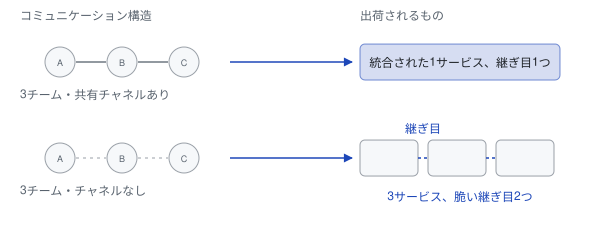
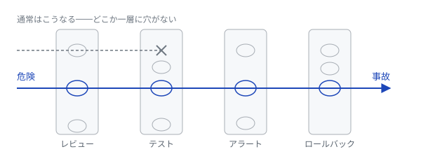
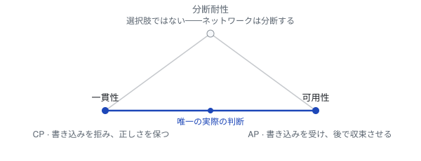
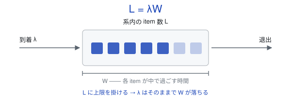
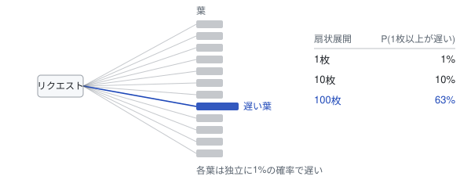
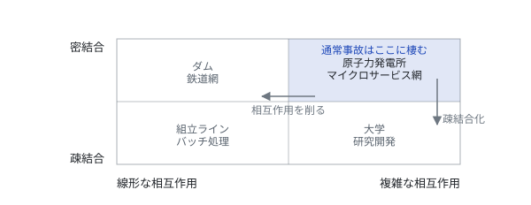

各法則に「対抗力」「現場の指針」「一次資料の出典」を添えた、エンジニアリングの法典。

[](https://github.com/kanywst/hammurabi/stargazers)
[](#法典)
[](https://kanywst.github.io/hammurabi/ja/)
[](../LICENSE)

[English](../README.md) • **日本語**

---

## Hammurabi とは？

複雑性が増し続ける現代において、エンジニアリングの最大のボトルネックは「コード」ではなく、**「不確実な状況下での意思決定」** です。

Hammurabi は、**認知心理学**・**安全工学**・**システム設計**から選び抜いたエンジニアリング法則の法典です。人類最古の成文法典に因んで名付けました。法則が「覚えておくもの」から「引用できるもの」に変わった、その最初の瞬間に因んでいます。

法則集の多くは「解説」で終わります。しかし解説は意思決定ではありません。この法典では、各条文に次の3つが必ず付きます。

- **対抗力 (Counter)** — その法則が独断に硬直するのを止める原理。ここにある法則はすべて、適用しすぎれば害を生みます。対抗力はその境界線です。フェイルファストのないポステルの法則は、破損データを黙って飲み込むシステムを生みます。心理的受容性のない最小権限は、利用者に迂回される統制を生みます。
- **現場の指針 (Guideline)** — 明日から実行できること。観察ではなく、命令形で書かれています。
- **一次資料の出典 (Source)** — その考えが実際に現れた論文・書籍・書簡・RFC。それを要約したブログ記事ではありません。全条文にリンクが付いているので、信じる前に確かめられます。

## 条文の読み方

すべての条文は、同じ5つの部分を同じ順序で持ちます。

| 部分 | 答えている問い |
| --- | --- |
| **概念** | この力は一言で言うと何か？ |
| **メカニズム** | なぜそれが起きるのか。多くはソフトウェアではなく、人間かシステムの性質に関する事実。 |
| **対立概念** | 何がそれを独断から守るのか？ |
| **判断の指針** | 月曜日に何をすればいいのか？ |
| **出典** | それは実際どこから来たのか。どう検証するのか。 |

`§` 番号は表示用の安定したラベルで、ファイル内の順序から機械的に割り当てられます。条文の恒久的な identity は **slug** であり、ウェブサイトのパーマリンクはこれを使います。前後に条文が追加されても slug は変わりません。

## 法典

<!-- CODEX:START -->

<!-- Generated from data/laws.yaml by scripts/generate.mjs. Do not edit by hand. -->

**状況から引く**

- **見積りが毎回ずれる:** [ホフスタッターの法則 (Hofstadter's Law)](#ホフスタッターの法則-hofstadters-law) · [90対90の法則 (Ninety-Ninety Rule)](#90対90の法則-ninety-ninety-rule) · [パーキンソンの法則 (Parkinson's Law)](#パーキンソンの法則-parkinsons-law) · [ブルックスの法則 (Brooks' Law)](#ブルックスの法則-brooks-law)
- **チームが大きくなってきた:** [ブルックスの法則 (Brooks' Law)](#ブルックスの法則-brooks-law) · [ダンバー数 (Dunbar's Number)](#ダンバー数-dunbars-number) · [リンゲルマン効果 (Ringelmann Effect)](#リンゲルマン効果-ringelmann-effect) · [コンウェイの法則 (Conway's Law)](#コンウェイの法則-conways-law) · [傍観者効果 (Bystander Effect)](#傍観者効果-bystander-effect)
- **指標が数字合わせになっている:** [グッドハートの法則 (Goodhart's Law)](#グッドハートの法則-goodharts-law) · [コブラ効果 (Cobra Effect)](#コブラ効果-cobra-effect) · [シャーキーの原理 (Shirky Principle)](#シャーキーの原理-shirky-principle)
- **決めきれない:** [意思決定の可逆性 (Type 1 vs Type 2 Decisions)](#意思決定の可逆性-type-1-vs-type-2-decisions) · [反対してもコミットする (Disagree and Commit)](#反対してもコミットする-disagree-and-commit) · [パーキンソンの凡俗法則 (Law of Triviality)](#パーキンソンの凡俗法則-law-of-triviality) · [サンクコストの誤謬 (Sunk Cost Fallacy)](#サンクコストの誤謬-sunk-cost-fallacy)
- **障害が起きた後:** [非難なきポストモーテム (Blameless Postmortem)](#非難なきポストモーテム-blameless-postmortem) · [スイスチーズモデル (Swiss Cheese Model)](#スイスチーズモデル-swiss-cheese-model) · [逸脱の常態化 (Normalization of Deviance)](#逸脱の常態化-normalization-of-deviance) · [通常事故理論 (Normal Accident Theory)](#通常事故理論-normal-accident-theory) · [ハンロンの剃刀 (Hanlon's Razor)](#ハンロンの剃刀-hanlons-razor) · [自動化の皮肉 (Ironies of Automation)](#自動化の皮肉-ironies-of-automation)
- **信頼性と開発速度がぶつかる:** [エラーバジェット (Error Budget)](#エラーバジェット-error-budget) · [トイル (Toil)](#トイル-toil) · [逸脱の常態化 (Normalization of Deviance)](#逸脱の常態化-normalization-of-deviance) · [マーフィーの法則 (Murphy's Law)](#マーフィーの法則-murphys-law)
- **何かが遅い:** [アムダールの法則 (Amdahl's Law)](#アムダールの法則-amdahls-law) · [制約理論 (Theory of Constraints)](#制約理論-theory-of-constraints) · [早すぎる最適化 (Premature Optimization)](#早すぎる最適化-premature-optimization) · [スケールの裾野 (The Tail at Scale)](#スケールの裾野-the-tail-at-scale) · [リトルの法則 (Little's Law)](#リトルの法則-littles-law)
- **古いコードを消す・作り直す:** [チェスタトンの柵 (Chesterton's Fence)](#チェスタトンの柵-chestertons-fence) · [セカンドシステム症候群 (Second-System Effect)](#セカンドシステム症候群-second-system-effect) · [ガルの法則 (Gall's Law)](#ガルの法則-galls-law) · [ハイラムの法則 (Hyrum's Law)](#ハイラムの法則-hyrums-law) · [イーグルソンの法則 (Eagleson's Law)](#イーグルソンの法則-eaglesons-law) · [ボーイスカウトの規則 (Boy Scout Rule)](#ボーイスカウトの規則-boy-scout-rule)
- **API やインタフェースを設計する:** [ハイラムの法則 (Hyrum's Law)](#ハイラムの法則-hyrums-law) · [ポステルの法則 (Postel's Law)](#ポステルの法則-postels-law) · [驚き最小の原則 (Principle of Least Astonishment)](#驚き最小の原則-principle-of-least-astonishment) · [リーキー・アブストラクション (Law of Leaky Abstractions)](#リーキーアブストラクション-law-of-leaky-abstractions) · [テスラーの複雑性保存則 (Tesler's Law)](#テスラーの複雑性保存則-teslers-law)
- **新しいものを作り始める:** [ワーキング・バックワーズ (Working Backwards)](#ワーキングバックワーズ-working-backwards) · [YAGNI (YAGNI)](#yagni-yagni) · [ガルの法則 (Gall's Law)](#ガルの法則-galls-law) · [劣っている方が勝つ (Worse is Better)](#劣っている方が勝つ-worse-is-better) · [KISS の原則 (KISS Principle)](#kiss-の原則-kiss-principle) · [XY問題 (XY Problem)](#xy問題-xy-problem)
- **技術を選ぶ:** [リンディ効果 (Lindy Effect)](#リンディ効果-lindy-effect) · [カーゴ・カルト・エンジニアリング (Cargo Cult Engineering)](#カーゴカルトエンジニアリング-cargo-cult-engineering) · [アマラの法則 (Amara's Law)](#アマラの法則-amaras-law) · [生存者バイアス (Survivorship Bias)](#生存者バイアス-survivorship-bias)
- **分散システムを組む:** [分散コンピューティングの誤謬 (Fallacies of Distributed Computing)](#分散コンピューティングの誤謬-fallacies-of-distributed-computing) · [CAP定理 (CAP Theorem)](#cap定理-cap-theorem) · [二人の将軍問題 (Two Generals Problem)](#二人の将軍問題-two-generals-problem) · [スケールの裾野 (The Tail at Scale)](#スケールの裾野-the-tail-at-scale)
- **権限と秘密を設計する:** [最小権限の原則 (Principle of Least Privilege)](#最小権限の原則-principle-of-least-privilege) · [ケルクホフスの原理 (Kerckhoffs's Principle)](#ケルクホフスの原理-kerckhoffss-principle)

**すべての法則**

| § | 法則 | カテゴリ | 核心 |
| --- | --- | --- | --- |
| `01` | [意思決定の可逆性 (Type 1 vs Type 2 Decisions)](#意思決定の可逆性-type-1-vs-type-2-decisions) | 意思決定 | やり直せる決定にまで、やり直せない決定と同じ慎重さを払ってしまう。 |
| `02` | [逸脱の常態化 (Normalization of Deviance)](#逸脱の常態化-normalization-of-deviance) | 安全工学 | 破っても何も起きなかったルール違反は、いつの間にか当たり前になる。 |
| `03` | [チェスタトンの柵 (Chesterton's Fence)](#チェスタトンの柵-chestertons-fence) | システム | 経緯を知らないコードやルールは無駄に見え、理由も知らずに消される。 |
| `04` | [正常性バイアス (Normalcy Bias)](#正常性バイアス-normalcy-bias) | 認知 | 本物の異常を前にしても、人はいつもの無害な説明に飛びつく。 |
| `05` | [パーキンソンの凡俗法則 (Law of Triviality)](#パーキンソンの凡俗法則-law-of-triviality) | 組織 | 議論は重要な部分ではなく、誰でも口を出せる簡単な部分に集中する。 |
| `06` | [ガルの法則 (Gall's Law)](#ガルの法則-galls-law) | システム | 動く複雑なシステムは、動く単純なシステムから育ったものだけだ。 |
| `07` | [コンウェイの法則 (Conway's Law)](#コンウェイの法則-conways-law) | 組織 | システムの構造は、作るチーム同士の意思疎通の形に似てくる。 |
| `08` | [ハイラムの法則 (Hyrum's Law)](#ハイラムの法則-hyrums-law) | システム | 利用者が十分に多ければ、バグも含めた観測可能な挙動すべてに誰かが依存する。 |
| `09` | [ブルックスの法則 (Brooks' Law)](#ブルックスの法則-brooks-law) | 組織 | 遅れたプロジェクトに人を足すと、調整コストが増えてさらに遅れる。 |
| `10` | [XY問題 (XY Problem)](#xy問題-xy-problem) | 認知 | 人は本当の問題ではなく、自分が思いついた解決策について助けを求める。 |
| `11` | [ポステルの法則 (Postel's Law)](#ポステルの法則-postels-law) | 分散システム | 相手が仕様どおりに動く前提のシステムは、最初の逸脱で壊れる。 |
| `12` | [ハンロンの剃刀 (Hanlon's Razor)](#ハンロンの剃刀-hanlons-razor) | 組織 | 疲労や文脈不足で説明がつく遅れやバグに、人は悪意を読み取ってしまう。 |
| `13` | [ホフスタッターの法則 (Hofstadter's Law)](#ホフスタッターの法則-hofstadters-law) | 見積り | 作業は見積りより長くかかる。それを織り込んで見積もってもなお長くかかる。 |
| `14` | [グッドハートの法則 (Goodhart's Law)](#グッドハートの法則-goodharts-law) | インセンティブ | 数字を動かすことに報酬がつくと、その数字は実態を測らなくなる。 |
| `15` | [リンディ効果 (Lindy Effect)](#リンディ効果-lindy-effect) | システム | アイデアやソフトウェアは、長く生き残ったものほどこの先も長く残る。 |
| `16` | [サンクコストの誤謬 (Sunk Cost Fallacy)](#サンクコストの誤謬-sunk-cost-fallacy) | 意思決定 | すでに注ぎ込んだ分が惜しくて、失敗しているプロジェクトに投資し続ける。 |
| `17` | [カーゴ・カルト・エンジニアリング (Cargo Cult Engineering)](#カーゴカルトエンジニアリング-cargo-cult-engineering) | 認知 | うまくいった理由を理解しないまま、他社のやり方の形だけを真似る。 |
| `18` | [アムダールの法則 (Amdahl's Law)](#アムダールの法則-amdahls-law) | 性能 | ボトルネックが別の場所にあれば、一部を速くしても全体はほとんど速くならない。 |
| `19` | [リーキー・アブストラクション (Law of Leaky Abstractions)](#リーキーアブストラクション-law-of-leaky-abstractions) | システム | 込み入った抽象化はいずれ、隠したはずの下の層の詳細を露出させる。 |
| `20` | [パレートの法則 (Pareto Principle)](#パレートの法則-pareto-principle) | 意思決定 | 結果の大半は、少数の原因から生まれる。バグの多くは一部のコードに集中する。 |
| `21` | [生存者バイアス (Survivorship Bias)](#生存者バイアス-survivorship-bias) | 認知 | 成功例だけから結論を出すと、同じやり方で失敗した例が見えなくなる。 |
| `22` | [カーニハンの法則 (Kernighan's Law)](#カーニハンの法則-kernighans-law) | 保守性 | デバッグは書くより難しい。最大限に凝ったコードは、自分ではデバッグできない。 |
| `23` | [コブラ効果 (Cobra Effect)](#コブラ効果-cobra-effect) | インセンティブ | 問題を減らすための報酬が、問題を増やす行動に報いてしまう。 |
| `24` | [ダンバー数 (Dunbar's Number)](#ダンバー数-dunbars-number) | 組織 | 人が安定して保てる関係は150人ほど。文脈を共有できる規模を超えると、増員は調整に消える。 |
| `25` | [劣っている方が勝つ (Worse is Better)](#劣っている方が勝つ-worse-is-better) | システム | 作りやすく広めやすい単純な設計は、正しいが複雑な設計に勝つ。 |
| `26` | [カニンガムの法則 (Cunningham's Law)](#カニンガムの法則-cunninghams-law) | 組織 | 人は質問に答えるより、間違った答えを訂正するほうに熱心だ。 |
| `27` | [傍観者効果 (Bystander Effect)](#傍観者効果-bystander-effect) | 組織 | 問題を目にする人が多いほど、誰も動かなくなる。 |
| `28` | [マーフィーの法則 (Murphy's Law)](#マーフィーの法則-murphys-law) | 安全工学 | 時間と負荷が十分にあれば、潜んでいる故障はいずれすべて起きる。 |
| `29` | [ボーイスカウトの規則 (Boy Scout Rule)](#ボーイスカウトの規則-boy-scout-rule) | 保守性 | 掃除がいつも来ないリファクタリングに先送りされ、コードは劣化していく。 |
| `30` | [テスラーの複雑性保存則 (Tesler's Law)](#テスラーの複雑性保存則-teslers-law) | システム | 複雑さはシステムから消せない。誰か別の人に移るだけだ。 |
| `31` | [ダニング・クルーガー効果 (Dunning-Kruger Effect)](#ダニングクルーガー効果-dunning-kruger-effect) | 認知 | ある分野に疎い人ほど、自分の能力を高く見積もる。 |
| `32` | [知識の呪い (Curse of Knowledge)](#知識の呪い-curse-of-knowledge) | 認知 | 一度知ってしまうと、知らなかったときの感覚を想像できなくなる。 |
| `33` | [スイスチーズモデル (Swiss Cheese Model)](#スイスチーズモデル-swiss-cheese-model) | 安全工学 | どの防御層にも穴がある。事故は複数の層の穴がそろったときに起きる。 |
| `34` | [早すぎる最適化 (Premature Optimization)](#早すぎる最適化-premature-optimization) | 性能 | 計測する前に最適化すると、ボトルネックでない箇所に工数を使ってしまう。 |
| `35` | [リーナスの法則 (Linus's Law)](#リーナスの法則-linuss-law) | 保守性 | 一人では見つからないバグも、多くの人が見れば誰かがすぐに気づく。 |
| `36` | [CAP定理 (CAP Theorem)](#cap定理-cap-theorem) | 分散システム | ネットワーク分断が起きたら、データストアは一貫性か可用性のどちらかを捨てる。 |
| `37` | [リトルの法則 (Little's Law)](#リトルの法則-littles-law) | 性能 | 系の中にある件数は、到着率と滞在時間の積に等しい。 |
| `38` | [二人の将軍問題 (Two Generals Problem)](#二人の将軍問題-two-generals-problem) | 分散システム | 信頼できない通信路では、二者は合意できたと確信することができない。 |
| `39` | [ピーターの法則 (Peter Principle)](#ピーターの法則-peter-principle) | 組織 | 人は苦手な役職にたどり着くまで昇進し、そこにとどまる。 |
| `40` | [パーキンソンの法則 (Parkinson's Law)](#パーキンソンの法則-parkinsons-law) | 組織 | 仕事は、完了までに使える時間をすべて使い切るまで膨らむ。 |
| `41` | [ヴィルトの法則 (Wirth's Law)](#ヴィルトの法則-wirths-law) | 性能 | ソフトウェアが遅くなる速さは、ハードウェアが速くなる速さを上回る。 |
| `42` | [90対90の法則 (Ninety-Ninety Rule)](#90対90の法則-ninety-ninety-rule) | 見積り | 残り1割の作業に、最初の9割と同じだけの時間がかかる。 |
| `43` | [イーグルソンの法則 (Eagleson's Law)](#イーグルソンの法則-eaglesons-law) | 保守性 | 半年見ていない自分のコードは、他人が書いたコードと変わらない。 |
| `44` | [ヒックの法則 (Hick's Law)](#ヒックの法則-hicks-law) | ヒューマンインタフェース | 選択肢が増えるほど、人は一つを選ぶのに時間がかかる。 |
| `45` | [フィッツの法則 (Fitts's Law)](#フィッツの法則-fittss-law) | ヒューマンインタフェース | 小さく遠いターゲットほど、押すのに時間がかかり、押し間違えも増える。 |
| `46` | [ミラーの法則 (Miller's Law)](#ミラーの法則-millers-law) | 認知 | 作業記憶に入るのは7個前後で、それを超えると人は項目を取りこぼす。 |
| `47` | [分散コンピューティングの誤謬 (Fallacies of Distributed Computing)](#分散コンピューティングの誤謬-fallacies-of-distributed-computing) | 分散システム | ネットワーク越しのコードは、本番では成り立たない8つの前提を暗に置いている。 |
| `48` | [自動化の皮肉 (Ironies of Automation)](#自動化の皮肉-ironies-of-automation) | 安全工学 | 自動化は人に最も難しい例外だけを残し、その対応に要る腕は使わないうちに鈍る。 |
| `49` | [最小権限の原則 (Principle of Least Privilege)](#最小権限の原則-principle-of-least-privilege) | セキュリティ | 不要な権限を持つ部品ほど、問題が起きたときの被害範囲が広がる。 |
| `50` | [ケルクホフスの原理 (Kerckhoffs's Principle)](#ケルクホフスの原理-kerckhoffss-principle) | セキュリティ | 設計が秘密である間だけ安全なシステムは、安全ではない。 |
| `51` | [グスタフソンの法則 (Gustafson's Law)](#グスタフソンの法則-gustafsons-law) | 性能 | 問題の規模が計算機とともに大きくなるなら、並列化の効果はほぼ比例して伸びる。 |
| `52` | [スケールの裾野 (The Tail at Scale)](#スケールの裾野-the-tail-at-scale) | 分散システム | 一つのリクエストが多数のサーバに分かれると、最も遅いサーバが応答時間を決める。 |
| `53` | [アシュビーの必要多様性の法則 (Ashby's Law of Requisite Variety)](#アシュビーの必要多様性の法則-ashbys-law-of-requisite-variety) | システム | 制御側は、対象がとりうる状態と同じだけの対応を持たないと制御できない。 |
| `54` | [デメテルの法則 (Law of Demeter)](#デメテルの法則-law-of-demeter) | 保守性 | 他のオブジェクトの内部をたどるコードは、その連鎖のどこが変わっても壊れる。 |
| `55` | [ジェヴォンズのパラドックス (Jevons Paradox)](#ジェヴォンズのパラドックス-jevons-paradox) | インセンティブ | 資源を安く使えるようにすると、かえって総使用量が増えることがある。 |
| `56` | [通常事故理論 (Normal Accident Theory)](#通常事故理論-normal-accident-theory) | 安全工学 | 複雑で密に結合したシステムでは、事故は構造そのものから生じる。 |
| `57` | [割れ窓理論 (Broken Windows Theory)](#割れ窓理論-broken-windows-theory) | 安全工学 | 放置された小さな乱れは、基準は守らなくてよいという合図になり、乱れを呼ぶ。 |
| `58` | [YAGNI (YAGNI)](#yagni-yagni) | 保守性 | 想像した将来のために書いたコードは、今の工数を食い、実際の要件にもまず合わない。 |
| `59` | [KISS の原則 (KISS Principle)](#kiss-の原則-kiss-principle) | 保守性 | システムは、普通の人が悪条件の中でも直せる程度に単純である必要がある。 |
| `60` | [DRY 原則 (DRY Principle)](#dry-原則-dry-principle) | 保守性 | 同じ知識を二か所に置くと、一緒に変わる保証がないので食い違っていく。 |
| `61` | [制約理論 (Theory of Constraints)](#制約理論-theory-of-constraints) | 性能 | システムの処理量は、最も詰まっている一か所で決まる。 |
| `62` | [オッカムの剃刀 (Occam's Razor)](#オッカムの剃刀-occams-razor) | 認知 | 検証されていない仮定が最も少ない説明が、たいてい正しい。 |
| `63` | [単一責任の原則 (Single Responsibility Principle)](#単一責任の原則-single-responsibility-principle) | 保守性 | 二つの利用者に仕えるモジュールには、両方から食い違う変更要求が届く。 |
| `64` | [驚き最小の原則 (Principle of Least Astonishment)](#驚き最小の原則-principle-of-least-astonishment) | ヒューマンインタフェース | 利用者を驚かせる挙動は、少し劣っても予想どおりの挙動より高くつく。 |
| `65` | [セカンドシステム症候群 (Second-System Effect)](#セカンドシステム症候群-second-system-effect) | システム | 最初の成功のあと、設計者は先送りしたアイデアをすべて二作目に詰め込む。 |
| `66` | [ムーアの法則 (Moore's Law)](#ムーアの法則-moores-law) | 性能 | 部品単価が最も安くなるチップのトランジスタ数は、約2年ごとに倍になる。 |
| `67` | [アマラの法則 (Amara's Law)](#アマラの法則-amaras-law) | 見積り | 新しい技術は、最初の数年は過大評価され、十年単位では過小評価される。 |
| `68` | [苦い教訓 (The Bitter Lesson)](#苦い教訓-the-bitter-lesson) | システム | AIでは、計算量とともに伸びる汎用手法が、人が作り込んだ知識に勝つ。 |
| `69` | [メトカーフの法則 (Metcalfe's Law)](#メトカーフの法則-metcalfes-law) | システム | ノードが一つ増えるたびに既存の全ノードの価値が上がり、価値は規模より速く増える。 |
| `70` | [リンゲルマン効果 (Ringelmann Effect)](#リンゲルマン効果-ringelmann-effect) | 組織 | 集団が大きくなるほど一人あたりの貢献は減る。誰の成果か見えないと特にそうだ。 |
| `71` | [シャーキーの原理 (Shirky Principle)](#シャーキーの原理-shirky-principle) | インセンティブ | 組織は、自分たちが存在する理由である問題を残そうとする。 |
| `72` | [エラーバジェット (Error Budget)](#エラーバジェット-error-budget) | 運用 | 100% 未満の SLO は許容できる失敗の量を決める。その量は使ってよい予算だ。 |
| `73` | [トイル (Toil)](#トイル-toil) | 運用 | 手作業の繰り返し運用はサービスと一緒に増え、やがて開発の時間を食い尽くす。 |
| `74` | [非難なきポストモーテム (Blameless Postmortem)](#非難なきポストモーテム-blameless-postmortem) | 運用 | 障害のいちばん近くにいた人を罰すると、全員が自分のしたことを隠すようになる。 |
| `75` | [ワーキング・バックワーズ (Working Backwards)](#ワーキングバックワーズ-working-backwards) | 意思決定 | 解決策から始めると誰も必要としないものができる。発表文から始めると早く気づける。 |
| `76` | [反対してもコミットする (Disagree and Commit)](#反対してもコミットする-disagree-and-commit) | 意思決定 | 全員の同意を待つより、決めて実行し、誤りなら軌道修正するほうが速い。 |

### 意思決定の可逆性 (Type 1 vs Type 2 Decisions)

`§ 01` · 意思決定

- **概念:** やり直せる決定にまで、やり直せない決定と同じ慎重さを払ってしまう。
- **メカニズム:** 脳は生存本能的に「すべての失敗」を脅威と見なし、すぐに戻せる決定（双方向のドア）に対しても過剰な慎重さを求めてしまう。これが「分析麻痺」の正体。
- **対立概念:** **「一方向のドア」フィルター**。
- **判断の指針:** 容易にやり直しができる決定なら、24時間以内に実行してデータを得よ。数日・数週間かけるのは、やり直し不能な決定（DBスキーマの根幹、セキュリティ等）のみにせよ。
- **出典:** Jeff Bezos『2015 年 株主への手紙』（Amazon.com, Inc.、2016 年 4 月提出）——"Type 1 / Type 2 decisions" の初出。1997 年の手紙は「Day 1」の手紙であり、この枠組みは含まれていない。 — [原典 ↗](https://www.sec.gov/Archives/edgar/data/1018724/000119312516530910/d168744dex991.htm)
- **関連:** [サンクコストの誤謬 (Sunk Cost Fallacy)](#サンクコストの誤謬-sunk-cost-fallacy) · [パーキンソンの法則 (Parkinson's Law)](#パーキンソンの法則-parkinsons-law) · [反対してもコミットする (Disagree and Commit)](#反対してもコミットする-disagree-and-commit)

### 逸脱の常態化 (Normalization of Deviance)

`§ 02` · 安全工学

- **概念:** 破っても何も起きなかったルール違反は、いつの間にか当たり前になる。
- **メカニズム:** 小さなルール違反（テストのスキップ等）をしても即座に大惨事が起きない場合、脳はその「逸脱」を「正常」なものとして再定義する。これが破滅的な失敗の始まり。
- **対立概念:** **割れ窓理論**。
- **判断の指針:** 「以前も大丈夫だった」を理由に調査を省略するな。その場しのぎの「ハック」を見つけたら、即座に修正するか、高優先度の技術負債として記録せよ。
- **出典:** Diane Vaughan, *The Challenger Launch Decision* (1996) — NASA チャレンジャー号事故の分析から提唱された概念。 — [原典 ↗](https://en.wikipedia.org/wiki/Normalization_of_deviance)
- **関連:** [スイスチーズモデル (Swiss Cheese Model)](#スイスチーズモデル-swiss-cheese-model) · [通常事故理論 (Normal Accident Theory)](#通常事故理論-normal-accident-theory) · [ボーイスカウトの規則 (Boy Scout Rule)](#ボーイスカウトの規則-boy-scout-rule) · [正常性バイアス (Normalcy Bias)](#正常性バイアス-normalcy-bias) · [割れ窓理論 (Broken Windows Theory)](#割れ窓理論-broken-windows-theory) · [非難なきポストモーテム (Blameless Postmortem)](#非難なきポストモーテム-blameless-postmortem) · [エラーバジェット (Error Budget)](#エラーバジェット-error-budget)

### チェスタトンの柵 (Chesterton's Fence)

`§ 03` · システム

- **概念:** 経緯を知らないコードやルールは無駄に見え、理由も知らずに消される。
- **メカニズム:** 背景文脈を知らない古いコードやプロセスを「無駄」に見誤る。エゴは理解できないものを「単純化」という名目で削除したがる。
- **対立概念:** **期限を切った考古学** — この規則を絶対に適用すれば何ひとつ削除できなくなる。理由を知っていた人と一緒に、理由そのものが去っていることもある。
- **判断の指針:** その「柵（コード/ルール）」がなぜそこに立てられたのかを説明できるようになるまで壊してはならない——ただし、その調査には期限を切れ。期限が切れたら、ロールバックを用意してフラグの裏で外し、何が苦情を上げるかを見よ。
- **出典:** G. K. Chesterton, *The Thing* (1929) — 道に立つ柵の寓話の原典。 — [原典 ↗](https://www.chesterton.org/taking-a-fence-down/)
- **関連:** [イーグルソンの法則 (Eagleson's Law)](#イーグルソンの法則-eaglesons-law) · [YAGNI (YAGNI)](#yagni-yagni)

### 正常性バイアス (Normalcy Bias)

`§ 04` · 認知

- **概念:** 本物の異常を前にしても、人はいつもの無害な説明に飛びつく。
- **メカニズム:** 真の異常に直面しても、脳はエネルギー節約のため「いつものパターン」で解釈しようとする。DBが壊れ始めていても「一時的なネットワークの瞬断だろう」と片付けてしまう。
- **対立概念:** **プレモータム / レッドチーミング**。
- **判断の指針:** 異常が起きたとき、「これがシステム全壊の始まりだとしたら、次の10分で何が起きるか？」を問え。その答えが恐ろしいなら、今すぐ調査せよ。
- **出典:** 災害心理学の文献群。Amanda Ripley, *The Unthinkable* (2008) で総説されている。 — [原典 ↗](https://en.wikipedia.org/wiki/Normalcy_bias)
- **関連:** [マーフィーの法則 (Murphy's Law)](#マーフィーの法則-murphys-law) · [逸脱の常態化 (Normalization of Deviance)](#逸脱の常態化-normalization-of-deviance) · [オッカムの剃刀 (Occam's Razor)](#オッカムの剃刀-occams-razor)

### パーキンソンの凡俗法則 (Law of Triviality)

`§ 05` · 組織

- **概念:** 議論は重要な部分ではなく、誰でも口を出せる簡単な部分に集中する。
- **メカニズム:** 人は複雑なこと（分散合意）より、単純なこと（変数名）に多くのフィードバックをする。誰でも理解できるため、意見を言うことで偽の貢献感を得やすいため。
- **対立概念:** **コア・バリューへの集中**。
- **判断の指針:** PRレビューのコメントの8割がスタイルや命名に集中しているなら、即座に承認し、議論をリンターの設定自動化に移せ。
- **出典:** C. Northcote Parkinson『Parkinson's Law and Other Studies in Administration』(Houghton Mifflin, 1957) 所収「High Finance, or the Point of Vanishing Interest」——自転車置き場の委員会の寓話の初出。英国版は『Parkinson's Law: The Pursuit of Progress』(John Murray, 1958)。 — [原典 ↗](https://en.wikipedia.org/wiki/Law_of_triviality)
- **関連:** [パーキンソンの法則 (Parkinson's Law)](#パーキンソンの法則-parkinsons-law) · [反対してもコミットする (Disagree and Commit)](#反対してもコミットする-disagree-and-commit)

### ガルの法則 (Gall's Law)

`§ 06` · システム

- **概念:** 動く複雑なシステムは、動く単純なシステムから育ったものだけだ。
- **メカニズム:** 複雑なシステムをゼロから「設計」できるという妄想。実際には、複雑系は混沌すぎてトップダウンでは設計できない。
- **対立概念:** **MVP (実用最小限の製品)**。
- **判断の指針:** 機能している複雑なシステムは、例外なく「機能していた単純なシステム」から進化したものである。まずは動作する最小単位から始めよ。
- **出典:** John Gall, *Systemantics: How Systems Really Work and How They Fail* (1975)。 — [原典 ↗](https://en.wikipedia.org/wiki/John_Gall_(author))
- **関連:** [劣っている方が勝つ (Worse is Better)](#劣っている方が勝つ-worse-is-better) · [YAGNI (YAGNI)](#yagni-yagni) · [セカンドシステム症候群 (Second-System Effect)](#セカンドシステム症候群-second-system-effect)

### コンウェイの法則 (Conway's Law)

`§ 07` · 組織

- **概念:** システムの構造は、作るチーム同士の意思疎通の形に似てくる。
- **メカニズム:** ソフトウェアの構造は、組織図の写し鏡になる。2つのチームが会話しなければ、そのサービス間の統合もスムーズにはいかない。
- **対立概念:** **逆コンウェイ戦略**。
- **判断の指針:** モジュール化されたアーキテクチャが欲しいなら、先にチームを独立したモジュールとして再編せよ。組織構造とコードで戦うな。
- **出典:** Melvin E. Conway, *How Do Committees Invent?* (Datamation, 1968 年 4 月号)。 — [原典 ↗](https://www.melconway.com/Home/Committees_Paper.html)
- **関連:** [ダンバー数 (Dunbar's Number)](#ダンバー数-dunbars-number) · [ブルックスの法則 (Brooks' Law)](#ブルックスの法則-brooks-law) · [単一責任の原則 (Single Responsibility Principle)](#単一責任の原則-single-responsibility-principle)

<picture>
  <source media="(prefers-color-scheme: dark)" srcset="../assets/diagrams/conways-law-ja-dark.svg">
  
</picture>

アーキテクチャはコミュニケーション構造の下流にある。紙の上の組織図ではなく、実際に誰が誰と話しているかのほうだ。チームを引き直せば継ぎ目もついてくる。図だけを引き直せば、古い継ぎ目が生えてくる。

### ハイラムの法則 (Hyrum's Law)

`§ 08` · システム

- **概念:** 利用者が十分に多ければ、バグも含めた観測可能な挙動すべてに誰かが依存する。
- **メカニズム:** ユーザー数が十分に増えれば、システムの観測可能なあらゆる挙動（バグさえも）は、誰かの依存対象になる。
- **対立概念:** **意図的なゆらぎ** — 観測可能な挙動すべてを不可侵とすれば何も変えられなくなる。約束していない部分は意図的に揺らせ——反復順序のランダム化、計画的な停止——そうすれば依存はそもそも生まれない。
- **判断の指針:** ユーザーがいる限り「内部実装」は存在しない。約束した部分はバージョニングと機能フラグで守り、約束していない部分は意図的に揺らして、そもそも依存させるな。
- **出典:** Hyrum Wright, *hyrumslaw.com*; *Software Engineering at Google* (Winters, Manshreck, Wright, 2020) で正式化。 — [原典 ↗](https://www.hyrumslaw.com/)
- **関連:** [ポステルの法則 (Postel's Law)](#ポステルの法則-postels-law) · [驚き最小の原則 (Principle of Least Astonishment)](#驚き最小の原則-principle-of-least-astonishment)

### ブルックスの法則 (Brooks' Law)

`§ 09` · 組織

- **概念:** 遅れたプロジェクトに人を足すと、調整コストが増えてさらに遅れる。
- **メカニズム:** 遅れているプロジェクトに人を追加すると、調整コストが二次関数的に増大する（n 人で n(n-1)/2 本の通信路）。新人はベテランの手を止めるため、貢献よりも損失が上回る。
- **対立概念:** **スコープ削減**。
- **判断の指針:** プロジェクトが遅れているなら、人を増やすな。機能を削るか、期限を延ばせ。
- **出典:** Fred Brooks, *人月の神話 (The Mythical Man-Month)* (1975, 20 周年記念版 1995)。 — [原典 ↗](https://en.wikipedia.org/wiki/Brooks%27s_law)
- **関連:** [コンウェイの法則 (Conway's Law)](#コンウェイの法則-conways-law) · [ダンバー数 (Dunbar's Number)](#ダンバー数-dunbars-number) · [セカンドシステム症候群 (Second-System Effect)](#セカンドシステム症候群-second-system-effect) · [メトカーフの法則 (Metcalfe's Law)](#メトカーフの法則-metcalfes-law)

### XY問題 (XY Problem)

`§ 10` · 認知

- **概念:** 人は本当の問題ではなく、自分が思いついた解決策について助けを求める。
- **メカニズム:** ユーザーやエンジニアが解決策（Y）で詰まったとき、その方法を質問してしまうが、本来の目的（X）にはもっと簡単な解決策があることが多い。
- **対立概念:** **なぜなぜ分析**。
- **判断の指針:** 誰かが「どうやってYをすればいいか？」と聞いてきたら、常に「Yで何を達成したいのか？」と問い返せ。
- **出典:** Perl IRC やシステム管理者コミュニティ発の口承。標準的な解説は *xyproblem.info*。 — [原典 ↗](https://xyproblem.info/)
- **関連:** [知識の呪い (Curse of Knowledge)](#知識の呪い-curse-of-knowledge) · [ワーキング・バックワーズ (Working Backwards)](#ワーキングバックワーズ-working-backwards)

### ポステルの法則 (Postel's Law)

`§ 11` · 分散システム

- **概念:** 相手が仕様どおりに動く前提のシステムは、最初の逸脱で壊れる。
- **メカニズム:** 分散システムで全員が仕様を完璧に守ると想定すると、脆い失敗を招く。
- **対立概念:** **フェイルファスト (内部エラー限定)**。
- **判断の指針:** 自分が送るものには厳格に（仕様準拠）、受け取るものには寛容に（不完全な入力も優雅に処理）。
- **出典:** Jon Postel『RFC 761』(DoD Standard TCP, 1980年1月) §2.10——"be conservative in what you do, be liberal in what you accept from others"。同じ趣旨は『RFC 760』(IP) §3.2 に別の言い回しで、『RFC 793』(1981) に同文で再掲される。 — [原典 ↗](https://www.rfc-editor.org/rfc/rfc761)
- **関連:** [ハイラムの法則 (Hyrum's Law)](#ハイラムの法則-hyrums-law) · [分散コンピューティングの誤謬 (Fallacies of Distributed Computing)](#分散コンピューティングの誤謬-fallacies-of-distributed-computing)

### ハンロンの剃刀 (Hanlon's Razor)

`§ 12` · 組織

- **概念:** 疲労や文脈不足で説明がつく遅れやバグに、人は悪意を読み取ってしまう。
- **メカニズム:** バグや遅延を「悪意」や「嫌がらせ」と受け取ってしまう。実際には、単なる睡眠不足やコンテキストの欠如であることがほとんど。
- **対立概念:** **心理的安全性**。
- **判断の指針:** 無能（知識不足や文脈欠如）で説明がつくことに、決して悪意を見出すな。人ではなくシステムをデバッグせよ。
- **出典:** Robert J. Hanlon が *Murphy's Law Book Two* (Arthur Bloch 編, 1980) に寄稿した格言。 — [原典 ↗](https://en.wikipedia.org/wiki/Hanlon%27s_razor)
- **関連:** [傍観者効果 (Bystander Effect)](#傍観者効果-bystander-effect) · [オッカムの剃刀 (Occam's Razor)](#オッカムの剃刀-occams-razor) · [非難なきポストモーテム (Blameless Postmortem)](#非難なきポストモーテム-blameless-postmortem)

### ホフスタッターの法則 (Hofstadter's Law)

`§ 13` · 見積り

- **概念:** 作業は見積りより長くかかる。それを織り込んで見積もってもなお長くかかる。
- **メカニズム:** 「この法則を考慮に入れたとしても、常に予想以上の時間がかかる」。脳は「未知の未知」を可視化できない。
- **対立概念:** **実績ベースのスケジューリング**。
- **判断の指針:** 最も慎重な見積もりを2倍し、さらに20%加えよ。それでもなお、外れることを覚悟せよ。
- **出典:** Douglas Hofstadter, *ゲーデル、エッシャー、バッハ — あるいは不思議の環 (Gödel, Escher, Bach)* (1979)。 — [原典 ↗](https://en.wikipedia.org/wiki/Hofstadter%27s_law)
- **関連:** [90対90の法則 (Ninety-Ninety Rule)](#90対90の法則-ninety-ninety-rule) · [パーキンソンの法則 (Parkinson's Law)](#パーキンソンの法則-parkinsons-law)

### グッドハートの法則 (Goodhart's Law)

`§ 14` · インセンティブ

- **概念:** 数字を動かすことに報酬がつくと、その数字は実態を測らなくなる。
- **メカニズム:** ある指標が目標になると、それは良い指標ではなくなる。「コミット数」で評価すれば、人々は意味のない小さなコミットを量産する。
- **対立概念:** **バランスト・スコアカード**。
- **判断の指針:** 単一の指標でパフォーマンスを判断するな。システムの「出力」そのものを観察し、その代用指標（プロキシ）に固執するな。
- **出典:** Charles Goodhart, *Problems of Monetary Management* (1975); 現代によく引用される定式化は Marilyn Strathern (1997) による。 — [原典 ↗](https://en.wikipedia.org/wiki/Goodhart%27s_law)
- **関連:** [コブラ効果 (Cobra Effect)](#コブラ効果-cobra-effect) · [シャーキーの原理 (Shirky Principle)](#シャーキーの原理-shirky-principle) · [エラーバジェット (Error Budget)](#エラーバジェット-error-budget)

### リンディ効果 (Lindy Effect)

`§ 15` · システム

- **概念:** アイデアやソフトウェアは、長く生き残ったものほどこの先も長く残る。
- **メカニズム:** アイデアやソフトウェアのような非腐敗的なものは、長く生き残ってきたものほど、今後も長く生き残る可能性が高い。
- **対立概念:** **ハイプサイクル分析**。
- **判断の指針:** 今後10年安定させたいなら、既に10年以上存在している技術（例：新しいNoSQLよりPostgreSQL）を選べ。
- **出典:** Albert Goldman 命名 (*New Republic*, 1964); Benoit Mandelbrot が形式化し、Nassim Taleb *Antifragile* (2012) で普及。 — [原典 ↗](https://en.wikipedia.org/wiki/Lindy_effect)
- **関連:** [劣っている方が勝つ (Worse is Better)](#劣っている方が勝つ-worse-is-better) · [アマラの法則 (Amara's Law)](#アマラの法則-amaras-law)

### サンクコストの誤謬 (Sunk Cost Fallacy)

`§ 16` · 意思決定

- **概念:** すでに注ぎ込んだ分が惜しくて、失敗しているプロジェクトに投資し続ける。
- **メカニズム:** 「既に多額の投資をしたから」という理由で、失敗している技術やプロジェクトに投資し続けてしまう。脳は負けを認めるのを嫌う。
- **対立概念:** **ゼロベース予算**。
- **判断の指針:** 「もし今日、ゼロから始めるとしたら、この道を選ぶか？」と問え。答えがNOなら、今すぐ捨てろ。
- **出典:** Hal R. Arkes & Catherine Blumer, *The Psychology of Sunk Cost* (Organizational Behavior and Human Decision Processes, 1985)。 — [原典 ↗](https://doi.org/10.1016/0749-5978(85)90049-4)
- **関連:** [意思決定の可逆性 (Type 1 vs Type 2 Decisions)](#意思決定の可逆性-type-1-vs-type-2-decisions)

### カーゴ・カルト・エンジニアリング (Cargo Cult Engineering)

`§ 17` · 認知

- **概念:** うまくいった理由を理解しないまま、他社のやり方の形だけを真似る。
- **メカニズム:** 成功企業の慣行（例：Spotifyモデル）を、なぜそれが機能したか理解せずに真似る。同じ結果が得られると盲信する罠。
- **対立概念:** **第一原理思考**。
- **判断の指針:** Googleが使っているからという理由で導入するな。そのスケールにおけるGoogleと同じ問題が自分たちにあるから、導入せよ。
- **出典:** Richard P. Feynman, *Cargo Cult Science* (Caltech 卒業式講演, 1974)。 — [原典 ↗](https://calteches.library.caltech.edu/51/2/CargoCult.htm)
- **関連:** [生存者バイアス (Survivorship Bias)](#生存者バイアス-survivorship-bias) · [苦い教訓 (The Bitter Lesson)](#苦い教訓-the-bitter-lesson)

### アムダールの法則 (Amdahl's Law)

`§ 18` · 性能

- **概念:** ボトルネックが別の場所にあれば、一部を速くしても全体はほとんど速くならない。
- **メカニズム:** ボトルネックが他にある場合、システムの一部をいくら最適化しても全体の性能には影響しない。
- **対立概念:** **制約理論**。
- **判断の指針:** 実行時間の90%を占める1%のコードを見つけ、そこだけを最適化せよ。それ以外は無視してよい。
- **出典:** Gene Amdahl, *Validity of the Single Processor Approach to Achieving Large Scale Computing Capabilities* (AFIPS, 1967)。 — [原典 ↗](https://doi.org/10.1145/1465482.1465560)
- **関連:** [グスタフソンの法則 (Gustafson's Law)](#グスタフソンの法則-gustafsons-law) · [早すぎる最適化 (Premature Optimization)](#早すぎる最適化-premature-optimization) · [制約理論 (Theory of Constraints)](#制約理論-theory-of-constraints)

### リーキー・アブストラクション (Law of Leaky Abstractions)

`§ 19` · システム

- **概念:** 込み入った抽象化はいずれ、隠したはずの下の層の詳細を露出させる。
- **メカニズム:** あらゆる非自明な抽象化は、ある程度「漏れる」。インデックスの仕組みを知らずにSQLを使い続けることはできない。
- **対立概念:** **T型スキル**。
- **判断の指針:** 抽象化を利用して加速せよ。ただし、チーム内に少なくとも一人は、その下の層で何が起きているか理解している人間を置け。
- **出典:** Joel Spolsky, *The Law of Leaky Abstractions* (Joel on Software, 2002)。 — [原典 ↗](https://www.joelonsoftware.com/2002/11/11/the-law-of-leaky-abstractions/)
- **関連:** [テスラーの複雑性保存則 (Tesler's Law)](#テスラーの複雑性保存則-teslers-law) · [デメテルの法則 (Law of Demeter)](#デメテルの法則-law-of-demeter)

### パレートの法則 (Pareto Principle)

`§ 20` · 意思決定

- **概念:** 結果の大半は、少数の原因から生まれる。バグの多くは一部のコードに集中する。
- **メカニズム:** バグの80%はコードの20%に起因する。価値の80%は機能の20%から生まれる。
- **対立概念:** **非情な優先順位付け**。
- **判断の指針:** 「重要な20%」を特定し、品質管理のリソースの100%をそこに集中させよ。
- **出典:** Vilfredo Pareto, *Cours d'Économie Politique* (1896); 品質工学への応用は Joseph M. Juran, *Quality Control Handbook* (1951)。 — [原典 ↗](https://en.wikipedia.org/wiki/Pareto_principle)
- **関連:** [早すぎる最適化 (Premature Optimization)](#早すぎる最適化-premature-optimization)

### 生存者バイアス (Survivorship Bias)

`§ 21` · 認知

- **概念:** 成功例だけから結論を出すと、同じやり方で失敗した例が見えなくなる。
- **メカニズム:** 生き残った成功事例だけを研究し、そこから結論を導いてしまう。同じ戦略を採って消えていった無数の失敗は、データとして見えない。本質的に偏った情報で意思決定している。
- **対立概念:** **失敗学 / ポストモーテム文化**。
- **判断の指針:** 「X社がこの方法で成功した」を根拠にする前に、同じ方法で失敗した企業を調べよ。死者はブログ記事を書かない。
- **出典:** Abraham Wald, *A Method of Estimating Plane Vulnerability* (SRG メモ, 1943) — 第二次大戦時の爆撃機装甲分析。 — [原典 ↗](https://en.wikipedia.org/wiki/Survivorship_bias)
- **関連:** [カーゴ・カルト・エンジニアリング (Cargo Cult Engineering)](#カーゴカルトエンジニアリング-cargo-cult-engineering) · [アマラの法則 (Amara's Law)](#アマラの法則-amaras-law)

### カーニハンの法則 (Kernighan's Law)

`§ 22` · 保守性

- **概念:** デバッグは書くより難しい。最大限に凝ったコードは、自分ではデバッグできない。
- **メカニズム:** 「デバッグは、コードを書くときの2倍の知性を要する。したがって、自分の知力の限界まで賢いコードを書いた時点で、そのコードをデバッグする知性が定義上、足りなくなる。」
- **対立概念:** **KISS (Keep It Simple, Stupid)**。
- **判断の指針:** コードの「賢さ」は資産ではなく負債である。6ヶ月後の、午前3時に睡眠不足の自分がまだ理解できるコードを書け。
- **出典:** Brian W. Kernighan & P. J. Plauger, *The Elements of Programming Style*, 第 2 版 (1978)。 — [原典 ↗](https://en.wikipedia.org/wiki/The_Elements_of_Programming_Style)
- **関連:** [イーグルソンの法則 (Eagleson's Law)](#イーグルソンの法則-eaglesons-law) · [KISS の原則 (KISS Principle)](#kiss-の原則-kiss-principle)

### コブラ効果 (Cobra Effect)

`§ 23` · インセンティブ

- **概念:** 問題を減らすための報酬が、問題を増やす行動に報いてしまう。
- **メカニズム:** 問題を解決するための施策が、かえって問題を悪化させる。英領インドでコブラ駆除のため懸賞金をかけたら、人々がコブラを養殖し始めた。懸賞金を廃止すると養殖コブラが放流され、さらに事態が悪化した。
- **対立概念:** **二次効果分析 / システムダイナミクス**。
- **判断の指針:** あらゆるインセンティブに対し「これを悪用するならどうする？」を問え。悪用方法が見つかるなら、設計が間違っている。
- **出典:** Horst Siebert, *Der Kobra-Effekt: Wie man Irrwege der Wirtschaftspolitik vermeidet* (2001)。 — [原典 ↗](https://en.wikipedia.org/wiki/Perverse_incentive)
- **関連:** [グッドハートの法則 (Goodhart's Law)](#グッドハートの法則-goodharts-law) · [ジェヴォンズのパラドックス (Jevons Paradox)](#ジェヴォンズのパラドックス-jevons-paradox)

### ダンバー数 (Dunbar's Number)

`§ 24` · 組織

- **概念:** 人が安定して保てる関係は150人ほど。文脈を共有できる規模を超えると、増員は調整に消える。
- **メカニズム:** 人間が安定した社会関係を維持できる認知限界は約150人。ダンバーの結果は霊長類全般における新皮質サイズと群れの大きさの関係についてであって、仕事のチームについてではない。エンジニアリングがそこから外挿しているのは別の議論だ——コミュニケーション経路は n(n-1)/2 で増えるので、全員が全員の文脈をまだ保持できる規模を超えた時点から、増えた人員は成果ではなく調整に消える。
- **対立概念:** **ツー・ピザ・ルール / チームトポロジー**。
- **判断の指針:** チームが7±2人を超えたら分割を検討せよ。「情報共有ミーティング」が増殖し始めたら、認知限界を超えた兆候である。
- **出典:** Robin I. M. Dunbar, *Neocortex size as a constraint on group size in primates* (Journal of Human Evolution, 1992)。併せて引かれる小さいチーム規模の数字——7±2、ツー・ピザ・ルール——はダンバーの知見ではなく、通俗的な外挿である。 — [原典 ↗](https://doi.org/10.1016/0047-2484(92)90081-J)
- **関連:** [コンウェイの法則 (Conway's Law)](#コンウェイの法則-conways-law) · [ブルックスの法則 (Brooks' Law)](#ブルックスの法則-brooks-law) · [ミラーの法則 (Miller's Law)](#ミラーの法則-millers-law) · [メトカーフの法則 (Metcalfe's Law)](#メトカーフの法則-metcalfes-law) · [リンゲルマン効果 (Ringelmann Effect)](#リンゲルマン効果-ringelmann-effect)

### 劣っている方が勝つ (Worse is Better)

`§ 25` · システム

- **概念:** 作りやすく広めやすい単純な設計は、正しいが複雑な設計に勝つ。
- **メカニズム:** 理論的に「正しい」が複雑な設計よりも、単純で「不完全」だが実装と採用が容易な設計の方が、現実世界では勝利する。UnixはLispに勝ち、HTTPはCORBAに勝った。
- **対立概念:** **The Right Thing / 完璧主義**。
- **判断の指針:** 80%正しくて今日リリースできるものは、100%正しくて来年リリースされるものに勝つ。優雅さではなく普及を最適化せよ。
- **出典:** Richard P. Gabriel, *Lisp: Good News, Bad News, How to Win Big* (1991) — "Worse is Better" のエッセイ。 — [原典 ↗](https://www.dreamsongs.com/RiseOfWorseIsBetter.html)
- **関連:** [ガルの法則 (Gall's Law)](#ガルの法則-galls-law) · [リンディ効果 (Lindy Effect)](#リンディ効果-lindy-effect) · [セカンドシステム症候群 (Second-System Effect)](#セカンドシステム症候群-second-system-effect)

### カニンガムの法則 (Cunningham's Law)

`§ 26` · 組織

- **概念:** 人は質問に答えるより、間違った答えを訂正するほうに熱心だ。
- **メカニズム:** 「インターネットで正しい答えを得る最良の方法は、質問することではなく、間違った答えを投稿することだ。」人は質問に答えるよりも、間違いを訂正する動機の方が強い。
- **対立概念:** **ソクラテス式問答**。
- **判断の指針:** ドキュメントがないシステムについて「これはXをやっているのだと思う」と書け。真実を知る人間が沈黙を破って訂正してくれる確率は、単に「これは何？」と聞くより遥かに高い。
- **出典:** Ward Cunningham (wiki の発明者) に Steven McGeady が帰属、Wikipedia 上でこの名称で定着 (~2010)。 — [原典 ↗](https://meta.wikimedia.org/wiki/Cunningham%27s_Law)
- **関連:** [リーナスの法則 (Linus's Law)](#リーナスの法則-linuss-law)

### 傍観者効果 (Bystander Effect)

`§ 27` · 組織

- **概念:** 問題を目にする人が多いほど、誰も動かなくなる。
- **メカニズム:** 緊急事態において、居合わせる人数が多いほど、個々人が行動を起こす可能性は低くなる。「誰かが対応するだろう」と全員が思い、結果誰も対応しない。エンジニアリングでは、グループチャンネルへのアラートは往々にして無視される。
- **対立概念:** **明示的な役割割り当て / インシデントコマンダー制**。
- **判断の指針:** 「誰か見てますか？」とは決して言うな。「@名前、あなたがこれを調査してください」と名指しで依頼せよ。すべてのインシデントに、名前のある単一のオーナーを割り当てよ。
- **出典:** John M. Darley & Bibb Latané, *Bystander Intervention in Emergencies: Diffusion of Responsibility* (Journal of Personality and Social Psychology, 1968)。 — [原典 ↗](https://doi.org/10.1037/h0025589)
- **関連:** [ハンロンの剃刀 (Hanlon's Razor)](#ハンロンの剃刀-hanlons-razor) · [リンゲルマン効果 (Ringelmann Effect)](#リンゲルマン効果-ringelmann-effect) · [非難なきポストモーテム (Blameless Postmortem)](#非難なきポストモーテム-blameless-postmortem)

### マーフィーの法則 (Murphy's Law)

`§ 28` · 安全工学

- **概念:** 時間と負荷が十分にあれば、潜んでいる故障はいずれすべて起きる。
- **メカニズム:** 「うまくいかない可能性があることは、必ずうまくいかない。」十分な時間・トラフィック・想定外の入力さえあれば、潜在的な失敗モードはいずれ必ず発火する。ハッピーパスだけを設計したシステムは、ネットワークの一瞬の揺れで崩れる。
- **対立概念:** **防御的設計 / カオスエンジニアリング**。
- **判断の指針:** 外部依存・リトライ・タイムアウトはすべて、本番でいつか必ず失敗するものとして扱え。成功パスより先に失敗パスを設計せよ。
- **出典:** Capt. Edward A. Murphy Jr. (USAF MX981 計画, 1949); Maj. John Paul Stapp により普及。 — [原典 ↗](https://en.wikipedia.org/wiki/Murphy%27s_law)
- **関連:** [正常性バイアス (Normalcy Bias)](#正常性バイアス-normalcy-bias) · [分散コンピューティングの誤謬 (Fallacies of Distributed Computing)](#分散コンピューティングの誤謬-fallacies-of-distributed-computing)

### ボーイスカウトの規則 (Boy Scout Rule)

`§ 29` · 保守性

- **概念:** 掃除がいつも来ないリファクタリングに先送りされ、コードは劣化していく。
- **メカニズム:** クリーンアップは常に「誰か別の人の仕事」になりがちで、コードベースは劣化していく。各エンジニアはエントロピー増加の影響だけ受けて、修正は「いつかのリファクタ」に先送りされ、それは結局来ない。
- **対立概念:** **1つの差分に1つの理由** — 振る舞いの変更に清掃が相乗りすると変更そのものが隠れる。ついでに40箇所リネームした PR は、誰にもレビューされない。
- **判断の指針:** コードを来たときよりきれいにして去れ。ただし清掃は、同じ差分の中で読み切れる大きさに留めよ——1行のリネーム、より明確なコメント、デッドコードの削除。それより大きいものは独立したコミットにせよ。
- **出典:** Robert C. Martin『The Boy Scout Rule』(Kevlin Henney 編『97 Things Every Programmer Should Know』O'Reilly, 2010 所収)——ベーデン＝パウエルの「この世界を来たときより少しだけ良くして去れ」の翻案。『Clean Code』(2008) にも記述がある。 — [原典 ↗](https://www.oreilly.com/library/view/97-things-every/9780596809515/ch08.html)
- **関連:** [逸脱の常態化 (Normalization of Deviance)](#逸脱の常態化-normalization-of-deviance) · [割れ窓理論 (Broken Windows Theory)](#割れ窓理論-broken-windows-theory)

### テスラーの複雑性保存則 (Tesler's Law)

`§ 30` · システム

- **概念:** 複雑さはシステムから消せない。誰か別の人に移るだけだ。
- **メカニズム:** あらゆるシステムには取り除けない本質的複雑性があり、それは消えるのではなく**移動する**だけだ。ユーザーから隠せば開発者へ、開発者から隠せば運用者へ、運用者から隠せば午前 3 時の顧客の手元に着地する。
- **対立概念:** **誠実なレイヤリング / 明示的なトレードオフ**。
- **判断の指針:** 「シンプルな API」が綺麗すぎると感じたら問え——いま自分が消した複雑性を、誰が吸収したのか? 答えられないなら、簡素化したのではなく**転嫁**しただけだ。
- **出典:** Larry Tesler (Xerox PARC / Apple 在籍時, ~1984) が "Law of Conservation of Complexity" として提示。 — [原典 ↗](https://en.wikipedia.org/wiki/Law_of_conservation_of_complexity)
- **関連:** [リーキー・アブストラクション (Law of Leaky Abstractions)](#リーキーアブストラクション-law-of-leaky-abstractions) · [アシュビーの必要多様性の法則 (Ashby's Law of Requisite Variety)](#アシュビーの必要多様性の法則-ashbys-law-of-requisite-variety)

### ダニング・クルーガー効果 (Dunning-Kruger Effect)

`§ 31` · 認知

- **概念:** ある分野に疎い人ほど、自分の能力を高く見積もる。
- **メカニズム:** ある分野で専門性を欠くということは、「自分の無能さを認識するために必要なメタ的スキル」も同時に欠くということ。元の研究では、下位四分位の被験者は実際には12パーセンタイル程度でありながら、自己評価を60パーセンタイル付近に置いた。逆に上位の被験者は、他人にも同じくらい簡単なはずだと仮定して自分を過小評価した。
- **対立概念:** **較正された自信** — この効果には異論がある——古典的なパターンの多くは、ノイズの多い自己評価の平均への回帰でも再現できる。だから過信は「診断」ではなく「実績を確認せよという合図」として扱え。
- **判断の指針:** 誰かが難問を「簡単」と断言したら、その見積もりを信じる前に、その分野での実績を確認せよ。スコーピングの場面では、自信ある新参者と寡黙な熟達者をペアにし、寡黙な側の声を重く扱え。
- **出典:** Justin Kruger & David Dunning, *Unskilled and Unaware of It* (Journal of Personality and Social Psychology, 1999)。 — [原典 ↗](https://doi.org/10.1037/0022-3514.77.6.1121)
- **関連:** [知識の呪い (Curse of Knowledge)](#知識の呪い-curse-of-knowledge) · [ピーターの法則 (Peter Principle)](#ピーターの法則-peter-principle)

### 知識の呪い (Curse of Knowledge)

`§ 32` · 認知

- **概念:** 一度知ってしまうと、知らなかったときの感覚を想像できなくなる。
- **メカニズム:** 一度ある事を知ってしまうと、「それを知らなかった状態」を容易には想像できなくなる。エンジニアはドキュメント、エラーメッセージ、API を、自分にとっては自明で、次に使う人にとっては不透明な状態で書いてしまう。
- **対立概念:** **ユーザーテスト / オンボーディングバディ / 著者のチーム外のドキュメントレビュアー**。
- **判断の指針:** ドキュメントや公開 API を出荷する前に、システムを一度も触ったことのない人にそのタスクをやらせ、自分は黙って観察せよ。彼らの混乱は、自分が言語化し忘れた前提を正確に指している。
- **出典:** Colin Camerer, George Loewenstein & Martin Weber, *The Curse of Knowledge in Economic Settings: An Experimental Analysis* (Journal of Political Economy, 1989)。 — [原典 ↗](https://doi.org/10.1086/261651)
- **関連:** [XY問題 (XY Problem)](#xy問題-xy-problem) · [ダニング・クルーガー効果 (Dunning-Kruger Effect)](#ダニングクルーガー効果-dunning-kruger-effect) · [驚き最小の原則 (Principle of Least Astonishment)](#驚き最小の原則-principle-of-least-astonishment)

### スイスチーズモデル (Swiss Cheese Model)

`§ 33` · 安全工学

- **概念:** どの防御層にも穴がある。事故は複数の層の穴がそろったときに起きる。
- **メカニズム:** すべての保護層（レビュー、テスト、アラート、ランブック、ロールバック）には穴がある。事故は、独立した複数層の穴が偶然一直線に並んだ瞬間に発生する。単一の層を完璧にすることはできないので、独立した形で失敗する複数層に依存するしかない。
- **対立概念:** **多層防御 / 独立した統制 / ポストモーテムでの「穴の監査」**。
- **判断の指針:** インシデントレビューにおいて、「失敗した一つのもの」で止まってはならない。本来それを捉えるはずだった全層を列挙し、なぜ同じ瞬間にすべての穴が開いていたのかを問え。修正対象は単一層ではなく、最も安価に塞げる二層が答えになる。
- **出典:** James Reason, *Human Error* (Cambridge University Press, 1990)。 — [原典 ↗](https://en.wikipedia.org/wiki/Swiss_cheese_model)
- **関連:** [逸脱の常態化 (Normalization of Deviance)](#逸脱の常態化-normalization-of-deviance) · [通常事故理論 (Normal Accident Theory)](#通常事故理論-normal-accident-theory) · [非難なきポストモーテム (Blameless Postmortem)](#非難なきポストモーテム-blameless-postmortem)

<picture>
  <source media="(prefers-color-scheme: dark)" srcset="../assets/diagrams/swiss-cheese-model-ja-dark.svg">
  
</picture>

どの層にも穴があり、穴は動く。事故とは「ある層が失敗したこと」ではなく、独立した4つの穴がたまたま一直線に並んだ瞬間である。だから対策は、最後に破れた層とは限らない。

### 早すぎる最適化 (Premature Optimization)

`§ 34` · 性能

- **概念:** 計測する前に最適化すると、ボトルネックでない箇所に工数を使ってしまう。
- **メカニズム:** 「早すぎる最適化はあらゆる悪の根源である。」計測が必要性を示す前にコードを最適化すると、エンジニアの時間を浪費するだけでなく、ホットパスとコールドパスを絡め取って、本当に必要となる最適化を阻む複雑性を残してしまう。
- **対立概念:** **プロファイル優先 / Make It Work, Make It Right, Make It Fast (この順序で)**。
- **判断の指針:** まず素直なコードを書け。プロファイラがボトルネックと証明したホットパスのみを最適化せよ。残り 97% のクリティカルでないコードは単純なまま保て——次のメンテナーが住むのはそこである。
- **出典:** Donald E. Knuth, *Structured Programming with go to Statements* (Computing Surveys, 1974)。 — [原典 ↗](https://doi.org/10.1145/356635.356640)
- **関連:** [アムダールの法則 (Amdahl's Law)](#アムダールの法則-amdahls-law) · [パレートの法則 (Pareto Principle)](#パレートの法則-pareto-principle)

### リーナスの法則 (Linus's Law)

`§ 35` · 保守性

- **概念:** 一人では見つからないバグも、多くの人が見れば誰かがすぐに気づく。
- **メカニズム:** 「十分な目玉があれば、あらゆるバグは浅い。」一人の目には不可能に見える欠陥も、独立した多くの視点が当たれば自明になる——ただし、コードが実際にその視点に対して可視であることが前提。
- **対立概念:** **オープンソース / レビュアーのローテーション / バグバウンティ / 社内コードの発見可能性**。
- **判断の指針:** ある型のバグが何度もすり抜けるなら、解決策は「同じ人による、より慎重なレビュー」ではない。形の違う多くの目にコードを晒せ。レビュアーをローテーションし、内部ライブラリを公開し、バウンティを開け。
- **出典:** Eric S. Raymond, *The Cathedral and the Bazaar* (1999) — Linus Torvalds に因んで命名。 — [原典 ↗](https://web.archive.org/web/2024/http://www.catb.org/~esr/writings/cathedral-bazaar/cathedral-bazaar/)
- **関連:** [カニンガムの法則 (Cunningham's Law)](#カニンガムの法則-cunninghams-law)

### CAP定理 (CAP Theorem)

`§ 36` · 分散システム

- **概念:** ネットワーク分断が起きたら、データストアは一貫性か可用性のどちらかを捨てる。
- **メカニズム:** ネットワーク化されたデータストアは、**一貫性 (C)**・**可用性 (A)**・**分断耐性 (P)** を同時には保証できない。現実世界でネットワーク分断は不可避なので、実際に選べるのは*分断が起きたその瞬間*の「一貫性か可用性か」である。
- **対立概念:** **PACELC / 調整可能な一貫性**。
- **判断の指針:** 障害が起きる*前*に、各操作が一貫性と可用性のどちらを優先するか決めておけ。分断は必ず起きる。問われるのは「起きた時にシステムが何をするか」だけだ。
- **出典:** Eric Brewer, *Towards Robust Distributed Systems* (PODC 基調講演, 2000); Seth Gilbert & Nancy Lynch が証明 (*SIGACT News*, 2002)。 — [原典 ↗](https://doi.org/10.1145/564585.564601)
- **関連:** [二人の将軍問題 (Two Generals Problem)](#二人の将軍問題-two-generals-problem) · [分散コンピューティングの誤謬 (Fallacies of Distributed Computing)](#分散コンピューティングの誤謬-fallacies-of-distributed-computing)

<picture>
  <source media="(prefers-color-scheme: dark)" srcset="../assets/diagrams/cap-theorem-ja-dark.svg">
  
</picture>

この三角形はよく「3つから2つを選ぶ」と描かれるが、それは誤解を招く。分断を断る権利はこちらにはなく、ネットワークが勝手に断ってくる。P は選択ではなく世界の事実である。実際に選べるのは底辺の上の一点だけで、しかもそれを選ぶのは分断の最中ではなく、その前だ。

### リトルの法則 (Little's Law)

`§ 37` · 性能

- **概念:** 系の中にある件数は、到着率と滞在時間の積に等しい。
- **メカニズム:** 安定したシステムでは、系内の平均項目数 (L) は平均到着率 (λ) と平均滞留時間 (W) の積に等しい: **L = λW**。到着分布やサービス規律に依らず成り立つ。
- **対立概念:** **バックプレッシャ / 流入制御**。
- **判断の指針:** 容量 (capacity) を増やさずにレイテンシ (W) を下げたいなら、仕掛り (L) を減らせ。同時リクエスト数に上限を設けよ——短い行列は、速いサーバより速い。
- **出典:** John D. C. Little, *A Proof for the Queuing Formula L = λW* (Operations Research, 1961)。 — [原典 ↗](https://doi.org/10.1287/opre.9.3.383)
- **関連:** [スケールの裾野 (The Tail at Scale)](#スケールの裾野-the-tail-at-scale) · [制約理論 (Theory of Constraints)](#制約理論-theory-of-constraints)

<picture>
  <source media="(prefers-color-scheme: dark)" srcset="../assets/diagrams/littles-law-ja-dark.svg">
  
</picture>

L = λW は3つの量を縛り合う。ひとつを動かせば必ず別のものが動く。到着率を決めるのは利用者であってこちらではない。残る、実際に握れているレバーはひとつ——仕掛りに上限を掛ければ、レイテンシは算術として落ちる。速いサーバは要らない。

### 二人の将軍問題 (Two Generals Problem)

`§ 38` · 分散システム

- **概念:** 信頼できない通信路では、二者は合意できたと確信することができない。
- **メカニズム:** 不確実な通信路で通信する二者は、合意に達したと*確信*することが決してできない——あらゆるメッセージは確認応答を必要とし、その応答自体もまた応答を必要とし、永遠に終わらない。いかなる固定回数のやり取りも共有知識をもたらさない。
- **対立概念:** **べき等性 / 結果整合性 / 確認付き再送**。
- **判断の指針:** 「送ったから届いた」と決して仮定するな。ネットワークを跨ぐ操作はすべて再送安全かつべき等に設計し、一往復を信じる代わりに状態を突き合わせて整合させよ。
- **出典:** E. A. Akkoyunlu, K. Ekanadham & R. V. Huber (1975); Jim Gray が *Notes on Data Base Operating Systems* (1978) でデータベースの問題として定式化。 — [原典 ↗](https://en.wikipedia.org/wiki/Two_Generals%27_Problem)
- **関連:** [CAP定理 (CAP Theorem)](#cap定理-cap-theorem)

### ピーターの法則 (Peter Principle)

`§ 39` · 組織

- **概念:** 人は苦手な役職にたどり着くまで昇進し、そこにとどまる。
- **メカニズム:** 階層組織では、人は*一つ上*の職務ではなく*現職*の成績で昇進する。だから誰もが、自分の不得手な職位に達するまで昇り続け、そこで留まる。有能は昇進によって失われ、無能が堆積していく。
- **対立概念:** **複線型キャリアパス / 職務別の評価**。
- **判断の指針:** 最高のエンジニアを褒美にマネジメントへ昇進させるな——優れたエンジニアを一人失い、かつ貧弱なマネージャーを一人生むリスクがある。技術職の梯子を用意し、すでに習熟した職務ではなく「一つ上の職務」への適性で候補者を評価せよ。
- **出典:** Laurence J. Peter & Raymond Hull, *The Peter Principle* (1969)。 — [原典 ↗](https://en.wikipedia.org/wiki/Peter_principle)
- **関連:** [ダニング・クルーガー効果 (Dunning-Kruger Effect)](#ダニングクルーガー効果-dunning-kruger-effect) · [シャーキーの原理 (Shirky Principle)](#シャーキーの原理-shirky-principle)

### パーキンソンの法則 (Parkinson's Law)

`§ 40` · 組織

- **概念:** 仕事は、完了までに使える時間をすべて使い切るまで膨らむ。
- **メカニズム:** 「仕事は、それを完了するために与えられた時間を満たすまで膨張する。」一週間与えれば一週間かかり、同じ作業も締切が二日なら二日で片付く。緩衝 (slack) は貯蓄されず、消費される。
- **対立概念:** **タイムボックス**。
- **判断の指針:** 終わりの見えない作業には意図的に短いタイムボックスを切り、締切の時点で見直せ。きつい箱は、緩い箱が永遠に先送りしてしまうスコープ判断を強制する。
- **出典:** C. Northcote Parkinson『Parkinson's Law』(The Economist, 1955年11月19日)。『Parkinson's Law and Other Studies in Administration』(Houghton Mifflin, 1957) に発展した。 — [原典 ↗](https://www.economist.com/news/1955/11/19/parkinsons-law)
- **関連:** [意思決定の可逆性 (Type 1 vs Type 2 Decisions)](#意思決定の可逆性-type-1-vs-type-2-decisions) · [パーキンソンの凡俗法則 (Law of Triviality)](#パーキンソンの凡俗法則-law-of-triviality) · [ホフスタッターの法則 (Hofstadter's Law)](#ホフスタッターの法則-hofstadters-law)

### ヴィルトの法則 (Wirth's Law)

`§ 41` · 性能

- **概念:** ソフトウェアが遅くなる速さは、ハードウェアが速くなる速さを上回る。
- **メカニズム:** 「ソフトウェアはハードウェアが速くなるよりも速く遅くなっている。」ハードの利得はそのたびに、追加された抽象層・機能・不注意によって吸収され、ユーザーが体感する速度は横ばいか悪化する。
- **対立概念:** **パフォーマンスバジェット / リーンなソフトウェア**。
- **判断の指針:** 速いマシンが買ってくれた速度を、「使ってよい許可」ではなく「守るべき予算」とみなせ。性能予算を設け、リリースがそれを割り込んだらビルドを失敗させよ。
- **出典:** Niklaus Wirth, *A Plea for Lean Software* (IEEE Computer, 1995)。 — [原典 ↗](https://doi.org/10.1109/2.348001)
- **関連:** [ジェヴォンズのパラドックス (Jevons Paradox)](#ジェヴォンズのパラドックス-jevons-paradox) · [ムーアの法則 (Moore's Law)](#ムーアの法則-moores-law)

### 90対90の法則 (Ninety-Ninety Rule)

`§ 42` · 見積り

- **概念:** 残り1割の作業に、最初の9割と同じだけの時間がかかる。
- **メカニズム:** 「最初の90%のコードが、開発時間の最初の90%を占める。残り10%のコードが、もう90%を占める。」目に見える作業は、同じ大きさの統合・エッジケース・仕上げという第二の塊を隠している。
- **対立概念:** **本番相当データでのデモ / 厳格な完了の定義**。
- **判断の指針:** 「ほぼ完成」に見えたら、もう一つ丸ごとプロジェクトが残ると思え——最後の10%、すなわち堅牢化・エッジケース・統合。端数として無視せず、明示的にスケジュールに積め。
- **出典:** Tom Cargill (Bell Labs); Jon Bentley が *Programming Pearls* (CACM, 1985) で広めた。 — [原典 ↗](https://en.wikipedia.org/wiki/Ninety%E2%80%93ninety_rule)
- **関連:** [ホフスタッターの法則 (Hofstadter's Law)](#ホフスタッターの法則-hofstadters-law)

### イーグルソンの法則 (Eagleson's Law)

`§ 43` · 保守性

- **概念:** 半年見ていない自分のコードは、他人が書いたコードと変わらない。
- **メカニズム:** 「半年見ていない自分のコードは、他人が書いたも同然である。」コードそのものより遥かに速く、頭の中のメンタルモデルは蒸発する。文脈はソースには保存されない。
- **対立概念:** **ADR / 自己説明的なコード / 「なぜ」を記すコメント**。
- **判断の指針:** 半年後に他人と化す自分のために、コードとコミットメッセージを書け。コードから自明でない判断は、その「なぜ」をコメントか ADR に残せ——頭の中だけに留めるな。
- **出典:** Peter Eagleson に帰される、プログラミングの口伝。カタログ化された「ソフトウェア開発の法則」群の一つとして長く流布。 — [原典 ↗](https://wiki.c2.com/?EaglesonsLaw)
- **関連:** [チェスタトンの柵 (Chesterton's Fence)](#チェスタトンの柵-chestertons-fence) · [カーニハンの法則 (Kernighan's Law)](#カーニハンの法則-kernighans-law)

### ヒックの法則 (Hick's Law)

`§ 44` · ヒューマンインタフェース

- **概念:** 選択肢が増えるほど、人は一つを選ぶのに時間がかかる。
- **メカニズム:** 決定にかかる時間は選択肢の数の対数で増える: **T = b·log₂(n+1)**。選択肢の増加は見た目を散らかすだけでなく、すべてのユーザーを計測可能なほど遅くする。
- **対立概念:** **段階的開示 / 妥当な既定値**。
- **判断の指針:** 画面や API 表面の選択肢を、効くものだけに絞れ。残りは既定値と段階的開示の裏へ押しやれ。ドアが少ないほど、決定は速い。
- **出典:** William E. Hick (1952) と Ray Hyman (1953) — 「ヒック・ハイマンの法則」。 — [原典 ↗](https://doi.org/10.1080/17470215208416600)
- **関連:** [ミラーの法則 (Miller's Law)](#ミラーの法則-millers-law) · [フィッツの法則 (Fitts's Law)](#フィッツの法則-fittss-law)

### フィッツの法則 (Fitts's Law)

`§ 45` · ヒューマンインタフェース

- **概念:** 小さく遠いターゲットほど、押すのに時間がかかり、押し間違えも増える。
- **メカニズム:** 標的へ移動する時間は、その距離と大きさで決まる。遠く小さい標的は遅く誤りやすく、近く大きい標的は速い。ポインティングは計測可能なコストを持つ物理的行為である。
- **対立概念:** **端と角の活用 / 頻度に応じたサイズ設計**。
- **判断の指針:** 頻用する操作や破壊的な操作は大きく当てやすく、稀な操作や危険な操作は小さく遠くに。画面の端と角は実質無限大の的である——主要な操作はそこに置け。
- **出典:** Paul M. Fitts, *The Information Capacity of the Human Motor System in Controlling the Amplitude of Movement* (Journal of Experimental Psychology, 1954)。 — [原典 ↗](https://doi.org/10.1037/h0055392)
- **関連:** [ヒックの法則 (Hick's Law)](#ヒックの法則-hicks-law)

### ミラーの法則 (Miller's Law)

`§ 46` · 認知

- **概念:** 作業記憶に入るのは7個前後で、それを超えると人は項目を取りこぼす。
- **メカニズム:** 「マジカルナンバー 7 ± 2」——人間の作業記憶が一度に保持できるのは約7チャンクのみ。その限界を超えると想起は崩壊する。脳は速度を落とすのではなく、項目を捨てる。
- **対立概念:** **チャンク化 / 情報隠蔽**。
- **判断の指針:** 人が頭の中で状態を保持しなければならない場所——関数の引数・フォーム項目・メニュー群・オンコール手順——では、関連する項目を電話番号のように少数の名前付きチャンクへまとめよ。
- **出典:** George A. Miller, *The Magical Number Seven, Plus or Minus Two* (Psychological Review, 1956)。 — [原典 ↗](https://doi.org/10.1037/h0043158)
- **関連:** [ダンバー数 (Dunbar's Number)](#ダンバー数-dunbars-number) · [ヒックの法則 (Hick's Law)](#ヒックの法則-hicks-law)

### 分散コンピューティングの誤謬 (Fallacies of Distributed Computing)

`§ 47` · 分散システム

- **概念:** ネットワーク越しのコードは、本番では成り立たない8つの前提を暗に置いている。
- **メカニズム:** 分散システムに不慣れな者は、ネットワークは信頼でき、遅延はゼロ、帯域は無限、通信は安全、構成は不変、管理者は一人、転送コストはゼロ、ネットワークは均質だと暗黙に仮定する。この8つの仮定はすべて本番で崩れる。
- **対立概念:** **失敗前提の設計** — 起こり得ない故障への過剰武装は避けつつ。
- **判断の指針:** プロセス間呼び出しを出す前に、8つの仮定のどれに依存しているかを明示し、各々に明示的なタイムアウト・リトライ・失敗経路を与えよ。
- **出典:** L. Peter Deutsch（誤謬 5〜7、1994年）と James Gosling（8つ目、1997年頃）——Sun Microsystems での先行研究に基づく。 — [原典 ↗](https://en.wikipedia.org/wiki/Fallacies_of_distributed_computing)
- **関連:** [ポステルの法則 (Postel's Law)](#ポステルの法則-postels-law) · [マーフィーの法則 (Murphy's Law)](#マーフィーの法則-murphys-law) · [CAP定理 (CAP Theorem)](#cap定理-cap-theorem)

### 自動化の皮肉 (Ironies of Automation)

`§ 48` · 安全工学

- **概念:** 自動化は人に最も難しい例外だけを残し、その対応に要る腕は使わないうちに鈍る。
- **メカニズム:** 作業の定型部分を自動化すると、人間には最も稀で難しい例外だけが残る——しかも使わぬ間に手作業の技能と状況認識は衰える。破綻した自動システムが制御を人へ返すのは、まさにその瞬間である。
- **対立概念:** **人間参加型の訓練** — 自動化を減らすのではなく、協働を良くする。
- **判断の指針:** 定期的なゲームデーと実地訓練で運用者の勘を保て。引き継ぎは、文脈なく冷えた状態でなく、状況を保持したまま人が引き取れるよう設計せよ。
- **出典:** Lisanne Bainbridge, *Ironies of Automation* (Automatica, 1983)。 — [原典 ↗](https://doi.org/10.1016/0005-1098(83)90046-8)
- **関連:** [通常事故理論 (Normal Accident Theory)](#通常事故理論-normal-accident-theory) · [トイル (Toil)](#トイル-toil)

### 最小権限の原則 (Principle of Least Privilege)

`§ 49` · セキュリティ

- **概念:** 不要な権限を持つ部品ほど、問題が起きたときの被害範囲が広がる。
- **メカニズム:** 厳密に必要な以上の権限を与えられた要素は、あらゆるバグ・侵害・事故の被害範囲を広げ、監査者が考慮すべき相互作用を増やす。
- **対立概念:** **心理的受容性** — 利用者が回避してしまうほどの過剰な制限は、自らを敗北させる。
- **判断の指針:** すべてのプロセス・サービスアカウント・トークンを既定で拒否とし、職務が証明できる最小限の権限だけを加えよ。職務が変わるたびに権限を再監査せよ。
- **出典:** Jerome Saltzer & Michael Schroeder, *The Protection of Information in Computer Systems* (Proceedings of the IEEE, 1975)。 — [原典 ↗](https://web.mit.edu/Saltzer/www/publications/protection/)
- **関連:** [ケルクホフスの原理 (Kerckhoffs's Principle)](#ケルクホフスの原理-kerckhoffss-principle)

### ケルクホフスの原理 (Kerckhoffs's Principle)

`§ 50` · セキュリティ

- **概念:** 設計が秘密である間だけ安全なシステムは、安全ではない。
- **メカニズム:** 暗号方式は、鍵以外のすべてが公開されても安全であるべきだ。アルゴリズムの秘匿は脆い——仕組みは漏れ、解析され、他システムで使い回される。
- **対立概念:** **多層防御** — 秘匿は薄い一層としてなら許されるが、決して土台にはならない。
- **判断の指針:** 攻撃者は自分のソースと設計をすべて握っていると仮定せよ。秘密はすべて交換可能な鍵に置き、隠したアルゴリズムに防御を頼るな。
- **出典:** Auguste Kerckhoffs, *La cryptographie militaire* (Journal des sciences militaires, 1883)。 — [原典 ↗](https://en.wikipedia.org/wiki/Kerckhoffs%27s_principle)
- **関連:** [最小権限の原則 (Principle of Least Privilege)](#最小権限の原則-principle-of-least-privilege)

### グスタフソンの法則 (Gustafson's Law)

`§ 51` · 性能

- **概念:** 問題の規模が計算機とともに大きくなるなら、並列化の効果はほぼ比例して伸びる。
- **メカニズム:** 時間の予算を固定すれば、大きな計算機はそれに比例して大きな問題を解ける。ゆえに規模とともに逐次部分の割合は縮み、速度向上はほぼ線形に伸びる——固定作業量を前提とするアムダールの悲観に対する、楽観的な対の視点である。
- **対立概念:** **アムダールの法則** — 固定サイズの作業量では、逐次部分が依然として速度向上を頭打ちにする。
- **判断の指針:** コア増設を正当化する前に、問題規模がハードウェアとともに大きくなるかを問え。作業量が固定ならアムダールで考え、規模とともに増えるならグスタフソンが効く。
- **出典:** John L. Gustafson, *Reevaluating Amdahl's Law* (Communications of the ACM, 1988)。 — [原典 ↗](https://doi.org/10.1145/42411.42415)
- **関連:** [アムダールの法則 (Amdahl's Law)](#アムダールの法則-amdahls-law) · [ムーアの法則 (Moore's Law)](#ムーアの法則-moores-law)

### スケールの裾野 (The Tail at Scale)

`§ 52` · 分散システム

- **概念:** 一つのリクエストが多数のサーバに分かれると、最も遅いサーバが応答時間を決める。
- **メカニズム:** 多数の要素へ扇状に処理を広げるサービスでは、ノード単位の稀な遅延（GC 停止・競合・不良ディスク）がほぼ毎リクエストどこかのノードで発生する。ゆえに中央値が健全に見えても、裾野のレイテンシ（p99・p99.9）が体感を支配する。
- **対立概念:** **冗長化には代償がある** — ヘッジドリクエストや連動リクエストは負荷を増やす。中央値が体感を決める場面で裾野を追うな。
- **判断の指針:** 平均ではなく p99／p99.9 で SLO を引け。すべてのノードを均一に速くしようとするより、ヘッジドリクエストやマイクロ分割といった裾野耐性の技法を導入せよ。
- **出典:** Jeffrey Dean & Luiz André Barroso, *The Tail at Scale* (Communications of the ACM, 2013)。 — [原典 ↗](https://doi.org/10.1145/2408776.2408794)
- **関連:** [リトルの法則 (Little's Law)](#リトルの法則-littles-law) · [エラーバジェット (Error Budget)](#エラーバジェット-error-budget)

<picture>
  <source media="(prefers-color-scheme: dark)" srcset="../assets/diagrams/tail-at-scale-ja-dark.svg">
  
</picture>

100回に1回だけ遅い葉は、単体では見えない。それを100枚に扇状展開すると、同じ葉レベルの p99 が利用者の体感の中央値になる——63%のリクエストが遅れた1枚を待つ。スケールにおける裾野レイテンシは、ノード単体の性質ではなく、扇状展開の算術的な帰結である。

### アシュビーの必要多様性の法則 (Ashby's Law of Requisite Variety)

`§ 53` · システム

- **概念:** 制御側は、対象がとりうる状態と同じだけの対応を持たないと制御できない。
- **メカニズム:** 制御装置が系を調整できるのは、その系が生み出しうる状態の多様性に匹敵できる場合のみである。力不足の制御は、十分に豊かな環境にはそもそも対処できない。
- **対立概念:** **環境そのものを制約する** — 制御側の過剰な多様性は、それ自体がコストと複雑さである。
- **判断の指針:** 障害がアラートや手順書を繰り返しすり抜けるなら、対応能力を多様性に見合うまで増やすか、設定を減らし入力を厳しくして系の状態空間を意図的に縮めよ。
- **出典:** W. Ross Ashby, *An Introduction to Cybernetics* (Chapman & Hall, 1956)。 — [原典 ↗](https://en.wikipedia.org/wiki/Variety_(cybernetics))
- **関連:** [テスラーの複雑性保存則 (Tesler's Law)](#テスラーの複雑性保存則-teslers-law) · [通常事故理論 (Normal Accident Theory)](#通常事故理論-normal-accident-theory) · [KISS の原則 (KISS Principle)](#kiss-の原則-kiss-principle)

### デメテルの法則 (Law of Demeter)

`§ 54` · 保守性

- **概念:** 他のオブジェクトの内部をたどるコードは、その連鎖のどこが変わっても壊れる。
- **メカニズム:** 他オブジェクトの内部を辿って呼び出すコード（`a.getB().getC().doThing()`）は、依存の連鎖全体に自らを結びつける。ゆえにその連鎖のどこかの変更が波及して壊れる。
- **対立概念:** **教条より実用** — 厳格な適用は転送メソッドとラッパーの肥大を招く。
- **判断の指針:** 呼んでよいのは、直接の協力者・引数・自分が生成したもの・自分のフィールドのメソッドだけ。getter を数珠つなぎにしているなら、データを持つオブジェクト側にメソッドを足せ。
- **出典:** Karl Lieberherr & Ian Holland, *Assuring Good Style for Object-Oriented Programs* (IEEE Software, 1989)。 — [原典 ↗](https://doi.org/10.1109/52.35588)
- **関連:** [リーキー・アブストラクション (Law of Leaky Abstractions)](#リーキーアブストラクション-law-of-leaky-abstractions) · [DRY 原則 (DRY Principle)](#dry-原則-dry-principle) · [単一責任の原則 (Single Responsibility Principle)](#単一責任の原則-single-responsibility-principle)

### ジェヴォンズのパラドックス (Jevons Paradox)

`§ 55` · インセンティブ

- **概念:** 資源を安く使えるようにすると、かえって総使用量が増えることがある。
- **メカニズム:** 資源の単位あたり利用を安くすると実効価格が下がり、総消費はむしろ増えうる——効率化で浮いた分は、節約として貯まらず、さらなる利用に費やされる。
- **対立概念:** **反動に上限を設ける** — 効率化には割当・上限・価格シグナルを組み合わせ、節約を実際に回収せよ。
- **判断の指針:** 計算資源・ストレージ・社内 API など何かを安くしたら、需要が膨らむと見込め。純減を前提にせず、反動を織り込んで容量と予算を確保せよ。
- **出典:** William Stanley Jevons, *The Coal Question* (1865)。 — [原典 ↗](https://en.wikipedia.org/wiki/Jevons_paradox)
- **関連:** [コブラ効果 (Cobra Effect)](#コブラ効果-cobra-effect) · [ヴィルトの法則 (Wirth's Law)](#ヴィルトの法則-wirths-law)

### 通常事故理論 (Normal Accident Theory)

`§ 56` · 安全工学

- **概念:** 複雑で密に結合したシステムでは、事故は構造そのものから生じる。
- **メカニズム:** 相互作用的に複雑で、かつ密結合な系では、独立した小さな故障が設計者の予見しない形で相互作用し、運用者が介入するより速く伝播する——ゆえに事故は不運ではなく、構造の性質となる。
- **対立概念:** **高信頼性組織（HRO）** — 文化・余裕・疎結合は、宿命論に測定可能な形で勝る。
- **判断の指針:** バッファ・タイムアウト・隔壁・サーキットブレーカで結合を緩め、複雑さを削れ。安全連動装置を足すのはその後だ——連動装置自体もまた相互作用を増やす。
- **出典:** Charles Perrow, *Normal Accidents: Living with High-Risk Technologies* (Basic Books, 1984)。 — [原典 ↗](https://en.wikipedia.org/wiki/Normal_Accidents)
- **関連:** [逸脱の常態化 (Normalization of Deviance)](#逸脱の常態化-normalization-of-deviance) · [スイスチーズモデル (Swiss Cheese Model)](#スイスチーズモデル-swiss-cheese-model) · [自動化の皮肉 (Ironies of Automation)](#自動化の皮肉-ironies-of-automation) · [アシュビーの必要多様性の法則 (Ashby's Law of Requisite Variety)](#アシュビーの必要多様性の法則-ashbys-law-of-requisite-variety)

<picture>
  <source media="(prefers-color-scheme: dark)" srcset="../assets/diagrams/normal-accident-theory-ja-dark.svg">
  
</picture>

ペローは系を2軸に置いた。誰も設計せず、誰も間に合わないタイプの事故が出るのは右上の象限だけである。どちらの軸も動かせる——バッファ・タイムアウト・隔壁で疎結合にするか、相互作用そのものを削るか。安全連動装置を足す対策は、横軸を悪い方向に動かす。

### 割れ窓理論 (Broken Windows Theory)

`§ 57` · 安全工学

- **概念:** 放置された小さな乱れは、基準は守らなくてよいという合図になり、乱れを呼ぶ。
- **メカニズム:** 割れたまま放置された窓は「誰も見ていない」という信号になり、次の違反のコストを下げる。コードベースでも、見逃された一つのハック、飛ばされた一つのテスト、恒久的に黙らされた一つのアラートが揃って「この基準は守らなくてよい」と宣言する。
- **対立概念:** **修繕もタダではない** — 塗装に注ぐ注意は土台に注がれない注意であり、そもそも元の犯罪学的主張の実証には強い異論がある。
- **判断の指針:** いま触っているファイルにある、最初の目に見える欠陥を直せ。黙認する例外にはすべて担当者と期限を付けよ。自分がいま立っていない場所の窓を直すためにリファクタを起こすな。
- **出典:** James Q. Wilson & George L. Kelling『Broken Windows』(The Atlantic, 1982年3月号)。 — [原典 ↗](https://www.theatlantic.com/magazine/archive/1982/03/broken-windows/304465/)
- **関連:** [逸脱の常態化 (Normalization of Deviance)](#逸脱の常態化-normalization-of-deviance) · [ボーイスカウトの規則 (Boy Scout Rule)](#ボーイスカウトの規則-boy-scout-rule)

### YAGNI (YAGNI)

`§ 58` · 保守性

- **概念:** 想像した将来のために書いたコードは、今の工数を食い、実際の要件にもまず合わない。
- **メカニズム:** 推測に基づく一般化は3回支払わされる。抽象を書くとき、使われないまま抱え続けるとき、そして予期した要件が違う形で実際に来て解きほぐすとき。将来要件の予測は、たいてい「その抽象が固定してしまった細部」で外れる。
- **対立概念:** **チェスタトンの柵** — YAGNI が許すのは「作らないこと」だけであり、目的を確かめていないものを「消すこと」まで許してはいない。
- **判断の指針:** 実際に手元にあるケースだけを実装せよ。一般化したくなったら、まず2つ目の具体的なケースを名指しせよ。名指しできないなら、それはパターンではなく当て推量だ。
- **出典:** Ron Jeffries による Extreme Programming の実践ノート。"You Aren't Gonna Need It" として命名され、Kent Beck『Extreme Programming Explained』(1999) で広まった。 — [原典 ↗](https://ronjeffries.com/xprog/articles/practices/pracnotneed/)
- **関連:** [チェスタトンの柵 (Chesterton's Fence)](#チェスタトンの柵-chestertons-fence) · [ガルの法則 (Gall's Law)](#ガルの法則-galls-law) · [ワーキング・バックワーズ (Working Backwards)](#ワーキングバックワーズ-working-backwards)

### KISS の原則 (KISS Principle)

`§ 59` · 保守性

- **概念:** システムは、普通の人が悪条件の中でも直せる程度に単純である必要がある。
- **メカニズム:** "Keep it simple, stupid" は航空機設計から出た言葉で、要件は「平均的な整備兵が、基本的な工具だけで、野戦で直せること」だった。基準は優雅さではなく、その機体が実際に遭遇する最悪の状況で、普通の人間が直せるかどうかだった。
- **対立概念:** **アシュビーの必要多様性の法則** — 制御すべき問題より単純な系はその問題に対処できない。その下限を割った単純さは、複雑さの削減ではなく移動である。
- **判断の指針:** 設計はレビューでの読みやすさではなく、「午前3時に誰が直せるか」で評価せよ。オンコール担当が作者を呼ばないと直せないなら、それは単純なのではなく、一人にとって馴染みがあるだけだ。
- **出典:** Lockheed Skunk Works の Kelly Johnson に帰される (1960年頃)。戦闘機の野戦整備性の要求として。 — [原典 ↗](https://en.wikipedia.org/wiki/KISS_principle)
- **関連:** [カーニハンの法則 (Kernighan's Law)](#カーニハンの法則-kernighans-law) · [アシュビーの必要多様性の法則 (Ashby's Law of Requisite Variety)](#アシュビーの必要多様性の法則-ashbys-law-of-requisite-variety)

### DRY 原則 (DRY Principle)

`§ 60` · 保守性

- **概念:** 同じ知識を二か所に置くと、一緒に変わる保証がないので食い違っていく。
- **メカニズム:** 重複した知識は必ずずれていく。コピー同士を一緒に変えることを強制するものが何もないからだ。コストは余分な文字数ではない。将来の誰かが片方だけを直し、自分自身と静かに矛盾するシステムを出荷してしまうことだ。
- **対立概念:** **誤った抽象より重複のほうが安い** — 今は似ているだけの2つのブロックは、分岐が必要になった瞬間に互いを縛り合う。
- **判断の指針:** 重複を排除するのはテキストではなく知識だ。似た2つのブロックを統合する前に、「同じ理由で、同じ人の要求によって変わるか」を問え。違うなら分けたままにせよ。
- **出典:** Andrew Hunt & David Thomas『The Pragmatic Programmer』(Addison-Wesley, 1999)——「あらゆる知識は、システムの中で単一かつ明確で権威ある表現を持たねばならない」。 — [原典 ↗](https://pragprog.com/titles/tpp20/the-pragmatic-programmer-20th-anniversary-edition/)
- **関連:** [デメテルの法則 (Law of Demeter)](#デメテルの法則-law-of-demeter) · [単一責任の原則 (Single Responsibility Principle)](#単一責任の原則-single-responsibility-principle)

### 制約理論 (Theory of Constraints)

`§ 61` · 性能

- **概念:** システムの処理量は、最も詰まっている一か所で決まる。
- **メカニズム:** 鎖には必ず最も弱い環が一つある。それ以外のどこを改善しても、局所的な効率は上がるが全体のスループットは動かない。むしろ悪化することが多い——速くなった上流工程が、本当のボトルネックの前により多くの仕掛品を積み上げるからだ。
- **対立概念:** **制約は移動する** — 一つを緩めれば別のものが制約になる。昨日のボトルネックに合わせて恒久的に最適化された工程は、新しい制約のところで飢える。
- **判断の指針:** 制約を特定し、能力を買い足す前にまず徹底的に使い切り、他の全工程をそれに従属させよ。そのうえで測り直せ。あなたはたった今、別の場所に新しいボトルネックを作ったところだ。
- **出典:** Eliyahu M. Goldratt & Jeff Cox『The Goal: A Process of Ongoing Improvement』(North River Press, 1984)。 — [原典 ↗](https://en.wikipedia.org/wiki/Theory_of_constraints)
- **関連:** [アムダールの法則 (Amdahl's Law)](#アムダールの法則-amdahls-law) · [リトルの法則 (Little's Law)](#リトルの法則-littles-law)

### オッカムの剃刀 (Occam's Razor)

`§ 62` · 認知

- **概念:** 検証されていない仮定が最も少ない説明が、たいてい正しい。
- **メカニズム:** インシデントの圧力下では、思考は面白い仮説に手を伸ばす——カーネルのバグ、壊れたディスク、攻撃者。だが未検証の仮定を最も必要としない説明は、ほぼ常に「20分前に出たデプロイ」である。
- **対立概念:** **ヒッカムの格言** — 系は複数の独立した障害を同時に抱えうる。症状に合う最も単純な物語が、自動的に真実になるわけではない。
- **判断の指針:** 仮説を「未検証の仮定がいくつ必要か」で並べ、最も安いものから検証せよ。「何が壊れたか」の前に「何が変わったか」を問え。
- **出典:** オッカムのウィリアム (1287頃–1347) に帰される。「剃刀」の比喩も、定式 *entia non sunt multiplicanda praeter necessitatem* も、彼の倹約の原理に対する後世の注釈である。 — [原典 ↗](https://en.wikipedia.org/wiki/Occam%27s_razor)
- **関連:** [正常性バイアス (Normalcy Bias)](#正常性バイアス-normalcy-bias) · [ハンロンの剃刀 (Hanlon's Razor)](#ハンロンの剃刀-hanlons-razor)

### 単一責任の原則 (Single Responsibility Principle)

`§ 63` · 保守性

- **概念:** 二つの利用者に仕えるモジュールには、両方から食い違う変更要求が届く。
- **メカニズム:** 一つのモジュールが二つの利用者集団に仕える場合、彼らの変更要求は異なるスケジュールで届き、同じファイルの上で衝突する。結合とは本当はモジュール間の呼び出しの話ではない——「誰があなたにそのモジュールの編集を強制できるか」の話だ。
- **対立概念:** **早すぎる分解** — 想像上の責務で分割すると、メソッド1個のクラスが散乱し、複雑さがすべてその間の配線に移るだけになる。
- **判断の指針:** 責務は「コードが何をするか」ではなく「誰が変更を要求してくるか」で定義せよ。同じモジュールに対して別々の人物がそれぞれ編集を要求できるなら、その線でだけ分割せよ。
- **出典:** Robert C. Martin『Agile Software Development: Principles, Patterns, and Practices』(2002)。『The Single Responsibility Principle』(The Clean Code Blog, 2014年5月8日、本項のリンク先) で「モジュールはただ一人のアクターに対して責任を負う」と鋭くされ、『Clean Architecture』(2017) で再掲された。 — [原典 ↗](https://blog.cleancoder.com/uncle-bob/2014/05/08/SingleReponsibilityPrinciple.html)
- **関連:** [DRY 原則 (DRY Principle)](#dry-原則-dry-principle) · [デメテルの法則 (Law of Demeter)](#デメテルの法則-law-of-demeter) · [コンウェイの法則 (Conway's Law)](#コンウェイの法則-conways-law)

### 驚き最小の原則 (Principle of Least Astonishment)

`§ 64` · ヒューマンインタフェース

- **概念:** 利用者を驚かせる挙動は、少し劣っても予想どおりの挙動より高くつく。
- **メカニズム:** 利用者は、これまで使ってきた似たものすべてから組み立てたモデルを持ってやって来る。「筋は通っているが意外な」振る舞いは、「わずかに劣るが予想どおりの」振る舞いより高くつく。驚きは全利用者が、毎回、永久に支払い続けるからだ。
- **対立概念:** **驚きは相対的である** — 今日の期待だけに合わせた設計は、悪い慣習をその場に凍結する。ときには移行手順を添えて、一度だけ大きく驚かせるのが正しい。
- **判断の指針:** 2つの設計が拮抗したら、利用者がすでに知っている慣習に合うほうを取れ——フラグ名、終了コード、並び順。意図的な驚きは、告知するコストを払える場所にだけ使え。
- **出典:** 言語・インタフェース設計の古くからの言い伝え。Michael F. Cowlishaw『The Design of the REXX Language』(IBM Systems Journal, 1984) に明示的な記述がある。 — [原典 ↗](https://en.wikipedia.org/wiki/Principle_of_least_astonishment)
- **関連:** [ハイラムの法則 (Hyrum's Law)](#ハイラムの法則-hyrums-law) · [知識の呪い (Curse of Knowledge)](#知識の呪い-curse-of-knowledge)

### セカンドシステム症候群 (Second-System Effect)

`§ 65` · システム

- **概念:** 最初の成功のあと、設計者は先送りしたアイデアをすべて二作目に詰め込む。
- **メカニズム:** 1番目のシステムは、地面の固さを測りかねている者によって慎重に作られる。その成功が慎重さを自信に変え、1回目に見送ったアイデアがすべて一度に書き直しへ流し込まれる。結果は過剰に汎用的で、遅れ、そして多くの場合そもそも出荷されない。
- **対立概念:** **ガルの法則** — 答えは1番目のシステムを凍結することではなく、育てることだ。分割して出荷される書き直しは「2番目のシステム」ではない。
- **判断の指針:** 書き直すときは、願望リストだけでなく制約も引き継げ。見送っていた機能は「実際に利用者を止めていた2つ」まで削り、元のシステムを一つずつ置き換えよ。
- **出典:** Fred Brooks『人月の神話』(Addison-Wesley, 1975) 第5章。 — [原典 ↗](https://en.wikipedia.org/wiki/Second-system_effect)
- **関連:** [ブルックスの法則 (Brooks' Law)](#ブルックスの法則-brooks-law) · [ガルの法則 (Gall's Law)](#ガルの法則-galls-law) · [劣っている方が勝つ (Worse is Better)](#劣っている方が勝つ-worse-is-better)

### ムーアの法則 (Moore's Law)

`§ 66` · 性能

- **概念:** 部品単価が最も安くなるチップのトランジスタ数は、約2年ごとに倍になる。
- **メカニズム:** ムーアの観察は物理ではなく経済のものだった——部品あたりコストが最小になる集積度が、およそ2年で倍になる。これが半世紀成立し、「ハードがいずれ救ってくれる」という前提のあらゆる計画を静かに支えた。だが2005年頃にデナードスケーリングが終わってから、シングルスレッド性能はこの曲線から外れている。
- **対立概念:** **ヴィルトの法則** — 得られた余力は貯金されず消費される。しかもクロック速度はトランジスタ数よりずっと早く頭打ちになった。
- **判断の指針:** ハードウェアが設計を救ってくれる前提で予算を組むな。ワークロードがシングルスレッドかつレイテンシ律速なら、来年のマシンは助けにならない。並列化するか、やる仕事を減らすかだ。
- **出典:** Gordon E. Moore『Cramming More Components onto Integrated Circuits』(Electronics, 1965年4月19日)。 — [原典 ↗](https://en.wikipedia.org/wiki/Moore%27s_law)
- **関連:** [ヴィルトの法則 (Wirth's Law)](#ヴィルトの法則-wirths-law) · [グスタフソンの法則 (Gustafson's Law)](#グスタフソンの法則-gustafsons-law) · [苦い教訓 (The Bitter Lesson)](#苦い教訓-the-bitter-lesson)

### アマラの法則 (Amara's Law)

`§ 67` · 見積り

- **概念:** 新しい技術は、最初の数年は過大評価され、十年単位では過小評価される。
- **メカニズム:** 新技術はデモで評価され——デモは技術を実際より良く見せる——そして既存の設備の上に導入される。既存設備は抵抗する。だから最初の2年は期待外れになる。その後、初期予測を外させたのと同じ複利が10年間逆方向に働き、10年予測もまた外れる。今度は過小に。
- **対立概念:** **そもそも来ないものもある** — 生存者バイアスがこの法則を必然に見せている。長期を迎えられなかった技術は、あとから引用されないからだ。
- **判断の指針:** 新技術についての2年予測は割り引き、10年予測は真に受けよ。ただし計画はデモ版ではなく、実際に出荷される版を前提に立てよ。
- **出典:** Institute for the Future 会長 Roy Amara に帰される。1970年代以降に流布した言葉。 — [原典 ↗](https://en.wikipedia.org/wiki/Roy_Amara)
- **関連:** [生存者バイアス (Survivorship Bias)](#生存者バイアス-survivorship-bias) · [リンディ効果 (Lindy Effect)](#リンディ効果-lindy-effect)

### 苦い教訓 (The Bitter Lesson)

`§ 68` · システム

- **概念:** AIでは、計算量とともに伸びる汎用手法が、人が作り込んだ知識に勝つ。
- **メカニズム:** AI研究の70年を通じて勝ったのは、利用可能な計算量とともにスケールする探索と学習であり、その領域についての人間の洞察を埋め込んだ手法ではなかった。作り込まれた知識は短期では効き、長期では天井になる。計算資源と違って、毎年安くならないからだ。
- **対立概念:** **計算資源はタダではない** — 固定予算の内側では領域知識が唯一使えるレバーであることも多い。この教訓は分野の軌跡を述べたものであって、今四半期の正解ではない。
- **判断の指針:** 「知っていることを埋め込む」か「より多くのデータや計算から学ぶものを作る」かで迷ったら、予算が倍になったとき勝手に良くなるのはどちらかを問え。数年単位の話なら、そちらに賭けよ。
- **出典:** Richard S. Sutton『The Bitter Lesson』(2019年3月13日)。 — [原典 ↗](https://web.archive.org/web/2024/http://www.incompleteideas.net/IncIdeas/BitterLesson.html)
- **関連:** [カーゴ・カルト・エンジニアリング (Cargo Cult Engineering)](#カーゴカルトエンジニアリング-cargo-cult-engineering) · [ムーアの法則 (Moore's Law)](#ムーアの法則-moores-law)

### メトカーフの法則 (Metcalfe's Law)

`§ 69` · システム

- **概念:** ノードが一つ増えるたびに既存の全ノードの価値が上がり、価値は規模より速く増える。
- **メカニズム:** n ノードのネットワークには n(n−1)/2 通りの接続がありうるため、価値は n² に比例すると主張された。指数には異論があり——実在のネットワークには n log n のほうがよく当てはまる——だが形は変わらない。新しいノードは既存の全ノードに価値を足す。だからネットワークは滑らかに成長せず、ある点で一気に傾く。
- **対立概念:** **同じ二次関数はコストでもある** — 接続は利用者どうしでは資産だが、同僚どうしでは負債になる。ブルックスの法則はメトカーフの法則の符号を反転させたものだ。
- **判断の指針:** 価値が他の利用者から生まれるプロダクトでは、初期の労力を機能ではなく「その参加者にとってすでに有用な最小のネットワーク」に注げ。チームでは逆に、接続を削れ。
- **出典:** Robert Metcalfe に帰される (1980年頃)。n log n による批判は Bob Briscoe, Andrew Odlyzko & Benjamin Tilly『Metcalfe's Law is Wrong』(IEEE Spectrum, 2006年7月)。 — [原典 ↗](https://en.wikipedia.org/wiki/Metcalfe%27s_law)
- **関連:** [ダンバー数 (Dunbar's Number)](#ダンバー数-dunbars-number) · [ブルックスの法則 (Brooks' Law)](#ブルックスの法則-brooks-law)

### リンゲルマン効果 (Ringelmann Effect)

`§ 70` · 組織

- **概念:** 集団が大きくなるほど一人あたりの貢献は減る。誰の成果か見えないと特にそうだ。
- **メカニズム:** リンゲルマンは、綱を一人で引かせた場合とチームで引かせた場合の力を測った。人を増やすたび、一人あたりの寄与は単独時より小さくなった。一部は協調のロスだが、一部は「寄与が分離できなくなった途端に落ちる個人の努力」である。成果が合算され、誰がどの部分を出したか見えない場所ならどこでも起きる。
- **対立概念:** **寄与を分離可能にする** — この効果は人間の性質ではなく仕事の測り方の性質だ。個人の寄与を可視化すれば、その大半は消える。
- **判断の指針:** すべての作業の流れに、名前の付いた担当者一人と、目に見える成果物を与えよ。成果のどの部分を誰が出したか言えないなら、その集団は構成員の総和より少ない成果しか出さないと考えよ。
- **出典:** Maximilien Ringelmann『Recherches sur les moteurs animés: Travail de l'homme』(Annales de l'Institut National Agronomique, 1913)。 — [原典 ↗](https://en.wikipedia.org/wiki/Ringelmann_effect)
- **関連:** [傍観者効果 (Bystander Effect)](#傍観者効果-bystander-effect) · [ダンバー数 (Dunbar's Number)](#ダンバー数-dunbars-number)

### シャーキーの原理 (Shirky Principle)

`§ 71` · インセンティブ

- **概念:** 組織は、自分たちが存在する理由である問題を残そうとする。
- **メカニズム:** ある問題を解くために作られた組織は、その問題が存続することから予算・人員・地位を得る。これが働くのに誰かが冷笑的である必要はない。インセンティブが「自分のチームを不要にすること」を決して指さないだけだ。時間が経つと、解決策は静かに問題の存続理由へと変わる。
- **対立概念:** **永続する問題も実在する** — 長命なチームをすべて自己保存的だと見なせば、必要な保守をしているチームを壊す。保守はうまくいっているときほど見えない。
- **判断の指針:** 何かを直すために作ったチームやツールには、「直った状態」がどう見えるか、いつそれを確認するかを書き出せ。自らの不要化を説明できないプラットフォームチームは、自らの生存を最適化している。
- **出典:** Clay Shirky の言。Kevin Kelly『The Shirky Principle』(The Technium, 2010) で命名・引用された。 — [原典 ↗](https://kk.org/thetechnium/the-shirky-prin/)
- **関連:** [グッドハートの法則 (Goodhart's Law)](#グッドハートの法則-goodharts-law) · [ピーターの法則 (Peter Principle)](#ピーターの法則-peter-principle)

### エラーバジェット (Error Budget)

`§ 72` · 運用

- **概念:** 100% 未満の SLO は許容できる失敗の量を決める。その量は使ってよい予算だ。
- **メカニズム:** プロダクト開発は速度で、運用は信頼性で評価される。だからリリースのたびに交渉になり、声の大きい側が勝つ。ある水準を超えると利用者は違いに気づかない（信頼性 99% のスマートフォンを使う人には 99.99% と 99.999% の差は分からない）のに、最後のわずかな差にいちばんコストがかかり、いちばん変更を止める。目標を明示すれば、目標と完璧の差が予算になる。30 日で 99.9% なら失敗に使えるのは約 43 分で、残りがいくらかを両者が同じ数字で見られる。
- **対立概念:** **逸脱の常態化** — 失敗を許す枠があると、失敗は日常だとチームが学ぶ。本来なら驚くべき障害も予算から差し引かれるだけで、調べられなくなる。
- **判断の指針:** SLO と予算を使い切ったときの方針は、障害の最中ではなく事前に合意せよ。予算が残っていればリリースし、使い切ったら機能リリースを止めて回復するまで信頼性に時間を使え。データ消失とセキュリティは予算の外に置け。
- **出典:** Marc Alvidrez「Embracing Risk」（「Motivation for Error Budgets」節は Mark Roth）、Beyer, Jones, Petoff & Murphy 編『Site Reliability Engineering』(O'Reilly, 2016) 第 3 章。エラーバジェットの定義と「100% がふさわしい信頼性目標であることはおそらくない」という主張の出典。 — [原典 ↗](https://sre.google/sre-book/embracing-risk/)
- **関連:** [グッドハートの法則 (Goodhart's Law)](#グッドハートの法則-goodharts-law) · [スケールの裾野 (The Tail at Scale)](#スケールの裾野-the-tail-at-scale) · [トイル (Toil)](#トイル-toil) · [逸脱の常態化 (Normalization of Deviance)](#逸脱の常態化-normalization-of-deviance)

### トイル (Toil)

`§ 73` · 運用

- **概念:** 手作業の繰り返し運用はサービスと一緒に増え、やがて開発の時間を食い尽くす。
- **メカニズム:** トイルとは、手作業で、繰り返され、自動化でき、割り込みでやって来て、終えてもシステムが良くならず、トラフィックや利用者数に比例して増える作業だ。一件ずつは小さく急ぎなので、その場では必ずプロジェクト作業に勝つ。サービスとともに増えるのに開発の時間は増えないので、押し返さないチームは最後にはそれしかしなくなる。
- **対立概念:** **自動化の皮肉** — 作業を自動化すると、自動化が壊れたときに対処するための練習の機会が消える。作って維持するコストが、置き換えるトイルより高くつく自動化もある。
- **判断の指針:** 一人ひとりの時間のうちトイルが占める割合を測り、上限を決めよ（Google は 50%）。同じ作業が三度目に来たら（本書ではなく経験則だ）開発タスクとして起票せよ。利用者数に比例して増える作業は、雑用ではなく欠陥として扱え。
- **出典:** Vivek Rau「Eliminating Toil」、Beyer, Jones, Petoff & Murphy 編『Site Reliability Engineering』(O'Reilly, 2016) 第 5 章。トイルの定義と 50% 上限の出典。 — [原典 ↗](https://sre.google/sre-book/eliminating-toil/)
- **関連:** [自動化の皮肉 (Ironies of Automation)](#自動化の皮肉-ironies-of-automation) · [エラーバジェット (Error Budget)](#エラーバジェット-error-budget)

### 非難なきポストモーテム (Blameless Postmortem)

`§ 74` · 運用

- **概念:** 障害のいちばん近くにいた人を罰すると、全員が自分のしたことを隠すようになる。
- **メカニズム:** 障害の現場にいた人だけが、何を見て、何を信じ、なぜその操作がその時点で妥当に思えたかを正確に語れる。語ることで不利益を被るなら、その人は話を短くする。すると組織は、ミスを起こしやすくしていた条件を直すための情報を失う。同じ誤りが、別の人の名前で繰り返される。非難しないことは、何をしても責任を問わないことではない。公正な文化は、悪い仕組みの中での正直なミスと、リスクを承知で無視したこととを区別する。
- **対立概念:** **責任の拡散** — 誰も責任を負わないと、対策項目に持ち主がいなくなり、いつの間にか立ち消える。だから責めないことと引き換えに、修正の担当者だけは名指しするチームもある。
- **判断の指針:** ポストモーテムは、各人が何を見て、なぜその操作がその時点で妥当だったかの時系列として書き、人ではなく仕組みの変更で締めくくれ。根本原因に「ヒューマンエラー」と書くことを禁じ、何がその誤りを起こしやすくしたかを問え。
- **出典:** John Allspaw『Blameless PostMortems and a Just Culture』(Code as Craft, Etsy, 2012)。実践としては Lunney & Lueder「Postmortem Culture」『Site Reliability Engineering』(O'Reilly, 2016) 第 15 章にまとめられている。 — [原典 ↗](https://www.etsy.com/codeascraft/blameless-postmortems)
- **関連:** [スイスチーズモデル (Swiss Cheese Model)](#スイスチーズモデル-swiss-cheese-model) · [逸脱の常態化 (Normalization of Deviance)](#逸脱の常態化-normalization-of-deviance) · [ハンロンの剃刀 (Hanlon's Razor)](#ハンロンの剃刀-hanlons-razor) · [傍観者効果 (Bystander Effect)](#傍観者効果-bystander-effect)

### ワーキング・バックワーズ (Working Backwards)

`§ 75` · 意思決定

- **概念:** 解決策から始めると誰も必要としないものができる。発表文から始めると早く気づける。
- **メカニズム:** エンジニアは作れるものから考え始め、顧客は後から探しがちだ。コードを書く前にプレスリリースを書くと、誰が顧客で、どんな問題を抱え、既存の手段がなぜ駄目なのかを、顧客自身の言葉で書かざるを得なくなる。その一枚が書きにくいなら、製品の輪郭がぼやけている。紙一枚を書き直すほうが、製品を作り直すよりずっと安い。
- **対立概念:** **作って学ぶ** — 顧客が紙の上では判断できないもの（新しいプラットフォーム、基盤の変更、前例のないもの）では、磨いたプレスリリースより安い試作品のほうが多くを教えてくれる。
- **判断の指針:** プロジェクトを始める前に、顧客向けの一枚のプレスリリースと FAQ を書き、チームでレビューせよ。最初の段落で顧客とその問題を言えないなら、作り始めるな。
- **出典:** Ian McAllister による Quora の回答「What is Amazon's approach to product development and product management?」(2010) が最初の公開記述。PR/FAQ の全体像は Colin Bryar & Bill Carr『Working Backwards』(St. Martin's Press, 2021)。 — [原典 ↗](https://www.quora.com/What-is-Amazons-approach-to-product-development-and-product-management/answer/Ian-McAllister)
- **関連:** [XY問題 (XY Problem)](#xy問題-xy-problem) · [YAGNI (YAGNI)](#yagni-yagni)

### 反対してもコミットする (Disagree and Commit)

`§ 76` · 意思決定

- **概念:** 全員の同意を待つより、決めて実行し、誤りなら軌道修正するほうが速い。
- **メカニズム:** 合意を求める集団では、決定は最も粘る懐疑派の速度でしか進まない。しかも議論の終盤では、誰にも正解は分からない。議論に負けた反対者は、決まった方針を半端にしか実行しないことが多く、どちらが正しかったにせよ結果を悪くする。「同意するか」と「コミットするか」を分ければ、反対は全部言い切ったうえで、実行は全力で進められる。
- **対立概念:** **一方向のドアでは反対を続ける** — 取り返しのつかない決定や、安全・倫理上のリスクがある決定では、コミットしても異議を取り下げるべきではない。黙るのではなくエスカレーションせよ。
- **判断の指針:** 反対意見は一度、理由とともに全部言え。そのうえで「反対だがコミットする」と宣言し、自分の案だったかのように実行せよ。立場が上の人も同じことをせよ。チームに自分を説得させるのではなく、チームの判断を支えよ。
- **出典:** Jeff Bezos『2016 年 株主への手紙』（Amazon.com, Inc.、2017 年）。"use the phrase 'disagree and commit'" と Amazon Studios の例。語句自体は Amazon 以前からあり、1980 年代の Sun Microsystems の Scott McNealy に結びつけられている。 — [原典 ↗](https://www.aboutamazon.com/news/company-news/2016-letter-to-shareholders)
- **関連:** [意思決定の可逆性 (Type 1 vs Type 2 Decisions)](#意思決定の可逆性-type-1-vs-type-2-decisions) · [パーキンソンの凡俗法則 (Law of Triviality)](#パーキンソンの凡俗法則-law-of-triviality)

<!-- CODEX:END -->

## サイト

英語と日本語で、法典を「番号の振られた条文集」として読ませる、石碑のような編集デザインのサイトがあります。

```bash
cd website
npm install
npm run dev
```

`http://localhost:3000` を開いてください。

## コントリビュート

認知科学・安全工学・エンジニアリング史に確かな基盤を持つ法則を歓迎します。訂正はさらに歓迎します——出典の誤りは、このリポジトリに対して最も価値のある issue です。

**編集するファイルは `data/laws.yaml` だけです。** `README.md`・`translations/ja.md`・ウェブサイトのデータモジュールはすべてそこから生成され、内容がずれていると CI が失敗します。詳しい手順は [CONTRIBUTING.md](../CONTRIBUTING.md) を参照してください。

```bash
npm install
npm run validate      # data/laws.yaml の構造検査
npm run generate      # README.md / translations/ja.md / サイトのデータを再生成
npm run check:links   # 全出典 URL が生きているか検証
```

## ライセンス

- **コンテンツ**（`data/`・`README.md`・`translations/` の法典本文）は [CC BY-SA 4.0](../LICENSE)。利用・翻訳・派生は自由です。出典表示と同一ライセンスでの共有をお願いします。
- **コード**（`website/`・`scripts/` 以下）は [MIT](../website/LICENSE)。
